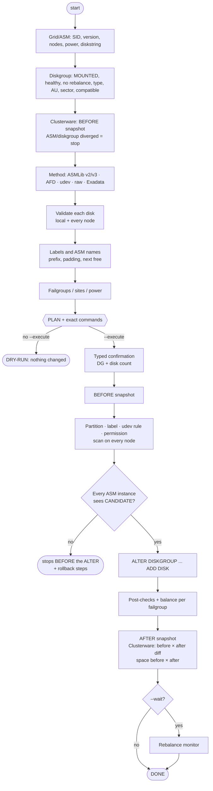

<div align="center">

```
   ____  ____    _      ____  ____      _    ____   ___
  |  _ \| __ )  / \    | __ )|  _ \    / \  | __ ) / _ \
  | | | |  _ \ / _ \   |  _ \| |_) |  / _ \ |  _ \| | | |
  | |_| | |_) / ___ \  | |_) |  _ <  / ___ \| |_) | |_| |
  |____/|____/_/   \_\ |____/|_| \_\/_/   \_\____/ \___/
```

# ASM ADD DISK BRABO

**SAFE disk adds to Oracle ASM — from raw LUN to finished rebalance.**

*Dry-run by default. Validates everything on every node before touching anything.*

[](asm_add_disk_brabo.sh)
[](https://docs.oracle.com/en/database/oracle/oracle-database/19/ostmg/)
[](#supported-environments)
[](#supported-environments)
[](#exadata)
[](#validated-on-a-real-rac)
[](asm_add_disk_brabo.sh)
[](https://dbabrabo.com.br)

[🇧🇷 Português](README.md) · 🇺🇸 English

</div>

---

> The script itself speaks Brazilian Portuguese (messages, help and prompts). The outputs below
> are shown exactly as it prints them; the notes around them explain what is happening.

## Why it exists

Adding a disk to ASM looks simple: `ALTER DISKGROUP DATA ADD DISK ...`. In real life it is one of
the changes that most often takes an environment down:

- the LUN that "was free" belonged to another server, a volume group or the OS itself;
- the disk shows up as `/dev/sdt` on one node and `/dev/sdv` on the other;
- the label comes out as `DSK_DATA_4` in a diskgroup where every disk is `DSK_DATA_04`;
- one RAC instance cannot see the disk and the `ALTER` fails halfway;
- a smaller disk joins the diskgroup and usable space disappears;
- a high-power rebalance saturates I/O during business hours.

**ASM ADD DISK BRABO** runs the whole procedure — OS provisioning, scan on every node, discovery in
**every** ASM instance, `ALTER DISKGROUP`, post-checks and rebalance monitoring — behind dozens of
safety locks. **Without `--execute` nothing changes**: you get the plan and the exact commands.
Every add also takes a **Clusterware snapshot** and a **diskgroup space snapshot** before and after,
and compares them.

## Contents

- [Quick start](#quick-start)
- [How it works](#how-it-works)
- [Supported environments](#supported-environments)
- [What is validated](#what-is-validated-before-any-change)
- [Options](#options)
- [Examples with output](#examples-with-output) (all 28 from `--help`)
- [Clusterware and space: `--rac-status` and `--asmdu`](#clusterware-and-space---rac-status-and---asmdu)
- [Safety locks in action](#safety-locks-in-action)
- [Validated on a real RAC](#validated-on-a-real-rac)
- [Exit codes, log and snapshots](#exit-codes-log-and-snapshots)
- [Simulator](#simulator)
- [Version history](#version-history)
- [Disclaimer](#disclaimer)

## Quick start

```bash
# as root, on a database node (any RAC node)
curl -fsSLO https://raw.githubusercontent.com/acaciolr/asm-add-disk-brabo/main/asm_add_disk_brabo.sh
chmod 700 asm_add_disk_brabo.sh

./asm_add_disk_brabo.sh --scan                       # which disks are free?
./asm_add_disk_brabo.sh -g DATA -d /dev/sdt          # DRY-RUN: plan + commands
./asm_add_disk_brabo.sh -g DATA -d /dev/sdt --execute
```

Requirements: `bash >= 4`, ASM up and a `/ as sysasm` connection as the Grid owner. Adding,
provisioning and `--scan` require `root`; `--status`, `--monitor`, `--set-power`, `--rac-status`
and `--asmdu` also run as the Grid owner (e.g. `grid`). On RAC, passwordless root `ssh` between
nodes, or `--remote manual` (one command to paste on each node).

> **Updating the script on a server?** Write the new version to a new file and swap it with `mv`
> (atomic). Anything already running keeps using the old file.

## How it works



## Supported environments

| Platform | Support |
|---|---|
| **Linux** | OL/RHEL/SLES 6 to 9 · ASMLib v2 and **v3** (OL8/9, UEK7) · ASMFD (AFD) · udev · multipath · VMware/KVM/Hyper-V/**VirtualBox** · AWS EBS (Nitro/NVMe) · OCI · Azure · GCP |
| **AIX** | raw `rhdisk` (chown/chmod + `reserve_policy`) · RAC with `unique_id` mapping |
| **Solaris and others** | provision the slice by hand and use `--add-only` |
| **Grid** | Standalone/Oracle Restart, RAC, Flex ASM · ASM 11.2, 12.1, 12.2, 18c, 19c, 21c, 23ai, 26ai |
| **Diskgroup** | EXTERNAL, NORMAL, HIGH, FLEX, EXTENDED (with `SITE`) |
| **Exadata** | on-premises X2 to X11M (HC, EF, XT), cells over ssh as `root`/`celladmin` · ExaCS/ExaCC/ExaDB-D **refused** |

## What is validated before any change

- **Environment:** root, bash >= 4, lock against concurrent runs, ASM up, SYSASM connection.
- **Diskgroup:** MOUNTED, no running rebalance, no OFFLINE/DROPPING/HUNG disk. If
  `usable_file_mb` is already negative, it warns and projects the value after the ADD.
- **Clusterware:** resource snapshot (`crsctl`) before; an ASM/diskgroup resource with STATE ≠
  TARGET stops everything. After the ADD it compares and shows what changed, vanished or restarted.
- **Each disk:** whole disk (or mpath) and **not** a multipath leg; no partition, children or
  holders; not mounted; not swap/LVM/md; not open by any process; no signature
  (`blkid`/`wipefs`); no ASMLib mark; no ASM header (`kfed`); start and end zeroed; `maj:min`
  not used by any ASM/ASMLib/AFD disk (on ASMLib v3, with no `/dev/oracleasm/disks`, the device
  comes from `querydisk -p`); size within the min–max range of the diskgroup disks (±2%) and a
  compatible sector; not repeated on the command line.
- **Size in ASM:** with `compatible.asm >= 23` and every diskgroup disk at the same `TOTAL_MB`, the
  ADD carries `SIZE <TOTAL_MB>M` — without it ASM 23ai/26ai refuses with ORA-15410.
- **RAC:** disk visible, of the **same size** and clean on **every** node (by-id/WWN; without by-id,
  as on VirtualBox/KVM, it uses `ID_PATH` and, after partitioning, checks the PTUUID on each node;
  `unique_id` on AIX); ASMLib/AFD/udev and device permission consistent across nodes.
- **Discovery:** the new path matches `asm_diskstring` and **every** ASM instance
  (`gv$asm_disk`) sees the disk as CANDIDATE/PROVISIONED/FORMER. Otherwise it stops **before** the
  `ALTER`.
- **Labels/names:** dominant prefix, zero-padding and next free number (max + 1), taking the
  diskgroup, ASMLib/AFD/udev and existing rules into account. `08` and `09` are not read as octal.
  Mixes like `DSK_DATA_4` next to `DSK_DATA_04` are reported.
- **Failgroups:** a NORMAL/HIGH diskgroup with named failgroups requires `--failgroup`; balance per
  failgroup is shown after the ADD.
- **Exadata:** cloud environments refused; cell online; griddisks `active`/`UNUSED`, in no
  diskgroup, same `diskType` and **same size**; count per cell = griddisks per failgroup in the
  diskgroup; celldisks `normal` with free space (when creating); all seen as CANDIDATE in every
  instance.
- **Execution:** typed confirmation (diskgroup name + disk count), before/after snapshots and
  rollback steps printed if something fails midway.

## Options

<details open>
<summary><b>Actions</b> (one per run; default = add)</summary>

| Option | What it does |
|---|---|
| *(default)* | Provisions on the OS (partition + ASMLib/AFD/udev/permission), scans every node, validates discovery in every instance and runs `ALTER DISKGROUP ... ADD DISK` |
| `--provision-only` | Only provisions and validates discovery. Does **not** run the `ALTER` |
| `--add-only` | Disk already provisioned: only validates and runs the `ALTER`. `-d` takes an ASM path (`ORCL:X`, `AFD:X`, `/dev/oracleasm/disks/X`, `/dev/rhdiskN`, `/dev/...`) or just the label |
| `--status` | Diskgroup, failgroups, disks (`gv$asm_disk`) and rebalance |
| `--scan` | Lists OS disks and classifies them FREE / IN USE / DIRTY |
| `--rescan` | Bus rescan (SCSI on Linux, `cfgmgr` on AIX) on every node + `--scan`. Requires `--execute` |
| `--set-power <N>` | `ALTER DISKGROUP <DG> REBALANCE POWER N NOWAIT`. Requires `--execute` |
| `--monitor` | Follows the rebalance (`gv$asm_operation`) until it ends: only the running pass, with % |
| `--rac-status` | Clusterware resources per node (databases, PDBs, services, listeners, ASM, network): STATE ≠ TARGET, disabled, restarts < 24 h. Read-only |
| `--asmdu` | Space per diskgroup with mirroring taken into account (total, free, reserve, usable, % free). With `-g` it shows usage per directory (`asmcmd du`); `--dir SUB` goes into a subdirectory; `--unit M\|G\|T` |

</details>

<details>
<summary><b>Main parameters and rebalance</b></summary>

| Option | What it does |
|---|---|
| `-g, --diskgroup <DG>` | Diskgroup (DATA, RECO, REDO, OCR...) |
| `-d, --disk <DEV>` | Disk(s), repeatable or comma-separated. Linux: `/dev/sdj`, `sdj`, `/dev/nvme3n1`, `/dev/xvdf`, `/dev/mapper/mpathk`, `/dev/disk/by-id/...` · AIX: `hdisk12`, `/dev/hdisk12`, `/dev/rhdisk12` |
| `--execute` | Really executes |
| `--yes` | Skips the typed confirmation (automation). Only with `--execute`, and **very** carefully |
| `-p, --power <N>` | Power 0-1024 (`COMPATIBLE.ASM >= 11.2.0.2`) or 1-11. Default: `ASM_POWER_LIMIT` |
| `--no-rebalance` | ADD with `REBALANCE POWER 0` (run `--set-power` later) |
| `--wait` / `--nowait` | Follow the rebalance after the ADD / return right away (default) |
| `--wait-timeout <min>` | Monitoring limit (0 = none). The rebalance keeps running in ASM |
| `--poll <sec>` | Polling interval (default 30, minimum 5) |

</details>

<details>
<summary><b>Label / ASM name and provisioning</b></summary>

| Option | What it does |
|---|---|
| `--prefix <TXT>` | Forces the prefix (e.g. `DSK_DATA_`) |
| `--width <N>` | Forces zero-padding (2 → `_07`, 3 → `_007`, 0 → none) |
| `--start <N>` | Forces the first number (aborts if already in use) |
| `--labels <L1,L2>` | Explicit labels (ASMLib/AFD/udev), one per disk |
| `--names <N1,N2>` | Explicit ASM names (`NAME` clause), one per disk |
| `--method <M>` | `auto` \| `asmlib` \| `afd` \| `udev` \| `raw` (default `auto`) |
| `--partition` / `--no-partition` | Forces a single partition (starting at 1MiB) / the whole disk |
| `--pttype <T>` | `gpt` \| `msdos` (default: same as current disks; > 2 TiB = gpt) |
| `--use-existing-partition` | Accepts `-d` pointing to an existing, empty partition |
| `--owner` `--group` `--perm` | Device permission (raw/AIX). Default: same as current disks |
| `--fix-aix-attrs` | AIX/RAC: sets `reserve_policy=no_reserve` on every node |

</details>

<details>
<summary><b>Exadata</b></summary>

| Option | What it does |
|---|---|
| `--exa-cell <c1,c2>` | Cell(s) whose griddisks join the diskgroup. Replaces `-d`. Root on the DB node |
| `--exa-prefix <P>` | Griddisk prefix (default: taken from the diskgroup: DATA, RECO, DATAC1...) |
| `--exa-user <u>` | ssh user on the cells: `root` (default) or `celladmin` |
| `--exa-create-griddisk` | Also **creates** the griddisks (`CREATE GRIDDISK ALL HARDDISK\|FLASHDISK PREFIX=<P>, SIZE=<same as DG>`) |
| `--exa-size <size>` | Size on creation (default: exact `OS_MB` of the current ones). E.g. `5562G`, `1.5T`, `870400M` |
| `--exa-allow-partial` | Accepts a cell whose griddisk count differs from the current failgroups |

</details>

<details>
<summary><b>Failgroup / site, Grid environment and cluster</b></summary>

| Option | What it does |
|---|---|
| `--failgroup <FG>` | One failgroup for all disks or a list `FG1,FG2` (one per disk) |
| `--allow-new-failgroup` | Allows a failgroup that does not exist yet |
| `--site <S>` | Site (Extended Diskgroup 12.2+): one for all or a list |
| `--grid-user` `--grid-home` `--asm-sid` `--oracle-base` | Explicit Grid environment (default: autodetected from `asm_pmon`, `olr.loc`, `oratab`) |
| `--env-file <file>` | Environment file sourced first (e.g. `.profile_infra`) |
| `--nodes <n1,n2>` | Forces the node list (default: `olsnodes`) |
| `--remote <mode>` | `auto` (ssh if available, else manual) · `ssh` (requires BatchMode root) · `manual` (**one** command per node that finds the disk by itself, checks size and PTUUID and ends with `>>> <node>: OK`; also saved to a file) · `none` |

</details>

<details>
<summary><b>Locks you can turn off</b> (only when you know exactly why) and output</summary>

| Option | What it does |
|---|---|
| `--size-tolerance <%>` | Tolerance around the min–max range of the diskgroup disks (default 2) |
| `--allow-size-mismatch` | A size outside the range becomes just a warning |
| `--asm-size <auto\|none\|MB>` | `SIZE` clause of ADD DISK. `auto` (default): with `compatible.asm >= 23` and equal disks in ASM, the new one joins with the same `TOTAL_MB` (avoids ORA-15410) |
| `--allow-dirty` | Accepts a disk with non-zero bytes at start/end (no signature). The script **never** wipes anything |
| `--allow-running-rebalance` | Accepts adding while a rebalance is running |
| `--allow-unhealthy-dg` | Accepts a diskgroup with OFFLINE/DROPPING/HUNG disks |
| `--log-dir <dir>` | Default `/var/log/dbabrabo` (log + before/after snapshots) |
| `--no-color` · `-h, --help` · `-V, --version` | |

</details>

## Examples with output

> Every output below was produced by the [simulator](#simulator): the **real script, unmodified**,
> running in a container with fake Grid/ASM, disks, ASMLib, AFD, udev, multipath, AIX and Exadata
> cells. Where a confirmation is required, the simulator's "operator" types the answers.
> Repeated rebalance-monitor lines were trimmed.

Main scenario (examples 1-9, 17, 18 and 22): RAC 19c `racdb01`/`racdb02`, EXTERNAL diskgroup
`DATA` with 16 × 512 GiB ASMLib disks (`DSK_DATA_01..16`), new disks `/dev/sdt` and `/dev/sdu`.

### 1) See what would be done (dry-run) for one disk in DATA

```bash
./asm_add_disk_brabo.sh -g DATA -d /dev/sdt
```

<!-- SAIDA:1 -->
<details>
<summary><b>Output (simulator)</b></summary>

```text
[root@racdb01 dbabrabo]# ./asm_add_disk_brabo.sh -g DATA -d /dev/sdt

   ____  ____    _      ____  ____      _    ____   ___
  |  _ \| __ )  / \    | __ )|  _ \    / \  | __ ) / _ \
  | | | |  _ \ / _ \   |  _ \| |_) |  / _ \ |  _ \| | | |
  | |_| | |_) / ___ \  | |_) |  _ <  / ___ \| |_) | |_| |
  |____/|____/_/   \_\ |____/|_| \_\/_/   \_\____/ \___/
  ASM ADD DISK BRABO v1.3.1 (2026-11-11) — adição segura de discos no Oracle ASM
  by • DBA BRABO — dbabrabo.com.br

2026-11-10 22:00:01 [INFO] Ação=add | modo=DRY-RUN | host=racdb01 | usuário=root | SO=Linux
2026-11-10 22:00:01 [INFO] Linha de comando: ./asm_add_disk_brabo.sh -g DATA -d /dev/sdt

==[ Ambiente Grid / ASM ]==
2026-11-10 22:00:01 [ OK ] ASM: SID=+ASM1 versão=19.0.0.0.0 instâncias=2
2026-11-10 22:00:01 [INFO] Grid: user=grid home=/u01/app/19.0.0/grid base=/u01/app/grid
2026-11-10 22:00:01 [INFO] asm_power_limit=1 | asm_diskstring=ORCL:*
2026-11-10 22:00:01 [ OK ] Cluster: RAC com 2 nós (racdb01 racdb02) | local=racdb01
2026-11-10 22:00:01 [ OK ] Execução remota: ssh (nós: racdb02)

==[ Diskgroup DATA ]==
2026-11-10 22:00:01 [ OK ] DG=DATA tipo=EXTERN estado=MOUNTED discos=16 total=8388576MB livre=1449984MB usable=1449984MB
2026-11-10 22:00:01 [INFO] AU=4MB setor=512 compatible.asm=19.0.0.0.0 | discos: mais comum 524286MB, faixa 524286-524286MB

==[ Validação do Clusterware (estilo rac-status) ]==
2026-11-10 22:00:01 [ OK ] Clusterware: 24 recursos, nenhum com STATE≠TARGET; 0 reiniciado(s) nas últimas 24 h. (tabela completa: --rac-status)
2026-11-10 22:00:01 [INFO] Foto do Clusterware (antes): /var/log/dbabrabo/asm_add_disk_brabo_DATA_20261110_220001_crs_antes.txt

==[ Espaço do DATA antes (estilo asmdu) ]==
  DiskGroup  Redund.    Total G    Livre G  Reserva G   Utiliz. G  %Livre  uso (espelhado)        Disc. Rebal Voting
  -----------------------------------------------------------------------------------------------------------------
  DATA       EXTERN      8192.0     1416.0        0.0      1416.0     17%  [#################...]    16     -      N

==[ Método de provisionamento ]==
2026-11-10 22:00:01 [ OK ] Método: asmlib | estilo de caminho: orcl
2026-11-10 22:00:01 [INFO] Permissão de referência dos discos ASMLib: grid:asmadmin:660 (de /dev/oracleasm/disks/DSK_DATA_01) — ASMLib v2: o driver cuida da permissão
2026-11-10 22:00:01 [INFO] Devices do ASM/ASMLib/AFD protegidos (maj:min): 51
2026-11-10 22:00:03 [INFO] Discos atuais: particionados=16 inteiros=0 | tabela=gpt

==[ Validação dos discos (1) ]==
2026-11-10 22:00:03 [ OK ] /dev/sdt -> /dev/sdt (disk, 524288MB, setor 512) by-id: scsi-36000c29f1111111e8d2c41b9a7f03e5
2026-11-10 22:00:03 [ OK ] [racdb02] /dev/sdt visível como /dev/sdt, mesmo tamanho e limpo

==[ Labels e nomes ASM ]==
2026-11-10 22:00:04 [INFO] Padrão de label: prefixo='DSK_DATA_' padding=2 maior número em uso=16 → DSK_DATA_17
2026-11-10 22:00:04 [INFO] Convenção do DG: nome ASM = label
2026-11-10 22:00:04 [ OK ] Disco 1: label=DSK_DATA_17 nome=DSK_DATA_17 caminho=ORCL:DSK_DATA_17

==[ Failgroups / Sites / Rebalance ]==
2026-11-10 22:00:04 [INFO] Rebalance: power=1 (asm_power_limit) | acompanhar=não
2026-11-10 22:00:04 [INFO] Cláusula SIZE: não usada (compatible.asm 19.0.0.0.0 < 23: o ASM aceita discos de tamanhos diferentes).
2026-11-10 22:00:04 [INFO] Particionamento: yes (tabela gpt, início 1MiB)

==[ PLANO DE EXECUÇÃO ]==
  Host/Nó    : racdb01 (racdb01) | SO=Linux | modo=DRY-RUN
  Cluster    : RAC (racdb01 racdb02) | remoto=ssh
  Diskgroup  : DATA (EXTERN) AU=4MB setor=512 compatible.asm=19.0.0.0.0
  Método     : asmlib | partição=yes (gpt) | ação=add

  #  DISCO                    DEVICE REAL                MB LABEL          NOME ASM                 FAILGROUP
  --------------------------------------------------------------------------------------------------------------------
  1  /dev/sdt                 /dev/sdt               524288 DSK_DATA_17    DSK_DATA_17              (padrão)
     caminho ASM: ORCL:DSK_DATA_17
     by-id      : scsi-36000c29f1111111e8d2c41b9a7f03e5
     id         : ID_SERIAL=36000c29f1111111e8d2c41b9a7f03e5 ID_WWN=0x6000c29f1111111e8d2
     outros nós : racdb02=/dev/sdt

  Capacidade : total 8388576MB -> ~8912864MB (+524288MB brutos) | livre 1449984MB -> ~1974272MB

  Statement que será executado:
    ALTER DISKGROUP DATA ADD
      DISK
        'ORCL:DSK_DATA_17' NAME DSK_DATA_17
      REBALANCE NOWAIT;

==[ DRY-RUN — comandos que seriam executados ]==
         [DRY-RUN] parted -s -a optimal /dev/sdt mklabel gpt mkpart primary 1MiB 100%
         [DRY-RUN] partprobe /dev/sdt
         [DRY-RUN] udevadm settle
         [DRY-RUN] [racdb02] ( D='/dev/sdt'; [ -b "$D" ] || { echo 'ERRO: disco /dev/sdt não localizado neste nó'; exit 1; }; [ "$(blockdev --getsize64 $D)" = '549755813888' ] || { echo "ERRO: $D tem tamanho diferente de /dev/sdt"; exit 1; }; <confere o PTUUID gravado no racdb01>; partprobe $D && udevadm settle && lsblk $D )
         [DRY-RUN] /usr/sbin/oracleasm createdisk DSK_DATA_17 /dev/sdt1
         [DRY-RUN] /usr/sbin/oracleasm scandisks
         [DRY-RUN] sh -c true
         [DRY-RUN] [racdb02] ( /usr/sbin/oracleasm scandisks && /usr/sbin/oracleasm querydisk -p DSK_DATA_17 && true )

==[ Descoberta pelo ASM em TODAS as instâncias ]==
         [DRY-RUN] gv$asm_disk: cada disco precisa aparecer em 2 instância(s) como CANDIDATE/PROVISIONED/FORMER

==[ ALTER DISKGROUP DATA ]==
    ALTER DISKGROUP DATA ADD
      DISK
        'ORCL:DSK_DATA_17' NAME DSK_DATA_17
      REBALANCE NOWAIT;
         [DRY-RUN] (statement acima)

DRY-RUN concluído: NADA foi alterado. Revise o plano e rode novamente com --execute.

  Log completo: /var/log/dbabrabo/asm_add_disk_brabo_DATA_add_20261110_220001.log
```

</details>
<!-- /SAIDA:1 -->

### 2) Add two disks with power 4, without waiting for the rebalance

```bash
./asm_add_disk_brabo.sh -g DATA -d /dev/sdt,/dev/sdu -p 4 --execute
```

<!-- SAIDA:2 -->
<details>
<summary><b>Output (simulator)</b></summary>

```text
[root@racdb01 dbabrabo]# ./asm_add_disk_brabo.sh -g DATA -d /dev/sdt,/dev/sdu -p 4 --execute

   ____  ____    _      ____  ____      _    ____   ___
  |  _ \| __ )  / \    | __ )|  _ \    / \  | __ ) / _ \
  | | | |  _ \ / _ \   |  _ \| |_) |  / _ \ |  _ \| | | |
  | |_| | |_) / ___ \  | |_) |  _ <  / ___ \| |_) | |_| |
  |____/|____/_/   \_\ |____/|_| \_\/_/   \_\____/ \___/
  ASM ADD DISK BRABO v1.3.1 (2026-11-11) — adição segura de discos no Oracle ASM
  by • DBA BRABO — dbabrabo.com.br

2026-11-10 22:00:01 [INFO] Ação=add | modo=EXECUTE | host=racdb01 | usuário=root | SO=Linux
2026-11-10 22:00:01 [INFO] Linha de comando: ./asm_add_disk_brabo.sh -g DATA -d /dev/sdt,/dev/sdu -p 4 --execute

==[ Ambiente Grid / ASM ]==
2026-11-10 22:00:01 [ OK ] ASM: SID=+ASM1 versão=19.0.0.0.0 instâncias=2
2026-11-10 22:00:01 [INFO] Grid: user=grid home=/u01/app/19.0.0/grid base=/u01/app/grid
2026-11-10 22:00:01 [INFO] asm_power_limit=1 | asm_diskstring=ORCL:*
2026-11-10 22:00:01 [ OK ] Cluster: RAC com 2 nós (racdb01 racdb02) | local=racdb01
2026-11-10 22:00:01 [ OK ] Execução remota: ssh (nós: racdb02)

==[ Diskgroup DATA ]==
2026-11-10 22:00:01 [ OK ] DG=DATA tipo=EXTERN estado=MOUNTED discos=16 total=8388576MB livre=1449984MB usable=1449984MB
2026-11-10 22:00:01 [INFO] AU=4MB setor=512 compatible.asm=19.0.0.0.0 | discos: mais comum 524286MB, faixa 524286-524286MB

==[ Validação do Clusterware (estilo rac-status) ]==
2026-11-10 22:00:01 [ OK ] Clusterware: 24 recursos, nenhum com STATE≠TARGET; 0 reiniciado(s) nas últimas 24 h. (tabela completa: --rac-status)
2026-11-10 22:00:01 [INFO] Foto do Clusterware (antes): /var/log/dbabrabo/asm_add_disk_brabo_DATA_20261110_220001_crs_antes.txt

==[ Espaço do DATA antes (estilo asmdu) ]==
  DiskGroup  Redund.    Total G    Livre G  Reserva G   Utiliz. G  %Livre  uso (espelhado)        Disc. Rebal Voting
  -----------------------------------------------------------------------------------------------------------------
  DATA       EXTERN      8192.0     1416.0        0.0      1416.0     17%  [#################...]    16     -      N

==[ Método de provisionamento ]==
2026-11-10 22:00:01 [ OK ] Método: asmlib | estilo de caminho: orcl
2026-11-10 22:00:01 [INFO] Permissão de referência dos discos ASMLib: grid:asmadmin:660 (de /dev/oracleasm/disks/DSK_DATA_01) — ASMLib v2: o driver cuida da permissão
2026-11-10 22:00:01 [INFO] Devices do ASM/ASMLib/AFD protegidos (maj:min): 51
2026-11-10 22:00:04 [INFO] Discos atuais: particionados=16 inteiros=0 | tabela=gpt

==[ Validação dos discos (2) ]==
2026-11-10 22:00:04 [ OK ] /dev/sdt -> /dev/sdt (disk, 524288MB, setor 512) by-id: scsi-36000c29f1111111e8d2c41b9a7f03e5
2026-11-10 22:00:04 [ OK ] /dev/sdu -> /dev/sdu (disk, 524288MB, setor 512) by-id: scsi-36000c29f2222222e8d2c41b9a7f03e5
2026-11-10 22:00:04 [ OK ] [racdb02] /dev/sdt visível como /dev/sdt, mesmo tamanho e limpo
2026-11-10 22:00:04 [ OK ] [racdb02] /dev/sdu visível como /dev/sdu, mesmo tamanho e limpo

==[ Labels e nomes ASM ]==
2026-11-10 22:00:04 [INFO] Padrão de label: prefixo='DSK_DATA_' padding=2 maior número em uso=16 → DSK_DATA_17 DSK_DATA_18
2026-11-10 22:00:04 [INFO] Convenção do DG: nome ASM = label
2026-11-10 22:00:04 [ OK ] Disco 1: label=DSK_DATA_17 nome=DSK_DATA_17 caminho=ORCL:DSK_DATA_17
2026-11-10 22:00:04 [ OK ] Disco 2: label=DSK_DATA_18 nome=DSK_DATA_18 caminho=ORCL:DSK_DATA_18

==[ Failgroups / Sites / Rebalance ]==
2026-11-10 22:00:04 [INFO] Rebalance: power=4 | acompanhar=não
2026-11-10 22:00:04 [INFO] Cláusula SIZE: não usada (compatible.asm 19.0.0.0.0 < 23: o ASM aceita discos de tamanhos diferentes).
2026-11-10 22:00:04 [INFO] Particionamento: yes (tabela gpt, início 1MiB)

==[ PLANO DE EXECUÇÃO ]==
  Host/Nó    : racdb01 (racdb01) | SO=Linux | modo=EXECUTE
  Cluster    : RAC (racdb01 racdb02) | remoto=ssh
  Diskgroup  : DATA (EXTERN) AU=4MB setor=512 compatible.asm=19.0.0.0.0
  Método     : asmlib | partição=yes (gpt) | ação=add

  #  DISCO                    DEVICE REAL                MB LABEL          NOME ASM                 FAILGROUP
  --------------------------------------------------------------------------------------------------------------------
  1  /dev/sdt                 /dev/sdt               524288 DSK_DATA_17    DSK_DATA_17              (padrão)
     caminho ASM: ORCL:DSK_DATA_17
     by-id      : scsi-36000c29f1111111e8d2c41b9a7f03e5
     id         : ID_SERIAL=36000c29f1111111e8d2c41b9a7f03e5 ID_WWN=0x6000c29f1111111e8d2
     outros nós : racdb02=/dev/sdt
  2  /dev/sdu                 /dev/sdu               524288 DSK_DATA_18    DSK_DATA_18              (padrão)
     caminho ASM: ORCL:DSK_DATA_18
     by-id      : scsi-36000c29f2222222e8d2c41b9a7f03e5
     id         : ID_SERIAL=36000c29f2222222e8d2c41b9a7f03e5 ID_WWN=0x6000c29f2222222e8d2
     outros nós : racdb02=/dev/sdu

  Capacidade : total 8388576MB -> ~9437152MB (+1048576MB brutos) | livre 1449984MB -> ~2498560MB

  Statement que será executado:
    ALTER DISKGROUP DATA ADD
      DISK
        'ORCL:DSK_DATA_17' NAME DSK_DATA_17,
        'ORCL:DSK_DATA_18' NAME DSK_DATA_18
      REBALANCE POWER 4 NOWAIT;

==[ CONFIRMAÇÃO ]==
  Esta operação vai alterar o storage e o diskgroup DATA em racdb01.
  Digite o nome do diskgroup (DATA): DATA
  Digite a quantidade de discos (2): 2
2026-11-10 22:00:06 [INFO] Snapshot (antes): /var/log/dbabrabo/asm_add_disk_brabo_DATA_20261110_220001_snap_antes.txt

==[ Provisionando 1/2: /dev/sdt -> DSK_DATA_17 ]==
2026-11-10 22:00:06 [INFO] EXEC: parted -s -a optimal /dev/sdt mklabel gpt mkpart primary 1MiB 100%
2026-11-10 22:00:06 [INFO] EXEC: partprobe /dev/sdt
2026-11-10 22:00:06 [INFO] EXEC: udevadm settle
2026-11-10 22:00:06 [ OK ] Partição criada: /dev/sdt1 (PTUUID 19f6f6f6-f1ea-11db-2e39-c97585cee6a9)
2026-11-10 22:00:06 [INFO] EXEC [racdb02]: ( D='/dev/sdt'; [ -b "$D" ] || { echo 'ERRO: disco /dev/sdt não localizado neste nó'; exit 1; }; [ "$(blockdev --getsize64 $D)" = '549755813888' ] || { echo "ERRO: $D tem tamanho diferente de /dev/sdt"; exit 1; }; [ "$(blkid -p -o value -s PTUUID $D)" = '19f6f6f6-f1ea-11db-2e39-c97585cee6a9' ] || { echo "ERRO: PTUUID de $D difere — NÃO é o disco particionado no racdb01"; exit 1; }; partprobe $D && udevadm settle && lsblk $D )
NAME       MAJ:MIN    TYPE       SIZE       MOUNTPOINT
sdt        65:48      disk       512G
sdt1       65:49      part       512.0G
2026-11-10 22:00:06 [INFO] EXEC: /usr/sbin/oracleasm createdisk DSK_DATA_17 /dev/sdt1
Writing disk header: done
Instantiating disk: done
Disk "DSK_DATA_17" is a valid ASM disk
/dev/sdt1: LABEL="DSK_DATA_17" TYPE="oracleasm"
2026-11-10 22:00:06 [INFO] EXEC: /usr/sbin/oracleasm scandisks
Reloading disk partitions: done
Cleaning any stale ASM disks...
Scanning system for ASM disks...
2026-11-10 22:00:06 [INFO] EXEC: sh -c true
2026-11-10 22:00:06 [INFO] EXEC [racdb02]: ( /usr/sbin/oracleasm scandisks && /usr/sbin/oracleasm querydisk -p DSK_DATA_17 && true )
Reloading disk partitions: done
Cleaning any stale ASM disks...
Scanning system for ASM disks...
Disk "DSK_DATA_17" is a valid ASM disk
/dev/sdt1: LABEL="DSK_DATA_17" TYPE="oracleasm"

==[ Provisionando 2/2: /dev/sdu -> DSK_DATA_18 ]==
2026-11-10 22:00:06 [INFO] EXEC: parted -s -a optimal /dev/sdu mklabel gpt mkpart primary 1MiB 100%
2026-11-10 22:00:07 [INFO] EXEC: partprobe /dev/sdu
2026-11-10 22:00:07 [INFO] EXEC: udevadm settle
2026-11-10 22:00:07 [ OK ] Partição criada: /dev/sdu1 (PTUUID b13fc070-63a6-6ba8-1510-c42c8ab28684)
2026-11-10 22:00:07 [INFO] EXEC [racdb02]: ( D='/dev/sdu'; [ -b "$D" ] || { echo 'ERRO: disco /dev/sdu não localizado neste nó'; exit 1; }; [ "$(blockdev --getsize64 $D)" = '549755813888' ] || { echo "ERRO: $D tem tamanho diferente de /dev/sdu"; exit 1; }; [ "$(blkid -p -o value -s PTUUID $D)" = 'b13fc070-63a6-6ba8-1510-c42c8ab28684' ] || { echo "ERRO: PTUUID de $D difere — NÃO é o disco particionado no racdb01"; exit 1; }; partprobe $D && udevadm settle && lsblk $D )
NAME       MAJ:MIN    TYPE       SIZE       MOUNTPOINT
sdu        65:64      disk       512G
sdu1       65:65      part       512.0G
2026-11-10 22:00:07 [INFO] EXEC: /usr/sbin/oracleasm createdisk DSK_DATA_18 /dev/sdu1
Writing disk header: done
Instantiating disk: done
Disk "DSK_DATA_18" is a valid ASM disk
/dev/sdu1: LABEL="DSK_DATA_18" TYPE="oracleasm"
2026-11-10 22:00:07 [INFO] EXEC: /usr/sbin/oracleasm scandisks
Reloading disk partitions: done
Cleaning any stale ASM disks...
Scanning system for ASM disks...
2026-11-10 22:00:07 [INFO] EXEC: sh -c true
2026-11-10 22:00:07 [INFO] EXEC [racdb02]: ( /usr/sbin/oracleasm scandisks && /usr/sbin/oracleasm querydisk -p DSK_DATA_18 && true )
Reloading disk partitions: done
Cleaning any stale ASM disks...
Scanning system for ASM disks...
Disk "DSK_DATA_18" is a valid ASM disk
/dev/sdu1: LABEL="DSK_DATA_18" TYPE="oracleasm"

==[ Descoberta pelo ASM em TODAS as instâncias ]==
2026-11-10 22:00:07 [ OK ] Todos os discos descobertos em 2 instância(s).

==[ ALTER DISKGROUP DATA ]==
    ALTER DISKGROUP DATA ADD
      DISK
        'ORCL:DSK_DATA_17' NAME DSK_DATA_17,
        'ORCL:DSK_DATA_18' NAME DSK_DATA_18
      REBALANCE POWER 4 NOWAIT;
2026-11-10 22:00:07 [ OK ] ALTER DISKGROUP DATA ADD executado.

==[ Verificação pós-ADD ]==
2026-11-10 22:00:07 [ OK ] DSK_DATA_17 ORCL:DSK_DATA_17 MEMBER/ONLINE/NORMAL fg=DSK_DATA_17 524286MB
2026-11-10 22:00:07 [ OK ] DSK_DATA_18 ORCL:DSK_DATA_18 MEMBER/ONLINE/NORMAL fg=DSK_DATA_18 524286MB
2026-11-10 22:00:08 [INFO] Snapshot (depois): /var/log/dbabrabo/asm_add_disk_brabo_DATA_20261110_220001_snap_depois.txt

==[ Clusterware depois da mudança (comparação com a foto de antes) ]==
2026-11-10 22:00:08 [ OK ] Clusterware: nenhum recurso mudou de estado, sumiu ou reiniciou durante a mudança.
2026-11-10 22:00:08 [INFO] Foto do Clusterware (depois): /var/log/dbabrabo/asm_add_disk_brabo_DATA_20261110_220001_crs_depois.txt

==[ Espaço do DATA depois (estilo asmdu) ]==
  DiskGroup  Redund.    Total G    Livre G  Reserva G   Utiliz. G  %Livre  uso (espelhado)        Disc. Rebal Voting
  -----------------------------------------------------------------------------------------------------------------
  DATA       EXTERN      9216.0     2439.9        0.0      2439.9     26%  [###############.....]    18   SIM      N
2026-11-10 22:00:08 [INFO] O rebalance ainda pode estar rodando: o utilizável final aparece depois dele (--monitor / --asmdu -g DATA).

==[ CONCLUÍDO ]==
  Discos adicionados ao DATA: DSK_DATA_17 DSK_DATA_18
  Acompanhar : ./asm_add_disk_brabo.sh -g DATA --monitor
  Status     : ./asm_add_disk_brabo.sh -g DATA --status
  Power      : ./asm_add_disk_brabo.sh -g DATA --set-power <N> --execute
  Reverter   : ALTER DISKGROUP DATA DROP DISK DSK_DATA_17,DSK_DATA_18 REBALANCE POWER <N>;  (só depois de avaliar espaço!)

  Log completo: /var/log/dbabrabo/asm_add_disk_brabo_DATA_add_20261110_220001.log
```

</details>
<!-- /SAIDA:2 -->

### 3) Add and follow the rebalance to the end (3h max)

```bash
./asm_add_disk_brabo.sh -g DATA -d /dev/sdt -d /dev/sdu -p 8 --wait --wait-timeout 180 --execute
```

<!-- SAIDA:3 -->
<details>
<summary><b>Output (simulator)</b></summary>

```text
[root@racdb01 dbabrabo]# ./asm_add_disk_brabo.sh -g DATA -d /dev/sdt -d /dev/sdu -p 8 --wait --wait-timeout 180 --execute

   ____  ____    _      ____  ____      _    ____   ___
  |  _ \| __ )  / \    | __ )|  _ \    / \  | __ ) / _ \
  | | | |  _ \ / _ \   |  _ \| |_) |  / _ \ |  _ \| | | |
  | |_| | |_) / ___ \  | |_) |  _ <  / ___ \| |_) | |_| |
  |____/|____/_/   \_\ |____/|_| \_\/_/   \_\____/ \___/
  ASM ADD DISK BRABO v1.3.1 (2026-11-11) — adição segura de discos no Oracle ASM
  by • DBA BRABO — dbabrabo.com.br

2026-11-10 22:00:00 [INFO] Ação=add | modo=EXECUTE | host=racdb01 | usuário=root | SO=Linux
2026-11-10 22:00:00 [INFO] Linha de comando: ./asm_add_disk_brabo.sh -g DATA -d /dev/sdt -d /dev/sdu -p 8 --wait --wait-timeout 180 --execute

==[ Ambiente Grid / ASM ]==
2026-11-10 22:00:00 [ OK ] ASM: SID=+ASM1 versão=19.0.0.0.0 instâncias=2
2026-11-10 22:00:00 [INFO] Grid: user=grid home=/u01/app/19.0.0/grid base=/u01/app/grid
2026-11-10 22:00:00 [INFO] asm_power_limit=1 | asm_diskstring=ORCL:*
2026-11-10 22:00:00 [ OK ] Cluster: RAC com 2 nós (racdb01 racdb02) | local=racdb01
2026-11-10 22:00:00 [ OK ] Execução remota: ssh (nós: racdb02)

==[ Diskgroup DATA ]==
2026-11-10 22:00:01 [ OK ] DG=DATA tipo=EXTERN estado=MOUNTED discos=16 total=8388576MB livre=1449984MB usable=1449984MB
2026-11-10 22:00:01 [INFO] AU=4MB setor=512 compatible.asm=19.0.0.0.0 | discos: mais comum 524286MB, faixa 524286-524286MB

==[ Validação do Clusterware (estilo rac-status) ]==
2026-11-10 22:00:01 [ OK ] Clusterware: 24 recursos, nenhum com STATE≠TARGET; 0 reiniciado(s) nas últimas 24 h. (tabela completa: --rac-status)
2026-11-10 22:00:01 [INFO] Foto do Clusterware (antes): /var/log/dbabrabo/asm_add_disk_brabo_DATA_20261110_220000_crs_antes.txt

==[ Espaço do DATA antes (estilo asmdu) ]==
  DiskGroup  Redund.    Total G    Livre G  Reserva G   Utiliz. G  %Livre  uso (espelhado)        Disc. Rebal Voting
  -----------------------------------------------------------------------------------------------------------------
  DATA       EXTERN      8192.0     1416.0        0.0      1416.0     17%  [#################...]    16     -      N

==[ Método de provisionamento ]==
2026-11-10 22:00:01 [ OK ] Método: asmlib | estilo de caminho: orcl
2026-11-10 22:00:01 [INFO] Permissão de referência dos discos ASMLib: grid:asmadmin:660 (de /dev/oracleasm/disks/DSK_DATA_01) — ASMLib v2: o driver cuida da permissão
2026-11-10 22:00:01 [INFO] Devices do ASM/ASMLib/AFD protegidos (maj:min): 51
2026-11-10 22:00:03 [INFO] Discos atuais: particionados=16 inteiros=0 | tabela=gpt

==[ Validação dos discos (2) ]==
2026-11-10 22:00:03 [ OK ] /dev/sdt -> /dev/sdt (disk, 524288MB, setor 512) by-id: scsi-36000c29f1111111e8d2c41b9a7f03e5
2026-11-10 22:00:04 [ OK ] /dev/sdu -> /dev/sdu (disk, 524288MB, setor 512) by-id: scsi-36000c29f2222222e8d2c41b9a7f03e5
2026-11-10 22:00:04 [ OK ] [racdb02] /dev/sdt visível como /dev/sdt, mesmo tamanho e limpo
2026-11-10 22:00:04 [ OK ] [racdb02] /dev/sdu visível como /dev/sdu, mesmo tamanho e limpo

==[ Labels e nomes ASM ]==
2026-11-10 22:00:04 [INFO] Padrão de label: prefixo='DSK_DATA_' padding=2 maior número em uso=16 → DSK_DATA_17 DSK_DATA_18
2026-11-10 22:00:04 [INFO] Convenção do DG: nome ASM = label
2026-11-10 22:00:04 [ OK ] Disco 1: label=DSK_DATA_17 nome=DSK_DATA_17 caminho=ORCL:DSK_DATA_17
2026-11-10 22:00:04 [ OK ] Disco 2: label=DSK_DATA_18 nome=DSK_DATA_18 caminho=ORCL:DSK_DATA_18

==[ Failgroups / Sites / Rebalance ]==
2026-11-10 22:00:04 [INFO] Rebalance: power=8 | acompanhar=sim
2026-11-10 22:00:04 [INFO] Cláusula SIZE: não usada (compatible.asm 19.0.0.0.0 < 23: o ASM aceita discos de tamanhos diferentes).
2026-11-10 22:00:04 [INFO] Particionamento: yes (tabela gpt, início 1MiB)

==[ PLANO DE EXECUÇÃO ]==
  Host/Nó    : racdb01 (racdb01) | SO=Linux | modo=EXECUTE
  Cluster    : RAC (racdb01 racdb02) | remoto=ssh
  Diskgroup  : DATA (EXTERN) AU=4MB setor=512 compatible.asm=19.0.0.0.0
  Método     : asmlib | partição=yes (gpt) | ação=add

  #  DISCO                    DEVICE REAL                MB LABEL          NOME ASM                 FAILGROUP
  --------------------------------------------------------------------------------------------------------------------
  1  /dev/sdt                 /dev/sdt               524288 DSK_DATA_17    DSK_DATA_17              (padrão)
     caminho ASM: ORCL:DSK_DATA_17
     by-id      : scsi-36000c29f1111111e8d2c41b9a7f03e5
     id         : ID_SERIAL=36000c29f1111111e8d2c41b9a7f03e5 ID_WWN=0x6000c29f1111111e8d2
     outros nós : racdb02=/dev/sdt
  2  /dev/sdu                 /dev/sdu               524288 DSK_DATA_18    DSK_DATA_18              (padrão)
     caminho ASM: ORCL:DSK_DATA_18
     by-id      : scsi-36000c29f2222222e8d2c41b9a7f03e5
     id         : ID_SERIAL=36000c29f2222222e8d2c41b9a7f03e5 ID_WWN=0x6000c29f2222222e8d2
     outros nós : racdb02=/dev/sdu

  Capacidade : total 8388576MB -> ~9437152MB (+1048576MB brutos) | livre 1449984MB -> ~2498560MB

  Statement que será executado:
    ALTER DISKGROUP DATA ADD
      DISK
        'ORCL:DSK_DATA_17' NAME DSK_DATA_17,
        'ORCL:DSK_DATA_18' NAME DSK_DATA_18
      REBALANCE POWER 8 NOWAIT;

==[ CONFIRMAÇÃO ]==
  Esta operação vai alterar o storage e o diskgroup DATA em racdb01.
  Digite o nome do diskgroup (DATA): DATA
  Digite a quantidade de discos (2): 2
2026-11-10 22:00:07 [INFO] Snapshot (antes): /var/log/dbabrabo/asm_add_disk_brabo_DATA_20261110_220000_snap_antes.txt

==[ Provisionando 1/2: /dev/sdt -> DSK_DATA_17 ]==
2026-11-10 22:00:07 [INFO] EXEC: parted -s -a optimal /dev/sdt mklabel gpt mkpart primary 1MiB 100%
2026-11-10 22:00:07 [INFO] EXEC: partprobe /dev/sdt
2026-11-10 22:00:07 [INFO] EXEC: udevadm settle
2026-11-10 22:00:07 [ OK ] Partição criada: /dev/sdt1 (PTUUID 19f6f6f6-f1ea-11db-2e39-c97585cee6a9)
2026-11-10 22:00:07 [INFO] EXEC [racdb02]: ( D='/dev/sdt'; [ -b "$D" ] || { echo 'ERRO: disco /dev/sdt não localizado neste nó'; exit 1; }; [ "$(blockdev --getsize64 $D)" = '549755813888' ] || { echo "ERRO: $D tem tamanho diferente de /dev/sdt"; exit 1; }; [ "$(blkid -p -o value -s PTUUID $D)" = '19f6f6f6-f1ea-11db-2e39-c97585cee6a9' ] || { echo "ERRO: PTUUID de $D difere — NÃO é o disco particionado no racdb01"; exit 1; }; partprobe $D && udevadm settle && lsblk $D )
NAME       MAJ:MIN    TYPE       SIZE       MOUNTPOINT
sdt        65:48      disk       512G
sdt1       65:49      part       512.0G
2026-11-10 22:00:07 [INFO] EXEC: /usr/sbin/oracleasm createdisk DSK_DATA_17 /dev/sdt1
Writing disk header: done
Instantiating disk: done
Disk "DSK_DATA_17" is a valid ASM disk
/dev/sdt1: LABEL="DSK_DATA_17" TYPE="oracleasm"
2026-11-10 22:00:07 [INFO] EXEC: /usr/sbin/oracleasm scandisks
Reloading disk partitions: done
Cleaning any stale ASM disks...
Scanning system for ASM disks...
2026-11-10 22:00:07 [INFO] EXEC: sh -c true
2026-11-10 22:00:07 [INFO] EXEC [racdb02]: ( /usr/sbin/oracleasm scandisks && /usr/sbin/oracleasm querydisk -p DSK_DATA_17 && true )
Reloading disk partitions: done
Cleaning any stale ASM disks...
Scanning system for ASM disks...
Disk "DSK_DATA_17" is a valid ASM disk
/dev/sdt1: LABEL="DSK_DATA_17" TYPE="oracleasm"

==[ Provisionando 2/2: /dev/sdu -> DSK_DATA_18 ]==
2026-11-10 22:00:07 [INFO] EXEC: parted -s -a optimal /dev/sdu mklabel gpt mkpart primary 1MiB 100%
2026-11-10 22:00:07 [INFO] EXEC: partprobe /dev/sdu
2026-11-10 22:00:07 [INFO] EXEC: udevadm settle
2026-11-10 22:00:07 [ OK ] Partição criada: /dev/sdu1 (PTUUID b13fc070-63a6-6ba8-1510-c42c8ab28684)
2026-11-10 22:00:07 [INFO] EXEC [racdb02]: ( D='/dev/sdu'; [ -b "$D" ] || { echo 'ERRO: disco /dev/sdu não localizado neste nó'; exit 1; }; [ "$(blockdev --getsize64 $D)" = '549755813888' ] || { echo "ERRO: $D tem tamanho diferente de /dev/sdu"; exit 1; }; [ "$(blkid -p -o value -s PTUUID $D)" = 'b13fc070-63a6-6ba8-1510-c42c8ab28684' ] || { echo "ERRO: PTUUID de $D difere — NÃO é o disco particionado no racdb01"; exit 1; }; partprobe $D && udevadm settle && lsblk $D )
NAME       MAJ:MIN    TYPE       SIZE       MOUNTPOINT
sdu        65:64      disk       512G
sdu1       65:65      part       512.0G
2026-11-10 22:00:07 [INFO] EXEC: /usr/sbin/oracleasm createdisk DSK_DATA_18 /dev/sdu1
Writing disk header: done
Instantiating disk: done
Disk "DSK_DATA_18" is a valid ASM disk
/dev/sdu1: LABEL="DSK_DATA_18" TYPE="oracleasm"
2026-11-10 22:00:07 [INFO] EXEC: /usr/sbin/oracleasm scandisks
Reloading disk partitions: done
Cleaning any stale ASM disks...
Scanning system for ASM disks...
2026-11-10 22:00:07 [INFO] EXEC: sh -c true
2026-11-10 22:00:07 [INFO] EXEC [racdb02]: ( /usr/sbin/oracleasm scandisks && /usr/sbin/oracleasm querydisk -p DSK_DATA_18 && true )
Reloading disk partitions: done
Cleaning any stale ASM disks...
Scanning system for ASM disks...
Disk "DSK_DATA_18" is a valid ASM disk
/dev/sdu1: LABEL="DSK_DATA_18" TYPE="oracleasm"

==[ Descoberta pelo ASM em TODAS as instâncias ]==
2026-11-10 22:00:07 [ OK ] Todos os discos descobertos em 2 instância(s).

==[ ALTER DISKGROUP DATA ]==
    ALTER DISKGROUP DATA ADD
      DISK
        'ORCL:DSK_DATA_17' NAME DSK_DATA_17,
        'ORCL:DSK_DATA_18' NAME DSK_DATA_18
      REBALANCE POWER 8 NOWAIT;
2026-11-10 22:00:08 [ OK ] ALTER DISKGROUP DATA ADD executado.

==[ Verificação pós-ADD ]==
2026-11-10 22:00:08 [ OK ] DSK_DATA_17 ORCL:DSK_DATA_17 MEMBER/ONLINE/NORMAL fg=DSK_DATA_17 524286MB
2026-11-10 22:00:08 [ OK ] DSK_DATA_18 ORCL:DSK_DATA_18 MEMBER/ONLINE/NORMAL fg=DSK_DATA_18 524286MB

==[ Rebalance do DATA (Ctrl+C sai do monitor; o rebalance NÃO é afetado) ]==
  2026-11-10 22:00:08 inst=1 REBAL RUN pass=REBALANCE power=8 0/131071 AU 0% (3600 AU/min) faltam ~37 min
  2026-11-10 22:00:38 inst=1 REBAL RUN pass=REBALANCE power=8 1800/131071 AU 1% (3600 AU/min) faltam ~36 min
  2026-11-10 22:01:08 inst=1 REBAL RUN pass=REBALANCE power=8 3600/131071 AU 2% (3600 AU/min) faltam ~36 min
  [... 67 monitor lines trimmed ...]
  2026-11-10 22:35:13 inst=1 REBAL RUN pass=COMPACT power=8 126300/131071 AU 96% (3600 AU/min) faltam ~2 min
  2026-11-10 22:35:43 inst=1 REBAL RUN pass=COMPACT power=8 128100/131071 AU 97% (3600 AU/min) faltam ~1 min
  2026-11-10 22:36:13 inst=1 REBAL RUN pass=COMPACT power=8 129900/131071 AU 99% (3600 AU/min) faltam ~1 min
2026-11-10 22:36:43 [ OK ] Nenhuma operação em andamento no DATA — rebalance concluído.
2026-11-10 22:36:44 [INFO] Snapshot (depois): /var/log/dbabrabo/asm_add_disk_brabo_DATA_20261110_220000_snap_depois.txt

==[ Clusterware depois da mudança (comparação com a foto de antes) ]==
2026-11-10 22:36:44 [ OK ] Clusterware: nenhum recurso mudou de estado, sumiu ou reiniciou durante a mudança.
2026-11-10 22:36:44 [INFO] Foto do Clusterware (depois): /var/log/dbabrabo/asm_add_disk_brabo_DATA_20261110_220000_crs_depois.txt

==[ Espaço do DATA depois (estilo asmdu) ]==
  DiskGroup  Redund.    Total G    Livre G  Reserva G   Utiliz. G  %Livre  uso (espelhado)        Disc. Rebal Voting
  -----------------------------------------------------------------------------------------------------------------
  DATA       EXTERN      9216.0     2439.9        0.0      2439.9     26%  [###############.....]    18     -      N

==[ CONCLUÍDO ]==
  Discos adicionados ao DATA: DSK_DATA_17 DSK_DATA_18
  Acompanhar : ./asm_add_disk_brabo.sh -g DATA --monitor
  Status     : ./asm_add_disk_brabo.sh -g DATA --status
  Power      : ./asm_add_disk_brabo.sh -g DATA --set-power <N> --execute
  Reverter   : ALTER DISKGROUP DATA DROP DISK DSK_DATA_17,DSK_DATA_18 REBALANCE POWER <N>;  (só depois de avaliar espaço!)

  Log completo: /var/log/dbabrabo/asm_add_disk_brabo_DATA_add_20261110_220000.log
```

</details>
<!-- /SAIDA:3 -->

### 4) Add WITHOUT rebalancing now, rebalance in the maintenance window

```bash
./asm_add_disk_brabo.sh -g DATA -d /dev/sdt --no-rebalance --execute
./asm_add_disk_brabo.sh -g DATA --set-power 8 --execute
```

<!-- SAIDA:4 -->
<details>
<summary><b>Output (simulator)</b></summary>

```text
[root@racdb01 dbabrabo]# ./asm_add_disk_brabo.sh -g DATA -d /dev/sdt --no-rebalance --execute

   ____  ____    _      ____  ____      _    ____   ___
  |  _ \| __ )  / \    | __ )|  _ \    / \  | __ ) / _ \
  | | | |  _ \ / _ \   |  _ \| |_) |  / _ \ |  _ \| | | |
  | |_| | |_) / ___ \  | |_) |  _ <  / ___ \| |_) | |_| |
  |____/|____/_/   \_\ |____/|_| \_\/_/   \_\____/ \___/
  ASM ADD DISK BRABO v1.3.1 (2026-11-11) — adição segura de discos no Oracle ASM
  by • DBA BRABO — dbabrabo.com.br

2026-11-10 22:00:01 [INFO] Ação=add | modo=EXECUTE | host=racdb01 | usuário=root | SO=Linux
2026-11-10 22:00:01 [INFO] Linha de comando: ./asm_add_disk_brabo.sh -g DATA -d /dev/sdt --no-rebalance --execute

==[ Ambiente Grid / ASM ]==
2026-11-10 22:00:01 [ OK ] ASM: SID=+ASM1 versão=19.0.0.0.0 instâncias=2
2026-11-10 22:00:01 [INFO] Grid: user=grid home=/u01/app/19.0.0/grid base=/u01/app/grid
2026-11-10 22:00:01 [INFO] asm_power_limit=1 | asm_diskstring=ORCL:*
2026-11-10 22:00:01 [ OK ] Cluster: RAC com 2 nós (racdb01 racdb02) | local=racdb01
2026-11-10 22:00:01 [ OK ] Execução remota: ssh (nós: racdb02)

==[ Diskgroup DATA ]==
2026-11-10 22:00:01 [ OK ] DG=DATA tipo=EXTERN estado=MOUNTED discos=16 total=8388576MB livre=1449984MB usable=1449984MB
2026-11-10 22:00:01 [INFO] AU=4MB setor=512 compatible.asm=19.0.0.0.0 | discos: mais comum 524286MB, faixa 524286-524286MB

==[ Validação do Clusterware (estilo rac-status) ]==
2026-11-10 22:00:01 [ OK ] Clusterware: 24 recursos, nenhum com STATE≠TARGET; 0 reiniciado(s) nas últimas 24 h. (tabela completa: --rac-status)
2026-11-10 22:00:01 [INFO] Foto do Clusterware (antes): /var/log/dbabrabo/asm_add_disk_brabo_DATA_20261110_220001_crs_antes.txt

==[ Espaço do DATA antes (estilo asmdu) ]==
  DiskGroup  Redund.    Total G    Livre G  Reserva G   Utiliz. G  %Livre  uso (espelhado)        Disc. Rebal Voting
  -----------------------------------------------------------------------------------------------------------------
  DATA       EXTERN      8192.0     1416.0        0.0      1416.0     17%  [#################...]    16     -      N

==[ Método de provisionamento ]==
2026-11-10 22:00:01 [ OK ] Método: asmlib | estilo de caminho: orcl
2026-11-10 22:00:01 [INFO] Permissão de referência dos discos ASMLib: grid:asmadmin:660 (de /dev/oracleasm/disks/DSK_DATA_01) — ASMLib v2: o driver cuida da permissão
2026-11-10 22:00:01 [INFO] Devices do ASM/ASMLib/AFD protegidos (maj:min): 51
2026-11-10 22:00:04 [INFO] Discos atuais: particionados=16 inteiros=0 | tabela=gpt

==[ Validação dos discos (1) ]==
2026-11-10 22:00:04 [ OK ] /dev/sdt -> /dev/sdt (disk, 524288MB, setor 512) by-id: scsi-36000c29f1111111e8d2c41b9a7f03e5
2026-11-10 22:00:04 [ OK ] [racdb02] /dev/sdt visível como /dev/sdt, mesmo tamanho e limpo

==[ Labels e nomes ASM ]==
2026-11-10 22:00:04 [INFO] Padrão de label: prefixo='DSK_DATA_' padding=2 maior número em uso=16 → DSK_DATA_17
2026-11-10 22:00:04 [INFO] Convenção do DG: nome ASM = label
2026-11-10 22:00:04 [ OK ] Disco 1: label=DSK_DATA_17 nome=DSK_DATA_17 caminho=ORCL:DSK_DATA_17

==[ Failgroups / Sites / Rebalance ]==
2026-11-10 22:00:04 [WARN] REBALANCE POWER 0: os dados NÃO serão redistribuídos até você rodar --set-power.
2026-11-10 22:00:04 [INFO] Rebalance: power=0 | acompanhar=não
2026-11-10 22:00:04 [INFO] Cláusula SIZE: não usada (compatible.asm 19.0.0.0.0 < 23: o ASM aceita discos de tamanhos diferentes).
2026-11-10 22:00:04 [INFO] Particionamento: yes (tabela gpt, início 1MiB)

==[ PLANO DE EXECUÇÃO ]==
  Host/Nó    : racdb01 (racdb01) | SO=Linux | modo=EXECUTE
  Cluster    : RAC (racdb01 racdb02) | remoto=ssh
  Diskgroup  : DATA (EXTERN) AU=4MB setor=512 compatible.asm=19.0.0.0.0
  Método     : asmlib | partição=yes (gpt) | ação=add

  #  DISCO                    DEVICE REAL                MB LABEL          NOME ASM                 FAILGROUP
  --------------------------------------------------------------------------------------------------------------------
  1  /dev/sdt                 /dev/sdt               524288 DSK_DATA_17    DSK_DATA_17              (padrão)
     caminho ASM: ORCL:DSK_DATA_17
     by-id      : scsi-36000c29f1111111e8d2c41b9a7f03e5
     id         : ID_SERIAL=36000c29f1111111e8d2c41b9a7f03e5 ID_WWN=0x6000c29f1111111e8d2
     outros nós : racdb02=/dev/sdt

  Capacidade : total 8388576MB -> ~8912864MB (+524288MB brutos) | livre 1449984MB -> ~1974272MB

  Statement que será executado:
    ALTER DISKGROUP DATA ADD
      DISK
        'ORCL:DSK_DATA_17' NAME DSK_DATA_17
      REBALANCE POWER 0 NOWAIT;

  Atenção: 1 aviso(s) acima. Leia antes de prosseguir.

==[ CONFIRMAÇÃO ]==
  Esta operação vai alterar o storage e o diskgroup DATA em racdb01.
  Digite o nome do diskgroup (DATA): DATA
  Digite a quantidade de discos (1): 1
2026-11-10 22:00:06 [INFO] Snapshot (antes): /var/log/dbabrabo/asm_add_disk_brabo_DATA_20261110_220001_snap_antes.txt

==[ Provisionando 1/1: /dev/sdt -> DSK_DATA_17 ]==
2026-11-10 22:00:06 [INFO] EXEC: parted -s -a optimal /dev/sdt mklabel gpt mkpart primary 1MiB 100%
2026-11-10 22:00:06 [INFO] EXEC: partprobe /dev/sdt
2026-11-10 22:00:06 [INFO] EXEC: udevadm settle
2026-11-10 22:00:06 [ OK ] Partição criada: /dev/sdt1 (PTUUID 19f6f6f6-f1ea-11db-2e39-c97585cee6a9)
2026-11-10 22:00:06 [INFO] EXEC [racdb02]: ( D='/dev/sdt'; [ -b "$D" ] || { echo 'ERRO: disco /dev/sdt não localizado neste nó'; exit 1; }; [ "$(blockdev --getsize64 $D)" = '549755813888' ] || { echo "ERRO: $D tem tamanho diferente de /dev/sdt"; exit 1; }; [ "$(blkid -p -o value -s PTUUID $D)" = '19f6f6f6-f1ea-11db-2e39-c97585cee6a9' ] || { echo "ERRO: PTUUID de $D difere — NÃO é o disco particionado no racdb01"; exit 1; }; partprobe $D && udevadm settle && lsblk $D )
NAME       MAJ:MIN    TYPE       SIZE       MOUNTPOINT
sdt        65:48      disk       512G
sdt1       65:49      part       512.0G
2026-11-10 22:00:06 [INFO] EXEC: /usr/sbin/oracleasm createdisk DSK_DATA_17 /dev/sdt1
Writing disk header: done
Instantiating disk: done
Disk "DSK_DATA_17" is a valid ASM disk
/dev/sdt1: LABEL="DSK_DATA_17" TYPE="oracleasm"
2026-11-10 22:00:06 [INFO] EXEC: /usr/sbin/oracleasm scandisks
Reloading disk partitions: done
Cleaning any stale ASM disks...
Scanning system for ASM disks...
2026-11-10 22:00:06 [INFO] EXEC: sh -c true
2026-11-10 22:00:06 [INFO] EXEC [racdb02]: ( /usr/sbin/oracleasm scandisks && /usr/sbin/oracleasm querydisk -p DSK_DATA_17 && true )
Reloading disk partitions: done
Cleaning any stale ASM disks...
Scanning system for ASM disks...
Disk "DSK_DATA_17" is a valid ASM disk
/dev/sdt1: LABEL="DSK_DATA_17" TYPE="oracleasm"

==[ Descoberta pelo ASM em TODAS as instâncias ]==
2026-11-10 22:00:06 [ OK ] Todos os discos descobertos em 2 instância(s).

==[ ALTER DISKGROUP DATA ]==
    ALTER DISKGROUP DATA ADD
      DISK
        'ORCL:DSK_DATA_17' NAME DSK_DATA_17
      REBALANCE POWER 0 NOWAIT;
2026-11-10 22:00:06 [ OK ] ALTER DISKGROUP DATA ADD executado.

==[ Verificação pós-ADD ]==
2026-11-10 22:00:07 [ OK ] DSK_DATA_17 ORCL:DSK_DATA_17 MEMBER/ONLINE/NORMAL fg=DSK_DATA_17 524286MB
2026-11-10 22:00:08 [INFO] Snapshot (depois): /var/log/dbabrabo/asm_add_disk_brabo_DATA_20261110_220001_snap_depois.txt

==[ Clusterware depois da mudança (comparação com a foto de antes) ]==
2026-11-10 22:00:08 [ OK ] Clusterware: nenhum recurso mudou de estado, sumiu ou reiniciou durante a mudança.
2026-11-10 22:00:08 [INFO] Foto do Clusterware (depois): /var/log/dbabrabo/asm_add_disk_brabo_DATA_20261110_220001_crs_depois.txt

==[ Espaço do DATA depois (estilo asmdu) ]==
  DiskGroup  Redund.    Total G    Livre G  Reserva G   Utiliz. G  %Livre  uso (espelhado)        Disc. Rebal Voting
  -----------------------------------------------------------------------------------------------------------------
  DATA       EXTERN      8704.0     1927.9        0.0      1927.9     22%  [################....]    17     -      N
2026-11-10 22:00:08 [INFO] O rebalance ainda pode estar rodando: o utilizável final aparece depois dele (--monitor / --asmdu -g DATA).

==[ CONCLUÍDO ]==
  Discos adicionados ao DATA: DSK_DATA_17
  Acompanhar : ./asm_add_disk_brabo.sh -g DATA --monitor
  Status     : ./asm_add_disk_brabo.sh -g DATA --status
  Power      : ./asm_add_disk_brabo.sh -g DATA --set-power <N> --execute
  Reverter   : ALTER DISKGROUP DATA DROP DISK DSK_DATA_17 REBALANCE POWER <N>;  (só depois de avaliar espaço!)
2026-11-10 22:00:08 [WARN] Execução com 1 aviso(s) — revise o log.

  Log completo: /var/log/dbabrabo/asm_add_disk_brabo_DATA_add_20261110_220001.log


[root@racdb01 dbabrabo]# ./asm_add_disk_brabo.sh -g DATA --set-power 8 --execute

   ____  ____    _      ____  ____      _    ____   ___
  |  _ \| __ )  / \    | __ )|  _ \    / \  | __ ) / _ \
  | | | |  _ \ / _ \   |  _ \| |_) |  / _ \ |  _ \| | | |
  | |_| | |_) / ___ \  | |_) |  _ <  / ___ \| |_) | |_| |
  |____/|____/_/   \_\ |____/|_| \_\/_/   \_\____/ \___/
  ASM ADD DISK BRABO v1.3.1 (2026-11-11) — adição segura de discos no Oracle ASM
  by • DBA BRABO — dbabrabo.com.br

2026-11-10 22:00:08 [INFO] Ação=set-power | modo=EXECUTE | host=racdb01 | usuário=root | SO=Linux
2026-11-10 22:00:08 [INFO] Linha de comando: ./asm_add_disk_brabo.sh -g DATA --set-power 8 --execute

==[ Ambiente Grid / ASM ]==
2026-11-10 22:00:08 [ OK ] ASM: SID=+ASM1 versão=19.0.0.0.0 instâncias=2
2026-11-10 22:00:08 [INFO] Grid: user=grid home=/u01/app/19.0.0/grid base=/u01/app/grid
2026-11-10 22:00:08 [INFO] asm_power_limit=1 | asm_diskstring=ORCL:*

==[ Rebalance power do DATA ]==
2026-11-10 22:00:08 [INFO] Operação atual:
        1|REBAL|WAIT|0|0|65535|0|0|-|REBALANCE
    ALTER DISKGROUP DATA REBALANCE POWER 8 NOWAIT;
Digite o nome do diskgroup (DATA) para confirmar: DATA
2026-11-10 22:00:09 [ OK ] Power alterado para 8.
        1|REBAL|RUN|8|180|65535|3600|19|-|REBALANCE

  Log completo: /var/log/dbabrabo/asm_add_disk_brabo_DATA_set-power_20261110_220008.log
```

</details>
<!-- /SAIDA:4 -->

### 5) Lower the power of a rebalance that is hurting I/O

Scenario: `DSK_DATA_17` was just added and the rebalance runs at power 4.

```bash
./asm_add_disk_brabo.sh -g DATA --set-power 2 --execute
```

<!-- SAIDA:5 -->
<details>
<summary><b>Output (simulator)</b></summary>

```text
[root@racdb01 dbabrabo]# ./asm_add_disk_brabo.sh -g DATA --set-power 2 --execute

   ____  ____    _      ____  ____      _    ____   ___
  |  _ \| __ )  / \    | __ )|  _ \    / \  | __ ) / _ \
  | | | |  _ \ / _ \   |  _ \| |_) |  / _ \ |  _ \| | | |
  | |_| | |_) / ___ \  | |_) |  _ <  / ___ \| |_) | |_| |
  |____/|____/_/   \_\ |____/|_| \_\/_/   \_\____/ \___/
  ASM ADD DISK BRABO v1.3.1 (2026-11-11) — adição segura de discos no Oracle ASM
  by • DBA BRABO — dbabrabo.com.br

2026-11-10 22:00:01 [INFO] Ação=set-power | modo=EXECUTE | host=racdb01 | usuário=root | SO=Linux
2026-11-10 22:00:01 [INFO] Linha de comando: ./asm_add_disk_brabo.sh -g DATA --set-power 2 --execute

==[ Ambiente Grid / ASM ]==
2026-11-10 22:00:01 [ OK ] ASM: SID=+ASM1 versão=19.0.0.0.0 instâncias=2
2026-11-10 22:00:01 [INFO] Grid: user=grid home=/u01/app/19.0.0/grid base=/u01/app/grid
2026-11-10 22:00:01 [INFO] asm_power_limit=1 | asm_diskstring=ORCL:*

==[ Rebalance power do DATA ]==
2026-11-10 22:00:01 [INFO] Operação atual:
        1|REBAL|RUN|4|21430|65535|1800|25|-|REBALANCE
    ALTER DISKGROUP DATA REBALANCE POWER 2 NOWAIT;
Digite o nome do diskgroup (DATA) para confirmar: DATA
2026-11-10 22:00:01 [ OK ] Power alterado para 2.
        1|REBAL|RUN|2|21475|65535|900|49|-|REBALANCE

  Log completo: /var/log/dbabrabo/asm_add_disk_brabo_DATA_set-power_20261110_220001.log
```

</details>
<!-- /SAIDA:5 -->

### 6) Follow the rebalance / show diskgroup status

```bash
./asm_add_disk_brabo.sh -g DATA --monitor --poll 60
./asm_add_disk_brabo.sh -g DATA --status
```

<!-- SAIDA:6 -->
<details>
<summary><b>Output (simulator)</b></summary>

```text
[root@racdb01 dbabrabo]# ./asm_add_disk_brabo.sh -g DATA --monitor --poll 60

   ____  ____    _      ____  ____      _    ____   ___
  |  _ \| __ )  / \    | __ )|  _ \    / \  | __ ) / _ \
  | | | |  _ \ / _ \   |  _ \| |_) |  / _ \ |  _ \| | | |
  | |_| | |_) / ___ \  | |_) |  _ <  / ___ \| |_) | |_| |
  |____/|____/_/   \_\ |____/|_| \_\/_/   \_\____/ \___/
  ASM ADD DISK BRABO v1.3.1 (2026-11-11) — adição segura de discos no Oracle ASM
  by • DBA BRABO — dbabrabo.com.br

2026-11-10 22:00:00 [INFO] Ação=monitor | modo=DRY-RUN | host=racdb01 | usuário=root | SO=Linux
2026-11-10 22:00:00 [INFO] Linha de comando: ./asm_add_disk_brabo.sh -g DATA --monitor --poll 60

==[ Ambiente Grid / ASM ]==
2026-11-10 22:00:00 [ OK ] ASM: SID=+ASM1 versão=19.0.0.0.0 instâncias=2
2026-11-10 22:00:00 [INFO] Grid: user=grid home=/u01/app/19.0.0/grid base=/u01/app/grid
2026-11-10 22:00:00 [INFO] asm_power_limit=1 | asm_diskstring=ORCL:*

==[ Rebalance do DATA (Ctrl+C sai do monitor; o rebalance NÃO é afetado) ]==
  2026-11-10 22:00:01 inst=1 REBAL RUN pass=REBALANCE power=4 21400/65535 AU 32% (1800 AU/min) faltam ~25 min
  2026-11-10 22:01:01 inst=1 REBAL RUN pass=REBALANCE power=4 23230/65535 AU 35% (1800 AU/min) faltam ~24 min
  2026-11-10 22:02:01 inst=1 REBAL RUN pass=REBALANCE power=4 25030/65535 AU 38% (1800 AU/min) faltam ~23 min
  [... 19 monitor lines trimmed ...]
  2026-11-10 22:22:02 inst=1 REBAL RUN pass=COMPACT power=4 61030/65535 AU 93% (1800 AU/min) faltam ~3 min
  2026-11-10 22:23:02 inst=1 REBAL RUN pass=COMPACT power=4 62860/65535 AU 95% (1800 AU/min) faltam ~2 min
  2026-11-10 22:24:02 inst=1 REBAL RUN pass=COMPACT power=4 64660/65535 AU 98% (1800 AU/min) faltam ~1 min
2026-11-10 22:25:02 [ OK ] Nenhuma operação em andamento no DATA — rebalance concluído.

  Log completo: /var/log/dbabrabo/asm_add_disk_brabo_DATA_monitor_20261110_220000.log


[root@racdb01 dbabrabo]# ./asm_add_disk_brabo.sh -g DATA --status

   ____  ____    _      ____  ____      _    ____   ___
  |  _ \| __ )  / \    | __ )|  _ \    / \  | __ ) / _ \
  | | | |  _ \ / _ \   |  _ \| |_) |  / _ \ |  _ \| | | |
  | |_| | |_) / ___ \  | |_) |  _ <  / ___ \| |_) | |_| |
  |____/|____/_/   \_\ |____/|_| \_\/_/   \_\____/ \___/
  ASM ADD DISK BRABO v1.3.1 (2026-11-11) — adição segura de discos no Oracle ASM
  by • DBA BRABO — dbabrabo.com.br

2026-11-10 22:25:02 [INFO] Ação=status | modo=DRY-RUN | host=racdb01 | usuário=root | SO=Linux
2026-11-10 22:25:02 [INFO] Linha de comando: ./asm_add_disk_brabo.sh -g DATA --status

==[ Ambiente Grid / ASM ]==
2026-11-10 22:25:02 [ OK ] ASM: SID=+ASM1 versão=19.0.0.0.0 instâncias=2
2026-11-10 22:25:02 [INFO] Grid: user=grid home=/u01/app/19.0.0/grid base=/u01/app/grid
2026-11-10 22:25:02 [INFO] asm_power_limit=1 | asm_diskstring=ORCL:*

==[ Status do diskgroup DATA ]==

NAME                 STATE      TYPE      TOTAL_MB    FREE_MB USABLE_FILE_MB REQUIRED_MIRROR_FREE_MB      AU_MB SECTOR_SIZE
-------------------- ---------- ------- ---------- ---------- -------------- ----------------------- ---------- -----------
DATA                 MOUNTED    EXTERN     8912862    1749984        1749984                       0          4         512

==== Failgroups ====

FAILGROUP                      FAILGRO     DISCOS   TOTAL_MB    FREE_MB
------------------------------ ------- ---------- ---------- ----------
DSK_DATA_01                    REGULAR          1     524286      82944
DSK_DATA_02                    REGULAR          1     524286      83968
DSK_DATA_03                    REGULAR          1     524286      84992
DSK_DATA_04                    REGULAR          1     524286      86016
DSK_DATA_05                    REGULAR          1     524286      87040
DSK_DATA_06                    REGULAR          1     524286      88064
DSK_DATA_07                    REGULAR          1     524286      89088
DSK_DATA_08                    REGULAR          1     524286      90112
DSK_DATA_09                    REGULAR          1     524286      91136
DSK_DATA_10                    REGULAR          1     524286      92160
DSK_DATA_11                    REGULAR          1     524286      93184
DSK_DATA_12                    REGULAR          1     524286      94208
DSK_DATA_13                    REGULAR          1     524286      95232
DSK_DATA_14                    REGULAR          1     524286      96256
DSK_DATA_15                    REGULAR          1     524286      97280
DSK_DATA_16                    REGULAR          1     524286      98304
DSK_DATA_17                    REGULAR          1     524286     300000

==== Discos (gv$asm_disk) do DATA e candidatos (grupo 0) ====

                                       ASM Disks - General Information (From GV$ASM_DISK)

       ASM   ASM                                      Total
      Disk  Disk                                       Disk Mount   Header       Mode     Disk
Inst Grp #     # ASM Disk Name                    Space(MB) Status  Status       Status   State    Failgroup            OS Disk Path Name
---- ----- ----- -------------------------------- --------- ------- ------------ -------- -------- -------------------- ----------------------------------------
   1     1     0 DSK_DATA_01                         524286 CACHED  MEMBER       ONLINE   NORMAL   DSK_DATA_01          ORCL:DSK_DATA_01
   2     1     0 DSK_DATA_01                         524286 CACHED  MEMBER       ONLINE   NORMAL   DSK_DATA_01          ORCL:DSK_DATA_01
   1     1     1 DSK_DATA_02                         524286 CACHED  MEMBER       ONLINE   NORMAL   DSK_DATA_02          ORCL:DSK_DATA_02
   2     1     1 DSK_DATA_02                         524286 CACHED  MEMBER       ONLINE   NORMAL   DSK_DATA_02          ORCL:DSK_DATA_02
   1     1     2 DSK_DATA_03                         524286 CACHED  MEMBER       ONLINE   NORMAL   DSK_DATA_03          ORCL:DSK_DATA_03
   2     1     2 DSK_DATA_03                         524286 CACHED  MEMBER       ONLINE   NORMAL   DSK_DATA_03          ORCL:DSK_DATA_03
   1     1     3 DSK_DATA_04                         524286 CACHED  MEMBER       ONLINE   NORMAL   DSK_DATA_04          ORCL:DSK_DATA_04
   2     1     3 DSK_DATA_04                         524286 CACHED  MEMBER       ONLINE   NORMAL   DSK_DATA_04          ORCL:DSK_DATA_04
   1     1     4 DSK_DATA_05                         524286 CACHED  MEMBER       ONLINE   NORMAL   DSK_DATA_05          ORCL:DSK_DATA_05
   2     1     4 DSK_DATA_05                         524286 CACHED  MEMBER       ONLINE   NORMAL   DSK_DATA_05          ORCL:DSK_DATA_05
   1     1     5 DSK_DATA_06                         524286 CACHED  MEMBER       ONLINE   NORMAL   DSK_DATA_06          ORCL:DSK_DATA_06
   2     1     5 DSK_DATA_06                         524286 CACHED  MEMBER       ONLINE   NORMAL   DSK_DATA_06          ORCL:DSK_DATA_06
   1     1     6 DSK_DATA_07                         524286 CACHED  MEMBER       ONLINE   NORMAL   DSK_DATA_07          ORCL:DSK_DATA_07
   2     1     6 DSK_DATA_07                         524286 CACHED  MEMBER       ONLINE   NORMAL   DSK_DATA_07          ORCL:DSK_DATA_07
   1     1     7 DSK_DATA_08                         524286 CACHED  MEMBER       ONLINE   NORMAL   DSK_DATA_08          ORCL:DSK_DATA_08
   2     1     7 DSK_DATA_08                         524286 CACHED  MEMBER       ONLINE   NORMAL   DSK_DATA_08          ORCL:DSK_DATA_08
   1     1     8 DSK_DATA_09                         524286 CACHED  MEMBER       ONLINE   NORMAL   DSK_DATA_09          ORCL:DSK_DATA_09
   2     1     8 DSK_DATA_09                         524286 CACHED  MEMBER       ONLINE   NORMAL   DSK_DATA_09          ORCL:DSK_DATA_09
   1     1     9 DSK_DATA_10                         524286 CACHED  MEMBER       ONLINE   NORMAL   DSK_DATA_10          ORCL:DSK_DATA_10
   2     1     9 DSK_DATA_10                         524286 CACHED  MEMBER       ONLINE   NORMAL   DSK_DATA_10          ORCL:DSK_DATA_10
   1     1    10 DSK_DATA_11                         524286 CACHED  MEMBER       ONLINE   NORMAL   DSK_DATA_11          ORCL:DSK_DATA_11
   2     1    10 DSK_DATA_11                         524286 CACHED  MEMBER       ONLINE   NORMAL   DSK_DATA_11          ORCL:DSK_DATA_11
   1     1    11 DSK_DATA_12                         524286 CACHED  MEMBER       ONLINE   NORMAL   DSK_DATA_12          ORCL:DSK_DATA_12
   2     1    11 DSK_DATA_12                         524286 CACHED  MEMBER       ONLINE   NORMAL   DSK_DATA_12          ORCL:DSK_DATA_12
   1     1    12 DSK_DATA_13                         524286 CACHED  MEMBER       ONLINE   NORMAL   DSK_DATA_13          ORCL:DSK_DATA_13
   2     1    12 DSK_DATA_13                         524286 CACHED  MEMBER       ONLINE   NORMAL   DSK_DATA_13          ORCL:DSK_DATA_13
   1     1    13 DSK_DATA_14                         524286 CACHED  MEMBER       ONLINE   NORMAL   DSK_DATA_14          ORCL:DSK_DATA_14
   2     1    13 DSK_DATA_14                         524286 CACHED  MEMBER       ONLINE   NORMAL   DSK_DATA_14          ORCL:DSK_DATA_14
   1     1    14 DSK_DATA_15                         524286 CACHED  MEMBER       ONLINE   NORMAL   DSK_DATA_15          ORCL:DSK_DATA_15
   2     1    14 DSK_DATA_15                         524286 CACHED  MEMBER       ONLINE   NORMAL   DSK_DATA_15          ORCL:DSK_DATA_15
   1     1    15 DSK_DATA_16                         524286 CACHED  MEMBER       ONLINE   NORMAL   DSK_DATA_16          ORCL:DSK_DATA_16
   2     1    15 DSK_DATA_16                         524286 CACHED  MEMBER       ONLINE   NORMAL   DSK_DATA_16          ORCL:DSK_DATA_16
   1     1    16 DSK_DATA_17                         524286 CACHED  MEMBER       ONLINE   NORMAL   DSK_DATA_17          ORCL:DSK_DATA_17
   2     1    16 DSK_DATA_17                         524286 CACHED  MEMBER       ONLINE   NORMAL   DSK_DATA_17          ORCL:DSK_DATA_17

==== Operações (gv$asm_operation) ====

no rows selected

==[ Espaço (estilo asmdu) ]==
  DiskGroup  Redund.    Total G    Livre G  Reserva G   Utiliz. G  %Livre  uso (espelhado)        Disc. Rebal Voting
  -----------------------------------------------------------------------------------------------------------------
  DATA       EXTERN      8704.0     1709.0        0.0      1709.0     19%  [#################...]    17     -      N

  Log completo: /var/log/dbabrabo/asm_add_disk_brabo_DATA_status_20261110_222502.log
```

</details>
<!-- /SAIDA:6 -->

### 7) Find out which disks are free (read-only)

```bash
./asm_add_disk_brabo.sh --scan
./asm_add_disk_brabo.sh --rescan --execute        # new LUN not visible yet
```

<!-- SAIDA:7 -->
<details>
<summary><b>Output (simulator)</b></summary>

```text
[root@racdb01 dbabrabo]# ./asm_add_disk_brabo.sh --scan

   ____  ____    _      ____  ____      _    ____   ___
  |  _ \| __ )  / \    | __ )|  _ \    / \  | __ ) / _ \
  | | | |  _ \ / _ \   |  _ \| |_) |  / _ \ |  _ \| | | |
  | |_| | |_) / ___ \  | |_) |  _ <  / ___ \| |_) | |_| |
  |____/|____/_/   \_\ |____/|_| \_\/_/   \_\____/ \___/
  ASM ADD DISK BRABO v1.3.1 (2026-11-11) — adição segura de discos no Oracle ASM
  by • DBA BRABO — dbabrabo.com.br

2026-11-10 22:00:00 [INFO] Ação=scan | modo=DRY-RUN | host=racdb01 | usuário=root | SO=Linux
2026-11-10 22:00:00 [INFO] Linha de comando: ./asm_add_disk_brabo.sh --scan

==[ Ambiente Grid / ASM ]==
2026-11-10 22:00:00 [ OK ] ASM: SID=+ASM1 versão=19.0.0.0.0 instâncias=2
2026-11-10 22:00:00 [INFO] Grid: user=grid home=/u01/app/19.0.0/grid base=/u01/app/grid
2026-11-10 22:00:00 [INFO] asm_power_limit=1 | asm_diskstring=ORCL:*
2026-11-10 22:00:01 [INFO] Devices do ASM/ASMLib/AFD protegidos (maj:min): 51

==[ Scan de discos do SO (somente leitura) ]==
  DEVICE                     TIPO           MB  SITUAÇÃO
  -----------------------------------------------------------------------------------------
  /dev/sda                   disk       102400  EM USO/INAPTO: possui partições/dependentes: part:sda1 part:sda2
  /dev/sdb                   disk       204800  EM USO/INAPTO: montado em /u01
  /dev/sdc                   disk       524288  EM USO/INAPTO: possui partições/dependentes: part:sdc1
  /dev/sdd                   disk       524288  EM USO/INAPTO: possui partições/dependentes: part:sdd1
  /dev/sde                   disk       524288  EM USO/INAPTO: possui partições/dependentes: part:sde1
  /dev/sdf                   disk       524288  EM USO/INAPTO: possui partições/dependentes: part:sdf1
  /dev/sdg                   disk       524288  EM USO/INAPTO: possui partições/dependentes: part:sdg1
  /dev/sdh                   disk       524288  EM USO/INAPTO: possui partições/dependentes: part:sdh1
  /dev/sdi                   disk       524288  EM USO/INAPTO: possui partições/dependentes: part:sdi1
  /dev/sdj                   disk       524288  EM USO/INAPTO: possui partições/dependentes: part:sdj1
  /dev/sdk                   disk       524288  EM USO/INAPTO: possui partições/dependentes: part:sdk1
  /dev/sdl                   disk       524288  EM USO/INAPTO: possui partições/dependentes: part:sdl1
  /dev/sdm                   disk       524288  EM USO/INAPTO: possui partições/dependentes: part:sdm1
  /dev/sdn                   disk       524288  EM USO/INAPTO: possui partições/dependentes: part:sdn1
  /dev/sdo                   disk       524288  EM USO/INAPTO: possui partições/dependentes: part:sdo1
  /dev/sdp                   disk       524288  EM USO/INAPTO: possui partições/dependentes: part:sdp1
  /dev/sdq                   disk       524288  EM USO/INAPTO: possui partições/dependentes: part:sdq1
  /dev/sdr                   disk       524288  EM USO/INAPTO: possui partições/dependentes: part:sdr1
  /dev/sds                   disk       204800  EM USO/INAPTO: possui partições/dependentes: part:sds1
  /dev/sdt                   disk       524288  LIVRE by-id: scsi-36000c29f1111111e8d2c41b9a7f03e5
  /dev/sdu                   disk       524288  LIVRE by-id: scsi-36000c29f2222222e8d2c41b9a7f03e5
  /dev/sdv                   disk       524288  EM USO/INAPTO: NÃO está zerado (bytes não-nulos: início=23, fim=23). Pode ter dados antigos. Se tiver CERTEZA use --allow-dirty
  /dev/sdw                   disk       262144  LIVRE by-id: scsi-36000c29f4444444e8d2c41b9a7f03e5
  /dev/sdx                   disk       524288  EM USO/INAPTO: possui HEADER ASM (status/grupo: KFDHDR_MEMBER OLD_DATA)

==[ Discos que o ASM enxerga fora de diskgroup (grupo 0) ]==

  Log completo: /var/log/dbabrabo/asm_add_disk_brabo_NODG_scan_20261110_220000.log


[root@racdb01 dbabrabo]# ./asm_add_disk_brabo.sh --rescan --execute

   ____  ____    _      ____  ____      _    ____   ___
  |  _ \| __ )  / \    | __ )|  _ \    / \  | __ ) / _ \
  | | | |  _ \ / _ \   |  _ \| |_) |  / _ \ |  _ \| | | |
  | |_| | |_) / ___ \  | |_) |  _ <  / ___ \| |_) | |_| |
  |____/|____/_/   \_\ |____/|_| \_\/_/   \_\____/ \___/
  ASM ADD DISK BRABO v1.3.1 (2026-11-11) — adição segura de discos no Oracle ASM
  by • DBA BRABO — dbabrabo.com.br

2026-11-10 22:00:02 [INFO] Ação=rescan | modo=EXECUTE | host=racdb01 | usuário=root | SO=Linux
2026-11-10 22:00:02 [INFO] Linha de comando: ./asm_add_disk_brabo.sh --rescan --execute

==[ Ambiente Grid / ASM ]==
2026-11-10 22:00:02 [ OK ] ASM: SID=+ASM1 versão=19.0.0.0.0 instâncias=2
2026-11-10 22:00:02 [INFO] Grid: user=grid home=/u01/app/19.0.0/grid base=/u01/app/grid
2026-11-10 22:00:02 [INFO] asm_power_limit=1 | asm_diskstring=ORCL:*
2026-11-10 22:00:03 [ OK ] Cluster: RAC com 2 nós (racdb01 racdb02) | local=racdb01
2026-11-10 22:00:03 [ OK ] Execução remota: ssh (nós: racdb02)
2026-11-10 22:00:03 [INFO] Devices do ASM/ASMLib/AFD protegidos (maj:min): 51

==[ Rescan de barramento ]==
2026-11-10 22:00:03 [INFO] EXEC: sh -c echo\ \'-\ -\ -\'\ \>\ /sys/class/scsi_host/host0/scan
2026-11-10 22:00:03 [INFO] EXEC: sh -c echo\ \'-\ -\ -\'\ \>\ /sys/class/scsi_host/host1/scan
2026-11-10 22:00:03 [INFO] EXEC: sh -c echo\ \'-\ -\ -\'\ \>\ /sys/class/scsi_host/host2/scan
2026-11-10 22:00:03 [INFO] EXEC: udevadm settle
2026-11-10 22:00:03 [INFO] EXEC [racdb02]: for h in /sys/class/scsi_host/host*/scan; do echo '- - -' > $h; done; udevadm settle

==[ Scan de discos do SO (somente leitura) ]==
  DEVICE                     TIPO           MB  SITUAÇÃO
  -----------------------------------------------------------------------------------------
  /dev/sda                   disk       102400  EM USO/INAPTO: possui partições/dependentes: part:sda1 part:sda2
  /dev/sdb                   disk       204800  EM USO/INAPTO: montado em /u01
  /dev/sdc                   disk       524288  EM USO/INAPTO: possui partições/dependentes: part:sdc1
  /dev/sdd                   disk       524288  EM USO/INAPTO: possui partições/dependentes: part:sdd1
  /dev/sde                   disk       524288  EM USO/INAPTO: possui partições/dependentes: part:sde1
  /dev/sdf                   disk       524288  EM USO/INAPTO: possui partições/dependentes: part:sdf1
  /dev/sdg                   disk       524288  EM USO/INAPTO: possui partições/dependentes: part:sdg1
  /dev/sdh                   disk       524288  EM USO/INAPTO: possui partições/dependentes: part:sdh1
  /dev/sdi                   disk       524288  EM USO/INAPTO: possui partições/dependentes: part:sdi1
  /dev/sdj                   disk       524288  EM USO/INAPTO: possui partições/dependentes: part:sdj1
  /dev/sdk                   disk       524288  EM USO/INAPTO: possui partições/dependentes: part:sdk1
  /dev/sdl                   disk       524288  EM USO/INAPTO: possui partições/dependentes: part:sdl1
  /dev/sdm                   disk       524288  EM USO/INAPTO: possui partições/dependentes: part:sdm1
  /dev/sdn                   disk       524288  EM USO/INAPTO: possui partições/dependentes: part:sdn1
  /dev/sdo                   disk       524288  EM USO/INAPTO: possui partições/dependentes: part:sdo1
  /dev/sdp                   disk       524288  EM USO/INAPTO: possui partições/dependentes: part:sdp1
  /dev/sdq                   disk       524288  EM USO/INAPTO: possui partições/dependentes: part:sdq1
  /dev/sdr                   disk       524288  EM USO/INAPTO: possui partições/dependentes: part:sdr1
  /dev/sds                   disk       204800  EM USO/INAPTO: possui partições/dependentes: part:sds1
  /dev/sdt                   disk       524288  LIVRE by-id: scsi-36000c29f1111111e8d2c41b9a7f03e5
  /dev/sdu                   disk       524288  LIVRE by-id: scsi-36000c29f2222222e8d2c41b9a7f03e5
  /dev/sdv                   disk       524288  EM USO/INAPTO: NÃO está zerado (bytes não-nulos: início=23, fim=23). Pode ter dados antigos. Se tiver CERTEZA use --allow-dirty
  /dev/sdw                   disk       262144  LIVRE by-id: scsi-36000c29f4444444e8d2c41b9a7f03e5
  /dev/sdx                   disk       524288  EM USO/INAPTO: possui HEADER ASM (status/grupo: KFDHDR_MEMBER OLD_DATA)

==[ Discos que o ASM enxerga fora de diskgroup (grupo 0) ]==

  Log completo: /var/log/dbabrabo/asm_add_disk_brabo_NODG_rescan_20261110_220002.log
```

</details>
<!-- /SAIDA:7 -->

### 8) Diskgroup with inconsistent names (DSK_DATA_4 and DSK_DATA_04): force the pattern

Scenario: someone created `DSK_DATA_4` among the `DSK_DATA_04` disks.

```bash
./asm_add_disk_brabo.sh -g DATA -d /dev/sdt --prefix DSK_DATA_ --width 2
```

<!-- SAIDA:8 -->
<details>
<summary><b>Output (simulator)</b></summary>

```text
[root@racdb01 dbabrabo]# ./asm_add_disk_brabo.sh -g DATA -d /dev/sdt --prefix DSK_DATA_ --width 2

   ____  ____    _      ____  ____      _    ____   ___
  |  _ \| __ )  / \    | __ )|  _ \    / \  | __ ) / _ \
  | | | |  _ \ / _ \   |  _ \| |_) |  / _ \ |  _ \| | | |
  | |_| | |_) / ___ \  | |_) |  _ <  / ___ \| |_) | |_| |
  |____/|____/_/   \_\ |____/|_| \_\/_/   \_\____/ \___/
  ASM ADD DISK BRABO v1.3.1 (2026-11-11) — adição segura de discos no Oracle ASM
  by • DBA BRABO — dbabrabo.com.br

2026-11-10 22:00:00 [INFO] Ação=add | modo=DRY-RUN | host=racdb01 | usuário=root | SO=Linux
2026-11-10 22:00:00 [INFO] Linha de comando: ./asm_add_disk_brabo.sh -g DATA -d /dev/sdt --prefix DSK_DATA_ --width 2

==[ Ambiente Grid / ASM ]==
2026-11-10 22:00:00 [ OK ] ASM: SID=+ASM1 versão=19.0.0.0.0 instâncias=2
2026-11-10 22:00:00 [INFO] Grid: user=grid home=/u01/app/19.0.0/grid base=/u01/app/grid
2026-11-10 22:00:00 [INFO] asm_power_limit=1 | asm_diskstring=ORCL:*
2026-11-10 22:00:00 [ OK ] Cluster: RAC com 2 nós (racdb01 racdb02) | local=racdb01
2026-11-10 22:00:00 [ OK ] Execução remota: ssh (nós: racdb02)

==[ Diskgroup DATA ]==
2026-11-10 22:00:00 [ OK ] DG=DATA tipo=EXTERN estado=MOUNTED discos=16 total=8388576MB livre=1449984MB usable=1449984MB
2026-11-10 22:00:00 [INFO] AU=4MB setor=512 compatible.asm=19.0.0.0.0 | discos: mais comum 524286MB, faixa 524286-524286MB

==[ Validação do Clusterware (estilo rac-status) ]==
2026-11-10 22:00:01 [ OK ] Clusterware: 24 recursos, nenhum com STATE≠TARGET; 0 reiniciado(s) nas últimas 24 h. (tabela completa: --rac-status)
2026-11-10 22:00:01 [INFO] Foto do Clusterware (antes): /var/log/dbabrabo/asm_add_disk_brabo_DATA_20261110_220000_crs_antes.txt

==[ Espaço do DATA antes (estilo asmdu) ]==
  DiskGroup  Redund.    Total G    Livre G  Reserva G   Utiliz. G  %Livre  uso (espelhado)        Disc. Rebal Voting
  -----------------------------------------------------------------------------------------------------------------
  DATA       EXTERN      8192.0     1416.0        0.0      1416.0     17%  [#################...]    16     -      N

==[ Método de provisionamento ]==
2026-11-10 22:00:01 [ OK ] Método: asmlib | estilo de caminho: orcl
2026-11-10 22:00:01 [INFO] Permissão de referência dos discos ASMLib: grid:asmadmin:660 (de /dev/oracleasm/disks/DSK_DATA_01) — ASMLib v2: o driver cuida da permissão
2026-11-10 22:00:01 [INFO] Devices do ASM/ASMLib/AFD protegidos (maj:min): 51
2026-11-10 22:00:03 [INFO] Discos atuais: particionados=16 inteiros=0 | tabela=gpt

==[ Validação dos discos (1) ]==
2026-11-10 22:00:03 [ OK ] /dev/sdt -> /dev/sdt (disk, 524288MB, setor 512) by-id: scsi-36000c29f1111111e8d2c41b9a7f03e5
2026-11-10 22:00:03 [ OK ] [racdb02] /dev/sdt visível como /dev/sdt, mesmo tamanho e limpo

==[ Labels e nomes ASM ]==
2026-11-10 22:00:03 [WARN] Inconsistência de padding em label (padrão 2 dígitos): DSK_DATA_4
2026-11-10 22:00:03 [INFO] Padrão de label: prefixo='DSK_DATA_' padding=2 maior número em uso=16 → DSK_DATA_17
2026-11-10 22:00:03 [INFO] Convenção do DG: nome ASM = label
2026-11-10 22:00:03 [ OK ] Disco 1: label=DSK_DATA_17 nome=DSK_DATA_17 caminho=ORCL:DSK_DATA_17

==[ Failgroups / Sites / Rebalance ]==
2026-11-10 22:00:03 [INFO] Rebalance: power=1 (asm_power_limit) | acompanhar=não
2026-11-10 22:00:03 [INFO] Cláusula SIZE: não usada (compatible.asm 19.0.0.0.0 < 23: o ASM aceita discos de tamanhos diferentes).
2026-11-10 22:00:03 [INFO] Particionamento: yes (tabela gpt, início 1MiB)

==[ PLANO DE EXECUÇÃO ]==
  Host/Nó    : racdb01 (racdb01) | SO=Linux | modo=DRY-RUN
  Cluster    : RAC (racdb01 racdb02) | remoto=ssh
  Diskgroup  : DATA (EXTERN) AU=4MB setor=512 compatible.asm=19.0.0.0.0
  Método     : asmlib | partição=yes (gpt) | ação=add

  #  DISCO                    DEVICE REAL                MB LABEL          NOME ASM                 FAILGROUP
  --------------------------------------------------------------------------------------------------------------------
  1  /dev/sdt                 /dev/sdt               524288 DSK_DATA_17    DSK_DATA_17              (padrão)
     caminho ASM: ORCL:DSK_DATA_17
     by-id      : scsi-36000c29f1111111e8d2c41b9a7f03e5
     id         : ID_SERIAL=36000c29f1111111e8d2c41b9a7f03e5 ID_WWN=0x6000c29f1111111e8d2
     outros nós : racdb02=/dev/sdt

  Capacidade : total 8388576MB -> ~8912864MB (+524288MB brutos) | livre 1449984MB -> ~1974272MB

  Statement que será executado:
    ALTER DISKGROUP DATA ADD
      DISK
        'ORCL:DSK_DATA_17' NAME DSK_DATA_17
      REBALANCE NOWAIT;

  Atenção: 1 aviso(s) acima. Leia antes de prosseguir.

==[ DRY-RUN — comandos que seriam executados ]==
         [DRY-RUN] parted -s -a optimal /dev/sdt mklabel gpt mkpart primary 1MiB 100%
         [DRY-RUN] partprobe /dev/sdt
         [DRY-RUN] udevadm settle
         [DRY-RUN] [racdb02] ( D='/dev/sdt'; [ -b "$D" ] || { echo 'ERRO: disco /dev/sdt não localizado neste nó'; exit 1; }; [ "$(blockdev --getsize64 $D)" = '549755813888' ] || { echo "ERRO: $D tem tamanho diferente de /dev/sdt"; exit 1; }; <confere o PTUUID gravado no racdb01>; partprobe $D && udevadm settle && lsblk $D )
         [DRY-RUN] /usr/sbin/oracleasm createdisk DSK_DATA_17 /dev/sdt1
         [DRY-RUN] /usr/sbin/oracleasm scandisks
         [DRY-RUN] sh -c true
         [DRY-RUN] [racdb02] ( /usr/sbin/oracleasm scandisks && /usr/sbin/oracleasm querydisk -p DSK_DATA_17 && true )

==[ Descoberta pelo ASM em TODAS as instâncias ]==
         [DRY-RUN] gv$asm_disk: cada disco precisa aparecer em 2 instância(s) como CANDIDATE/PROVISIONED/FORMER

==[ ALTER DISKGROUP DATA ]==
    ALTER DISKGROUP DATA ADD
      DISK
        'ORCL:DSK_DATA_17' NAME DSK_DATA_17
      REBALANCE NOWAIT;
         [DRY-RUN] (statement acima)

DRY-RUN concluído: NADA foi alterado. Revise o plano e rode novamente com --execute.

  Log completo: /var/log/dbabrabo/asm_add_disk_brabo_DATA_add_20261110_220000.log
```

</details>
<!-- /SAIDA:8 -->

### 9) Explicit labels and names

```bash
./asm_add_disk_brabo.sh -g DATA -d /dev/sdt,/dev/sdu \
    --labels DSK_DATA_17,DSK_DATA_18 --names DSK_DATA_17,DSK_DATA_18 --execute
```

<!-- SAIDA:9 -->
<details>
<summary><b>Output (simulator)</b></summary>

```text
[root@racdb01 dbabrabo]# ./asm_add_disk_brabo.sh -g DATA -d /dev/sdt,/dev/sdu --labels DSK_DATA_17,DSK_DATA_18 --names DSK_DATA_17,DSK_DATA_18 --execute

   ____  ____    _      ____  ____      _    ____   ___
  |  _ \| __ )  / \    | __ )|  _ \    / \  | __ ) / _ \
  | | | |  _ \ / _ \   |  _ \| |_) |  / _ \ |  _ \| | | |
  | |_| | |_) / ___ \  | |_) |  _ <  / ___ \| |_) | |_| |
  |____/|____/_/   \_\ |____/|_| \_\/_/   \_\____/ \___/
  ASM ADD DISK BRABO v1.3.1 (2026-11-11) — adição segura de discos no Oracle ASM
  by • DBA BRABO — dbabrabo.com.br

2026-11-10 22:00:00 [INFO] Ação=add | modo=EXECUTE | host=racdb01 | usuário=root | SO=Linux
2026-11-10 22:00:01 [INFO] Linha de comando: ./asm_add_disk_brabo.sh -g DATA -d /dev/sdt,/dev/sdu --labels DSK_DATA_17,DSK_DATA_18 --names DSK_DATA_17,DSK_DATA_18 --execute

==[ Ambiente Grid / ASM ]==
2026-11-10 22:00:01 [ OK ] ASM: SID=+ASM1 versão=19.0.0.0.0 instâncias=2
2026-11-10 22:00:01 [INFO] Grid: user=grid home=/u01/app/19.0.0/grid base=/u01/app/grid
2026-11-10 22:00:01 [INFO] asm_power_limit=1 | asm_diskstring=ORCL:*
2026-11-10 22:00:01 [ OK ] Cluster: RAC com 2 nós (racdb01 racdb02) | local=racdb01
2026-11-10 22:00:01 [ OK ] Execução remota: ssh (nós: racdb02)

==[ Diskgroup DATA ]==
2026-11-10 22:00:01 [ OK ] DG=DATA tipo=EXTERN estado=MOUNTED discos=16 total=8388576MB livre=1449984MB usable=1449984MB
2026-11-10 22:00:01 [INFO] AU=4MB setor=512 compatible.asm=19.0.0.0.0 | discos: mais comum 524286MB, faixa 524286-524286MB

==[ Validação do Clusterware (estilo rac-status) ]==
2026-11-10 22:00:01 [ OK ] Clusterware: 24 recursos, nenhum com STATE≠TARGET; 0 reiniciado(s) nas últimas 24 h. (tabela completa: --rac-status)
2026-11-10 22:00:01 [INFO] Foto do Clusterware (antes): /var/log/dbabrabo/asm_add_disk_brabo_DATA_20261110_220000_crs_antes.txt

==[ Espaço do DATA antes (estilo asmdu) ]==
  DiskGroup  Redund.    Total G    Livre G  Reserva G   Utiliz. G  %Livre  uso (espelhado)        Disc. Rebal Voting
  -----------------------------------------------------------------------------------------------------------------
  DATA       EXTERN      8192.0     1416.0        0.0      1416.0     17%  [#################...]    16     -      N

==[ Método de provisionamento ]==
2026-11-10 22:00:01 [ OK ] Método: asmlib | estilo de caminho: orcl
2026-11-10 22:00:01 [INFO] Permissão de referência dos discos ASMLib: grid:asmadmin:660 (de /dev/oracleasm/disks/DSK_DATA_01) — ASMLib v2: o driver cuida da permissão
2026-11-10 22:00:01 [INFO] Devices do ASM/ASMLib/AFD protegidos (maj:min): 51
2026-11-10 22:00:03 [INFO] Discos atuais: particionados=16 inteiros=0 | tabela=gpt

==[ Validação dos discos (2) ]==
2026-11-10 22:00:04 [ OK ] /dev/sdt -> /dev/sdt (disk, 524288MB, setor 512) by-id: scsi-36000c29f1111111e8d2c41b9a7f03e5
2026-11-10 22:00:04 [ OK ] /dev/sdu -> /dev/sdu (disk, 524288MB, setor 512) by-id: scsi-36000c29f2222222e8d2c41b9a7f03e5
2026-11-10 22:00:04 [ OK ] [racdb02] /dev/sdt visível como /dev/sdt, mesmo tamanho e limpo
2026-11-10 22:00:04 [ OK ] [racdb02] /dev/sdu visível como /dev/sdu, mesmo tamanho e limpo

==[ Labels e nomes ASM ]==
2026-11-10 22:00:04 [INFO] Convenção do DG: nome ASM = label
2026-11-10 22:00:04 [ OK ] Disco 1: label=DSK_DATA_17 nome=DSK_DATA_17 caminho=ORCL:DSK_DATA_17
2026-11-10 22:00:04 [ OK ] Disco 2: label=DSK_DATA_18 nome=DSK_DATA_18 caminho=ORCL:DSK_DATA_18

==[ Failgroups / Sites / Rebalance ]==
2026-11-10 22:00:04 [INFO] Rebalance: power=1 (asm_power_limit) | acompanhar=não
2026-11-10 22:00:04 [INFO] Cláusula SIZE: não usada (compatible.asm 19.0.0.0.0 < 23: o ASM aceita discos de tamanhos diferentes).
2026-11-10 22:00:04 [INFO] Particionamento: yes (tabela gpt, início 1MiB)

==[ PLANO DE EXECUÇÃO ]==
  Host/Nó    : racdb01 (racdb01) | SO=Linux | modo=EXECUTE
  Cluster    : RAC (racdb01 racdb02) | remoto=ssh
  Diskgroup  : DATA (EXTERN) AU=4MB setor=512 compatible.asm=19.0.0.0.0
  Método     : asmlib | partição=yes (gpt) | ação=add

  #  DISCO                    DEVICE REAL                MB LABEL          NOME ASM                 FAILGROUP
  --------------------------------------------------------------------------------------------------------------------
  1  /dev/sdt                 /dev/sdt               524288 DSK_DATA_17    DSK_DATA_17              (padrão)
     caminho ASM: ORCL:DSK_DATA_17
     by-id      : scsi-36000c29f1111111e8d2c41b9a7f03e5
     id         : ID_SERIAL=36000c29f1111111e8d2c41b9a7f03e5 ID_WWN=0x6000c29f1111111e8d2
     outros nós : racdb02=/dev/sdt
  2  /dev/sdu                 /dev/sdu               524288 DSK_DATA_18    DSK_DATA_18              (padrão)
     caminho ASM: ORCL:DSK_DATA_18
     by-id      : scsi-36000c29f2222222e8d2c41b9a7f03e5
     id         : ID_SERIAL=36000c29f2222222e8d2c41b9a7f03e5 ID_WWN=0x6000c29f2222222e8d2
     outros nós : racdb02=/dev/sdu

  Capacidade : total 8388576MB -> ~9437152MB (+1048576MB brutos) | livre 1449984MB -> ~2498560MB

  Statement que será executado:
    ALTER DISKGROUP DATA ADD
      DISK
        'ORCL:DSK_DATA_17' NAME DSK_DATA_17,
        'ORCL:DSK_DATA_18' NAME DSK_DATA_18
      REBALANCE NOWAIT;

==[ CONFIRMAÇÃO ]==
  Esta operação vai alterar o storage e o diskgroup DATA em racdb01.
  Digite o nome do diskgroup (DATA): DATA
  Digite a quantidade de discos (2): 2
2026-11-10 22:00:06 [INFO] Snapshot (antes): /var/log/dbabrabo/asm_add_disk_brabo_DATA_20261110_220000_snap_antes.txt

==[ Provisionando 1/2: /dev/sdt -> DSK_DATA_17 ]==
2026-11-10 22:00:06 [INFO] EXEC: parted -s -a optimal /dev/sdt mklabel gpt mkpart primary 1MiB 100%
2026-11-10 22:00:06 [INFO] EXEC: partprobe /dev/sdt
2026-11-10 22:00:06 [INFO] EXEC: udevadm settle
2026-11-10 22:00:06 [ OK ] Partição criada: /dev/sdt1 (PTUUID 19f6f6f6-f1ea-11db-2e39-c97585cee6a9)
2026-11-10 22:00:06 [INFO] EXEC [racdb02]: ( D='/dev/sdt'; [ -b "$D" ] || { echo 'ERRO: disco /dev/sdt não localizado neste nó'; exit 1; }; [ "$(blockdev --getsize64 $D)" = '549755813888' ] || { echo "ERRO: $D tem tamanho diferente de /dev/sdt"; exit 1; }; [ "$(blkid -p -o value -s PTUUID $D)" = '19f6f6f6-f1ea-11db-2e39-c97585cee6a9' ] || { echo "ERRO: PTUUID de $D difere — NÃO é o disco particionado no racdb01"; exit 1; }; partprobe $D && udevadm settle && lsblk $D )
NAME       MAJ:MIN    TYPE       SIZE       MOUNTPOINT
sdt        65:48      disk       512G
sdt1       65:49      part       512.0G
2026-11-10 22:00:06 [INFO] EXEC: /usr/sbin/oracleasm createdisk DSK_DATA_17 /dev/sdt1
Writing disk header: done
Instantiating disk: done
Disk "DSK_DATA_17" is a valid ASM disk
/dev/sdt1: LABEL="DSK_DATA_17" TYPE="oracleasm"
2026-11-10 22:00:06 [INFO] EXEC: /usr/sbin/oracleasm scandisks
Reloading disk partitions: done
Cleaning any stale ASM disks...
Scanning system for ASM disks...
2026-11-10 22:00:06 [INFO] EXEC: sh -c true
2026-11-10 22:00:06 [INFO] EXEC [racdb02]: ( /usr/sbin/oracleasm scandisks && /usr/sbin/oracleasm querydisk -p DSK_DATA_17 && true )
Reloading disk partitions: done
Cleaning any stale ASM disks...
Scanning system for ASM disks...
Disk "DSK_DATA_17" is a valid ASM disk
/dev/sdt1: LABEL="DSK_DATA_17" TYPE="oracleasm"

==[ Provisionando 2/2: /dev/sdu -> DSK_DATA_18 ]==
2026-11-10 22:00:06 [INFO] EXEC: parted -s -a optimal /dev/sdu mklabel gpt mkpart primary 1MiB 100%
2026-11-10 22:00:06 [INFO] EXEC: partprobe /dev/sdu
2026-11-10 22:00:06 [INFO] EXEC: udevadm settle
2026-11-10 22:00:06 [ OK ] Partição criada: /dev/sdu1 (PTUUID b13fc070-63a6-6ba8-1510-c42c8ab28684)
2026-11-10 22:00:06 [INFO] EXEC [racdb02]: ( D='/dev/sdu'; [ -b "$D" ] || { echo 'ERRO: disco /dev/sdu não localizado neste nó'; exit 1; }; [ "$(blockdev --getsize64 $D)" = '549755813888' ] || { echo "ERRO: $D tem tamanho diferente de /dev/sdu"; exit 1; }; [ "$(blkid -p -o value -s PTUUID $D)" = 'b13fc070-63a6-6ba8-1510-c42c8ab28684' ] || { echo "ERRO: PTUUID de $D difere — NÃO é o disco particionado no racdb01"; exit 1; }; partprobe $D && udevadm settle && lsblk $D )
NAME       MAJ:MIN    TYPE       SIZE       MOUNTPOINT
sdu        65:64      disk       512G
sdu1       65:65      part       512.0G
2026-11-10 22:00:06 [INFO] EXEC: /usr/sbin/oracleasm createdisk DSK_DATA_18 /dev/sdu1
Writing disk header: done
Instantiating disk: done
Disk "DSK_DATA_18" is a valid ASM disk
/dev/sdu1: LABEL="DSK_DATA_18" TYPE="oracleasm"
2026-11-10 22:00:06 [INFO] EXEC: /usr/sbin/oracleasm scandisks
Reloading disk partitions: done
Cleaning any stale ASM disks...
Scanning system for ASM disks...
2026-11-10 22:00:06 [INFO] EXEC: sh -c true
2026-11-10 22:00:06 [INFO] EXEC [racdb02]: ( /usr/sbin/oracleasm scandisks && /usr/sbin/oracleasm querydisk -p DSK_DATA_18 && true )
Reloading disk partitions: done
Cleaning any stale ASM disks...
Scanning system for ASM disks...
Disk "DSK_DATA_18" is a valid ASM disk
/dev/sdu1: LABEL="DSK_DATA_18" TYPE="oracleasm"

==[ Descoberta pelo ASM em TODAS as instâncias ]==
2026-11-10 22:00:07 [ OK ] Todos os discos descobertos em 2 instância(s).

==[ ALTER DISKGROUP DATA ]==
    ALTER DISKGROUP DATA ADD
      DISK
        'ORCL:DSK_DATA_17' NAME DSK_DATA_17,
        'ORCL:DSK_DATA_18' NAME DSK_DATA_18
      REBALANCE NOWAIT;
2026-11-10 22:00:07 [ OK ] ALTER DISKGROUP DATA ADD executado.

==[ Verificação pós-ADD ]==
2026-11-10 22:00:07 [ OK ] DSK_DATA_17 ORCL:DSK_DATA_17 MEMBER/ONLINE/NORMAL fg=DSK_DATA_17 524286MB
2026-11-10 22:00:07 [ OK ] DSK_DATA_18 ORCL:DSK_DATA_18 MEMBER/ONLINE/NORMAL fg=DSK_DATA_18 524286MB
2026-11-10 22:00:08 [INFO] Snapshot (depois): /var/log/dbabrabo/asm_add_disk_brabo_DATA_20261110_220000_snap_depois.txt

==[ Clusterware depois da mudança (comparação com a foto de antes) ]==
2026-11-10 22:00:08 [ OK ] Clusterware: nenhum recurso mudou de estado, sumiu ou reiniciou durante a mudança.
2026-11-10 22:00:08 [INFO] Foto do Clusterware (depois): /var/log/dbabrabo/asm_add_disk_brabo_DATA_20261110_220000_crs_depois.txt

==[ Espaço do DATA depois (estilo asmdu) ]==
  DiskGroup  Redund.    Total G    Livre G  Reserva G   Utiliz. G  %Livre  uso (espelhado)        Disc. Rebal Voting
  -----------------------------------------------------------------------------------------------------------------
  DATA       EXTERN      9216.0     2439.9        0.0      2439.9     26%  [###############.....]    18   SIM      N
2026-11-10 22:00:08 [INFO] O rebalance ainda pode estar rodando: o utilizável final aparece depois dele (--monitor / --asmdu -g DATA).

==[ CONCLUÍDO ]==
  Discos adicionados ao DATA: DSK_DATA_17 DSK_DATA_18
  Acompanhar : ./asm_add_disk_brabo.sh -g DATA --monitor
  Status     : ./asm_add_disk_brabo.sh -g DATA --status
  Power      : ./asm_add_disk_brabo.sh -g DATA --set-power <N> --execute
  Reverter   : ALTER DISKGROUP DATA DROP DISK DSK_DATA_17,DSK_DATA_18 REBALANCE POWER <N>;  (só depois de avaliar espaço!)

  Log completo: /var/log/dbabrabo/asm_add_disk_brabo_DATA_add_20261110_220000.log
```

</details>
<!-- /SAIDA:9 -->

### 10) AWS EBS on a Nitro instance (/dev/sdX may change on reboot: use by-id)

Scenario: standalone (Oracle Restart) on EC2, diskgroup `DATA` with `DATA01..04` on NVMe.

```bash
./asm_add_disk_brabo.sh -g DATA -d /dev/disk/by-id/nvme-Amazon_Elastic_Block_Store_vol0abc123 -p 4 --execute
```

<!-- SAIDA:10 -->
<details>
<summary><b>Output (simulator)</b></summary>

```text
[root@ip-10-20-1-25 dbabrabo]# ./asm_add_disk_brabo.sh -g DATA -d /dev/disk/by-id/nvme-Amazon_Elastic_Block_Store_vol0abc123 -p 4 --execute

   ____  ____    _      ____  ____      _    ____   ___
  |  _ \| __ )  / \    | __ )|  _ \    / \  | __ ) / _ \
  | | | |  _ \ / _ \   |  _ \| |_) |  / _ \ |  _ \| | | |
  | |_| | |_) / ___ \  | |_) |  _ <  / ___ \| |_) | |_| |
  |____/|____/_/   \_\ |____/|_| \_\/_/   \_\____/ \___/
  ASM ADD DISK BRABO v1.3.1 (2026-11-11) — adição segura de discos no Oracle ASM
  by • DBA BRABO — dbabrabo.com.br

2026-11-10 22:00:01 [INFO] Ação=add | modo=EXECUTE | host=ip-10-20-1-25 | usuário=root | SO=Linux
2026-11-10 22:00:01 [INFO] Linha de comando: ./asm_add_disk_brabo.sh -g DATA -d /dev/disk/by-id/nvme-Amazon_Elastic_Block_Store_vol0abc123 -p 4 --execute

==[ Ambiente Grid / ASM ]==
2026-11-10 22:00:01 [ OK ] ASM: SID=+ASM1 versão=19.0.0.0.0 instâncias=1
2026-11-10 22:00:01 [INFO] Grid: user=grid home=/u01/app/19.0.0/grid base=/u01/app/grid
2026-11-10 22:00:01 [INFO] asm_power_limit=1 | asm_diskstring=ORCL:*
2026-11-10 22:00:01 [ OK ] Standalone / Oracle Restart (nó ip-10-20-1-25)

==[ Diskgroup DATA ]==
2026-11-10 22:00:01 [ OK ] DG=DATA tipo=EXTERN estado=MOUNTED discos=4 total=4194296MB livre=620480MB usable=620480MB
2026-11-10 22:00:01 [INFO] AU=4MB setor=512 compatible.asm=19.0.0.0.0 | discos: mais comum 1048574MB, faixa 1048574-1048574MB

==[ Validação do Clusterware (estilo rac-status) ]==
2026-11-10 22:00:01 [ OK ] Clusterware: 7 recursos, nenhum com STATE≠TARGET; 0 reiniciado(s) nas últimas 24 h. (tabela completa: --rac-status)
2026-11-10 22:00:01 [INFO] Foto do Clusterware (antes): /var/log/dbabrabo/asm_add_disk_brabo_DATA_20261110_220001_crs_antes.txt

==[ Espaço do DATA antes (estilo asmdu) ]==
  DiskGroup  Redund.    Total G    Livre G  Reserva G   Utiliz. G  %Livre  uso (espelhado)        Disc. Rebal Voting
  -----------------------------------------------------------------------------------------------------------------
  DATA       EXTERN      4096.0      605.9        0.0       605.9     14%  [##################..]     4     -      N

==[ Método de provisionamento ]==
2026-11-10 22:00:01 [ OK ] Método: asmlib | estilo de caminho: orcl
2026-11-10 22:00:01 [INFO] Permissão de referência dos discos ASMLib: grid:asmadmin:660 (de /dev/oracleasm/disks/DATA01) — ASMLib v2: o driver cuida da permissão
2026-11-10 22:00:01 [INFO] Devices do ASM/ASMLib/AFD protegidos (maj:min): 12
2026-11-10 22:00:01 [INFO] Discos atuais: particionados=4 inteiros=0 | tabela=gpt

==[ Validação dos discos (1) ]==
2026-11-10 22:00:02 [ OK ] /dev/disk/by-id/nvme-Amazon_Elastic_Block_Store_vol0abc123 -> /dev/nvme5n1 (disk, 1048576MB, setor 512) by-id: nvme-Amazon_Elastic_Block_Store_vol0abc123

==[ Labels e nomes ASM ]==
2026-11-10 22:00:02 [INFO] Padrão de label: prefixo='DATA' padding=2 maior número em uso=4 → DATA05
2026-11-10 22:00:02 [INFO] Convenção do DG: nome ASM = label
2026-11-10 22:00:02 [ OK ] Disco 1: label=DATA05 nome=DATA05 caminho=ORCL:DATA05

==[ Failgroups / Sites / Rebalance ]==
2026-11-10 22:00:02 [INFO] Rebalance: power=4 | acompanhar=não
2026-11-10 22:00:02 [INFO] Cláusula SIZE: não usada (compatible.asm 19.0.0.0.0 < 23: o ASM aceita discos de tamanhos diferentes).
2026-11-10 22:00:02 [INFO] Particionamento: yes (tabela gpt, início 1MiB)

==[ PLANO DE EXECUÇÃO ]==
  Host/Nó    : ip-10-20-1-25 (ip-10-20-1-25) | SO=Linux | modo=EXECUTE
  Cluster    : standalone | remoto=none
  Diskgroup  : DATA (EXTERN) AU=4MB setor=512 compatible.asm=19.0.0.0.0
  Método     : asmlib | partição=yes (gpt) | ação=add

  #  DISCO                    DEVICE REAL                MB LABEL          NOME ASM                 FAILGROUP
  --------------------------------------------------------------------------------------------------------------------
  1  /dev/disk/by-id/nvme-Amazon_Elastic_Block_Store_vol0abc123 /dev/nvme5n1          1048576 DATA05         DATA05                   (padrão)
     caminho ASM: ORCL:DATA05
     by-id      : nvme-Amazon_Elastic_Block_Store_vol0abc123
     id         : ID_SERIAL=Amazon Elastic Block Store_vol0abc123

  Capacidade : total 4194296MB -> ~5242872MB (+1048576MB brutos) | livre 620480MB -> ~1669056MB

  Statement que será executado:
    ALTER DISKGROUP DATA ADD
      DISK
        'ORCL:DATA05' NAME DATA05
      REBALANCE POWER 4 NOWAIT;

==[ CONFIRMAÇÃO ]==
  Esta operação vai alterar o storage e o diskgroup DATA em ip-10-20-1-25.
  Digite o nome do diskgroup (DATA): DATA
  Digite a quantidade de discos (1): 1
2026-11-10 22:00:03 [INFO] Snapshot (antes): /var/log/dbabrabo/asm_add_disk_brabo_DATA_20261110_220001_snap_antes.txt

==[ Provisionando 1/1: /dev/disk/by-id/nvme-Amazon_Elastic_Block_Store_vol0abc123 -> DATA05 ]==
2026-11-10 22:00:03 [INFO] EXEC: parted -s -a optimal /dev/nvme5n1 mklabel gpt mkpart primary 1MiB 100%
2026-11-10 22:00:03 [INFO] EXEC: partprobe /dev/nvme5n1
2026-11-10 22:00:03 [INFO] EXEC: udevadm settle
2026-11-10 22:00:03 [ OK ] Partição criada: /dev/nvme5n1p1 (PTUUID 1669c876-b8b6-4b8b-9586-134e26f3f6e0)
2026-11-10 22:00:03 [INFO] EXEC: /usr/sbin/oracleasm createdisk DATA05 /dev/nvme5n1p1
Writing disk header: done
Instantiating disk: done
Disk "DATA05" is a valid ASM disk
/dev/nvme5n1p1: LABEL="DATA05" TYPE="oracleasm"
2026-11-10 22:00:03 [INFO] EXEC: /usr/sbin/oracleasm scandisks
Reloading disk partitions: done
Cleaning any stale ASM disks...
Scanning system for ASM disks...
2026-11-10 22:00:03 [INFO] EXEC: sh -c true

==[ Descoberta pelo ASM em TODAS as instâncias ]==
2026-11-10 22:00:03 [ OK ] Todos os discos descobertos em 1 instância(s).

==[ ALTER DISKGROUP DATA ]==
    ALTER DISKGROUP DATA ADD
      DISK
        'ORCL:DATA05' NAME DATA05
      REBALANCE POWER 4 NOWAIT;
2026-11-10 22:00:03 [ OK ] ALTER DISKGROUP DATA ADD executado.

==[ Verificação pós-ADD ]==
2026-11-10 22:00:03 [ OK ] DATA05 ORCL:DATA05 MEMBER/ONLINE/NORMAL fg=DATA05 1048574MB
2026-11-10 22:00:04 [INFO] Snapshot (depois): /var/log/dbabrabo/asm_add_disk_brabo_DATA_20261110_220001_snap_depois.txt

==[ Clusterware depois da mudança (comparação com a foto de antes) ]==
2026-11-10 22:00:04 [ OK ] Clusterware: nenhum recurso mudou de estado, sumiu ou reiniciou durante a mudança.
2026-11-10 22:00:04 [INFO] Foto do Clusterware (depois): /var/log/dbabrabo/asm_add_disk_brabo_DATA_20261110_220001_crs_depois.txt

==[ Espaço do DATA depois (estilo asmdu) ]==
  DiskGroup  Redund.    Total G    Livre G  Reserva G   Utiliz. G  %Livre  uso (espelhado)        Disc. Rebal Voting
  -----------------------------------------------------------------------------------------------------------------
  DATA       EXTERN      5120.0     1629.9        0.0      1629.9     31%  [##############......]     5   SIM      N
2026-11-10 22:00:04 [INFO] O rebalance ainda pode estar rodando: o utilizável final aparece depois dele (--monitor / --asmdu -g DATA).

==[ CONCLUÍDO ]==
  Discos adicionados ao DATA: DATA05
  Acompanhar : ./asm_add_disk_brabo.sh -g DATA --monitor
  Status     : ./asm_add_disk_brabo.sh -g DATA --status
  Power      : ./asm_add_disk_brabo.sh -g DATA --set-power <N> --execute
  Reverter   : ALTER DISKGROUP DATA DROP DISK DATA05 REBALANCE POWER <N>;  (só depois de avaliar espaço!)

  Log completo: /var/log/dbabrabo/asm_add_disk_brabo_DATA_add_20261110_220001.log
```

</details>
<!-- /SAIDA:10 -->

### 11) Multipath storage

Scenario: RAC `racprd01`/`racprd02`, `ASM_DATA01..08` on `/dev/mapper/mpatha..h`.

```bash
./asm_add_disk_brabo.sh -g DATA -d /dev/mapper/mpathk,/dev/mapper/mpathl --execute
```

<!-- SAIDA:11 -->
<details>
<summary><b>Output (simulator)</b></summary>

```text
[root@racprd01 dbabrabo]# ./asm_add_disk_brabo.sh -g DATA -d /dev/mapper/mpathk,/dev/mapper/mpathl --execute

   ____  ____    _      ____  ____      _    ____   ___
  |  _ \| __ )  / \    | __ )|  _ \    / \  | __ ) / _ \
  | | | |  _ \ / _ \   |  _ \| |_) |  / _ \ |  _ \| | | |
  | |_| | |_) / ___ \  | |_) |  _ <  / ___ \| |_) | |_| |
  |____/|____/_/   \_\ |____/|_| \_\/_/   \_\____/ \___/
  ASM ADD DISK BRABO v1.3.1 (2026-11-11) — adição segura de discos no Oracle ASM
  by • DBA BRABO — dbabrabo.com.br

2026-11-10 22:00:00 [INFO] Ação=add | modo=EXECUTE | host=racprd01 | usuário=root | SO=Linux
2026-11-10 22:00:00 [INFO] Linha de comando: ./asm_add_disk_brabo.sh -g DATA -d /dev/mapper/mpathk,/dev/mapper/mpathl --execute

==[ Ambiente Grid / ASM ]==
2026-11-10 22:00:00 [ OK ] ASM: SID=+ASM1 versão=19.0.0.0.0 instâncias=2
2026-11-10 22:00:00 [INFO] Grid: user=grid home=/u01/app/19.0.0/grid base=/u01/app/grid
2026-11-10 22:00:00 [INFO] asm_power_limit=1 | asm_diskstring=ORCL:*
2026-11-10 22:00:00 [ OK ] Cluster: RAC com 2 nós (racprd01 racprd02) | local=racprd01
2026-11-10 22:00:00 [ OK ] Execução remota: ssh (nós: racprd02)

==[ Diskgroup DATA ]==
2026-11-10 22:00:00 [ OK ] DG=DATA tipo=EXTERN estado=MOUNTED discos=8 total=4095984MB livre=596864MB usable=596864MB
2026-11-10 22:00:00 [INFO] AU=4MB setor=512 compatible.asm=19.0.0.0.0 | discos: mais comum 511998MB, faixa 511998-511998MB

==[ Validação do Clusterware (estilo rac-status) ]==
2026-11-10 22:00:00 [ OK ] Clusterware: 22 recursos, nenhum com STATE≠TARGET; 0 reiniciado(s) nas últimas 24 h. (tabela completa: --rac-status)
2026-11-10 22:00:00 [INFO] Foto do Clusterware (antes): /var/log/dbabrabo/asm_add_disk_brabo_DATA_20261110_220000_crs_antes.txt

==[ Espaço do DATA antes (estilo asmdu) ]==
  DiskGroup  Redund.    Total G    Livre G  Reserva G   Utiliz. G  %Livre  uso (espelhado)        Disc. Rebal Voting
  -----------------------------------------------------------------------------------------------------------------
  DATA       EXTERN      4000.0      582.9        0.0       582.9     14%  [##################..]     8     -      N

==[ Método de provisionamento ]==
2026-11-10 22:00:01 [ OK ] Método: asmlib | estilo de caminho: orcl
2026-11-10 22:00:01 [INFO] Permissão de referência dos discos ASMLib: grid:asmadmin:660 (de /dev/oracleasm/disks/ASM_DATA01) — ASMLib v2: o driver cuida da permissão
2026-11-10 22:00:01 [INFO] Devices do ASM/ASMLib/AFD protegidos (maj:min): 24
2026-11-10 22:00:02 [INFO] Discos atuais: particionados=8 inteiros=0 | tabela=gpt

==[ Validação dos discos (2) ]==
2026-11-10 22:00:02 [ OK ] /dev/mapper/mpathk -> /dev/dm-16 (mpath, 512000MB, setor 512) by-id: dm-name-mpathk
2026-11-10 22:00:03 [ OK ] /dev/mapper/mpathl -> /dev/dm-17 (mpath, 512000MB, setor 512) by-id: dm-name-mpathl
2026-11-10 22:00:03 [ OK ] [racprd02] /dev/mapper/mpathk visível como /dev/mapper/mpathk, mesmo tamanho e limpo
2026-11-10 22:00:03 [ OK ] [racprd02] /dev/mapper/mpathl visível como /dev/mapper/mpathl, mesmo tamanho e limpo

==[ Labels e nomes ASM ]==
2026-11-10 22:00:03 [INFO] Padrão de label: prefixo='ASM_DATA' padding=2 maior número em uso=8 → ASM_DATA09 ASM_DATA10
2026-11-10 22:00:03 [INFO] Convenção do DG: nome ASM = label
2026-11-10 22:00:03 [ OK ] Disco 1: label=ASM_DATA09 nome=ASM_DATA09 caminho=ORCL:ASM_DATA09
2026-11-10 22:00:03 [ OK ] Disco 2: label=ASM_DATA10 nome=ASM_DATA10 caminho=ORCL:ASM_DATA10

==[ Failgroups / Sites / Rebalance ]==
2026-11-10 22:00:03 [INFO] Rebalance: power=1 (asm_power_limit) | acompanhar=não
2026-11-10 22:00:03 [INFO] Cláusula SIZE: não usada (compatible.asm 19.0.0.0.0 < 23: o ASM aceita discos de tamanhos diferentes).
2026-11-10 22:00:03 [INFO] Particionamento: yes (tabela gpt, início 1MiB)

==[ PLANO DE EXECUÇÃO ]==
  Host/Nó    : racprd01 (racprd01) | SO=Linux | modo=EXECUTE
  Cluster    : RAC (racprd01 racprd02) | remoto=ssh
  Diskgroup  : DATA (EXTERN) AU=4MB setor=512 compatible.asm=19.0.0.0.0
  Método     : asmlib | partição=yes (gpt) | ação=add

  #  DISCO                    DEVICE REAL                MB LABEL          NOME ASM                 FAILGROUP
  --------------------------------------------------------------------------------------------------------------------
  1  /dev/mapper/mpathk       /dev/dm-16             512000 ASM_DATA09     ASM_DATA09               (padrão)
     caminho ASM: ORCL:ASM_DATA09
     by-id      : dm-name-mpathk
     id         : DM_UUID=mpath-3600a098038304437095d4a6e4f6b4a09
     outros nós : racprd02=/dev/mapper/mpathk
  2  /dev/mapper/mpathl       /dev/dm-17             512000 ASM_DATA10     ASM_DATA10               (padrão)
     caminho ASM: ORCL:ASM_DATA10
     by-id      : dm-name-mpathl
     id         : DM_UUID=mpath-3600a098038304437105d4a6e4f6b4a10
     outros nós : racprd02=/dev/mapper/mpathl

  Capacidade : total 4095984MB -> ~5119984MB (+1024000MB brutos) | livre 596864MB -> ~1620864MB

  Statement que será executado:
    ALTER DISKGROUP DATA ADD
      DISK
        'ORCL:ASM_DATA09' NAME ASM_DATA09,
        'ORCL:ASM_DATA10' NAME ASM_DATA10
      REBALANCE NOWAIT;

==[ CONFIRMAÇÃO ]==
  Esta operação vai alterar o storage e o diskgroup DATA em racprd01.
  Digite o nome do diskgroup (DATA): DATA
  Digite a quantidade de discos (2): 2
2026-11-10 22:00:05 [INFO] Snapshot (antes): /var/log/dbabrabo/asm_add_disk_brabo_DATA_20261110_220000_snap_antes.txt

==[ Provisionando 1/2: /dev/mapper/mpathk -> ASM_DATA09 ]==
2026-11-10 22:00:05 [INFO] EXEC: parted -s -a optimal /dev/mapper/mpathk mklabel gpt mkpart primary 1MiB 100%
2026-11-10 22:00:06 [INFO] EXEC: kpartx -a /dev/mapper/mpathk
2026-11-10 22:00:06 [INFO] EXEC: udevadm settle
2026-11-10 22:00:06 [ OK ] Partição criada: /dev/mapper/mpathk1 (PTUUID b1c93a8d-caae-5654-457a-57e155cb5e10)
2026-11-10 22:00:06 [INFO] EXEC [racprd02]: ( D='/dev/mapper/mpathk'; [ -b "$D" ] || { echo 'ERRO: disco /dev/mapper/mpathk não localizado neste nó'; exit 1; }; [ "$(blockdev --getsize64 $D)" = '536870912000' ] || { echo "ERRO: $D tem tamanho diferente de /dev/mapper/mpathk"; exit 1; }; [ "$(blkid -p -o value -s PTUUID $D)" = 'b1c93a8d-caae-5654-457a-57e155cb5e10' ] || { echo "ERRO: PTUUID de $D difere — NÃO é o disco particionado no racprd01"; exit 1; }; kpartx -a $D && udevadm settle && lsblk $D )
NAME       MAJ:MIN    TYPE       SIZE       MOUNTPOINT
mpathk     253:16     mpath      500G
mpathk1    253:18     part       500.0G
2026-11-10 22:00:06 [INFO] EXEC: /usr/sbin/oracleasm createdisk ASM_DATA09 /dev/mapper/mpathk1
Writing disk header: done
Instantiating disk: done
Disk "ASM_DATA09" is a valid ASM disk
/dev/dm-18: LABEL="ASM_DATA09" TYPE="oracleasm"
2026-11-10 22:00:06 [INFO] EXEC: /usr/sbin/oracleasm scandisks
Reloading disk partitions: done
Cleaning any stale ASM disks...
Scanning system for ASM disks...
2026-11-10 22:00:06 [INFO] EXEC: sh -c true
2026-11-10 22:00:06 [INFO] EXEC [racprd02]: ( /usr/sbin/oracleasm scandisks && /usr/sbin/oracleasm querydisk -p ASM_DATA09 && true )
Reloading disk partitions: done
Cleaning any stale ASM disks...
Scanning system for ASM disks...
Disk "ASM_DATA09" is a valid ASM disk
/dev/dm-18: LABEL="ASM_DATA09" TYPE="oracleasm"

==[ Provisionando 2/2: /dev/mapper/mpathl -> ASM_DATA10 ]==
2026-11-10 22:00:06 [INFO] EXEC: parted -s -a optimal /dev/mapper/mpathl mklabel gpt mkpart primary 1MiB 100%
2026-11-10 22:00:06 [INFO] EXEC: kpartx -a /dev/mapper/mpathl
2026-11-10 22:00:06 [INFO] EXEC: udevadm settle
2026-11-10 22:00:06 [ OK ] Partição criada: /dev/mapper/mpathl1 (PTUUID 86ac2011-1ec5-baff-6d2f-43ef54ae77f2)
2026-11-10 22:00:06 [INFO] EXEC [racprd02]: ( D='/dev/mapper/mpathl'; [ -b "$D" ] || { echo 'ERRO: disco /dev/mapper/mpathl não localizado neste nó'; exit 1; }; [ "$(blockdev --getsize64 $D)" = '536870912000' ] || { echo "ERRO: $D tem tamanho diferente de /dev/mapper/mpathl"; exit 1; }; [ "$(blkid -p -o value -s PTUUID $D)" = '86ac2011-1ec5-baff-6d2f-43ef54ae77f2' ] || { echo "ERRO: PTUUID de $D difere — NÃO é o disco particionado no racprd01"; exit 1; }; kpartx -a $D && udevadm settle && lsblk $D )
NAME       MAJ:MIN    TYPE       SIZE       MOUNTPOINT
mpathl     253:17     mpath      500G
mpathl1    253:19     part       500.0G
2026-11-10 22:00:06 [INFO] EXEC: /usr/sbin/oracleasm createdisk ASM_DATA10 /dev/mapper/mpathl1
Writing disk header: done
Instantiating disk: done
Disk "ASM_DATA10" is a valid ASM disk
/dev/dm-19: LABEL="ASM_DATA10" TYPE="oracleasm"
2026-11-10 22:00:06 [INFO] EXEC: /usr/sbin/oracleasm scandisks
Reloading disk partitions: done
Cleaning any stale ASM disks...
Scanning system for ASM disks...
2026-11-10 22:00:06 [INFO] EXEC: sh -c true
2026-11-10 22:00:06 [INFO] EXEC [racprd02]: ( /usr/sbin/oracleasm scandisks && /usr/sbin/oracleasm querydisk -p ASM_DATA10 && true )
Reloading disk partitions: done
Cleaning any stale ASM disks...
Scanning system for ASM disks...
Disk "ASM_DATA10" is a valid ASM disk
/dev/dm-19: LABEL="ASM_DATA10" TYPE="oracleasm"

==[ Descoberta pelo ASM em TODAS as instâncias ]==
2026-11-10 22:00:06 [ OK ] Todos os discos descobertos em 2 instância(s).

==[ ALTER DISKGROUP DATA ]==
    ALTER DISKGROUP DATA ADD
      DISK
        'ORCL:ASM_DATA09' NAME ASM_DATA09,
        'ORCL:ASM_DATA10' NAME ASM_DATA10
      REBALANCE NOWAIT;
2026-11-10 22:00:06 [ OK ] ALTER DISKGROUP DATA ADD executado.

==[ Verificação pós-ADD ]==
2026-11-10 22:00:06 [ OK ] ASM_DATA09 ORCL:ASM_DATA09 MEMBER/ONLINE/NORMAL fg=ASM_DATA09 511998MB
2026-11-10 22:00:06 [ OK ] ASM_DATA10 ORCL:ASM_DATA10 MEMBER/ONLINE/NORMAL fg=ASM_DATA10 511998MB
2026-11-10 22:00:08 [INFO] Snapshot (depois): /var/log/dbabrabo/asm_add_disk_brabo_DATA_20261110_220000_snap_depois.txt

==[ Clusterware depois da mudança (comparação com a foto de antes) ]==
2026-11-10 22:00:08 [ OK ] Clusterware: nenhum recurso mudou de estado, sumiu ou reiniciou durante a mudança.
2026-11-10 22:00:08 [INFO] Foto do Clusterware (depois): /var/log/dbabrabo/asm_add_disk_brabo_DATA_20261110_220000_crs_depois.txt

==[ Espaço do DATA depois (estilo asmdu) ]==
  DiskGroup  Redund.    Total G    Livre G  Reserva G   Utiliz. G  %Livre  uso (espelhado)        Disc. Rebal Voting
  -----------------------------------------------------------------------------------------------------------------
  DATA       EXTERN      5000.0     1582.7        0.0      1582.7     31%  [##############......]    10   SIM      N
2026-11-10 22:00:08 [INFO] O rebalance ainda pode estar rodando: o utilizável final aparece depois dele (--monitor / --asmdu -g DATA).

==[ CONCLUÍDO ]==
  Discos adicionados ao DATA: ASM_DATA09 ASM_DATA10
  Acompanhar : ./asm_add_disk_brabo.sh -g DATA --monitor
  Status     : ./asm_add_disk_brabo.sh -g DATA --status
  Power      : ./asm_add_disk_brabo.sh -g DATA --set-power <N> --execute
  Reverter   : ALTER DISKGROUP DATA DROP DISK ASM_DATA09,ASM_DATA10 REBALANCE POWER <N>;  (só depois de avaliar espaço!)

  Log completo: /var/log/dbabrabo/asm_add_disk_brabo_DATA_add_20261110_220000.log
```

</details>
<!-- /SAIDA:11 -->

### 12) ASMFD (AFD), whole disk

Scenario: RAC `dbafd01`/`dbafd02` with `AFD:DATA1..6`.

```bash
./asm_add_disk_brabo.sh -g DATA -d /dev/sdk --method afd --no-partition --execute
```

<!-- SAIDA:12 -->
<details>
<summary><b>Output (simulator)</b></summary>

```text
[root@dbafd01 dbabrabo]# ./asm_add_disk_brabo.sh -g DATA -d /dev/sdk --method afd --no-partition --execute

   ____  ____    _      ____  ____      _    ____   ___
  |  _ \| __ )  / \    | __ )|  _ \    / \  | __ ) / _ \
  | | | |  _ \ / _ \   |  _ \| |_) |  / _ \ |  _ \| | | |
  | |_| | |_) / ___ \  | |_) |  _ <  / ___ \| |_) | |_| |
  |____/|____/_/   \_\ |____/|_| \_\/_/   \_\____/ \___/
  ASM ADD DISK BRABO v1.3.1 (2026-11-11) — adição segura de discos no Oracle ASM
  by • DBA BRABO — dbabrabo.com.br

2026-11-10 22:00:00 [INFO] Ação=add | modo=EXECUTE | host=dbafd01 | usuário=root | SO=Linux
2026-11-10 22:00:00 [INFO] Linha de comando: ./asm_add_disk_brabo.sh -g DATA -d /dev/sdk --method afd --no-partition --execute

==[ Ambiente Grid / ASM ]==
2026-11-10 22:00:00 [ OK ] ASM: SID=+ASM1 versão=19.0.0.0.0 instâncias=2
2026-11-10 22:00:00 [INFO] Grid: user=grid home=/u01/app/19.0.0/grid base=/u01/app/grid
2026-11-10 22:00:01 [INFO] asm_power_limit=1 | asm_diskstring=AFD:*
2026-11-10 22:00:01 [ OK ] Cluster: RAC com 2 nós (dbafd01 dbafd02) | local=dbafd01
2026-11-10 22:00:01 [ OK ] Execução remota: ssh (nós: dbafd02)

==[ Diskgroup DATA ]==
2026-11-10 22:00:01 [ OK ] DG=DATA tipo=EXTERN estado=MOUNTED discos=6 total=3145728MB livre=561504MB usable=561504MB
2026-11-10 22:00:01 [INFO] AU=4MB setor=512 compatible.asm=19.0.0.0.0 | discos: mais comum 524288MB, faixa 524288-524288MB

==[ Validação do Clusterware (estilo rac-status) ]==
2026-11-10 22:00:01 [ OK ] Clusterware: 22 recursos, nenhum com STATE≠TARGET; 0 reiniciado(s) nas últimas 24 h. (tabela completa: --rac-status)
2026-11-10 22:00:01 [INFO] Foto do Clusterware (antes): /var/log/dbabrabo/asm_add_disk_brabo_DATA_20261110_220000_crs_antes.txt

==[ Espaço do DATA antes (estilo asmdu) ]==
  DiskGroup  Redund.    Total G    Livre G  Reserva G   Utiliz. G  %Livre  uso (espelhado)        Disc. Rebal Voting
  -----------------------------------------------------------------------------------------------------------------
  DATA       EXTERN      3072.0      548.3        0.0       548.3     17%  [#################...]     6     -      N

==[ Método de provisionamento ]==
2026-11-10 22:00:01 [ OK ] Método: afd | estilo de caminho: afd
2026-11-10 22:00:01 [INFO] Devices do ASM/ASMLib/AFD protegidos (maj:min): 12
2026-11-10 22:00:01 [INFO] Discos atuais: particionados=0 inteiros=6 | tabela=?

==[ Validação dos discos (1) ]==
2026-11-10 22:00:01 [ OK ] /dev/sdk -> /dev/sdk (disk, 524288MB, setor 512) by-id: scsi-36000c29e77777774b2a9f1e7c3d5a0c
2026-11-10 22:00:01 [ OK ] [dbafd02] /dev/sdk visível como /dev/sdk, mesmo tamanho e limpo

==[ Labels e nomes ASM ]==
2026-11-10 22:00:01 [INFO] Padrão de label: prefixo='DATA' padding=0 maior número em uso=6 → DATA7
2026-11-10 22:00:02 [INFO] Convenção do DG: nome ASM = label
2026-11-10 22:00:02 [ OK ] Disco 1: label=DATA7 nome=DATA7 caminho=AFD:DATA7

==[ Failgroups / Sites / Rebalance ]==
2026-11-10 22:00:02 [INFO] Rebalance: power=1 (asm_power_limit) | acompanhar=não
2026-11-10 22:00:02 [INFO] Cláusula SIZE: não usada (compatible.asm 19.0.0.0.0 < 23: o ASM aceita discos de tamanhos diferentes).
2026-11-10 22:00:02 [INFO] Particionamento: no (tabela gpt, início 1MiB)

==[ PLANO DE EXECUÇÃO ]==
  Host/Nó    : dbafd01 (dbafd01) | SO=Linux | modo=EXECUTE
  Cluster    : RAC (dbafd01 dbafd02) | remoto=ssh
  Diskgroup  : DATA (EXTERN) AU=4MB setor=512 compatible.asm=19.0.0.0.0
  Método     : afd | partição=no (gpt) | ação=add

  #  DISCO                    DEVICE REAL                MB LABEL          NOME ASM                 FAILGROUP
  --------------------------------------------------------------------------------------------------------------------
  1  /dev/sdk                 /dev/sdk               524288 DATA7          DATA7                    (padrão)
     caminho ASM: AFD:DATA7
     by-id      : scsi-36000c29e77777774b2a9f1e7c3d5a0c
     id         : ID_SERIAL=36000c29e77777774b2a9f1e7c3d5a0c ID_WWN=0x6000c29e7777777
     outros nós : dbafd02=/dev/sdk

  Capacidade : total 3145728MB -> ~3670016MB (+524288MB brutos) | livre 561504MB -> ~1085792MB

  Statement que será executado:
    ALTER DISKGROUP DATA ADD
      DISK
        'AFD:DATA7' NAME DATA7
      REBALANCE NOWAIT;

==[ CONFIRMAÇÃO ]==
  Esta operação vai alterar o storage e o diskgroup DATA em dbafd01.
  Digite o nome do diskgroup (DATA): DATA
  Digite a quantidade de discos (1): 1
2026-11-10 22:00:03 [INFO] Snapshot (antes): /var/log/dbabrabo/asm_add_disk_brabo_DATA_20261110_220000_snap_antes.txt

==[ Provisionando 1/1: /dev/sdk -> DATA7 ]==
2026-11-10 22:00:03 [INFO] EXEC: grid_env_root /u01/app/19.0.0/grid/bin/asmcmd afd_label DATA7 /dev/sdk
2026-11-10 22:00:03 [INFO] EXEC [dbafd02]: ORACLE_HOME=/u01/app/19.0.0/grid ORACLE_BASE=/u01/app/grid /u01/app/19.0.0/grid/bin/asmcmd afd_scan && ORACLE_HOME=/u01/app/19.0.0/grid /u01/app/19.0.0/grid/bin/asmcmd afd_lslbl | grep -w DATA7
DATA7                       ENABLED   /dev/sdk

==[ Descoberta pelo ASM em TODAS as instâncias ]==
2026-11-10 22:00:03 [ OK ] Todos os discos descobertos em 2 instância(s).

==[ ALTER DISKGROUP DATA ]==
    ALTER DISKGROUP DATA ADD
      DISK
        'AFD:DATA7' NAME DATA7
      REBALANCE NOWAIT;
2026-11-10 22:00:03 [ OK ] ALTER DISKGROUP DATA ADD executado.

==[ Verificação pós-ADD ]==
2026-11-10 22:00:03 [ OK ] DATA7 AFD:DATA7 MEMBER/ONLINE/NORMAL fg=DATA7 524288MB
2026-11-10 22:00:03 [INFO] Snapshot (depois): /var/log/dbabrabo/asm_add_disk_brabo_DATA_20261110_220000_snap_depois.txt

==[ Clusterware depois da mudança (comparação com a foto de antes) ]==
2026-11-10 22:00:03 [ OK ] Clusterware: nenhum recurso mudou de estado, sumiu ou reiniciou durante a mudança.
2026-11-10 22:00:03 [INFO] Foto do Clusterware (depois): /var/log/dbabrabo/asm_add_disk_brabo_DATA_20261110_220000_crs_depois.txt

==[ Espaço do DATA depois (estilo asmdu) ]==
  DiskGroup  Redund.    Total G    Livre G  Reserva G   Utiliz. G  %Livre  uso (espelhado)        Disc. Rebal Voting
  -----------------------------------------------------------------------------------------------------------------
  DATA       EXTERN      3584.0     1060.3        0.0      1060.3     29%  [###############.....]     7   SIM      N
2026-11-10 22:00:03 [INFO] O rebalance ainda pode estar rodando: o utilizável final aparece depois dele (--monitor / --asmdu -g DATA).

==[ CONCLUÍDO ]==
  Discos adicionados ao DATA: DATA7
  Acompanhar : ./asm_add_disk_brabo.sh -g DATA --monitor
  Status     : ./asm_add_disk_brabo.sh -g DATA --status
  Power      : ./asm_add_disk_brabo.sh -g DATA --set-power <N> --execute
  Reverter   : ALTER DISKGROUP DATA DROP DISK DATA7 REBALANCE POWER <N>;  (só depois de avaliar espaço!)

  Log completo: /var/log/dbabrabo/asm_add_disk_brabo_DATA_add_20261110_220000.log
```

</details>
<!-- /SAIDA:12 -->

### 13) udev (the rule is generated from the rule of a current diskgroup disk)

Scenario: RAC `orarac01`/`orarac02`, `RECO` on `/dev/asmdisks/DSK_RECO_01..04` through
`99-oracle-asmdevices.rules` with `scsi_id`.

```bash
./asm_add_disk_brabo.sh -g RECO -d /dev/sdm --execute
```

<!-- SAIDA:13 -->
<details>
<summary><b>Output (simulator)</b></summary>

```text
[root@orarac01 dbabrabo]# ./asm_add_disk_brabo.sh -g RECO -d /dev/sdm --execute

   ____  ____    _      ____  ____      _    ____   ___
  |  _ \| __ )  / \    | __ )|  _ \    / \  | __ ) / _ \
  | | | |  _ \ / _ \   |  _ \| |_) |  / _ \ |  _ \| | | |
  | |_| | |_) / ___ \  | |_) |  _ <  / ___ \| |_) | |_| |
  |____/|____/_/   \_\ |____/|_| \_\/_/   \_\____/ \___/
  ASM ADD DISK BRABO v1.3.1 (2026-11-11) — adição segura de discos no Oracle ASM
  by • DBA BRABO — dbabrabo.com.br

2026-11-10 22:00:00 [INFO] Ação=add | modo=EXECUTE | host=orarac01 | usuário=root | SO=Linux
2026-11-10 22:00:00 [INFO] Linha de comando: ./asm_add_disk_brabo.sh -g RECO -d /dev/sdm --execute

==[ Ambiente Grid / ASM ]==
2026-11-10 22:00:00 [ OK ] ASM: SID=+ASM1 versão=19.0.0.0.0 instâncias=2
2026-11-10 22:00:00 [INFO] Grid: user=grid home=/u01/app/19.0.0/grid base=/u01/app/grid
2026-11-10 22:00:00 [INFO] asm_power_limit=1 | asm_diskstring=/dev/asmdisks/*
2026-11-10 22:00:00 [ OK ] Cluster: RAC com 2 nós (orarac01 orarac02) | local=orarac01
2026-11-10 22:00:00 [ OK ] Execução remota: ssh (nós: orarac02)

==[ Diskgroup RECO ]==
2026-11-10 22:00:00 [ OK ] DG=RECO tipo=EXTERN estado=MOUNTED discos=4 total=1048568MB livre=485120MB usable=485120MB
2026-11-10 22:00:00 [INFO] AU=4MB setor=512 compatible.asm=19.0.0.0.0 | discos: mais comum 262142MB, faixa 262142-262142MB

==[ Validação do Clusterware (estilo rac-status) ]==
2026-11-10 22:00:00 [ OK ] Clusterware: 22 recursos, nenhum com STATE≠TARGET; 0 reiniciado(s) nas últimas 24 h. (tabela completa: --rac-status)
2026-11-10 22:00:00 [INFO] Foto do Clusterware (antes): /var/log/dbabrabo/asm_add_disk_brabo_RECO_20261110_220000_crs_antes.txt

==[ Espaço do RECO antes (estilo asmdu) ]==
  DiskGroup  Redund.    Total G    Livre G  Reserva G   Utiliz. G  %Livre  uso (espelhado)        Disc. Rebal Voting
  -----------------------------------------------------------------------------------------------------------------
  RECO       EXTERN      1024.0      473.8        0.0       473.8     46%  [###########.........]     4     -      N

==[ Método de provisionamento ]==
2026-11-10 22:00:01 [ OK ] Método: udev | estilo de caminho: path
2026-11-10 22:00:01 [ OK ] Template udev: /etc/udev/rules.d/99-oracle-asmdevices.rules (RESULT==, regra de partição)
2026-11-10 22:00:01 [INFO]   KERNEL=="sd?1", SUBSYSTEM=="block", PROGRAM=="/usr/lib/udev/scsi_id -g -u -d /dev/$parent", RESULT=="36000c2961a1b2c3d4e5f60718293a4b5c1", SYMLINK+="asmdisks/DSK_RECO_01", OWNER="grid", GROUP="asmadmin", MODE="0660"
2026-11-10 22:00:01 [INFO] Permissão de referência: grid:asmadmin 660 (de /dev/asmdisks/DSK_RECO_01)
2026-11-10 22:00:01 [INFO] Devices do ASM/ASMLib/AFD protegidos (maj:min): 4
2026-11-10 22:00:01 [INFO] Discos atuais: particionados=4 inteiros=0 | tabela=gpt

==[ Validação dos discos (1) ]==
2026-11-10 22:00:01 [ OK ] /dev/sdm -> /dev/sdm (disk, 262144MB, setor 512) by-id: scsi-36000c2961a9b2c3d4e5f60718293a4b5c9
2026-11-10 22:00:01 [ OK ] [orarac02] /dev/sdm visível como /dev/sdm, mesmo tamanho e limpo

==[ Labels e nomes ASM ]==
2026-11-10 22:00:02 [INFO] Padrão de label: prefixo='DSK_RECO_' padding=2 maior número em uso=4 → DSK_RECO_05
2026-11-10 22:00:02 [INFO] Convenção do DG: nome ASM = label
2026-11-10 22:00:02 [ OK ] Disco 1: label=DSK_RECO_05 nome=DSK_RECO_05 caminho=/dev/asmdisks/DSK_RECO_05

==[ Failgroups / Sites / Rebalance ]==
2026-11-10 22:00:02 [INFO] Rebalance: power=1 (asm_power_limit) | acompanhar=não
2026-11-10 22:00:02 [INFO] Cláusula SIZE: não usada (compatible.asm 19.0.0.0.0 < 23: o ASM aceita discos de tamanhos diferentes).
2026-11-10 22:00:02 [INFO] Particionamento: yes (tabela gpt, início 1MiB)

==[ PLANO DE EXECUÇÃO ]==
  Host/Nó    : orarac01 (orarac01) | SO=Linux | modo=EXECUTE
  Cluster    : RAC (orarac01 orarac02) | remoto=ssh
  Diskgroup  : RECO (EXTERN) AU=4MB setor=512 compatible.asm=19.0.0.0.0
  Método     : udev | partição=yes (gpt) | ação=add

  #  DISCO                    DEVICE REAL                MB LABEL          NOME ASM                 FAILGROUP
  --------------------------------------------------------------------------------------------------------------------
  1  /dev/sdm                 /dev/sdm               262144 DSK_RECO_05    DSK_RECO_05              (padrão)
     caminho ASM: /dev/asmdisks/DSK_RECO_05
     by-id      : scsi-36000c2961a9b2c3d4e5f60718293a4b5c9
     id         : ID_SERIAL=36000c2961a9b2c3d4e5f60718293a4b5c9 ID_WWN=0x6000c2961a9b2c3d
     outros nós : orarac02=/dev/sdm

  Capacidade : total 1048568MB -> ~1310712MB (+262144MB brutos) | livre 485120MB -> ~747264MB

  Statement que será executado:
    ALTER DISKGROUP RECO ADD
      DISK
        '/dev/asmdisks/DSK_RECO_05' NAME DSK_RECO_05
      REBALANCE NOWAIT;

==[ CONFIRMAÇÃO ]==
  Esta operação vai alterar o storage e o diskgroup RECO em orarac01.
  Digite o nome do diskgroup (RECO): RECO
  Digite a quantidade de discos (1): 1
2026-11-10 22:00:03 [INFO] Snapshot (antes): /var/log/dbabrabo/asm_add_disk_brabo_RECO_20261110_220000_snap_antes.txt

==[ Provisionando 1/1: /dev/sdm -> DSK_RECO_05 ]==
2026-11-10 22:00:03 [INFO] EXEC: parted -s -a optimal /dev/sdm mklabel gpt mkpart primary 1MiB 100%
2026-11-10 22:00:03 [INFO] EXEC: partprobe /dev/sdm
2026-11-10 22:00:03 [INFO] EXEC: udevadm settle
2026-11-10 22:00:03 [ OK ] Partição criada: /dev/sdm1 (PTUUID 120c5440-f65b-6abc-ec0b-f60a23fad972)
2026-11-10 22:00:03 [INFO] EXEC [orarac02]: ( D='/dev/sdm'; [ -b "$D" ] || { echo 'ERRO: disco /dev/sdm não localizado neste nó'; exit 1; }; [ "$(blockdev --getsize64 $D)" = '274877906944' ] || { echo "ERRO: $D tem tamanho diferente de /dev/sdm"; exit 1; }; [ "$(blkid -p -o value -s PTUUID $D)" = '120c5440-f65b-6abc-ec0b-f60a23fad972' ] || { echo "ERRO: PTUUID de $D difere — NÃO é o disco particionado no orarac01"; exit 1; }; partprobe $D && udevadm settle && lsblk $D )
NAME       MAJ:MIN    TYPE       SIZE       MOUNTPOINT
sdm        8:192      disk       256G
sdm1       8:193      part       256.0G
2026-11-10 22:00:03 [INFO] EXEC: append em /etc/udev/rules.d/99-oracle-asmdevices.rules: KERNEL=="sd?1", SUBSYSTEM=="block", PROGRAM=="/usr/lib/udev/scsi_id -g -u -d /dev/$parent", RESULT=="36000c2961a9b2c3d4e5f60718293a4b5c9", SYMLINK+="asmdisks/DSK_RECO_05", OWNER="grid", GROUP="asmadmin", MODE="0660"
2026-11-10 22:00:03 [INFO] EXEC: udevadm control --reload-rules
2026-11-10 22:00:03 [INFO] EXEC: udevadm trigger --action=change --sysname-match=sdm1
2026-11-10 22:00:04 [INFO] EXEC: udevadm settle
2026-11-10 22:00:04 [ OK ] /dev/asmdisks/DSK_RECO_05 -> /dev/sdm1 (grid:asmadmin 660)
2026-11-10 22:00:04 [INFO] EXEC [orarac02]: ( D='/dev/sdm'; D=$(lsblk -nlpo NAME,TYPE $D | awk '$2=="part"{print $1; exit}'); [ -b "$D" ] || { echo 'ERRO: device de /dev/sdm não localizado'; exit 1; }; [ -e '/etc/udev/rules.d/99-oracle-asmdevices.rules.bak_asmbrabo_20261110_220000' ] || cp -p '/etc/udev/rules.d/99-oracle-asmdevices.rules' '/etc/udev/rules.d/99-oracle-asmdevices.rules.bak_asmbrabo_20261110_220000'; printf '%s\n' KERNEL==\"sd\?1\"\,\ SUBSYSTEM==\"block\"\,\ PROGRAM==\"/usr/lib/udev/scsi_id\ -g\ -u\ -d\ /dev/\$parent\"\,\ RESULT==\"36000c2961a9b2c3d4e5f60718293a4b5c9\"\,\ SYMLINK+=\"asmdisks/DSK_RECO_05\"\,\ OWNER=\"grid\"\,\ GROUP=\"asmadmin\"\,\ MODE=\"0660\" >> '/etc/udev/rules.d/99-oracle-asmdevices.rules' && udevadm control --reload-rules && udevadm trigger --action=change --sysname-match=$(basename $(readlink -f $D)) && udevadm settle && sleep 2 && ls -lL '/dev/asmdisks/DSK_RECO_05' )
brw-rw---- 1 grid asmadmin 8, 193 Nov 10 23:37 /dev/asmdisks/DSK_RECO_05

==[ Descoberta pelo ASM em TODAS as instâncias ]==
2026-11-10 22:00:06 [ OK ] Todos os discos descobertos em 2 instância(s).

==[ ALTER DISKGROUP RECO ]==
    ALTER DISKGROUP RECO ADD
      DISK
        '/dev/asmdisks/DSK_RECO_05' NAME DSK_RECO_05
      REBALANCE NOWAIT;
2026-11-10 22:00:06 [ OK ] ALTER DISKGROUP RECO ADD executado.

==[ Verificação pós-ADD ]==
2026-11-10 22:00:06 [ OK ] DSK_RECO_05 /dev/asmdisks/DSK_RECO_05 MEMBER/ONLINE/NORMAL fg=DSK_RECO_05 262142MB
2026-11-10 22:00:07 [INFO] Snapshot (depois): /var/log/dbabrabo/asm_add_disk_brabo_RECO_20261110_220000_snap_depois.txt

==[ Clusterware depois da mudança (comparação com a foto de antes) ]==
2026-11-10 22:00:07 [ OK ] Clusterware: nenhum recurso mudou de estado, sumiu ou reiniciou durante a mudança.
2026-11-10 22:00:07 [INFO] Foto do Clusterware (depois): /var/log/dbabrabo/asm_add_disk_brabo_RECO_20261110_220000_crs_depois.txt

==[ Espaço do RECO depois (estilo asmdu) ]==
  DiskGroup  Redund.    Total G    Livre G  Reserva G   Utiliz. G  %Livre  uso (espelhado)        Disc. Rebal Voting
  -----------------------------------------------------------------------------------------------------------------
  RECO       EXTERN      1280.0      729.7        0.0       729.7     57%  [#########...........]     5   SIM      N
2026-11-10 22:00:07 [INFO] O rebalance ainda pode estar rodando: o utilizável final aparece depois dele (--monitor / --asmdu -g RECO).

==[ CONCLUÍDO ]==
  Discos adicionados ao RECO: DSK_RECO_05
  Acompanhar : ./asm_add_disk_brabo.sh -g RECO --monitor
  Status     : ./asm_add_disk_brabo.sh -g RECO --status
  Power      : ./asm_add_disk_brabo.sh -g RECO --set-power <N> --execute
  Reverter   : ALTER DISKGROUP RECO DROP DISK DSK_RECO_05 REBALANCE POWER <N>;  (só depois de avaliar espaço!)

  Log completo: /var/log/dbabrabo/asm_add_disk_brabo_RECO_add_20261110_220000.log
```

</details>
<!-- /SAIDA:13 -->

### 14) NORMAL diskgroup with named failgroups (one disk in each)

Scenario: `DATA` NORMAL mirrored across two storage arrays (`FG_STG1`, `FG_STG2`).

```bash
./asm_add_disk_brabo.sh -g DATA -d /dev/sdt,/dev/sdu --failgroup FG_STG1,FG_STG2 --execute
```

<!-- SAIDA:14 -->
<details>
<summary><b>Output (simulator)</b></summary>

```text
[root@racdb01 dbabrabo]# ./asm_add_disk_brabo.sh -g DATA -d /dev/sdt,/dev/sdu --failgroup FG_STG1,FG_STG2 --execute

   ____  ____    _      ____  ____      _    ____   ___
  |  _ \| __ )  / \    | __ )|  _ \    / \  | __ ) / _ \
  | | | |  _ \ / _ \   |  _ \| |_) |  / _ \ |  _ \| | | |
  | |_| | |_) / ___ \  | |_) |  _ <  / ___ \| |_) | |_| |
  |____/|____/_/   \_\ |____/|_| \_\/_/   \_\____/ \___/
  ASM ADD DISK BRABO v1.3.1 (2026-11-11) — adição segura de discos no Oracle ASM
  by • DBA BRABO — dbabrabo.com.br

2026-11-10 22:00:00 [INFO] Ação=add | modo=EXECUTE | host=racdb01 | usuário=root | SO=Linux
2026-11-10 22:00:00 [INFO] Linha de comando: ./asm_add_disk_brabo.sh -g DATA -d /dev/sdt,/dev/sdu --failgroup FG_STG1,FG_STG2 --execute

==[ Ambiente Grid / ASM ]==
2026-11-10 22:00:00 [ OK ] ASM: SID=+ASM1 versão=19.0.0.0.0 instâncias=2
2026-11-10 22:00:00 [INFO] Grid: user=grid home=/u01/app/19.0.0/grid base=/u01/app/grid
2026-11-10 22:00:00 [INFO] asm_power_limit=1 | asm_diskstring=ORCL:*
2026-11-10 22:00:00 [ OK ] Cluster: RAC com 2 nós (racdb01 racdb02) | local=racdb01
2026-11-10 22:00:00 [ OK ] Execução remota: ssh (nós: racdb02)

==[ Diskgroup DATA ]==
2026-11-10 22:00:00 [ OK ] DG=DATA tipo=NORMAL estado=MOUNTED discos=16 total=8388576MB livre=1449984MB usable=462849MB
2026-11-10 22:00:00 [INFO] AU=4MB setor=512 compatible.asm=19.0.0.0.0 | discos: mais comum 524286MB, faixa 524286-524286MB

==[ Validação do Clusterware (estilo rac-status) ]==
2026-11-10 22:00:00 [ OK ] Clusterware: 24 recursos, nenhum com STATE≠TARGET; 0 reiniciado(s) nas últimas 24 h. (tabela completa: --rac-status)
2026-11-10 22:00:00 [INFO] Foto do Clusterware (antes): /var/log/dbabrabo/asm_add_disk_brabo_DATA_20261110_220000_crs_antes.txt

==[ Espaço do DATA antes (estilo asmdu) ]==
  DiskGroup  Redund.    Total G    Livre G  Reserva G   Utiliz. G  %Livre  uso (espelhado)        Disc. Rebal Voting
  -----------------------------------------------------------------------------------------------------------------
  DATA       NORMAL      4096.0      708.0      256.0       452.0     11%  [##################..]    16     -      N

==[ Método de provisionamento ]==
2026-11-10 22:00:01 [ OK ] Método: asmlib | estilo de caminho: orcl
2026-11-10 22:00:01 [INFO] Permissão de referência dos discos ASMLib: grid:asmadmin:660 (de /dev/oracleasm/disks/DSK_DATA_01) — ASMLib v2: o driver cuida da permissão
2026-11-10 22:00:01 [INFO] Devices do ASM/ASMLib/AFD protegidos (maj:min): 51
2026-11-10 22:00:03 [INFO] Discos atuais: particionados=16 inteiros=0 | tabela=gpt

==[ Validação dos discos (2) ]==
2026-11-10 22:00:03 [ OK ] /dev/sdt -> /dev/sdt (disk, 524288MB, setor 512) by-id: scsi-36000c29f1111111e8d2c41b9a7f03e5
2026-11-10 22:00:03 [ OK ] /dev/sdu -> /dev/sdu (disk, 524288MB, setor 512) by-id: scsi-36000c29f2222222e8d2c41b9a7f03e5
2026-11-10 22:00:03 [ OK ] [racdb02] /dev/sdt visível como /dev/sdt, mesmo tamanho e limpo
2026-11-10 22:00:04 [ OK ] [racdb02] /dev/sdu visível como /dev/sdu, mesmo tamanho e limpo

==[ Labels e nomes ASM ]==
2026-11-10 22:00:04 [INFO] Padrão de label: prefixo='DSK_DATA_' padding=2 maior número em uso=16 → DSK_DATA_17 DSK_DATA_18
2026-11-10 22:00:04 [INFO] Convenção do DG: nome ASM = label
2026-11-10 22:00:04 [ OK ] Disco 1: label=DSK_DATA_17 nome=DSK_DATA_17 caminho=ORCL:DSK_DATA_17
2026-11-10 22:00:04 [ OK ] Disco 2: label=DSK_DATA_18 nome=DSK_DATA_18 caminho=ORCL:DSK_DATA_18

==[ Failgroups / Sites / Rebalance ]==
2026-11-10 22:00:04 [INFO] Capacidade por failgroup DEPOIS do ADD (MB):
        FG_STG1                             4718576
        FG_STG2                             4718576
2026-11-10 22:00:04 [INFO] Rebalance: power=1 (asm_power_limit) | acompanhar=não
2026-11-10 22:00:04 [INFO] Cláusula SIZE: não usada (compatible.asm 19.0.0.0.0 < 23: o ASM aceita discos de tamanhos diferentes).
2026-11-10 22:00:04 [INFO] Particionamento: yes (tabela gpt, início 1MiB)

==[ PLANO DE EXECUÇÃO ]==
  Host/Nó    : racdb01 (racdb01) | SO=Linux | modo=EXECUTE
  Cluster    : RAC (racdb01 racdb02) | remoto=ssh
  Diskgroup  : DATA (NORMAL) AU=4MB setor=512 compatible.asm=19.0.0.0.0
  Método     : asmlib | partição=yes (gpt) | ação=add

  #  DISCO                    DEVICE REAL                MB LABEL          NOME ASM                 FAILGROUP
  --------------------------------------------------------------------------------------------------------------------
  1  /dev/sdt                 /dev/sdt               524288 DSK_DATA_17    DSK_DATA_17              FG_STG1
     caminho ASM: ORCL:DSK_DATA_17
     by-id      : scsi-36000c29f1111111e8d2c41b9a7f03e5
     id         : ID_SERIAL=36000c29f1111111e8d2c41b9a7f03e5 ID_WWN=0x6000c29f1111111e8d2
     outros nós : racdb02=/dev/sdt
  2  /dev/sdu                 /dev/sdu               524288 DSK_DATA_18    DSK_DATA_18              FG_STG2
     caminho ASM: ORCL:DSK_DATA_18
     by-id      : scsi-36000c29f2222222e8d2c41b9a7f03e5
     id         : ID_SERIAL=36000c29f2222222e8d2c41b9a7f03e5 ID_WWN=0x6000c29f2222222e8d2
     outros nós : racdb02=/dev/sdu

  Capacidade : total 8388576MB -> ~9437152MB (+1048576MB brutos) | livre 1449984MB -> ~2498560MB
               usable_file_mb: 462849MB -> ~987137MB (estimativa; o valor real sai no v$asm_diskgroup após o rebalance)

  Statement que será executado:
    ALTER DISKGROUP DATA ADD
      FAILGROUP FG_STG1 DISK
        'ORCL:DSK_DATA_17' NAME DSK_DATA_17
      FAILGROUP FG_STG2 DISK
        'ORCL:DSK_DATA_18' NAME DSK_DATA_18
      REBALANCE NOWAIT;

==[ CONFIRMAÇÃO ]==
  Esta operação vai alterar o storage e o diskgroup DATA em racdb01.
  Digite o nome do diskgroup (DATA): DATA
  Digite a quantidade de discos (2): 2
2026-11-10 22:00:06 [INFO] Snapshot (antes): /var/log/dbabrabo/asm_add_disk_brabo_DATA_20261110_220000_snap_antes.txt

==[ Provisionando 1/2: /dev/sdt -> DSK_DATA_17 ]==
2026-11-10 22:00:06 [INFO] EXEC: parted -s -a optimal /dev/sdt mklabel gpt mkpart primary 1MiB 100%
2026-11-10 22:00:06 [INFO] EXEC: partprobe /dev/sdt
2026-11-10 22:00:06 [INFO] EXEC: udevadm settle
2026-11-10 22:00:06 [ OK ] Partição criada: /dev/sdt1 (PTUUID 19f6f6f6-f1ea-11db-2e39-c97585cee6a9)
2026-11-10 22:00:06 [INFO] EXEC [racdb02]: ( D='/dev/sdt'; [ -b "$D" ] || { echo 'ERRO: disco /dev/sdt não localizado neste nó'; exit 1; }; [ "$(blockdev --getsize64 $D)" = '549755813888' ] || { echo "ERRO: $D tem tamanho diferente de /dev/sdt"; exit 1; }; [ "$(blkid -p -o value -s PTUUID $D)" = '19f6f6f6-f1ea-11db-2e39-c97585cee6a9' ] || { echo "ERRO: PTUUID de $D difere — NÃO é o disco particionado no racdb01"; exit 1; }; partprobe $D && udevadm settle && lsblk $D )
NAME       MAJ:MIN    TYPE       SIZE       MOUNTPOINT
sdt        65:48      disk       512G
sdt1       65:49      part       512.0G
2026-11-10 22:00:06 [INFO] EXEC: /usr/sbin/oracleasm createdisk DSK_DATA_17 /dev/sdt1
Writing disk header: done
Instantiating disk: done
Disk "DSK_DATA_17" is a valid ASM disk
/dev/sdt1: LABEL="DSK_DATA_17" TYPE="oracleasm"
2026-11-10 22:00:06 [INFO] EXEC: /usr/sbin/oracleasm scandisks
Reloading disk partitions: done
Cleaning any stale ASM disks...
Scanning system for ASM disks...
2026-11-10 22:00:06 [INFO] EXEC: sh -c true
2026-11-10 22:00:06 [INFO] EXEC [racdb02]: ( /usr/sbin/oracleasm scandisks && /usr/sbin/oracleasm querydisk -p DSK_DATA_17 && true )
Reloading disk partitions: done
Cleaning any stale ASM disks...
Scanning system for ASM disks...
Disk "DSK_DATA_17" is a valid ASM disk
/dev/sdt1: LABEL="DSK_DATA_17" TYPE="oracleasm"

==[ Provisionando 2/2: /dev/sdu -> DSK_DATA_18 ]==
2026-11-10 22:00:06 [INFO] EXEC: parted -s -a optimal /dev/sdu mklabel gpt mkpart primary 1MiB 100%
2026-11-10 22:00:06 [INFO] EXEC: partprobe /dev/sdu
2026-11-10 22:00:06 [INFO] EXEC: udevadm settle
2026-11-10 22:00:06 [ OK ] Partição criada: /dev/sdu1 (PTUUID b13fc070-63a6-6ba8-1510-c42c8ab28684)
2026-11-10 22:00:06 [INFO] EXEC [racdb02]: ( D='/dev/sdu'; [ -b "$D" ] || { echo 'ERRO: disco /dev/sdu não localizado neste nó'; exit 1; }; [ "$(blockdev --getsize64 $D)" = '549755813888' ] || { echo "ERRO: $D tem tamanho diferente de /dev/sdu"; exit 1; }; [ "$(blkid -p -o value -s PTUUID $D)" = 'b13fc070-63a6-6ba8-1510-c42c8ab28684' ] || { echo "ERRO: PTUUID de $D difere — NÃO é o disco particionado no racdb01"; exit 1; }; partprobe $D && udevadm settle && lsblk $D )
NAME       MAJ:MIN    TYPE       SIZE       MOUNTPOINT
sdu        65:64      disk       512G
sdu1       65:65      part       512.0G
2026-11-10 22:00:06 [INFO] EXEC: /usr/sbin/oracleasm createdisk DSK_DATA_18 /dev/sdu1
Writing disk header: done
Instantiating disk: done
Disk "DSK_DATA_18" is a valid ASM disk
/dev/sdu1: LABEL="DSK_DATA_18" TYPE="oracleasm"
2026-11-10 22:00:06 [INFO] EXEC: /usr/sbin/oracleasm scandisks
Reloading disk partitions: done
Cleaning any stale ASM disks...
Scanning system for ASM disks...
2026-11-10 22:00:06 [INFO] EXEC: sh -c true
2026-11-10 22:00:06 [INFO] EXEC [racdb02]: ( /usr/sbin/oracleasm scandisks && /usr/sbin/oracleasm querydisk -p DSK_DATA_18 && true )
Reloading disk partitions: done
Cleaning any stale ASM disks...
Scanning system for ASM disks...
Disk "DSK_DATA_18" is a valid ASM disk
/dev/sdu1: LABEL="DSK_DATA_18" TYPE="oracleasm"

==[ Descoberta pelo ASM em TODAS as instâncias ]==
2026-11-10 22:00:06 [ OK ] Todos os discos descobertos em 2 instância(s).

==[ ALTER DISKGROUP DATA ]==
    ALTER DISKGROUP DATA ADD
      FAILGROUP FG_STG1 DISK
        'ORCL:DSK_DATA_17' NAME DSK_DATA_17
      FAILGROUP FG_STG2 DISK
        'ORCL:DSK_DATA_18' NAME DSK_DATA_18
      REBALANCE NOWAIT;
2026-11-10 22:00:07 [ OK ] ALTER DISKGROUP DATA ADD executado.

==[ Verificação pós-ADD ]==
2026-11-10 22:00:07 [ OK ] DSK_DATA_17 ORCL:DSK_DATA_17 MEMBER/ONLINE/NORMAL fg=FG_STG1 524286MB
2026-11-10 22:00:07 [ OK ] DSK_DATA_18 ORCL:DSK_DATA_18 MEMBER/ONLINE/NORMAL fg=FG_STG2 524286MB
2026-11-10 22:00:07 [INFO] Snapshot (depois): /var/log/dbabrabo/asm_add_disk_brabo_DATA_20261110_220000_snap_depois.txt

==[ Clusterware depois da mudança (comparação com a foto de antes) ]==
2026-11-10 22:00:07 [ OK ] Clusterware: nenhum recurso mudou de estado, sumiu ou reiniciou durante a mudança.
2026-11-10 22:00:07 [INFO] Foto do Clusterware (depois): /var/log/dbabrabo/asm_add_disk_brabo_DATA_20261110_220000_crs_depois.txt

==[ Espaço do DATA depois (estilo asmdu) ]==
  DiskGroup  Redund.    Total G    Livre G  Reserva G   Utiliz. G  %Livre  uso (espelhado)        Disc. Rebal Voting
  -----------------------------------------------------------------------------------------------------------------
  DATA       NORMAL      4608.0     1219.9      256.0       963.9     20%  [################....]    18   SIM      N
2026-11-10 22:00:08 [INFO] O rebalance ainda pode estar rodando: o utilizável final aparece depois dele (--monitor / --asmdu -g DATA).

==[ CONCLUÍDO ]==
  Discos adicionados ao DATA: DSK_DATA_17 DSK_DATA_18
  Acompanhar : ./asm_add_disk_brabo.sh -g DATA --monitor
  Status     : ./asm_add_disk_brabo.sh -g DATA --status
  Power      : ./asm_add_disk_brabo.sh -g DATA --set-power <N> --execute
  Reverter   : ALTER DISKGROUP DATA DROP DISK DSK_DATA_17,DSK_DATA_18 REBALANCE POWER <N>;  (só depois de avaliar espaço!)

  Log completo: /var/log/dbabrabo/asm_add_disk_brabo_DATA_add_20261110_220000.log
```

</details>
<!-- /SAIDA:14 -->

### 15) Extended Diskgroup (12.2+)

Scenario: `DATA` EXTENDED with `SITEA`/`SITEB` and a quorum disk.

```bash
./asm_add_disk_brabo.sh -g DATA -d /dev/sdt --site SITEA --failgroup FG_SITEA --execute
```

<!-- SAIDA:15 -->
<details>
<summary><b>Output (simulator)</b></summary>

```text
[root@racdb01 dbabrabo]# ./asm_add_disk_brabo.sh -g DATA -d /dev/sdt --site SITEA --failgroup FG_SITEA --execute

   ____  ____    _      ____  ____      _    ____   ___
  |  _ \| __ )  / \    | __ )|  _ \    / \  | __ ) / _ \
  | | | |  _ \ / _ \   |  _ \| |_) |  / _ \ |  _ \| | | |
  | |_| | |_) / ___ \  | |_) |  _ <  / ___ \| |_) | |_| |
  |____/|____/_/   \_\ |____/|_| \_\/_/   \_\____/ \___/
  ASM ADD DISK BRABO v1.3.1 (2026-11-11) — adição segura de discos no Oracle ASM
  by • DBA BRABO — dbabrabo.com.br

2026-11-10 22:00:01 [INFO] Ação=add | modo=EXECUTE | host=racdb01 | usuário=root | SO=Linux
2026-11-10 22:00:01 [INFO] Linha de comando: ./asm_add_disk_brabo.sh -g DATA -d /dev/sdt --site SITEA --failgroup FG_SITEA --execute

==[ Ambiente Grid / ASM ]==
2026-11-10 22:00:01 [ OK ] ASM: SID=+ASM1 versão=19.0.0.0.0 instâncias=2
2026-11-10 22:00:01 [INFO] Grid: user=grid home=/u01/app/19.0.0/grid base=/u01/app/grid
2026-11-10 22:00:01 [INFO] asm_power_limit=1 | asm_diskstring=ORCL:*
2026-11-10 22:00:01 [ OK ] Cluster: RAC com 2 nós (racdb01 racdb02) | local=racdb01
2026-11-10 22:00:01 [ OK ] Execução remota: ssh (nós: racdb02)

==[ Diskgroup DATA ]==
2026-11-10 22:00:01 [ OK ] DG=DATA tipo=EXTEND estado=MOUNTED discos=17 total=8389598MB livre=1450974MB usable=1450974MB
2026-11-10 22:00:01 [INFO] AU=4MB setor=512 compatible.asm=19.0.0.0.0 | discos: mais comum 524286MB, faixa 524286-524286MB

==[ Validação do Clusterware (estilo rac-status) ]==
2026-11-10 22:00:01 [ OK ] Clusterware: 24 recursos, nenhum com STATE≠TARGET; 0 reiniciado(s) nas últimas 24 h. (tabela completa: --rac-status)
2026-11-10 22:00:01 [INFO] Foto do Clusterware (antes): /var/log/dbabrabo/asm_add_disk_brabo_DATA_20261110_220001_crs_antes.txt

==[ Espaço do DATA antes (estilo asmdu) ]==
  DiskGroup  Redund.    Total G    Livre G  Reserva G   Utiliz. G  %Livre  uso (espelhado)        Disc. Rebal Voting
  -----------------------------------------------------------------------------------------------------------------
  DATA       EXTEND      4096.5      708.5      256.0      1417.0     34%  [##############......]    17     -      N

==[ Método de provisionamento ]==
2026-11-10 22:00:01 [ OK ] Método: asmlib | estilo de caminho: orcl
2026-11-10 22:00:01 [INFO] Permissão de referência dos discos ASMLib: grid:asmadmin:660 (de /dev/oracleasm/disks/DSK_DATA_01) — ASMLib v2: o driver cuida da permissão
2026-11-10 22:00:01 [INFO] Devices do ASM/ASMLib/AFD protegidos (maj:min): 54
2026-11-10 22:00:04 [INFO] Discos atuais: particionados=17 inteiros=0 | tabela=gpt

==[ Validação dos discos (1) ]==
2026-11-10 22:00:04 [ OK ] /dev/sdt -> /dev/sdt (disk, 524288MB, setor 512) by-id: scsi-36000c29f1111111e8d2c41b9a7f03e5
2026-11-10 22:00:04 [ OK ] [racdb02] /dev/sdt visível como /dev/sdt, mesmo tamanho e limpo

==[ Labels e nomes ASM ]==
2026-11-10 22:00:04 [WARN] Mais de um prefixo de label no DG (16=DSK_DATA_ 1=DSK_QUORUM_ ); usando o dominante 'DSK_DATA_'.
2026-11-10 22:00:04 [INFO] Padrão de label: prefixo='DSK_DATA_' padding=2 maior número em uso=16 → DSK_DATA_17
2026-11-10 22:00:04 [INFO] Convenção do DG: nome ASM = label
2026-11-10 22:00:04 [ OK ] Disco 1: label=DSK_DATA_17 nome=DSK_DATA_17 caminho=ORCL:DSK_DATA_17

==[ Failgroups / Sites / Rebalance ]==
2026-11-10 22:00:04 [INFO] Capacidade por failgroup DEPOIS do ADD (MB):
        FG_SITEA                            4718576
        FG_SITEB                            4194288
2026-11-10 22:00:04 [WARN] Failgroups ficarão DESBALANCEADOS (>10% de diferença). Em NORMAL/HIGH isso reduz o espaço utilizável.
2026-11-10 22:00:04 [INFO] Rebalance: power=1 (asm_power_limit) | acompanhar=não
2026-11-10 22:00:04 [INFO] Cláusula SIZE: não usada (compatible.asm 19.0.0.0.0 < 23: o ASM aceita discos de tamanhos diferentes).
2026-11-10 22:00:04 [INFO] Particionamento: yes (tabela gpt, início 1MiB)

==[ PLANO DE EXECUÇÃO ]==
  Host/Nó    : racdb01 (racdb01) | SO=Linux | modo=EXECUTE
  Cluster    : RAC (racdb01 racdb02) | remoto=ssh
  Diskgroup  : DATA (EXTEND) AU=4MB setor=512 compatible.asm=19.0.0.0.0
  Método     : asmlib | partição=yes (gpt) | ação=add

  #  DISCO                    DEVICE REAL                MB LABEL          NOME ASM                 FAILGROUP
  --------------------------------------------------------------------------------------------------------------------
  1  /dev/sdt                 /dev/sdt               524288 DSK_DATA_17    DSK_DATA_17              FG_SITEA
     caminho ASM: ORCL:DSK_DATA_17
     by-id      : scsi-36000c29f1111111e8d2c41b9a7f03e5
     id         : ID_SERIAL=36000c29f1111111e8d2c41b9a7f03e5 ID_WWN=0x6000c29f1111111e8d2
     outros nós : racdb02=/dev/sdt

  Capacidade : total 8389598MB -> ~8913886MB (+524288MB brutos) | livre 1450974MB -> ~1975262MB

  Statement que será executado:
    ALTER DISKGROUP DATA ADD
      SITE SITEA FAILGROUP FG_SITEA DISK
        'ORCL:DSK_DATA_17' NAME DSK_DATA_17
      REBALANCE NOWAIT;

  Atenção: 2 aviso(s) acima. Leia antes de prosseguir.

==[ CONFIRMAÇÃO ]==
  Esta operação vai alterar o storage e o diskgroup DATA em racdb01.
  Digite o nome do diskgroup (DATA): DATA
  Digite a quantidade de discos (1): 1
2026-11-10 22:00:06 [INFO] Snapshot (antes): /var/log/dbabrabo/asm_add_disk_brabo_DATA_20261110_220001_snap_antes.txt

==[ Provisionando 1/1: /dev/sdt -> DSK_DATA_17 ]==
2026-11-10 22:00:06 [INFO] EXEC: parted -s -a optimal /dev/sdt mklabel gpt mkpart primary 1MiB 100%
2026-11-10 22:00:06 [INFO] EXEC: partprobe /dev/sdt
2026-11-10 22:00:06 [INFO] EXEC: udevadm settle
2026-11-10 22:00:06 [ OK ] Partição criada: /dev/sdt1 (PTUUID 19f6f6f6-f1ea-11db-2e39-c97585cee6a9)
2026-11-10 22:00:06 [INFO] EXEC [racdb02]: ( D='/dev/sdt'; [ -b "$D" ] || { echo 'ERRO: disco /dev/sdt não localizado neste nó'; exit 1; }; [ "$(blockdev --getsize64 $D)" = '549755813888' ] || { echo "ERRO: $D tem tamanho diferente de /dev/sdt"; exit 1; }; [ "$(blkid -p -o value -s PTUUID $D)" = '19f6f6f6-f1ea-11db-2e39-c97585cee6a9' ] || { echo "ERRO: PTUUID de $D difere — NÃO é o disco particionado no racdb01"; exit 1; }; partprobe $D && udevadm settle && lsblk $D )
NAME       MAJ:MIN    TYPE       SIZE       MOUNTPOINT
sdt        65:48      disk       512G
sdt1       65:49      part       512.0G
2026-11-10 22:00:06 [INFO] EXEC: /usr/sbin/oracleasm createdisk DSK_DATA_17 /dev/sdt1
Writing disk header: done
Instantiating disk: done
Disk "DSK_DATA_17" is a valid ASM disk
/dev/sdt1: LABEL="DSK_DATA_17" TYPE="oracleasm"
2026-11-10 22:00:06 [INFO] EXEC: /usr/sbin/oracleasm scandisks
Reloading disk partitions: done
Cleaning any stale ASM disks...
Scanning system for ASM disks...
2026-11-10 22:00:06 [INFO] EXEC: sh -c true
2026-11-10 22:00:06 [INFO] EXEC [racdb02]: ( /usr/sbin/oracleasm scandisks && /usr/sbin/oracleasm querydisk -p DSK_DATA_17 && true )
Reloading disk partitions: done
Cleaning any stale ASM disks...
Scanning system for ASM disks...
Disk "DSK_DATA_17" is a valid ASM disk
/dev/sdt1: LABEL="DSK_DATA_17" TYPE="oracleasm"

==[ Descoberta pelo ASM em TODAS as instâncias ]==
2026-11-10 22:00:07 [ OK ] Todos os discos descobertos em 2 instância(s).

==[ ALTER DISKGROUP DATA ]==
    ALTER DISKGROUP DATA ADD
      SITE SITEA FAILGROUP FG_SITEA DISK
        'ORCL:DSK_DATA_17' NAME DSK_DATA_17
      REBALANCE NOWAIT;
2026-11-10 22:00:07 [ OK ] ALTER DISKGROUP DATA ADD executado.

==[ Verificação pós-ADD ]==
2026-11-10 22:00:07 [ OK ] DSK_DATA_17 ORCL:DSK_DATA_17 MEMBER/ONLINE/NORMAL fg=FG_SITEA 524286MB
2026-11-10 22:00:08 [INFO] Snapshot (depois): /var/log/dbabrabo/asm_add_disk_brabo_DATA_20261110_220001_snap_depois.txt

==[ Clusterware depois da mudança (comparação com a foto de antes) ]==
2026-11-10 22:00:08 [ OK ] Clusterware: nenhum recurso mudou de estado, sumiu ou reiniciou durante a mudança.
2026-11-10 22:00:08 [INFO] Foto do Clusterware (depois): /var/log/dbabrabo/asm_add_disk_brabo_DATA_20261110_220001_crs_depois.txt

==[ Espaço do DATA depois (estilo asmdu) ]==
  DiskGroup  Redund.    Total G    Livre G  Reserva G   Utiliz. G  %Livre  uso (espelhado)        Disc. Rebal Voting
  -----------------------------------------------------------------------------------------------------------------
  DATA       EXTEND      4352.5      964.5      256.0      1928.9     44%  [############........]    18   SIM      N
2026-11-10 22:00:08 [INFO] O rebalance ainda pode estar rodando: o utilizável final aparece depois dele (--monitor / --asmdu -g DATA).

==[ CONCLUÍDO ]==
  Discos adicionados ao DATA: DSK_DATA_17
  Acompanhar : ./asm_add_disk_brabo.sh -g DATA --monitor
  Status     : ./asm_add_disk_brabo.sh -g DATA --status
  Power      : ./asm_add_disk_brabo.sh -g DATA --set-power <N> --execute
  Reverter   : ALTER DISKGROUP DATA DROP DISK DSK_DATA_17 REBALANCE POWER <N>;  (só depois de avaliar espaço!)
2026-11-10 22:00:08 [WARN] Execução com 2 aviso(s) — revise o log.

  Log completo: /var/log/dbabrabo/asm_add_disk_brabo_DATA_add_20261110_220001.log
```

</details>
<!-- /SAIDA:15 -->

### 16) RAC without ssh between nodes: the script prints each node's commands and waits for OK

Scenario: `racdb02` does not accept ssh from `racdb01`.

```bash
./asm_add_disk_brabo.sh -g DATA -d /dev/sdt --remote manual --execute
```

<!-- SAIDA:16 -->
<details>
<summary><b>Output (simulator)</b></summary>

```text
[root@racdb01 dbabrabo]# ./asm_add_disk_brabo.sh -g DATA -d /dev/sdt --remote manual --execute

   ____  ____    _      ____  ____      _    ____   ___
  |  _ \| __ )  / \    | __ )|  _ \    / \  | __ ) / _ \
  | | | |  _ \ / _ \   |  _ \| |_) |  / _ \ |  _ \| | | |
  | |_| | |_) / ___ \  | |_) |  _ <  / ___ \| |_) | |_| |
  |____/|____/_/   \_\ |____/|_| \_\/_/   \_\____/ \___/
  ASM ADD DISK BRABO v1.3.1 (2026-11-11) — adição segura de discos no Oracle ASM
  by • DBA BRABO — dbabrabo.com.br

2026-11-10 22:00:00 [INFO] Ação=add | modo=EXECUTE | host=racdb01 | usuário=root | SO=Linux
2026-11-10 22:00:00 [INFO] Linha de comando: ./asm_add_disk_brabo.sh -g DATA -d /dev/sdt --remote manual --execute

==[ Ambiente Grid / ASM ]==
2026-11-10 22:00:00 [ OK ] ASM: SID=+ASM1 versão=19.0.0.0.0 instâncias=2
2026-11-10 22:00:00 [INFO] Grid: user=grid home=/u01/app/19.0.0/grid base=/u01/app/grid
2026-11-10 22:00:00 [INFO] asm_power_limit=1 | asm_diskstring=ORCL:*
2026-11-10 22:00:00 [ OK ] Cluster: RAC com 2 nós (racdb01 racdb02) | local=racdb01
2026-11-10 22:00:00 [ OK ] Execução remota: manual (nós: racdb02)

==[ Diskgroup DATA ]==
2026-11-10 22:00:00 [ OK ] DG=DATA tipo=EXTERN estado=MOUNTED discos=16 total=8388576MB livre=1449984MB usable=1449984MB
2026-11-10 22:00:00 [INFO] AU=4MB setor=512 compatible.asm=19.0.0.0.0 | discos: mais comum 524286MB, faixa 524286-524286MB

==[ Validação do Clusterware (estilo rac-status) ]==
2026-11-10 22:00:00 [ OK ] Clusterware: 24 recursos, nenhum com STATE≠TARGET; 0 reiniciado(s) nas últimas 24 h. (tabela completa: --rac-status)
2026-11-10 22:00:00 [INFO] Foto do Clusterware (antes): /var/log/dbabrabo/asm_add_disk_brabo_DATA_20261110_220000_crs_antes.txt

==[ Espaço do DATA antes (estilo asmdu) ]==
  DiskGroup  Redund.    Total G    Livre G  Reserva G   Utiliz. G  %Livre  uso (espelhado)        Disc. Rebal Voting
  -----------------------------------------------------------------------------------------------------------------
  DATA       EXTERN      8192.0     1416.0        0.0      1416.0     17%  [#################...]    16     -      N

==[ Método de provisionamento ]==
2026-11-10 22:00:00 [ OK ] Método: asmlib | estilo de caminho: orcl
2026-11-10 22:00:00 [INFO] Permissão de referência dos discos ASMLib: grid:asmadmin:660 (de /dev/oracleasm/disks/DSK_DATA_01) — ASMLib v2: o driver cuida da permissão
2026-11-10 22:00:01 [INFO] Devices do ASM/ASMLib/AFD protegidos (maj:min): 51
2026-11-10 22:00:03 [INFO] Discos atuais: particionados=16 inteiros=0 | tabela=gpt

==[ Validação dos discos (1) ]==
2026-11-10 22:00:03 [ OK ] /dev/sdt -> /dev/sdt (disk, 524288MB, setor 512) by-id: scsi-36000c29f1111111e8d2c41b9a7f03e5
2026-11-10 22:00:03 [WARN] Modo remoto 'manual': os comandos de cada nó localizam o disco sozinhos (by-id/ID_PATH) e conferem tamanho e PTUUID; o ASM (gv$asm_disk) valida a visibilidade ANTES do ALTER.

==[ Labels e nomes ASM ]==
2026-11-10 22:00:03 [INFO] Padrão de label: prefixo='DSK_DATA_' padding=2 maior número em uso=16 → DSK_DATA_17
2026-11-10 22:00:03 [INFO] Convenção do DG: nome ASM = label
2026-11-10 22:00:03 [ OK ] Disco 1: label=DSK_DATA_17 nome=DSK_DATA_17 caminho=ORCL:DSK_DATA_17

==[ Failgroups / Sites / Rebalance ]==
2026-11-10 22:00:03 [INFO] Rebalance: power=1 (asm_power_limit) | acompanhar=não
2026-11-10 22:00:03 [INFO] Cláusula SIZE: não usada (compatible.asm 19.0.0.0.0 < 23: o ASM aceita discos de tamanhos diferentes).
2026-11-10 22:00:03 [INFO] Particionamento: yes (tabela gpt, início 1MiB)

==[ PLANO DE EXECUÇÃO ]==
  Host/Nó    : racdb01 (racdb01) | SO=Linux | modo=EXECUTE
  Cluster    : RAC (racdb01 racdb02) | remoto=manual
  Diskgroup  : DATA (EXTERN) AU=4MB setor=512 compatible.asm=19.0.0.0.0
  Método     : asmlib | partição=yes (gpt) | ação=add

  #  DISCO                    DEVICE REAL                MB LABEL          NOME ASM                 FAILGROUP
  --------------------------------------------------------------------------------------------------------------------
  1  /dev/sdt                 /dev/sdt               524288 DSK_DATA_17    DSK_DATA_17              (padrão)
     caminho ASM: ORCL:DSK_DATA_17
     by-id      : scsi-36000c29f1111111e8d2c41b9a7f03e5
     id         : ID_SERIAL=36000c29f1111111e8d2c41b9a7f03e5 ID_WWN=0x6000c29f1111111e8d2

  Capacidade : total 8388576MB -> ~8912864MB (+524288MB brutos) | livre 1449984MB -> ~1974272MB

  Statement que será executado:
    ALTER DISKGROUP DATA ADD
      DISK
        'ORCL:DSK_DATA_17' NAME DSK_DATA_17
      REBALANCE NOWAIT;

  Atenção: 1 aviso(s) acima. Leia antes de prosseguir.

==[ CONFIRMAÇÃO ]==
  Esta operação vai alterar o storage e o diskgroup DATA em racdb01.
  Digite o nome do diskgroup (DATA): DATA
  Digite a quantidade de discos (1): 1
2026-11-10 22:00:05 [INFO] Snapshot (antes): /var/log/dbabrabo/asm_add_disk_brabo_DATA_20261110_220000_snap_antes.txt

==[ Provisionando 1/1: /dev/sdt -> DSK_DATA_17 ]==
2026-11-10 22:00:05 [INFO] EXEC: parted -s -a optimal /dev/sdt mklabel gpt mkpart primary 1MiB 100%
2026-11-10 22:00:05 [INFO] EXEC: partprobe /dev/sdt
2026-11-10 22:00:05 [INFO] EXEC: udevadm settle
2026-11-10 22:00:05 [ OK ] Partição criada: /dev/sdt1 (PTUUID 19f6f6f6-f1ea-11db-2e39-c97585cee6a9)
2026-11-10 22:00:05 [INFO] EXEC: /usr/sbin/oracleasm createdisk DSK_DATA_17 /dev/sdt1
Writing disk header: done
Instantiating disk: done
Disk "DSK_DATA_17" is a valid ASM disk
/dev/sdt1: LABEL="DSK_DATA_17" TYPE="oracleasm"
2026-11-10 22:00:05 [INFO] EXEC: /usr/sbin/oracleasm scandisks
Reloading disk partitions: done
Cleaning any stale ASM disks...
Scanning system for ASM disks...
2026-11-10 22:00:05 [INFO] EXEC: sh -c true

==[ AÇÃO MANUAL NOS OUTROS NÓS ]==
Para CADA nó abaixo: entre nele COMO ROOT e cole a linha inteira UMA vez.
Ela localiza o disco sozinha, confere tamanho/PTUUID e para no primeiro ERRO.
A última linha impressa no nó deve ser:  >>> <nó>: OK

  === racdb02 ===   (também em /var/log/dbabrabo/asm_add_disk_brabo_DATA_20261110_220000_manual_racdb02.sh)
  ( D=''; for i in wwn-0x6000c29f1111111e8d2 scsi-36000c29f1111111e8d2c41b9a7f03e5 ; do [ -e /dev/disk/by-id/$i ] && { D=$(readlink -f /dev/disk/by-id/$i); break; }; done; case $D in /dev/dm-*) m=$(cat /sys/class/block/${D##*/}/dm/name 2>/dev/null); [ -n "$m" ] && D=/dev/mapper/$m;; esac; [ -b "$D" ] || { echo 'ERRO: disco /dev/sdt não localizado neste nó'; exit 1; }; [ "$(blockdev --getsize64 $D)" = '549755813888' ] || { echo "ERRO: $D tem tamanho diferente de /dev/sdt"; exit 1; }; [ "$(blkid -p -o value -s PTUUID $D)" = '19f6f6f6-f1ea-11db-2e39-c97585cee6a9' ] || { echo "ERRO: PTUUID de $D difere — NÃO é o disco particionado no racdb01"; exit 1; }; partprobe $D && udevadm settle && lsblk $D ) && ( /usr/sbin/oracleasm scandisks && /usr/sbin/oracleasm querydisk -p DSK_DATA_17 && true ) && echo '>>> racdb02: OK'

Quando TODOS os nós mostrarem ">>> <nó>: OK", digite OK (ou ABORTAR): OK

==[ Descoberta pelo ASM em TODAS as instâncias ]==
2026-11-10 22:00:06 [ OK ] Todos os discos descobertos em 2 instância(s).

==[ ALTER DISKGROUP DATA ]==
    ALTER DISKGROUP DATA ADD
      DISK
        'ORCL:DSK_DATA_17' NAME DSK_DATA_17
      REBALANCE NOWAIT;
2026-11-10 22:00:06 [ OK ] ALTER DISKGROUP DATA ADD executado.

==[ Verificação pós-ADD ]==
2026-11-10 22:00:06 [ OK ] DSK_DATA_17 ORCL:DSK_DATA_17 MEMBER/ONLINE/NORMAL fg=DSK_DATA_17 524286MB
2026-11-10 22:00:07 [INFO] Snapshot (depois): /var/log/dbabrabo/asm_add_disk_brabo_DATA_20261110_220000_snap_depois.txt

==[ Clusterware depois da mudança (comparação com a foto de antes) ]==
2026-11-10 22:00:07 [ OK ] Clusterware: nenhum recurso mudou de estado, sumiu ou reiniciou durante a mudança.
2026-11-10 22:00:07 [INFO] Foto do Clusterware (depois): /var/log/dbabrabo/asm_add_disk_brabo_DATA_20261110_220000_crs_depois.txt

==[ Espaço do DATA depois (estilo asmdu) ]==
  DiskGroup  Redund.    Total G    Livre G  Reserva G   Utiliz. G  %Livre  uso (espelhado)        Disc. Rebal Voting
  -----------------------------------------------------------------------------------------------------------------
  DATA       EXTERN      8704.0     1927.9        0.0      1927.9     22%  [################....]    17   SIM      N
2026-11-10 22:00:07 [INFO] O rebalance ainda pode estar rodando: o utilizável final aparece depois dele (--monitor / --asmdu -g DATA).

==[ CONCLUÍDO ]==
  Discos adicionados ao DATA: DSK_DATA_17
  Acompanhar : ./asm_add_disk_brabo.sh -g DATA --monitor
  Status     : ./asm_add_disk_brabo.sh -g DATA --status
  Power      : ./asm_add_disk_brabo.sh -g DATA --set-power <N> --execute
  Reverter   : ALTER DISKGROUP DATA DROP DISK DSK_DATA_17 REBALANCE POWER <N>;  (só depois de avaliar espaço!)
2026-11-10 22:00:07 [WARN] Execução com 1 aviso(s) — revise o log.

  Log completo: /var/log/dbabrabo/asm_add_disk_brabo_DATA_add_20261110_220000.log
```

</details>
<!-- /SAIDA:16 -->

### 17) Explicit Grid environment (e.g. a .profile_infra profile)

```bash
./asm_add_disk_brabo.sh -g DATA -d /dev/sdt --grid-user grid \
    --grid-home /u01/app/19.0.0/grid --asm-sid +ASM1 --env-file /home/grid/.profile_infra
```

<!-- SAIDA:17 -->
<details>
<summary><b>Output (simulator)</b></summary>

```text
[root@racdb01 dbabrabo]# ./asm_add_disk_brabo.sh -g DATA -d /dev/sdt --grid-user grid --grid-home /u01/app/19.0.0/grid --asm-sid +ASM1 --env-file /home/grid/.profile_infra

   ____  ____    _      ____  ____      _    ____   ___
  |  _ \| __ )  / \    | __ )|  _ \    / \  | __ ) / _ \
  | | | |  _ \ / _ \   |  _ \| |_) |  / _ \ |  _ \| | | |
  | |_| | |_) / ___ \  | |_) |  _ <  / ___ \| |_) | |_| |
  |____/|____/_/   \_\ |____/|_| \_\/_/   \_\____/ \___/
  ASM ADD DISK BRABO v1.3.1 (2026-11-11) — adição segura de discos no Oracle ASM
  by • DBA BRABO — dbabrabo.com.br

2026-11-10 22:00:00 [INFO] Ação=add | modo=DRY-RUN | host=racdb01 | usuário=root | SO=Linux
2026-11-10 22:00:00 [INFO] Linha de comando: ./asm_add_disk_brabo.sh -g DATA -d /dev/sdt --grid-user grid --grid-home /u01/app/19.0.0/grid --asm-sid +ASM1 --env-file /home/grid/.profile_infra

==[ Ambiente Grid / ASM ]==
2026-11-10 22:00:00 [ OK ] ASM: SID=+ASM1 versão=19.0.0.0.0 instâncias=2
2026-11-10 22:00:00 [INFO] Grid: user=grid home=/u01/app/19.0.0/grid base=/u01/app/grid
2026-11-10 22:00:00 [INFO] asm_power_limit=1 | asm_diskstring=ORCL:*
2026-11-10 22:00:00 [ OK ] Cluster: RAC com 2 nós (racdb01 racdb02) | local=racdb01
2026-11-10 22:00:00 [ OK ] Execução remota: ssh (nós: racdb02)

==[ Diskgroup DATA ]==
2026-11-10 22:00:00 [ OK ] DG=DATA tipo=EXTERN estado=MOUNTED discos=16 total=8388576MB livre=1449984MB usable=1449984MB
2026-11-10 22:00:00 [INFO] AU=4MB setor=512 compatible.asm=19.0.0.0.0 | discos: mais comum 524286MB, faixa 524286-524286MB

==[ Validação do Clusterware (estilo rac-status) ]==
2026-11-10 22:00:00 [ OK ] Clusterware: 24 recursos, nenhum com STATE≠TARGET; 0 reiniciado(s) nas últimas 24 h. (tabela completa: --rac-status)
2026-11-10 22:00:00 [INFO] Foto do Clusterware (antes): /var/log/dbabrabo/asm_add_disk_brabo_DATA_20261110_220000_crs_antes.txt

==[ Espaço do DATA antes (estilo asmdu) ]==
  DiskGroup  Redund.    Total G    Livre G  Reserva G   Utiliz. G  %Livre  uso (espelhado)        Disc. Rebal Voting
  -----------------------------------------------------------------------------------------------------------------
  DATA       EXTERN      8192.0     1416.0        0.0      1416.0     17%  [#################...]    16     -      N

==[ Método de provisionamento ]==
2026-11-10 22:00:01 [ OK ] Método: asmlib | estilo de caminho: orcl
2026-11-10 22:00:01 [INFO] Permissão de referência dos discos ASMLib: grid:asmadmin:660 (de /dev/oracleasm/disks/DSK_DATA_01) — ASMLib v2: o driver cuida da permissão
2026-11-10 22:00:01 [INFO] Devices do ASM/ASMLib/AFD protegidos (maj:min): 51
2026-11-10 22:00:03 [INFO] Discos atuais: particionados=16 inteiros=0 | tabela=gpt

==[ Validação dos discos (1) ]==
2026-11-10 22:00:03 [ OK ] /dev/sdt -> /dev/sdt (disk, 524288MB, setor 512) by-id: scsi-36000c29f1111111e8d2c41b9a7f03e5
2026-11-10 22:00:03 [ OK ] [racdb02] /dev/sdt visível como /dev/sdt, mesmo tamanho e limpo

==[ Labels e nomes ASM ]==
2026-11-10 22:00:03 [INFO] Padrão de label: prefixo='DSK_DATA_' padding=2 maior número em uso=16 → DSK_DATA_17
2026-11-10 22:00:03 [INFO] Convenção do DG: nome ASM = label
2026-11-10 22:00:03 [ OK ] Disco 1: label=DSK_DATA_17 nome=DSK_DATA_17 caminho=ORCL:DSK_DATA_17

==[ Failgroups / Sites / Rebalance ]==
2026-11-10 22:00:03 [INFO] Rebalance: power=1 (asm_power_limit) | acompanhar=não
2026-11-10 22:00:03 [INFO] Cláusula SIZE: não usada (compatible.asm 19.0.0.0.0 < 23: o ASM aceita discos de tamanhos diferentes).
2026-11-10 22:00:03 [INFO] Particionamento: yes (tabela gpt, início 1MiB)

==[ PLANO DE EXECUÇÃO ]==
  Host/Nó    : racdb01 (racdb01) | SO=Linux | modo=DRY-RUN
  Cluster    : RAC (racdb01 racdb02) | remoto=ssh
  Diskgroup  : DATA (EXTERN) AU=4MB setor=512 compatible.asm=19.0.0.0.0
  Método     : asmlib | partição=yes (gpt) | ação=add

  #  DISCO                    DEVICE REAL                MB LABEL          NOME ASM                 FAILGROUP
  --------------------------------------------------------------------------------------------------------------------
  1  /dev/sdt                 /dev/sdt               524288 DSK_DATA_17    DSK_DATA_17              (padrão)
     caminho ASM: ORCL:DSK_DATA_17
     by-id      : scsi-36000c29f1111111e8d2c41b9a7f03e5
     id         : ID_SERIAL=36000c29f1111111e8d2c41b9a7f03e5 ID_WWN=0x6000c29f1111111e8d2
     outros nós : racdb02=/dev/sdt

  Capacidade : total 8388576MB -> ~8912864MB (+524288MB brutos) | livre 1449984MB -> ~1974272MB

  Statement que será executado:
    ALTER DISKGROUP DATA ADD
      DISK
        'ORCL:DSK_DATA_17' NAME DSK_DATA_17
      REBALANCE NOWAIT;

==[ DRY-RUN — comandos que seriam executados ]==
         [DRY-RUN] parted -s -a optimal /dev/sdt mklabel gpt mkpart primary 1MiB 100%
         [DRY-RUN] partprobe /dev/sdt
         [DRY-RUN] udevadm settle
         [DRY-RUN] [racdb02] ( D='/dev/sdt'; [ -b "$D" ] || { echo 'ERRO: disco /dev/sdt não localizado neste nó'; exit 1; }; [ "$(blockdev --getsize64 $D)" = '549755813888' ] || { echo "ERRO: $D tem tamanho diferente de /dev/sdt"; exit 1; }; <confere o PTUUID gravado no racdb01>; partprobe $D && udevadm settle && lsblk $D )
         [DRY-RUN] /usr/sbin/oracleasm createdisk DSK_DATA_17 /dev/sdt1
         [DRY-RUN] /usr/sbin/oracleasm scandisks
         [DRY-RUN] sh -c true
         [DRY-RUN] [racdb02] ( /usr/sbin/oracleasm scandisks && /usr/sbin/oracleasm querydisk -p DSK_DATA_17 && true )

==[ Descoberta pelo ASM em TODAS as instâncias ]==
         [DRY-RUN] gv$asm_disk: cada disco precisa aparecer em 2 instância(s) como CANDIDATE/PROVISIONED/FORMER

==[ ALTER DISKGROUP DATA ]==
    ALTER DISKGROUP DATA ADD
      DISK
        'ORCL:DSK_DATA_17' NAME DSK_DATA_17
      REBALANCE NOWAIT;
         [DRY-RUN] (statement acima)

DRY-RUN concluído: NADA foi alterado. Revise o plano e rode novamente com --execute.

  Log completo: /var/log/dbabrabo/asm_add_disk_brabo_DATA_add_20261110_220000.log
```

</details>
<!-- /SAIDA:17 -->

### 18) Provision today, add in the window

```bash
./asm_add_disk_brabo.sh -g DATA -d /dev/sdt,/dev/sdu --provision-only --execute
./asm_add_disk_brabo.sh -g DATA --add-only -d DSK_DATA_17,DSK_DATA_18 -p 4 --execute
```

<!-- SAIDA:18 -->
<details>
<summary><b>Output (simulator)</b></summary>

```text
[root@racdb01 dbabrabo]# ./asm_add_disk_brabo.sh -g DATA -d /dev/sdt,/dev/sdu --provision-only --execute

   ____  ____    _      ____  ____      _    ____   ___
  |  _ \| __ )  / \    | __ )|  _ \    / \  | __ ) / _ \
  | | | |  _ \ / _ \   |  _ \| |_) |  / _ \ |  _ \| | | |
  | |_| | |_) / ___ \  | |_) |  _ <  / ___ \| |_) | |_| |
  |____/|____/_/   \_\ |____/|_| \_\/_/   \_\____/ \___/
  ASM ADD DISK BRABO v1.3.1 (2026-11-11) — adição segura de discos no Oracle ASM
  by • DBA BRABO — dbabrabo.com.br

2026-11-10 22:00:00 [INFO] Ação=provision-only | modo=EXECUTE | host=racdb01 | usuário=root | SO=Linux
2026-11-10 22:00:00 [INFO] Linha de comando: ./asm_add_disk_brabo.sh -g DATA -d /dev/sdt,/dev/sdu --provision-only --execute

==[ Ambiente Grid / ASM ]==
2026-11-10 22:00:00 [ OK ] ASM: SID=+ASM1 versão=19.0.0.0.0 instâncias=2
2026-11-10 22:00:00 [INFO] Grid: user=grid home=/u01/app/19.0.0/grid base=/u01/app/grid
2026-11-10 22:00:00 [INFO] asm_power_limit=1 | asm_diskstring=ORCL:*
2026-11-10 22:00:01 [ OK ] Cluster: RAC com 2 nós (racdb01 racdb02) | local=racdb01
2026-11-10 22:00:01 [ OK ] Execução remota: ssh (nós: racdb02)

==[ Diskgroup DATA ]==
2026-11-10 22:00:01 [ OK ] DG=DATA tipo=EXTERN estado=MOUNTED discos=16 total=8388576MB livre=1449984MB usable=1449984MB
2026-11-10 22:00:01 [INFO] AU=4MB setor=512 compatible.asm=19.0.0.0.0 | discos: mais comum 524286MB, faixa 524286-524286MB

==[ Validação do Clusterware (estilo rac-status) ]==
2026-11-10 22:00:01 [ OK ] Clusterware: 24 recursos, nenhum com STATE≠TARGET; 0 reiniciado(s) nas últimas 24 h. (tabela completa: --rac-status)
2026-11-10 22:00:01 [INFO] Foto do Clusterware (antes): /var/log/dbabrabo/asm_add_disk_brabo_DATA_20261110_220000_crs_antes.txt

==[ Espaço do DATA antes (estilo asmdu) ]==
  DiskGroup  Redund.    Total G    Livre G  Reserva G   Utiliz. G  %Livre  uso (espelhado)        Disc. Rebal Voting
  -----------------------------------------------------------------------------------------------------------------
  DATA       EXTERN      8192.0     1416.0        0.0      1416.0     17%  [#################...]    16     -      N

==[ Método de provisionamento ]==
2026-11-10 22:00:01 [ OK ] Método: asmlib | estilo de caminho: orcl
2026-11-10 22:00:01 [INFO] Permissão de referência dos discos ASMLib: grid:asmadmin:660 (de /dev/oracleasm/disks/DSK_DATA_01) — ASMLib v2: o driver cuida da permissão
2026-11-10 22:00:01 [INFO] Devices do ASM/ASMLib/AFD protegidos (maj:min): 51
2026-11-10 22:00:04 [INFO] Discos atuais: particionados=16 inteiros=0 | tabela=gpt

==[ Validação dos discos (2) ]==
2026-11-10 22:00:04 [ OK ] /dev/sdt -> /dev/sdt (disk, 524288MB, setor 512) by-id: scsi-36000c29f1111111e8d2c41b9a7f03e5
2026-11-10 22:00:04 [ OK ] /dev/sdu -> /dev/sdu (disk, 524288MB, setor 512) by-id: scsi-36000c29f2222222e8d2c41b9a7f03e5
2026-11-10 22:00:04 [ OK ] [racdb02] /dev/sdt visível como /dev/sdt, mesmo tamanho e limpo
2026-11-10 22:00:04 [ OK ] [racdb02] /dev/sdu visível como /dev/sdu, mesmo tamanho e limpo

==[ Labels e nomes ASM ]==
2026-11-10 22:00:04 [INFO] Padrão de label: prefixo='DSK_DATA_' padding=2 maior número em uso=16 → DSK_DATA_17 DSK_DATA_18
2026-11-10 22:00:04 [INFO] Convenção do DG: nome ASM = label
2026-11-10 22:00:04 [ OK ] Disco 1: label=DSK_DATA_17 nome=DSK_DATA_17 caminho=ORCL:DSK_DATA_17
2026-11-10 22:00:04 [ OK ] Disco 2: label=DSK_DATA_18 nome=DSK_DATA_18 caminho=ORCL:DSK_DATA_18

==[ Failgroups / Sites / Rebalance ]==
2026-11-10 22:00:04 [INFO] Rebalance: power=1 (asm_power_limit) | acompanhar=não
2026-11-10 22:00:04 [INFO] Cláusula SIZE: não usada (compatible.asm 19.0.0.0.0 < 23: o ASM aceita discos de tamanhos diferentes).
2026-11-10 22:00:04 [INFO] Particionamento: yes (tabela gpt, início 1MiB)

==[ PLANO DE EXECUÇÃO ]==
  Host/Nó    : racdb01 (racdb01) | SO=Linux | modo=EXECUTE
  Cluster    : RAC (racdb01 racdb02) | remoto=ssh
  Diskgroup  : DATA (EXTERN) AU=4MB setor=512 compatible.asm=19.0.0.0.0
  Método     : asmlib | partição=yes (gpt) | ação=provision-only

  #  DISCO                    DEVICE REAL                MB LABEL          NOME ASM                 FAILGROUP
  --------------------------------------------------------------------------------------------------------------------
  1  /dev/sdt                 /dev/sdt               524288 DSK_DATA_17    DSK_DATA_17              (padrão)
     caminho ASM: ORCL:DSK_DATA_17
     by-id      : scsi-36000c29f1111111e8d2c41b9a7f03e5
     id         : ID_SERIAL=36000c29f1111111e8d2c41b9a7f03e5 ID_WWN=0x6000c29f1111111e8d2
     outros nós : racdb02=/dev/sdt
  2  /dev/sdu                 /dev/sdu               524288 DSK_DATA_18    DSK_DATA_18              (padrão)
     caminho ASM: ORCL:DSK_DATA_18
     by-id      : scsi-36000c29f2222222e8d2c41b9a7f03e5
     id         : ID_SERIAL=36000c29f2222222e8d2c41b9a7f03e5 ID_WWN=0x6000c29f2222222e8d2
     outros nós : racdb02=/dev/sdu

  Capacidade : total 8388576MB -> ~9437152MB (+1048576MB brutos) | livre 1449984MB -> ~2498560MB

==[ CONFIRMAÇÃO ]==
  Esta operação vai particionar/rotular os discos em racdb01 (o diskgroup DATA NÃO é alterado; só confirme o nome).
  Digite o nome do diskgroup (DATA): DATA
  Digite a quantidade de discos (2): 2
2026-11-10 22:00:06 [INFO] Snapshot (antes): /var/log/dbabrabo/asm_add_disk_brabo_DATA_20261110_220000_snap_antes.txt

==[ Provisionando 1/2: /dev/sdt -> DSK_DATA_17 ]==
2026-11-10 22:00:06 [INFO] EXEC: parted -s -a optimal /dev/sdt mklabel gpt mkpart primary 1MiB 100%
2026-11-10 22:00:06 [INFO] EXEC: partprobe /dev/sdt
2026-11-10 22:00:06 [INFO] EXEC: udevadm settle
2026-11-10 22:00:06 [ OK ] Partição criada: /dev/sdt1 (PTUUID 19f6f6f6-f1ea-11db-2e39-c97585cee6a9)
2026-11-10 22:00:06 [INFO] EXEC [racdb02]: ( D='/dev/sdt'; [ -b "$D" ] || { echo 'ERRO: disco /dev/sdt não localizado neste nó'; exit 1; }; [ "$(blockdev --getsize64 $D)" = '549755813888' ] || { echo "ERRO: $D tem tamanho diferente de /dev/sdt"; exit 1; }; [ "$(blkid -p -o value -s PTUUID $D)" = '19f6f6f6-f1ea-11db-2e39-c97585cee6a9' ] || { echo "ERRO: PTUUID de $D difere — NÃO é o disco particionado no racdb01"; exit 1; }; partprobe $D && udevadm settle && lsblk $D )
NAME       MAJ:MIN    TYPE       SIZE       MOUNTPOINT
sdt        65:48      disk       512G
sdt1       65:49      part       512.0G
2026-11-10 22:00:06 [INFO] EXEC: /usr/sbin/oracleasm createdisk DSK_DATA_17 /dev/sdt1
Writing disk header: done
Instantiating disk: done
Disk "DSK_DATA_17" is a valid ASM disk
/dev/sdt1: LABEL="DSK_DATA_17" TYPE="oracleasm"
2026-11-10 22:00:06 [INFO] EXEC: /usr/sbin/oracleasm scandisks
Reloading disk partitions: done
Cleaning any stale ASM disks...
Scanning system for ASM disks...
2026-11-10 22:00:06 [INFO] EXEC: sh -c true
2026-11-10 22:00:07 [INFO] EXEC [racdb02]: ( /usr/sbin/oracleasm scandisks && /usr/sbin/oracleasm querydisk -p DSK_DATA_17 && true )
Reloading disk partitions: done
Cleaning any stale ASM disks...
Scanning system for ASM disks...
Disk "DSK_DATA_17" is a valid ASM disk
/dev/sdt1: LABEL="DSK_DATA_17" TYPE="oracleasm"

==[ Provisionando 2/2: /dev/sdu -> DSK_DATA_18 ]==
2026-11-10 22:00:07 [INFO] EXEC: parted -s -a optimal /dev/sdu mklabel gpt mkpart primary 1MiB 100%
2026-11-10 22:00:07 [INFO] EXEC: partprobe /dev/sdu
2026-11-10 22:00:07 [INFO] EXEC: udevadm settle
2026-11-10 22:00:07 [ OK ] Partição criada: /dev/sdu1 (PTUUID b13fc070-63a6-6ba8-1510-c42c8ab28684)
2026-11-10 22:00:07 [INFO] EXEC [racdb02]: ( D='/dev/sdu'; [ -b "$D" ] || { echo 'ERRO: disco /dev/sdu não localizado neste nó'; exit 1; }; [ "$(blockdev --getsize64 $D)" = '549755813888' ] || { echo "ERRO: $D tem tamanho diferente de /dev/sdu"; exit 1; }; [ "$(blkid -p -o value -s PTUUID $D)" = 'b13fc070-63a6-6ba8-1510-c42c8ab28684' ] || { echo "ERRO: PTUUID de $D difere — NÃO é o disco particionado no racdb01"; exit 1; }; partprobe $D && udevadm settle && lsblk $D )
NAME       MAJ:MIN    TYPE       SIZE       MOUNTPOINT
sdu        65:64      disk       512G
sdu1       65:65      part       512.0G
2026-11-10 22:00:07 [INFO] EXEC: /usr/sbin/oracleasm createdisk DSK_DATA_18 /dev/sdu1
Writing disk header: done
Instantiating disk: done
Disk "DSK_DATA_18" is a valid ASM disk
/dev/sdu1: LABEL="DSK_DATA_18" TYPE="oracleasm"
2026-11-10 22:00:07 [INFO] EXEC: /usr/sbin/oracleasm scandisks
Reloading disk partitions: done
Cleaning any stale ASM disks...
Scanning system for ASM disks...
2026-11-10 22:00:07 [INFO] EXEC: sh -c true
2026-11-10 22:00:07 [INFO] EXEC [racdb02]: ( /usr/sbin/oracleasm scandisks && /usr/sbin/oracleasm querydisk -p DSK_DATA_18 && true )
Reloading disk partitions: done
Cleaning any stale ASM disks...
Scanning system for ASM disks...
Disk "DSK_DATA_18" is a valid ASM disk
/dev/sdu1: LABEL="DSK_DATA_18" TYPE="oracleasm"

==[ Descoberta pelo ASM em TODAS as instâncias ]==
2026-11-10 22:00:07 [ OK ] Todos os discos descobertos em 2 instância(s).
2026-11-10 22:00:08 [INFO] Snapshot (depois): /var/log/dbabrabo/asm_add_disk_brabo_DATA_20261110_220000_snap_depois.txt

==[ PROVISIONAMENTO CONCLUÍDO ]==
  Discos prontos e visíveis em todas as instâncias ASM (NÃO adicionados a nenhum diskgroup): ORCL:DSK_DATA_17,ORCL:DSK_DATA_18
  O -g DATA serviu de referência (tamanho, partição, labels). Para adicionar a um diskgroup quando for a hora:
    ./asm_add_disk_brabo.sh -g <DISKGROUP> --add-only -d DSK_DATA_17,DSK_DATA_18 -p <N> --execute
  Ou use os discos num CREATE DISKGROUP (caminhos acima).

  Log completo: /var/log/dbabrabo/asm_add_disk_brabo_DATA_provision-only_20261110_220000.log


[root@racdb01 dbabrabo]# ./asm_add_disk_brabo.sh -g DATA --add-only -d DSK_DATA_17,DSK_DATA_18 -p 4 --execute

   ____  ____    _      ____  ____      _    ____   ___
  |  _ \| __ )  / \    | __ )|  _ \    / \  | __ ) / _ \
  | | | |  _ \ / _ \   |  _ \| |_) |  / _ \ |  _ \| | | |
  | |_| | |_) / ___ \  | |_) |  _ <  / ___ \| |_) | |_| |
  |____/|____/_/   \_\ |____/|_| \_\/_/   \_\____/ \___/
  ASM ADD DISK BRABO v1.3.1 (2026-11-11) — adição segura de discos no Oracle ASM
  by • DBA BRABO — dbabrabo.com.br

2026-11-10 22:00:08 [INFO] Ação=add-only | modo=EXECUTE | host=racdb01 | usuário=root | SO=Linux
2026-11-10 22:00:08 [INFO] Linha de comando: ./asm_add_disk_brabo.sh -g DATA --add-only -d DSK_DATA_17,DSK_DATA_18 -p 4 --execute

==[ Ambiente Grid / ASM ]==
2026-11-10 22:00:08 [ OK ] ASM: SID=+ASM1 versão=19.0.0.0.0 instâncias=2
2026-11-10 22:00:08 [INFO] Grid: user=grid home=/u01/app/19.0.0/grid base=/u01/app/grid
2026-11-10 22:00:08 [INFO] asm_power_limit=1 | asm_diskstring=ORCL:*
2026-11-10 22:00:08 [ OK ] Cluster: RAC com 2 nós (racdb01 racdb02) | local=racdb01

==[ Diskgroup DATA ]==
2026-11-10 22:00:08 [ OK ] DG=DATA tipo=EXTERN estado=MOUNTED discos=16 total=8388576MB livre=1449984MB usable=1449984MB
2026-11-10 22:00:08 [INFO] AU=4MB setor=512 compatible.asm=19.0.0.0.0 | discos: mais comum 524286MB, faixa 524286-524286MB

==[ Validação do Clusterware (estilo rac-status) ]==
2026-11-10 22:00:08 [ OK ] Clusterware: 24 recursos, nenhum com STATE≠TARGET; 0 reiniciado(s) nas últimas 24 h. (tabela completa: --rac-status)
2026-11-10 22:00:08 [INFO] Foto do Clusterware (antes): /var/log/dbabrabo/asm_add_disk_brabo_DATA_20261110_220008_crs_antes.txt

==[ Espaço do DATA antes (estilo asmdu) ]==
  DiskGroup  Redund.    Total G    Livre G  Reserva G   Utiliz. G  %Livre  uso (espelhado)        Disc. Rebal Voting
  -----------------------------------------------------------------------------------------------------------------
  DATA       EXTERN      8192.0     1416.0        0.0      1416.0     17%  [#################...]    16     -      N

==[ Método de provisionamento ]==
2026-11-10 22:00:08 [ OK ] Método: asmlib | estilo de caminho: orcl
2026-11-10 22:00:09 [INFO] Permissão de referência dos discos ASMLib: grid:asmadmin:660 (de /dev/oracleasm/disks/DSK_DATA_01) — ASMLib v2: o driver cuida da permissão
2026-11-10 22:00:09 [INFO] Devices do ASM/ASMLib/AFD protegidos (maj:min): 57

==[ Discos já provisionados (--add-only) ]==
2026-11-10 22:00:09 [ OK ] ORCL:DSK_DATA_17: visível em 2/2 instâncias, 524286MB
2026-11-10 22:00:09 [ OK ] ORCL:DSK_DATA_18: visível em 2/2 instâncias, 524286MB

==[ Labels e nomes ASM ]==
2026-11-10 22:00:09 [INFO] Convenção do DG: nome ASM = label
2026-11-10 22:00:09 [ OK ] Disco 1: label=DSK_DATA_17 nome=DSK_DATA_17 caminho=ORCL:DSK_DATA_17
2026-11-10 22:00:09 [ OK ] Disco 2: label=DSK_DATA_18 nome=DSK_DATA_18 caminho=ORCL:DSK_DATA_18

==[ Failgroups / Sites / Rebalance ]==
2026-11-10 22:00:09 [INFO] Rebalance: power=4 | acompanhar=não
2026-11-10 22:00:09 [INFO] Cláusula SIZE: não usada (compatible.asm 19.0.0.0.0 < 23: o ASM aceita discos de tamanhos diferentes).

==[ PLANO DE EXECUÇÃO ]==
  Host/Nó    : racdb01 (racdb01) | SO=Linux | modo=EXECUTE
  Cluster    : RAC (racdb01 racdb02) | remoto=none
  Diskgroup  : DATA (EXTERN) AU=4MB setor=512 compatible.asm=19.0.0.0.0
  Método     : asmlib | partição=no (gpt) | ação=add-only

  #  DISCO                    DEVICE REAL                MB LABEL          NOME ASM                 FAILGROUP
  --------------------------------------------------------------------------------------------------------------------
  1  DSK_DATA_17              -                      524286 DSK_DATA_17    DSK_DATA_17              (padrão)
     caminho ASM: ORCL:DSK_DATA_17
  2  DSK_DATA_18              -                      524286 DSK_DATA_18    DSK_DATA_18              (padrão)
     caminho ASM: ORCL:DSK_DATA_18

  Capacidade : total 8388576MB -> ~9437148MB (+1048572MB brutos) | livre 1449984MB -> ~2498556MB

  Statement que será executado:
    ALTER DISKGROUP DATA ADD
      DISK
        'ORCL:DSK_DATA_17' NAME DSK_DATA_17,
        'ORCL:DSK_DATA_18' NAME DSK_DATA_18
      REBALANCE POWER 4 NOWAIT;

==[ CONFIRMAÇÃO ]==
  Esta operação vai alterar o storage e o diskgroup DATA em racdb01.
  Digite o nome do diskgroup (DATA): DATA
  Digite a quantidade de discos (2): 2
2026-11-10 22:00:11 [INFO] Snapshot (antes): /var/log/dbabrabo/asm_add_disk_brabo_DATA_20261110_220008_snap_antes.txt

==[ Descoberta pelo ASM em TODAS as instâncias ]==
2026-11-10 22:00:11 [ OK ] Todos os discos descobertos em 2 instância(s).

==[ ALTER DISKGROUP DATA ]==
    ALTER DISKGROUP DATA ADD
      DISK
        'ORCL:DSK_DATA_17' NAME DSK_DATA_17,
        'ORCL:DSK_DATA_18' NAME DSK_DATA_18
      REBALANCE POWER 4 NOWAIT;
2026-11-10 22:00:11 [ OK ] ALTER DISKGROUP DATA ADD executado.

==[ Verificação pós-ADD ]==
2026-11-10 22:00:11 [ OK ] DSK_DATA_17 ORCL:DSK_DATA_17 MEMBER/ONLINE/NORMAL fg=DSK_DATA_17 524286MB
2026-11-10 22:00:11 [ OK ] DSK_DATA_18 ORCL:DSK_DATA_18 MEMBER/ONLINE/NORMAL fg=DSK_DATA_18 524286MB
2026-11-10 22:00:12 [INFO] Snapshot (depois): /var/log/dbabrabo/asm_add_disk_brabo_DATA_20261110_220008_snap_depois.txt

==[ Clusterware depois da mudança (comparação com a foto de antes) ]==
2026-11-10 22:00:12 [ OK ] Clusterware: nenhum recurso mudou de estado, sumiu ou reiniciou durante a mudança.
2026-11-10 22:00:12 [INFO] Foto do Clusterware (depois): /var/log/dbabrabo/asm_add_disk_brabo_DATA_20261110_220008_crs_depois.txt

==[ Espaço do DATA depois (estilo asmdu) ]==
  DiskGroup  Redund.    Total G    Livre G  Reserva G   Utiliz. G  %Livre  uso (espelhado)        Disc. Rebal Voting
  -----------------------------------------------------------------------------------------------------------------
  DATA       EXTERN      9216.0     2439.9        0.0      2439.9     26%  [###############.....]    18   SIM      N
2026-11-10 22:00:12 [INFO] O rebalance ainda pode estar rodando: o utilizável final aparece depois dele (--monitor / --asmdu -g DATA).

==[ CONCLUÍDO ]==
  Discos adicionados ao DATA: DSK_DATA_17 DSK_DATA_18
  Acompanhar : ./asm_add_disk_brabo.sh -g DATA --monitor
  Status     : ./asm_add_disk_brabo.sh -g DATA --status
  Power      : ./asm_add_disk_brabo.sh -g DATA --set-power <N> --execute
  Reverter   : ALTER DISKGROUP DATA DROP DISK DSK_DATA_17,DSK_DATA_18 REBALANCE POWER <N>;  (só depois de avaliar espaço!)

  Log completo: /var/log/dbabrabo/asm_add_disk_brabo_DATA_add-only_20261110_220008.log
```

</details>
<!-- /SAIDA:18 -->

### 19) AIX (RAC) fixing reserve_policy

Scenario: RAC `aixrac01`/`aixrac02`; the new LUNs are `hdisk12`/`hdisk13` on node 1 and
`hdisk14`/`hdisk15` on node 2 (mapped by `unique_id`), with `reserve_policy=single_path`.

```bash
./asm_add_disk_brabo.sh -g DATA -d hdisk12,hdisk13 --fix-aix-attrs -p 4 --execute
```

<!-- SAIDA:19 -->
<details>
<summary><b>Output (simulator)</b></summary>

```text
[root@aixrac01 dbabrabo]# ./asm_add_disk_brabo.sh -g DATA -d hdisk12,hdisk13 --fix-aix-attrs -p 4 --execute

   ____  ____    _      ____  ____      _    ____   ___
  |  _ \| __ )  / \    | __ )|  _ \    / \  | __ ) / _ \
  | | | |  _ \ / _ \   |  _ \| |_) |  / _ \ |  _ \| | | |
  | |_| | |_) / ___ \  | |_) |  _ <  / ___ \| |_) | |_| |
  |____/|____/_/   \_\ |____/|_| \_\/_/   \_\____/ \___/
  ASM ADD DISK BRABO v1.3.1 (2026-11-11) — adição segura de discos no Oracle ASM
  by • DBA BRABO — dbabrabo.com.br

2026-11-10 22:00:01 [INFO] Ação=add | modo=EXECUTE | host=aixrac01 | usuário=root | SO=AIX
2026-11-10 22:00:01 [INFO] Linha de comando: ./asm_add_disk_brabo.sh -g DATA -d hdisk12,hdisk13 --fix-aix-attrs -p 4 --execute

==[ Ambiente Grid / ASM ]==
2026-11-10 22:00:01 [ OK ] ASM: SID=+ASM1 versão=19.0.0.0.0 instâncias=2
2026-11-10 22:00:01 [INFO] Grid: user=grid home=/u01/app/19.0.0/grid base=/u01/app/grid
2026-11-10 22:00:01 [INFO] asm_power_limit=1 | asm_diskstring=/dev/rhdisk*
2026-11-10 22:00:01 [ OK ] Cluster: RAC com 2 nós (aixrac01 aixrac02) | local=aixrac01
2026-11-10 22:00:01 [ OK ] Execução remota: ssh (nós: aixrac02)

==[ Diskgroup DATA ]==
2026-11-10 22:00:01 [ OK ] DG=DATA tipo=EXTERN estado=MOUNTED discos=8 total=4194304MB livre=508000MB usable=508000MB
2026-11-10 22:00:01 [INFO] AU=4MB setor=512 compatible.asm=19.0.0.0.0 | discos: mais comum 524288MB, faixa 524288-524288MB

==[ Validação do Clusterware (estilo rac-status) ]==
2026-11-10 22:00:01 [ OK ] Clusterware: 22 recursos, nenhum com STATE≠TARGET; 0 reiniciado(s) nas últimas 24 h. (tabela completa: --rac-status)
2026-11-10 22:00:01 [INFO] Foto do Clusterware (antes): /var/log/dbabrabo/asm_add_disk_brabo_DATA_20261110_220001_crs_antes.txt

==[ Espaço do DATA antes (estilo asmdu) ]==
  DiskGroup  Redund.    Total G    Livre G  Reserva G   Utiliz. G  %Livre  uso (espelhado)        Disc. Rebal Voting
  -----------------------------------------------------------------------------------------------------------------
  DATA       EXTERN      4096.0      496.1        0.0       496.1     12%  [##################..]     8     -      N

==[ Método de provisionamento ]==
2026-11-10 22:00:01 [ OK ] Método: raw | estilo de caminho: path
2026-11-10 22:00:01 [INFO] Permissão de referência: grid:asmadmin 660 (de /dev/rhdisk2)
2026-11-10 22:00:01 [INFO] Devices do ASM/ASMLib/AFD protegidos (maj:min): 8

==[ Validação dos discos (2) ]==
2026-11-10 22:00:01 [ OK ] hdisk12 -> /dev/rhdisk12 (disk, 524288MB, setor 0)
2026-11-10 22:00:01 [WARN] hdisk12: reserve_policy=single_path será ajustado para no_reserve;
2026-11-10 22:00:02 [ OK ] hdisk13 -> /dev/rhdisk13 (disk, 524288MB, setor 0)
2026-11-10 22:00:02 [WARN] hdisk13: reserve_policy=single_path será ajustado para no_reserve;
2026-11-10 22:00:02 [ OK ] [aixrac02] hdisk12 = hdisk14
2026-11-10 22:00:02 [ OK ] [aixrac02] hdisk13 = hdisk15

==[ Labels e nomes ASM ]==
2026-11-10 22:00:02 [INFO] Convenção do DG: nome ASM ≠ label (padrão próprio)
2026-11-10 22:00:02 [INFO] Padrão de nome ASM: prefixo='DATA_' padding=4 maior número em uso=7 → DATA_0008 DATA_0009
2026-11-10 22:00:02 [ OK ] Disco 1: label=- nome=DATA_0008 caminho=/dev/rhdisk12
2026-11-10 22:00:02 [ OK ] Disco 2: label=- nome=DATA_0009 caminho=/dev/rhdisk13

==[ Failgroups / Sites / Rebalance ]==
2026-11-10 22:00:02 [INFO] Rebalance: power=4 | acompanhar=não
2026-11-10 22:00:02 [INFO] Cláusula SIZE: não usada (compatible.asm 19.0.0.0.0 < 23: o ASM aceita discos de tamanhos diferentes).

==[ PLANO DE EXECUÇÃO ]==
  Host/Nó    : aixrac01 (aixrac01) | SO=AIX | modo=EXECUTE
  Cluster    : RAC (aixrac01 aixrac02) | remoto=ssh
  Diskgroup  : DATA (EXTERN) AU=4MB setor=512 compatible.asm=19.0.0.0.0
  Método     : raw | partição=no (gpt) | ação=add

  #  DISCO                    DEVICE REAL                MB LABEL          NOME ASM                 FAILGROUP
  --------------------------------------------------------------------------------------------------------------------
  1  hdisk12                  /dev/rhdisk12          524288 -              DATA_0008                (padrão)
     caminho ASM: /dev/rhdisk12
     id         : 3E2136005076802810E9D8000000000012
     outros nós : aixrac02=hdisk14
  2  hdisk13                  /dev/rhdisk13          524288 -              DATA_0009                (padrão)
     caminho ASM: /dev/rhdisk13
     id         : 3E2136005076802810E9D8000000000013
     outros nós : aixrac02=hdisk15

  Capacidade : total 4194304MB -> ~5242880MB (+1048576MB brutos) | livre 508000MB -> ~1556576MB

  Statement que será executado:
    ALTER DISKGROUP DATA ADD
      DISK
        '/dev/rhdisk12' NAME DATA_0008,
        '/dev/rhdisk13' NAME DATA_0009
      REBALANCE POWER 4 NOWAIT;

  Atenção: 2 aviso(s) acima. Leia antes de prosseguir.

==[ CONFIRMAÇÃO ]==
  Esta operação vai alterar o storage e o diskgroup DATA em aixrac01.
  Digite o nome do diskgroup (DATA): DATA
  Digite a quantidade de discos (2): 2
2026-11-10 22:00:03 [INFO] Snapshot (antes): /var/log/dbabrabo/asm_add_disk_brabo_DATA_20261110_220001_snap_antes.txt

==[ Provisionando 1/2: hdisk12 -> - ]==
2026-11-10 22:00:03 [INFO] EXEC: chdev -l hdisk12 -a reserve_policy=no_reserve
hdisk12 changed
2026-11-10 22:00:03 [INFO] EXEC [aixrac02]: chdev -l hdisk14 -a reserve_policy=no_reserve
hdisk12 changed
2026-11-10 22:00:03 [INFO] EXEC: chown grid:asmadmin /dev/rhdisk12
2026-11-10 22:00:03 [INFO] EXEC: chmod 660 /dev/rhdisk12
2026-11-10 22:00:03 [INFO] EXEC [aixrac02]: chown grid:asmadmin /dev/rhdisk14 && chmod 660 /dev/rhdisk14 && ls -l /dev/rhdisk14
crw-rw---- 1 grid asmadmin 20, 14 Nov 10 23:37 /dev/rhdisk14

==[ Provisionando 2/2: hdisk13 -> - ]==
2026-11-10 22:00:03 [INFO] EXEC: chdev -l hdisk13 -a reserve_policy=no_reserve
hdisk13 changed
2026-11-10 22:00:03 [INFO] EXEC [aixrac02]: chdev -l hdisk15 -a reserve_policy=no_reserve
hdisk13 changed
2026-11-10 22:00:03 [INFO] EXEC: chown grid:asmadmin /dev/rhdisk13
2026-11-10 22:00:03 [INFO] EXEC: chmod 660 /dev/rhdisk13
2026-11-10 22:00:03 [INFO] EXEC [aixrac02]: chown grid:asmadmin /dev/rhdisk15 && chmod 660 /dev/rhdisk15 && ls -l /dev/rhdisk15
crw-rw---- 1 grid asmadmin 20, 15 Nov 10 23:37 /dev/rhdisk15

==[ Descoberta pelo ASM em TODAS as instâncias ]==
2026-11-10 22:00:03 [ OK ] Todos os discos descobertos em 2 instância(s).

==[ ALTER DISKGROUP DATA ]==
    ALTER DISKGROUP DATA ADD
      DISK
        '/dev/rhdisk12' NAME DATA_0008,
        '/dev/rhdisk13' NAME DATA_0009
      REBALANCE POWER 4 NOWAIT;
2026-11-10 22:00:03 [ OK ] ALTER DISKGROUP DATA ADD executado.

==[ Verificação pós-ADD ]==
2026-11-10 22:00:03 [ OK ] DATA_0008 /dev/rhdisk12 MEMBER/ONLINE/NORMAL fg=DATA_0008 524288MB
2026-11-10 22:00:03 [ OK ] DATA_0009 /dev/rhdisk13 MEMBER/ONLINE/NORMAL fg=DATA_0009 524288MB
2026-11-10 22:00:04 [INFO] Snapshot (depois): /var/log/dbabrabo/asm_add_disk_brabo_DATA_20261110_220001_snap_depois.txt

==[ Clusterware depois da mudança (comparação com a foto de antes) ]==
2026-11-10 22:00:04 [ OK ] Clusterware: nenhum recurso mudou de estado, sumiu ou reiniciou durante a mudança.
2026-11-10 22:00:04 [INFO] Foto do Clusterware (depois): /var/log/dbabrabo/asm_add_disk_brabo_DATA_20261110_220001_crs_depois.txt

==[ Espaço do DATA depois (estilo asmdu) ]==
  DiskGroup  Redund.    Total G    Livre G  Reserva G   Utiliz. G  %Livre  uso (espelhado)        Disc. Rebal Voting
  -----------------------------------------------------------------------------------------------------------------
  DATA       EXTERN      5120.0     1520.0        0.0      1520.0     29%  [###############.....]    10   SIM      N
2026-11-10 22:00:04 [INFO] O rebalance ainda pode estar rodando: o utilizável final aparece depois dele (--monitor / --asmdu -g DATA).

==[ CONCLUÍDO ]==
  Discos adicionados ao DATA: DATA_0008 DATA_0009
  Acompanhar : ./asm_add_disk_brabo.sh -g DATA --monitor
  Status     : ./asm_add_disk_brabo.sh -g DATA --status
  Power      : ./asm_add_disk_brabo.sh -g DATA --set-power <N> --execute
  Reverter   : ALTER DISKGROUP DATA DROP DISK DATA_0008,DATA_0009 REBALANCE POWER <N>;  (só depois de avaliar espaço!)
2026-11-10 22:00:04 [WARN] Execução com 2 aviso(s) — revise o log.

  Log completo: /var/log/dbabrabo/asm_add_disk_brabo_DATA_add_20261110_220001.log
```

</details>
<!-- /SAIDA:19 -->

### 20) Solaris or another OS (manual provisioning) — ADD only

```bash
./asm_add_disk_brabo.sh -g DATA --add-only -d /dev/rdsk/c0t5d0s6 --names DATA_0007 --execute
```

<!-- SAIDA:20 -->
<details>
<summary><b>Output (simulator)</b></summary>

```text
[root@solsrv01 dbabrabo]# ./asm_add_disk_brabo.sh -g DATA --add-only -d /dev/rdsk/c0t5d0s6 --names DATA_0007 --execute

   ____  ____    _      ____  ____      _    ____   ___
  |  _ \| __ )  / \    | __ )|  _ \    / \  | __ ) / _ \
  | | | |  _ \ / _ \   |  _ \| |_) |  / _ \ |  _ \| | | |
  | |_| | |_) / ___ \  | |_) |  _ <  / ___ \| |_) | |_| |
  |____/|____/_/   \_\ |____/|_| \_\/_/   \_\____/ \___/
  ASM ADD DISK BRABO v1.3.1 (2026-11-11) — adição segura de discos no Oracle ASM
  by • DBA BRABO — dbabrabo.com.br

2026-11-10 22:00:00 [INFO] Ação=add-only | modo=EXECUTE | host=solsrv01 | usuário=root | SO=SunOS
2026-11-10 22:00:00 [INFO] Linha de comando: ./asm_add_disk_brabo.sh -g DATA --add-only -d /dev/rdsk/c0t5d0s6 --names DATA_0007 --execute

==[ Ambiente Grid / ASM ]==
2026-11-10 22:00:00 [ OK ] ASM: SID=+ASM1 versão=19.0.0.0.0 instâncias=1
2026-11-10 22:00:00 [INFO] Grid: user=grid home=/u01/app/19.0.0/grid base=/u01/app/grid
2026-11-10 22:00:00 [INFO] asm_power_limit=1 | asm_diskstring=/dev/rdsk/c0t*d0s6
2026-11-10 22:00:00 [ OK ] Standalone / Oracle Restart (nó solsrv01)

==[ Diskgroup DATA ]==
2026-11-10 22:00:01 [ OK ] DG=DATA tipo=EXTERN estado=MOUNTED discos=7 total=1433600MB livre=220500MB usable=220500MB
2026-11-10 22:00:01 [INFO] AU=1MB setor=512 compatible.asm=19.0.0.0.0 | discos: mais comum 204800MB, faixa 204800-204800MB

==[ Validação do Clusterware (estilo rac-status) ]==
2026-11-10 22:00:01 [ OK ] Clusterware: 7 recursos, nenhum com STATE≠TARGET; 0 reiniciado(s) nas últimas 24 h. (tabela completa: --rac-status)
2026-11-10 22:00:01 [INFO] Foto do Clusterware (antes): /var/log/dbabrabo/asm_add_disk_brabo_DATA_20261110_220000_crs_antes.txt

==[ Espaço do DATA antes (estilo asmdu) ]==
  DiskGroup  Redund.    Total G    Livre G  Reserva G   Utiliz. G  %Livre  uso (espelhado)        Disc. Rebal Voting
  -----------------------------------------------------------------------------------------------------------------
  DATA       EXTERN      1400.0      215.3        0.0       215.3     15%  [#################...]     7     -      N

==[ Método de provisionamento ]==
2026-11-10 22:00:01 [ OK ] Método: path | estilo de caminho: path
2026-11-10 22:00:01 [INFO] Devices do ASM/ASMLib/AFD protegidos (maj:min): 8

==[ Discos já provisionados (--add-only) ]==
2026-11-10 22:00:01 [ OK ] /dev/rdsk/c0t5d0s6: visível em 1/1 instâncias, 204800MB

==[ Labels e nomes ASM ]==
2026-11-10 22:00:01 [INFO] Convenção do DG: nome ASM ≠ label (padrão próprio)
2026-11-10 22:00:01 [ OK ] Disco 1: label=- nome=DATA_0007 caminho=/dev/rdsk/c0t5d0s6

==[ Failgroups / Sites / Rebalance ]==
2026-11-10 22:00:01 [INFO] Rebalance: power=1 (asm_power_limit) | acompanhar=não
2026-11-10 22:00:01 [INFO] Cláusula SIZE: não usada (compatible.asm 19.0.0.0.0 < 23: o ASM aceita discos de tamanhos diferentes).

==[ PLANO DE EXECUÇÃO ]==
  Host/Nó    : solsrv01 (solsrv01) | SO=SunOS | modo=EXECUTE
  Cluster    : standalone | remoto=none
  Diskgroup  : DATA (EXTERN) AU=1MB setor=512 compatible.asm=19.0.0.0.0
  Método     : path | partição=no (gpt) | ação=add-only

  #  DISCO                    DEVICE REAL                MB LABEL          NOME ASM                 FAILGROUP
  --------------------------------------------------------------------------------------------------------------------
  1  /dev/rdsk/c0t5d0s6       -                      204800 -              DATA_0007                (padrão)
     caminho ASM: /dev/rdsk/c0t5d0s6

  Capacidade : total 1433600MB -> ~1638400MB (+204800MB brutos) | livre 220500MB -> ~425300MB

  Statement que será executado:
    ALTER DISKGROUP DATA ADD
      DISK
        '/dev/rdsk/c0t5d0s6' NAME DATA_0007
      REBALANCE NOWAIT;

==[ CONFIRMAÇÃO ]==
  Esta operação vai alterar o storage e o diskgroup DATA em solsrv01.
  Digite o nome do diskgroup (DATA): DATA
  Digite a quantidade de discos (1): 1
2026-11-10 22:00:02 [INFO] Snapshot (antes): /var/log/dbabrabo/asm_add_disk_brabo_DATA_20261110_220000_snap_antes.txt

==[ Descoberta pelo ASM em TODAS as instâncias ]==
2026-11-10 22:00:02 [ OK ] Todos os discos descobertos em 1 instância(s).

==[ ALTER DISKGROUP DATA ]==
    ALTER DISKGROUP DATA ADD
      DISK
        '/dev/rdsk/c0t5d0s6' NAME DATA_0007
      REBALANCE NOWAIT;
2026-11-10 22:00:02 [ OK ] ALTER DISKGROUP DATA ADD executado.

==[ Verificação pós-ADD ]==
2026-11-10 22:00:02 [ OK ] DATA_0007 /dev/rdsk/c0t5d0s6 MEMBER/ONLINE/NORMAL fg=DATA_0007 204800MB
2026-11-10 22:00:02 [INFO] Snapshot (depois): /var/log/dbabrabo/asm_add_disk_brabo_DATA_20261110_220000_snap_depois.txt

==[ Clusterware depois da mudança (comparação com a foto de antes) ]==
2026-11-10 22:00:02 [ OK ] Clusterware: nenhum recurso mudou de estado, sumiu ou reiniciou durante a mudança.
2026-11-10 22:00:02 [INFO] Foto do Clusterware (depois): /var/log/dbabrabo/asm_add_disk_brabo_DATA_20261110_220000_crs_depois.txt

==[ Espaço do DATA depois (estilo asmdu) ]==
  DiskGroup  Redund.    Total G    Livre G  Reserva G   Utiliz. G  %Livre  uso (espelhado)        Disc. Rebal Voting
  -----------------------------------------------------------------------------------------------------------------
  DATA       EXTERN      1600.0      415.3        0.0       415.3     25%  [###############.....]     8   SIM      N
2026-11-10 22:00:02 [INFO] O rebalance ainda pode estar rodando: o utilizável final aparece depois dele (--monitor / --asmdu -g DATA).

==[ CONCLUÍDO ]==
  Discos adicionados ao DATA: DATA_0007
  Acompanhar : ./asm_add_disk_brabo.sh -g DATA --monitor
  Status     : ./asm_add_disk_brabo.sh -g DATA --status
  Power      : ./asm_add_disk_brabo.sh -g DATA --set-power <N> --execute
  Reverter   : ALTER DISKGROUP DATA DROP DISK DATA_0007 REBALANCE POWER <N>;  (só depois de avaliar espaço!)

  Log completo: /var/log/dbabrabo/asm_add_disk_brabo_DATA_add-only_20261110_220000.log
```

</details>
<!-- /SAIDA:20 -->

### 21) Partition already created and empty

Scenario: Oracle Restart `dbprd01`, `/dev/sdj1` created by another team.

```bash
./asm_add_disk_brabo.sh -g DATA -d /dev/sdj1 --use-existing-partition --execute
```

<!-- SAIDA:21 -->
<details>
<summary><b>Output (simulator)</b></summary>

```text
[root@dbprd01 dbabrabo]# ./asm_add_disk_brabo.sh -g DATA -d /dev/sdj1 --use-existing-partition --execute

   ____  ____    _      ____  ____      _    ____   ___
  |  _ \| __ )  / \    | __ )|  _ \    / \  | __ ) / _ \
  | | | |  _ \ / _ \   |  _ \| |_) |  / _ \ |  _ \| | | |
  | |_| | |_) / ___ \  | |_) |  _ <  / ___ \| |_) | |_| |
  |____/|____/_/   \_\ |____/|_| \_\/_/   \_\____/ \___/
  ASM ADD DISK BRABO v1.3.1 (2026-11-11) — adição segura de discos no Oracle ASM
  by • DBA BRABO — dbabrabo.com.br

2026-11-10 22:00:00 [INFO] Ação=add | modo=EXECUTE | host=dbprd01 | usuário=root | SO=Linux
2026-11-10 22:00:00 [INFO] Linha de comando: ./asm_add_disk_brabo.sh -g DATA -d /dev/sdj1 --use-existing-partition --execute

==[ Ambiente Grid / ASM ]==
2026-11-10 22:00:00 [ OK ] ASM: SID=+ASM1 versão=19.0.0.0.0 instâncias=1
2026-11-10 22:00:00 [INFO] Grid: user=grid home=/u01/app/19.0.0/grid base=/u01/app/grid
2026-11-10 22:00:00 [INFO] asm_power_limit=2 | asm_diskstring=ORCL:*
2026-11-10 22:00:00 [ OK ] Standalone / Oracle Restart (nó dbprd01)

==[ Diskgroup DATA ]==
2026-11-10 22:00:00 [ OK ] DG=DATA tipo=EXTERN estado=MOUNTED discos=6 total=1572852MB livre=250752MB usable=250752MB
2026-11-10 22:00:00 [INFO] AU=4MB setor=512 compatible.asm=19.0.0.0.0 | discos: mais comum 262142MB, faixa 262142-262142MB

==[ Validação do Clusterware (estilo rac-status) ]==
2026-11-10 22:00:01 [ OK ] Clusterware: 7 recursos, nenhum com STATE≠TARGET; 0 reiniciado(s) nas últimas 24 h. (tabela completa: --rac-status)
2026-11-10 22:00:01 [INFO] Foto do Clusterware (antes): /var/log/dbabrabo/asm_add_disk_brabo_DATA_20261110_220000_crs_antes.txt

==[ Espaço do DATA antes (estilo asmdu) ]==
  DiskGroup  Redund.    Total G    Livre G  Reserva G   Utiliz. G  %Livre  uso (espelhado)        Disc. Rebal Voting
  -----------------------------------------------------------------------------------------------------------------
  DATA       EXTERN      1536.0      244.9        0.0       244.9     15%  [#################...]     6     -      N

==[ Método de provisionamento ]==
2026-11-10 22:00:01 [ OK ] Método: asmlib | estilo de caminho: orcl
2026-11-10 22:00:01 [INFO] Permissão de referência dos discos ASMLib: grid:asmadmin:660 (de /dev/oracleasm/disks/DATA_0001) — ASMLib v2: o driver cuida da permissão
2026-11-10 22:00:01 [INFO] Devices do ASM/ASMLib/AFD protegidos (maj:min): 18
2026-11-10 22:00:01 [INFO] Discos atuais: particionados=6 inteiros=0 | tabela=gpt

==[ Validação dos discos (1) ]==
2026-11-10 22:00:01 [ OK ] /dev/sdj1 -> /dev/sdj1 (part, 262142MB, setor 512) by-id: scsi-3600508b1001c7e3f8a2b4d6e8f0a1c9-part1

==[ Labels e nomes ASM ]==
2026-11-10 22:00:01 [INFO] Padrão de label: prefixo='DATA_' padding=4 maior número em uso=6 → DATA_0007
2026-11-10 22:00:02 [INFO] Convenção do DG: nome ASM = label
2026-11-10 22:00:02 [ OK ] Disco 1: label=DATA_0007 nome=DATA_0007 caminho=ORCL:DATA_0007

==[ Failgroups / Sites / Rebalance ]==
2026-11-10 22:00:02 [INFO] Rebalance: power=2 (asm_power_limit) | acompanhar=não
2026-11-10 22:00:02 [INFO] Cláusula SIZE: não usada (compatible.asm 19.0.0.0.0 < 23: o ASM aceita discos de tamanhos diferentes).
2026-11-10 22:00:02 [INFO] Particionamento: yes (tabela gpt, início 1MiB)

==[ PLANO DE EXECUÇÃO ]==
  Host/Nó    : dbprd01 (dbprd01) | SO=Linux | modo=EXECUTE
  Cluster    : standalone | remoto=none
  Diskgroup  : DATA (EXTERN) AU=4MB setor=512 compatible.asm=19.0.0.0.0
  Método     : asmlib | partição=yes (gpt) | ação=add

  #  DISCO                    DEVICE REAL                MB LABEL          NOME ASM                 FAILGROUP
  --------------------------------------------------------------------------------------------------------------------
  1  /dev/sdj1                /dev/sdj1              262142 DATA_0007      DATA_0007                (padrão)
     caminho ASM: ORCL:DATA_0007
     by-id      : scsi-3600508b1001c7e3f8a2b4d6e8f0a1c9-part1

  Capacidade : total 1572852MB -> ~1834994MB (+262142MB brutos) | livre 250752MB -> ~512894MB

  Statement que será executado:
    ALTER DISKGROUP DATA ADD
      DISK
        'ORCL:DATA_0007' NAME DATA_0007
      REBALANCE NOWAIT;

==[ CONFIRMAÇÃO ]==
  Esta operação vai alterar o storage e o diskgroup DATA em dbprd01.
  Digite o nome do diskgroup (DATA): DATA
  Digite a quantidade de discos (1): 1
2026-11-10 22:00:03 [INFO] Snapshot (antes): /var/log/dbabrabo/asm_add_disk_brabo_DATA_20261110_220000_snap_antes.txt

==[ Provisionando 1/1: /dev/sdj1 -> DATA_0007 ]==
2026-11-10 22:00:03 [INFO] EXEC: /usr/sbin/oracleasm createdisk DATA_0007 /dev/sdj1
Writing disk header: done
Instantiating disk: done
Disk "DATA_0007" is a valid ASM disk
/dev/sdj1: LABEL="DATA_0007" TYPE="oracleasm"
2026-11-10 22:00:03 [INFO] EXEC: /usr/sbin/oracleasm scandisks
Reloading disk partitions: done
Cleaning any stale ASM disks...
Scanning system for ASM disks...
2026-11-10 22:00:03 [INFO] EXEC: sh -c true

==[ Descoberta pelo ASM em TODAS as instâncias ]==
2026-11-10 22:00:03 [ OK ] Todos os discos descobertos em 1 instância(s).

==[ ALTER DISKGROUP DATA ]==
    ALTER DISKGROUP DATA ADD
      DISK
        'ORCL:DATA_0007' NAME DATA_0007
      REBALANCE NOWAIT;
2026-11-10 22:00:03 [ OK ] ALTER DISKGROUP DATA ADD executado.

==[ Verificação pós-ADD ]==
2026-11-10 22:00:03 [ OK ] DATA_0007 ORCL:DATA_0007 MEMBER/ONLINE/NORMAL fg=DATA_0007 262142MB
2026-11-10 22:00:03 [INFO] Snapshot (depois): /var/log/dbabrabo/asm_add_disk_brabo_DATA_20261110_220000_snap_depois.txt

==[ Clusterware depois da mudança (comparação com a foto de antes) ]==
2026-11-10 22:00:04 [ OK ] Clusterware: nenhum recurso mudou de estado, sumiu ou reiniciou durante a mudança.
2026-11-10 22:00:04 [INFO] Foto do Clusterware (depois): /var/log/dbabrabo/asm_add_disk_brabo_DATA_20261110_220000_crs_depois.txt

==[ Espaço do DATA depois (estilo asmdu) ]==
  DiskGroup  Redund.    Total G    Livre G  Reserva G   Utiliz. G  %Livre  uso (espelhado)        Disc. Rebal Voting
  -----------------------------------------------------------------------------------------------------------------
  DATA       EXTERN      1792.0      500.8        0.0       500.8     27%  [###############.....]     7   SIM      N
2026-11-10 22:00:04 [INFO] O rebalance ainda pode estar rodando: o utilizável final aparece depois dele (--monitor / --asmdu -g DATA).

==[ CONCLUÍDO ]==
  Discos adicionados ao DATA: DATA_0007
  Acompanhar : ./asm_add_disk_brabo.sh -g DATA --monitor
  Status     : ./asm_add_disk_brabo.sh -g DATA --status
  Power      : ./asm_add_disk_brabo.sh -g DATA --set-power <N> --execute
  Reverter   : ALTER DISKGROUP DATA DROP DISK DATA_0007 REBALANCE POWER <N>;  (só depois de avaliar espaço!)

  Log completo: /var/log/dbabrabo/asm_add_disk_brabo_DATA_add_20261110_220000.log
```

</details>
<!-- /SAIDA:21 -->

### 22) Automation (Ansible/cron): no prompt, ssh required, follows the rebalance

```bash
./asm_add_disk_brabo.sh -g DATA -d /dev/sdt -p 4 --remote ssh --wait --execute --yes
```

<!-- SAIDA:22 -->
<details>
<summary><b>Output (simulator)</b></summary>

```text
[root@racdb01 dbabrabo]# ./asm_add_disk_brabo.sh -g DATA -d /dev/sdt -p 4 --remote ssh --wait --execute --yes

   ____  ____    _      ____  ____      _    ____   ___
  |  _ \| __ )  / \    | __ )|  _ \    / \  | __ ) / _ \
  | | | |  _ \ / _ \   |  _ \| |_) |  / _ \ |  _ \| | | |
  | |_| | |_) / ___ \  | |_) |  _ <  / ___ \| |_) | |_| |
  |____/|____/_/   \_\ |____/|_| \_\/_/   \_\____/ \___/
  ASM ADD DISK BRABO v1.3.1 (2026-11-11) — adição segura de discos no Oracle ASM
  by • DBA BRABO — dbabrabo.com.br

2026-11-10 22:00:01 [INFO] Ação=add | modo=EXECUTE | host=racdb01 | usuário=root | SO=Linux
2026-11-10 22:00:01 [INFO] Linha de comando: ./asm_add_disk_brabo.sh -g DATA -d /dev/sdt -p 4 --remote ssh --wait --execute --yes

==[ Ambiente Grid / ASM ]==
2026-11-10 22:00:01 [ OK ] ASM: SID=+ASM1 versão=19.0.0.0.0 instâncias=2
2026-11-10 22:00:01 [INFO] Grid: user=grid home=/u01/app/19.0.0/grid base=/u01/app/grid
2026-11-10 22:00:01 [INFO] asm_power_limit=1 | asm_diskstring=ORCL:*
2026-11-10 22:00:01 [ OK ] Cluster: RAC com 2 nós (racdb01 racdb02) | local=racdb01
2026-11-10 22:00:01 [ OK ] Execução remota: ssh (nós: racdb02)

==[ Diskgroup DATA ]==
2026-11-10 22:00:01 [ OK ] DG=DATA tipo=EXTERN estado=MOUNTED discos=16 total=8388576MB livre=1449984MB usable=1449984MB
2026-11-10 22:00:01 [INFO] AU=4MB setor=512 compatible.asm=19.0.0.0.0 | discos: mais comum 524286MB, faixa 524286-524286MB

==[ Validação do Clusterware (estilo rac-status) ]==
2026-11-10 22:00:01 [ OK ] Clusterware: 24 recursos, nenhum com STATE≠TARGET; 0 reiniciado(s) nas últimas 24 h. (tabela completa: --rac-status)
2026-11-10 22:00:01 [INFO] Foto do Clusterware (antes): /var/log/dbabrabo/asm_add_disk_brabo_DATA_20261110_220000_crs_antes.txt

==[ Espaço do DATA antes (estilo asmdu) ]==
  DiskGroup  Redund.    Total G    Livre G  Reserva G   Utiliz. G  %Livre  uso (espelhado)        Disc. Rebal Voting
  -----------------------------------------------------------------------------------------------------------------
  DATA       EXTERN      8192.0     1416.0        0.0      1416.0     17%  [#################...]    16     -      N

==[ Método de provisionamento ]==
2026-11-10 22:00:01 [ OK ] Método: asmlib | estilo de caminho: orcl
2026-11-10 22:00:01 [INFO] Permissão de referência dos discos ASMLib: grid:asmadmin:660 (de /dev/oracleasm/disks/DSK_DATA_01) — ASMLib v2: o driver cuida da permissão
2026-11-10 22:00:01 [INFO] Devices do ASM/ASMLib/AFD protegidos (maj:min): 51
2026-11-10 22:00:04 [INFO] Discos atuais: particionados=16 inteiros=0 | tabela=gpt

==[ Validação dos discos (1) ]==
2026-11-10 22:00:05 [ OK ] /dev/sdt -> /dev/sdt (disk, 524288MB, setor 512) by-id: scsi-36000c29f1111111e8d2c41b9a7f03e5
2026-11-10 22:00:05 [ OK ] [racdb02] /dev/sdt visível como /dev/sdt, mesmo tamanho e limpo

==[ Labels e nomes ASM ]==
2026-11-10 22:00:05 [INFO] Padrão de label: prefixo='DSK_DATA_' padding=2 maior número em uso=16 → DSK_DATA_17
2026-11-10 22:00:05 [INFO] Convenção do DG: nome ASM = label
2026-11-10 22:00:05 [ OK ] Disco 1: label=DSK_DATA_17 nome=DSK_DATA_17 caminho=ORCL:DSK_DATA_17

==[ Failgroups / Sites / Rebalance ]==
2026-11-10 22:00:05 [INFO] Rebalance: power=4 | acompanhar=sim
2026-11-10 22:00:05 [INFO] Cláusula SIZE: não usada (compatible.asm 19.0.0.0.0 < 23: o ASM aceita discos de tamanhos diferentes).
2026-11-10 22:00:05 [INFO] Particionamento: yes (tabela gpt, início 1MiB)

==[ PLANO DE EXECUÇÃO ]==
  Host/Nó    : racdb01 (racdb01) | SO=Linux | modo=EXECUTE
  Cluster    : RAC (racdb01 racdb02) | remoto=ssh
  Diskgroup  : DATA (EXTERN) AU=4MB setor=512 compatible.asm=19.0.0.0.0
  Método     : asmlib | partição=yes (gpt) | ação=add

  #  DISCO                    DEVICE REAL                MB LABEL          NOME ASM                 FAILGROUP
  --------------------------------------------------------------------------------------------------------------------
  1  /dev/sdt                 /dev/sdt               524288 DSK_DATA_17    DSK_DATA_17              (padrão)
     caminho ASM: ORCL:DSK_DATA_17
     by-id      : scsi-36000c29f1111111e8d2c41b9a7f03e5
     id         : ID_SERIAL=36000c29f1111111e8d2c41b9a7f03e5 ID_WWN=0x6000c29f1111111e8d2
     outros nós : racdb02=/dev/sdt

  Capacidade : total 8388576MB -> ~8912864MB (+524288MB brutos) | livre 1449984MB -> ~1974272MB

  Statement que será executado:
    ALTER DISKGROUP DATA ADD
      DISK
        'ORCL:DSK_DATA_17' NAME DSK_DATA_17
      REBALANCE POWER 4 NOWAIT;

==[ CONFIRMAÇÃO ]==
  Esta operação vai alterar o storage e o diskgroup DATA em racdb01.
2026-11-10 22:00:05 [WARN] Confirmação dispensada por --yes.
2026-11-10 22:00:05 [WARN] Confirmação dispensada por --yes.
2026-11-10 22:00:06 [INFO] Snapshot (antes): /var/log/dbabrabo/asm_add_disk_brabo_DATA_20261110_220000_snap_antes.txt

==[ Provisionando 1/1: /dev/sdt -> DSK_DATA_17 ]==
2026-11-10 22:00:06 [INFO] EXEC: parted -s -a optimal /dev/sdt mklabel gpt mkpart primary 1MiB 100%
2026-11-10 22:00:06 [INFO] EXEC: partprobe /dev/sdt
2026-11-10 22:00:06 [INFO] EXEC: udevadm settle
2026-11-10 22:00:06 [ OK ] Partição criada: /dev/sdt1 (PTUUID 19f6f6f6-f1ea-11db-2e39-c97585cee6a9)
2026-11-10 22:00:06 [INFO] EXEC [racdb02]: ( D='/dev/sdt'; [ -b "$D" ] || { echo 'ERRO: disco /dev/sdt não localizado neste nó'; exit 1; }; [ "$(blockdev --getsize64 $D)" = '549755813888' ] || { echo "ERRO: $D tem tamanho diferente de /dev/sdt"; exit 1; }; [ "$(blkid -p -o value -s PTUUID $D)" = '19f6f6f6-f1ea-11db-2e39-c97585cee6a9' ] || { echo "ERRO: PTUUID de $D difere — NÃO é o disco particionado no racdb01"; exit 1; }; partprobe $D && udevadm settle && lsblk $D )
NAME       MAJ:MIN    TYPE       SIZE       MOUNTPOINT
sdt        65:48      disk       512G
sdt1       65:49      part       512.0G
2026-11-10 22:00:06 [INFO] EXEC: /usr/sbin/oracleasm createdisk DSK_DATA_17 /dev/sdt1
Writing disk header: done
Instantiating disk: done
Disk "DSK_DATA_17" is a valid ASM disk
/dev/sdt1: LABEL="DSK_DATA_17" TYPE="oracleasm"
2026-11-10 22:00:06 [INFO] EXEC: /usr/sbin/oracleasm scandisks
Reloading disk partitions: done
Cleaning any stale ASM disks...
Scanning system for ASM disks...
2026-11-10 22:00:06 [INFO] EXEC: sh -c true
2026-11-10 22:00:06 [INFO] EXEC [racdb02]: ( /usr/sbin/oracleasm scandisks && /usr/sbin/oracleasm querydisk -p DSK_DATA_17 && true )
Reloading disk partitions: done
Cleaning any stale ASM disks...
Scanning system for ASM disks...
Disk "DSK_DATA_17" is a valid ASM disk
/dev/sdt1: LABEL="DSK_DATA_17" TYPE="oracleasm"

==[ Descoberta pelo ASM em TODAS as instâncias ]==
2026-11-10 22:00:07 [ OK ] Todos os discos descobertos em 2 instância(s).

==[ ALTER DISKGROUP DATA ]==
    ALTER DISKGROUP DATA ADD
      DISK
        'ORCL:DSK_DATA_17' NAME DSK_DATA_17
      REBALANCE POWER 4 NOWAIT;
2026-11-10 22:00:07 [ OK ] ALTER DISKGROUP DATA ADD executado.

==[ Verificação pós-ADD ]==
2026-11-10 22:00:07 [ OK ] DSK_DATA_17 ORCL:DSK_DATA_17 MEMBER/ONLINE/NORMAL fg=DSK_DATA_17 524286MB

==[ Rebalance do DATA (Ctrl+C sai do monitor; o rebalance NÃO é afetado) ]==
  2026-11-10 22:00:07 inst=1 REBAL RUN pass=REBALANCE power=4 0/65535 AU 0% (1800 AU/min) faltam ~37 min
  2026-11-10 22:00:37 inst=1 REBAL RUN pass=REBALANCE power=4 900/65535 AU 1% (1800 AU/min) faltam ~36 min
  2026-11-10 22:01:07 inst=1 REBAL RUN pass=REBALANCE power=4 1800/65535 AU 2% (1800 AU/min) faltam ~36 min
  [... 67 monitor lines trimmed ...]
  2026-11-10 22:35:11 inst=1 REBAL RUN pass=COMPACT power=4 63120/65535 AU 96% (1800 AU/min) faltam ~2 min
  2026-11-10 22:35:41 inst=1 REBAL RUN pass=COMPACT power=4 64020/65535 AU 97% (1800 AU/min) faltam ~1 min
  2026-11-10 22:36:11 inst=1 REBAL RUN pass=COMPACT power=4 64920/65535 AU 99% (1800 AU/min) faltam ~1 min
2026-11-10 22:36:41 [ OK ] Nenhuma operação em andamento no DATA — rebalance concluído.
2026-11-10 22:36:42 [INFO] Snapshot (depois): /var/log/dbabrabo/asm_add_disk_brabo_DATA_20261110_220000_snap_depois.txt

==[ Clusterware depois da mudança (comparação com a foto de antes) ]==
2026-11-10 22:36:42 [ OK ] Clusterware: nenhum recurso mudou de estado, sumiu ou reiniciou durante a mudança.
2026-11-10 22:36:42 [INFO] Foto do Clusterware (depois): /var/log/dbabrabo/asm_add_disk_brabo_DATA_20261110_220000_crs_depois.txt

==[ Espaço do DATA depois (estilo asmdu) ]==
  DiskGroup  Redund.    Total G    Livre G  Reserva G   Utiliz. G  %Livre  uso (espelhado)        Disc. Rebal Voting
  -----------------------------------------------------------------------------------------------------------------
  DATA       EXTERN      8704.0     1927.9        0.0      1927.9     22%  [################....]    17     -      N

==[ CONCLUÍDO ]==
  Discos adicionados ao DATA: DSK_DATA_17
  Acompanhar : ./asm_add_disk_brabo.sh -g DATA --monitor
  Status     : ./asm_add_disk_brabo.sh -g DATA --status
  Power      : ./asm_add_disk_brabo.sh -g DATA --set-power <N> --execute
  Reverter   : ALTER DISKGROUP DATA DROP DISK DSK_DATA_17 REBALANCE POWER <N>;  (só depois de avaliar espaço!)
2026-11-10 22:36:42 [WARN] Execução com 2 aviso(s) — revise o log.

  Log completo: /var/log/dbabrabo/asm_add_disk_brabo_DATA_add_20261110_220000.log
```

</details>
<!-- /SAIDA:22 -->

### Exadata

Scenario: `exa01dbadm01`/`exa01dbadm02`, 3 cells in use (`exa01celadm01..03`, 12 griddisks each in
`DATA` and `RECO`, HIGH redundancy) and a storage expansion with cells `exa01celadm04`/`05`.

### 23) Exadata: storage expansion — griddisks already created on the new cell (dry-run)

```bash
./asm_add_disk_brabo.sh -g DATA --exa-cell exa01celadm04
```

<!-- SAIDA:23 -->
<details>
<summary><b>Output (simulator)</b></summary>

```text
[root@exa01dbadm01 dbabrabo]# ./asm_add_disk_brabo.sh -g DATA --exa-cell exa01celadm04

   ____  ____    _      ____  ____      _    ____   ___
  |  _ \| __ )  / \    | __ )|  _ \    / \  | __ ) / _ \
  | | | |  _ \ / _ \   |  _ \| |_) |  / _ \ |  _ \| | | |
  | |_| | |_) / ___ \  | |_) |  _ <  / ___ \| |_) | |_| |
  |____/|____/_/   \_\ |____/|_| \_\/_/   \_\____/ \___/
  ASM ADD DISK BRABO v1.3.1 (2026-11-11) — adição segura de discos no Oracle ASM
  by • DBA BRABO — dbabrabo.com.br

2026-11-10 22:00:00 [INFO] Ação=add | modo=DRY-RUN | host=exa01dbadm01 | usuário=root | SO=Linux
2026-11-10 22:00:00 [INFO] Linha de comando: ./asm_add_disk_brabo.sh -g DATA --exa-cell exa01celadm04

==[ Ambiente Grid / ASM ]==
2026-11-10 22:00:00 [ OK ] ASM: SID=+ASM1 versão=19.0.0.0.0 instâncias=2
2026-11-10 22:00:00 [INFO] Grid: user=grid home=/u01/app/19.0.0/grid base=/u01/app/grid
2026-11-10 22:00:00 [INFO] asm_power_limit=4 | asm_diskstring=o/*/*
2026-11-10 22:00:00 [ OK ] Cluster: RAC com 2 nós (exa01dbadm01 exa01dbadm02) | local=exa01dbadm01

==[ Diskgroup DATA ]==
2026-11-10 22:00:00 [ OK ] DG=DATA tipo=HIGH estado=MOUNTED discos=36 total=205037568MB livre=93600000MB usable=8418048MB
2026-11-10 22:00:00 [INFO] AU=4MB setor=512 compatible.asm=19.0.0.0.0 | discos: mais comum 5695488MB, faixa 5695488-5695488MB
2026-11-10 22:00:00 [INFO] cellip.ora: 5 cell(s) configurada(s)

==[ Referência Exadata do DATA ]==
2026-11-10 22:00:01 [ OK ] Prefixo=DATA tipo=HardDisk griddisks/failgroup=12 tamanho=5695488MB failgroups(cells): EXA01CELADM01 EXA01CELADM02 EXA01CELADM03
2026-11-10 22:00:01 [INFO] Atributos: appliance.mode=TRUE cell.smart_scan_capable=TRUE compatible.rdbms=19.0.0.0.0 content.type=data

==[ Cells Exadata ]==
2026-11-10 22:00:01 [ OK ] Cell exa01celadm04 (exa01celadm04): 12 griddisks DATA_* active/UNUSED, 5695488MB cada

==[ Descoberta pelo ASM ]==
2026-11-10 22:00:12 [ OK ] Todos os 12 griddisks descobertos como CANDIDATE em 2 instância(s) ASM.
2026-11-10 22:00:12 [INFO] Rebalance: power=4 (asm_power_limit) | acompanhar=não

==[ PLANO DE EXECUÇÃO ]==
  Host/Nó    : exa01dbadm01 (exa01dbadm01) | SO=Linux | modo=DRY-RUN
  Cluster    : RAC (exa01dbadm01 exa01dbadm02) | remoto=none
  Diskgroup  : DATA (HIGH) AU=4MB setor=512 compatible.asm=19.0.0.0.0
  Método     : exadata | cells=exa01celadm04 | prefixo=DATA | tipo=HardDisk | criar griddisk=não | ação=add

  #  CELL (host)              CELL (nome)                MB -              NOME ASM (griddisk)      FAILGROUP
  --------------------------------------------------------------------------------------------------------------------
  1  exa01celadm04            exa01celadm04         5695488 -              DATA_CD_00_EXA01CELADM04 EXA01CELADM04 (auto)
     caminho ASM: o/192.168.10.7;192.168.10.8/DATA_CD_00_exa01celadm04
  2  exa01celadm04            exa01celadm04         5695488 -              DATA_CD_01_EXA01CELADM04 EXA01CELADM04 (auto)
     caminho ASM: o/192.168.10.7;192.168.10.8/DATA_CD_01_exa01celadm04
  3  exa01celadm04            exa01celadm04         5695488 -              DATA_CD_02_EXA01CELADM04 EXA01CELADM04 (auto)
     caminho ASM: o/192.168.10.7;192.168.10.8/DATA_CD_02_exa01celadm04
  4  exa01celadm04            exa01celadm04         5695488 -              DATA_CD_03_EXA01CELADM04 EXA01CELADM04 (auto)
     caminho ASM: o/192.168.10.7;192.168.10.8/DATA_CD_03_exa01celadm04
  5  exa01celadm04            exa01celadm04         5695488 -              DATA_CD_04_EXA01CELADM04 EXA01CELADM04 (auto)
     caminho ASM: o/192.168.10.7;192.168.10.8/DATA_CD_04_exa01celadm04
  6  exa01celadm04            exa01celadm04         5695488 -              DATA_CD_05_EXA01CELADM04 EXA01CELADM04 (auto)
     caminho ASM: o/192.168.10.7;192.168.10.8/DATA_CD_05_exa01celadm04
  7  exa01celadm04            exa01celadm04         5695488 -              DATA_CD_06_EXA01CELADM04 EXA01CELADM04 (auto)
     caminho ASM: o/192.168.10.7;192.168.10.8/DATA_CD_06_exa01celadm04
  8  exa01celadm04            exa01celadm04         5695488 -              DATA_CD_07_EXA01CELADM04 EXA01CELADM04 (auto)
     caminho ASM: o/192.168.10.7;192.168.10.8/DATA_CD_07_exa01celadm04
  9  exa01celadm04            exa01celadm04         5695488 -              DATA_CD_08_EXA01CELADM04 EXA01CELADM04 (auto)
     caminho ASM: o/192.168.10.7;192.168.10.8/DATA_CD_08_exa01celadm04
  10 exa01celadm04            exa01celadm04         5695488 -              DATA_CD_09_EXA01CELADM04 EXA01CELADM04 (auto)
     caminho ASM: o/192.168.10.7;192.168.10.8/DATA_CD_09_exa01celadm04
  11 exa01celadm04            exa01celadm04         5695488 -              DATA_CD_10_EXA01CELADM04 EXA01CELADM04 (auto)
     caminho ASM: o/192.168.10.7;192.168.10.8/DATA_CD_10_exa01celadm04
  12 exa01celadm04            exa01celadm04         5695488 -              DATA_CD_11_EXA01CELADM04 EXA01CELADM04 (auto)
     caminho ASM: o/192.168.10.7;192.168.10.8/DATA_CD_11_exa01celadm04

  Capacidade : total 205037568MB -> ~273383424MB (+68345856MB brutos) | livre 93600000MB -> ~161945856MB
               usable_file_mb: 8418048MB -> ~31200000MB (estimativa; o valor real sai no v$asm_diskgroup após o rebalance)

  Statement que será executado:
    ALTER DISKGROUP DATA ADD
      DISK
        'o/192.168.10.7;192.168.10.8/DATA_CD_00_exa01celadm04' NAME DATA_CD_00_EXA01CELADM04,
        'o/192.168.10.7;192.168.10.8/DATA_CD_01_exa01celadm04' NAME DATA_CD_01_EXA01CELADM04,
        'o/192.168.10.7;192.168.10.8/DATA_CD_02_exa01celadm04' NAME DATA_CD_02_EXA01CELADM04,
        'o/192.168.10.7;192.168.10.8/DATA_CD_03_exa01celadm04' NAME DATA_CD_03_EXA01CELADM04,
        'o/192.168.10.7;192.168.10.8/DATA_CD_04_exa01celadm04' NAME DATA_CD_04_EXA01CELADM04,
        'o/192.168.10.7;192.168.10.8/DATA_CD_05_exa01celadm04' NAME DATA_CD_05_EXA01CELADM04,
        'o/192.168.10.7;192.168.10.8/DATA_CD_06_exa01celadm04' NAME DATA_CD_06_EXA01CELADM04,
        'o/192.168.10.7;192.168.10.8/DATA_CD_07_exa01celadm04' NAME DATA_CD_07_EXA01CELADM04,
        'o/192.168.10.7;192.168.10.8/DATA_CD_08_exa01celadm04' NAME DATA_CD_08_EXA01CELADM04,
        'o/192.168.10.7;192.168.10.8/DATA_CD_09_exa01celadm04' NAME DATA_CD_09_EXA01CELADM04,
        'o/192.168.10.7;192.168.10.8/DATA_CD_10_exa01celadm04' NAME DATA_CD_10_EXA01CELADM04,
        'o/192.168.10.7;192.168.10.8/DATA_CD_11_exa01celadm04' NAME DATA_CD_11_EXA01CELADM04
      REBALANCE NOWAIT;

==[ DRY-RUN — comandos que seriam executados ]==

==[ ALTER DISKGROUP DATA ]==
    ALTER DISKGROUP DATA ADD
      DISK
        'o/192.168.10.7;192.168.10.8/DATA_CD_00_exa01celadm04' NAME DATA_CD_00_EXA01CELADM04,
        'o/192.168.10.7;192.168.10.8/DATA_CD_01_exa01celadm04' NAME DATA_CD_01_EXA01CELADM04,
        'o/192.168.10.7;192.168.10.8/DATA_CD_02_exa01celadm04' NAME DATA_CD_02_EXA01CELADM04,
        'o/192.168.10.7;192.168.10.8/DATA_CD_03_exa01celadm04' NAME DATA_CD_03_EXA01CELADM04,
        'o/192.168.10.7;192.168.10.8/DATA_CD_04_exa01celadm04' NAME DATA_CD_04_EXA01CELADM04,
        'o/192.168.10.7;192.168.10.8/DATA_CD_05_exa01celadm04' NAME DATA_CD_05_EXA01CELADM04,
        'o/192.168.10.7;192.168.10.8/DATA_CD_06_exa01celadm04' NAME DATA_CD_06_EXA01CELADM04,
        'o/192.168.10.7;192.168.10.8/DATA_CD_07_exa01celadm04' NAME DATA_CD_07_EXA01CELADM04,
        'o/192.168.10.7;192.168.10.8/DATA_CD_08_exa01celadm04' NAME DATA_CD_08_EXA01CELADM04,
        'o/192.168.10.7;192.168.10.8/DATA_CD_09_exa01celadm04' NAME DATA_CD_09_EXA01CELADM04,
        'o/192.168.10.7;192.168.10.8/DATA_CD_10_exa01celadm04' NAME DATA_CD_10_EXA01CELADM04,
        'o/192.168.10.7;192.168.10.8/DATA_CD_11_exa01celadm04' NAME DATA_CD_11_EXA01CELADM04
      REBALANCE NOWAIT;
         [DRY-RUN] (statement acima)

DRY-RUN concluído: NADA foi alterado. Revise o plano e rode novamente com --execute.

  Log completo: /var/log/dbabrabo/asm_add_disk_brabo_DATA_add_20261110_220000.log
```

</details>
<!-- /SAIDA:23 -->

### 24) Exadata: add two new cells to DATA with power 8 and follow

```bash
./asm_add_disk_brabo.sh -g DATA --exa-cell exa01celadm04,exa01celadm05 -p 8 --wait --execute
```

<!-- SAIDA:24 -->
<details>
<summary><b>Output (simulator)</b></summary>

```text
[root@exa01dbadm01 dbabrabo]# ./asm_add_disk_brabo.sh -g DATA --exa-cell exa01celadm04,exa01celadm05 -p 8 --wait --execute

   ____  ____    _      ____  ____      _    ____   ___
  |  _ \| __ )  / \    | __ )|  _ \    / \  | __ ) / _ \
  | | | |  _ \ / _ \   |  _ \| |_) |  / _ \ |  _ \| | | |
  | |_| | |_) / ___ \  | |_) |  _ <  / ___ \| |_) | |_| |
  |____/|____/_/   \_\ |____/|_| \_\/_/   \_\____/ \___/
  ASM ADD DISK BRABO v1.3.1 (2026-11-11) — adição segura de discos no Oracle ASM
  by • DBA BRABO — dbabrabo.com.br

2026-11-10 22:00:01 [INFO] Ação=add | modo=EXECUTE | host=exa01dbadm01 | usuário=root | SO=Linux
2026-11-10 22:00:01 [INFO] Linha de comando: ./asm_add_disk_brabo.sh -g DATA --exa-cell exa01celadm04,exa01celadm05 -p 8 --wait --execute

==[ Ambiente Grid / ASM ]==
2026-11-10 22:00:01 [ OK ] ASM: SID=+ASM1 versão=19.0.0.0.0 instâncias=2
2026-11-10 22:00:01 [INFO] Grid: user=grid home=/u01/app/19.0.0/grid base=/u01/app/grid
2026-11-10 22:00:01 [INFO] asm_power_limit=4 | asm_diskstring=o/*/*
2026-11-10 22:00:01 [ OK ] Cluster: RAC com 2 nós (exa01dbadm01 exa01dbadm02) | local=exa01dbadm01

==[ Diskgroup DATA ]==
2026-11-10 22:00:01 [ OK ] DG=DATA tipo=HIGH estado=MOUNTED discos=36 total=205037568MB livre=93600000MB usable=8418048MB
2026-11-10 22:00:01 [INFO] AU=4MB setor=512 compatible.asm=19.0.0.0.0 | discos: mais comum 5695488MB, faixa 5695488-5695488MB
2026-11-10 22:00:01 [INFO] cellip.ora: 5 cell(s) configurada(s)

==[ Referência Exadata do DATA ]==
2026-11-10 22:00:01 [ OK ] Prefixo=DATA tipo=HardDisk griddisks/failgroup=12 tamanho=5695488MB failgroups(cells): EXA01CELADM01 EXA01CELADM02 EXA01CELADM03
2026-11-10 22:00:01 [INFO] Atributos: appliance.mode=TRUE cell.smart_scan_capable=TRUE compatible.rdbms=19.0.0.0.0 content.type=data

==[ Cells Exadata ]==
2026-11-10 22:00:01 [ OK ] Cell exa01celadm04 (exa01celadm04): 12 griddisks DATA_* active/UNUSED, 5695488MB cada
2026-11-10 22:00:01 [ OK ] Cell exa01celadm05 (exa01celadm05): 12 griddisks DATA_* active/UNUSED, 5695488MB cada

==[ Descoberta pelo ASM ]==
2026-11-10 22:00:24 [ OK ] Todos os 24 griddisks descobertos como CANDIDATE em 2 instância(s) ASM.
2026-11-10 22:00:24 [INFO] Rebalance: power=8 | acompanhar=sim

==[ PLANO DE EXECUÇÃO ]==
  Host/Nó    : exa01dbadm01 (exa01dbadm01) | SO=Linux | modo=EXECUTE
  Cluster    : RAC (exa01dbadm01 exa01dbadm02) | remoto=none
  Diskgroup  : DATA (HIGH) AU=4MB setor=512 compatible.asm=19.0.0.0.0
  Método     : exadata | cells=exa01celadm04 exa01celadm05 | prefixo=DATA | tipo=HardDisk | criar griddisk=não | ação=add

  #  CELL (host)              CELL (nome)                MB -              NOME ASM (griddisk)      FAILGROUP
  --------------------------------------------------------------------------------------------------------------------
  1  exa01celadm04            exa01celadm04         5695488 -              DATA_CD_00_EXA01CELADM04 EXA01CELADM04 (auto)
     caminho ASM: o/192.168.10.7;192.168.10.8/DATA_CD_00_exa01celadm04
  2  exa01celadm04            exa01celadm04         5695488 -              DATA_CD_01_EXA01CELADM04 EXA01CELADM04 (auto)
     caminho ASM: o/192.168.10.7;192.168.10.8/DATA_CD_01_exa01celadm04
  3  exa01celadm04            exa01celadm04         5695488 -              DATA_CD_02_EXA01CELADM04 EXA01CELADM04 (auto)
     caminho ASM: o/192.168.10.7;192.168.10.8/DATA_CD_02_exa01celadm04
  4  exa01celadm04            exa01celadm04         5695488 -              DATA_CD_03_EXA01CELADM04 EXA01CELADM04 (auto)
     caminho ASM: o/192.168.10.7;192.168.10.8/DATA_CD_03_exa01celadm04
  5  exa01celadm04            exa01celadm04         5695488 -              DATA_CD_04_EXA01CELADM04 EXA01CELADM04 (auto)
     caminho ASM: o/192.168.10.7;192.168.10.8/DATA_CD_04_exa01celadm04
  6  exa01celadm04            exa01celadm04         5695488 -              DATA_CD_05_EXA01CELADM04 EXA01CELADM04 (auto)
     caminho ASM: o/192.168.10.7;192.168.10.8/DATA_CD_05_exa01celadm04
  7  exa01celadm04            exa01celadm04         5695488 -              DATA_CD_06_EXA01CELADM04 EXA01CELADM04 (auto)
     caminho ASM: o/192.168.10.7;192.168.10.8/DATA_CD_06_exa01celadm04
  8  exa01celadm04            exa01celadm04         5695488 -              DATA_CD_07_EXA01CELADM04 EXA01CELADM04 (auto)
     caminho ASM: o/192.168.10.7;192.168.10.8/DATA_CD_07_exa01celadm04
  9  exa01celadm04            exa01celadm04         5695488 -              DATA_CD_08_EXA01CELADM04 EXA01CELADM04 (auto)
     caminho ASM: o/192.168.10.7;192.168.10.8/DATA_CD_08_exa01celadm04
  10 exa01celadm04            exa01celadm04         5695488 -              DATA_CD_09_EXA01CELADM04 EXA01CELADM04 (auto)
     caminho ASM: o/192.168.10.7;192.168.10.8/DATA_CD_09_exa01celadm04
  11 exa01celadm04            exa01celadm04         5695488 -              DATA_CD_10_EXA01CELADM04 EXA01CELADM04 (auto)
     caminho ASM: o/192.168.10.7;192.168.10.8/DATA_CD_10_exa01celadm04
  12 exa01celadm04            exa01celadm04         5695488 -              DATA_CD_11_EXA01CELADM04 EXA01CELADM04 (auto)
     caminho ASM: o/192.168.10.7;192.168.10.8/DATA_CD_11_exa01celadm04
  13 exa01celadm05            exa01celadm05         5695488 -              DATA_CD_00_EXA01CELADM05 EXA01CELADM05 (auto)
     caminho ASM: o/192.168.10.9;192.168.10.10/DATA_CD_00_exa01celadm05
  14 exa01celadm05            exa01celadm05         5695488 -              DATA_CD_01_EXA01CELADM05 EXA01CELADM05 (auto)
     caminho ASM: o/192.168.10.9;192.168.10.10/DATA_CD_01_exa01celadm05
  15 exa01celadm05            exa01celadm05         5695488 -              DATA_CD_02_EXA01CELADM05 EXA01CELADM05 (auto)
     caminho ASM: o/192.168.10.9;192.168.10.10/DATA_CD_02_exa01celadm05
  16 exa01celadm05            exa01celadm05         5695488 -              DATA_CD_03_EXA01CELADM05 EXA01CELADM05 (auto)
     caminho ASM: o/192.168.10.9;192.168.10.10/DATA_CD_03_exa01celadm05
  17 exa01celadm05            exa01celadm05         5695488 -              DATA_CD_04_EXA01CELADM05 EXA01CELADM05 (auto)
     caminho ASM: o/192.168.10.9;192.168.10.10/DATA_CD_04_exa01celadm05
  18 exa01celadm05            exa01celadm05         5695488 -              DATA_CD_05_EXA01CELADM05 EXA01CELADM05 (auto)
     caminho ASM: o/192.168.10.9;192.168.10.10/DATA_CD_05_exa01celadm05
  19 exa01celadm05            exa01celadm05         5695488 -              DATA_CD_06_EXA01CELADM05 EXA01CELADM05 (auto)
     caminho ASM: o/192.168.10.9;192.168.10.10/DATA_CD_06_exa01celadm05
  20 exa01celadm05            exa01celadm05         5695488 -              DATA_CD_07_EXA01CELADM05 EXA01CELADM05 (auto)
     caminho ASM: o/192.168.10.9;192.168.10.10/DATA_CD_07_exa01celadm05
  21 exa01celadm05            exa01celadm05         5695488 -              DATA_CD_08_EXA01CELADM05 EXA01CELADM05 (auto)
     caminho ASM: o/192.168.10.9;192.168.10.10/DATA_CD_08_exa01celadm05
  22 exa01celadm05            exa01celadm05         5695488 -              DATA_CD_09_EXA01CELADM05 EXA01CELADM05 (auto)
     caminho ASM: o/192.168.10.9;192.168.10.10/DATA_CD_09_exa01celadm05
  23 exa01celadm05            exa01celadm05         5695488 -              DATA_CD_10_EXA01CELADM05 EXA01CELADM05 (auto)
     caminho ASM: o/192.168.10.9;192.168.10.10/DATA_CD_10_exa01celadm05
  24 exa01celadm05            exa01celadm05         5695488 -              DATA_CD_11_EXA01CELADM05 EXA01CELADM05 (auto)
     caminho ASM: o/192.168.10.9;192.168.10.10/DATA_CD_11_exa01celadm05

  Capacidade : total 205037568MB -> ~341729280MB (+136691712MB brutos) | livre 93600000MB -> ~230291712MB
               usable_file_mb: 8418048MB -> ~53981952MB (estimativa; o valor real sai no v$asm_diskgroup após o rebalance)

  Statement que será executado:
    ALTER DISKGROUP DATA ADD
      DISK
        'o/192.168.10.7;192.168.10.8/DATA_CD_00_exa01celadm04' NAME DATA_CD_00_EXA01CELADM04,
        'o/192.168.10.7;192.168.10.8/DATA_CD_01_exa01celadm04' NAME DATA_CD_01_EXA01CELADM04,
        'o/192.168.10.7;192.168.10.8/DATA_CD_02_exa01celadm04' NAME DATA_CD_02_EXA01CELADM04,
        'o/192.168.10.7;192.168.10.8/DATA_CD_03_exa01celadm04' NAME DATA_CD_03_EXA01CELADM04,
        'o/192.168.10.7;192.168.10.8/DATA_CD_04_exa01celadm04' NAME DATA_CD_04_EXA01CELADM04,
        'o/192.168.10.7;192.168.10.8/DATA_CD_05_exa01celadm04' NAME DATA_CD_05_EXA01CELADM04,
        'o/192.168.10.7;192.168.10.8/DATA_CD_06_exa01celadm04' NAME DATA_CD_06_EXA01CELADM04,
        'o/192.168.10.7;192.168.10.8/DATA_CD_07_exa01celadm04' NAME DATA_CD_07_EXA01CELADM04,
        'o/192.168.10.7;192.168.10.8/DATA_CD_08_exa01celadm04' NAME DATA_CD_08_EXA01CELADM04,
        'o/192.168.10.7;192.168.10.8/DATA_CD_09_exa01celadm04' NAME DATA_CD_09_EXA01CELADM04,
        'o/192.168.10.7;192.168.10.8/DATA_CD_10_exa01celadm04' NAME DATA_CD_10_EXA01CELADM04,
        'o/192.168.10.7;192.168.10.8/DATA_CD_11_exa01celadm04' NAME DATA_CD_11_EXA01CELADM04,
        'o/192.168.10.9;192.168.10.10/DATA_CD_00_exa01celadm05' NAME DATA_CD_00_EXA01CELADM05,
        'o/192.168.10.9;192.168.10.10/DATA_CD_01_exa01celadm05' NAME DATA_CD_01_EXA01CELADM05,
        'o/192.168.10.9;192.168.10.10/DATA_CD_02_exa01celadm05' NAME DATA_CD_02_EXA01CELADM05,
        'o/192.168.10.9;192.168.10.10/DATA_CD_03_exa01celadm05' NAME DATA_CD_03_EXA01CELADM05,
        'o/192.168.10.9;192.168.10.10/DATA_CD_04_exa01celadm05' NAME DATA_CD_04_EXA01CELADM05,
        'o/192.168.10.9;192.168.10.10/DATA_CD_05_exa01celadm05' NAME DATA_CD_05_EXA01CELADM05,
        'o/192.168.10.9;192.168.10.10/DATA_CD_06_exa01celadm05' NAME DATA_CD_06_EXA01CELADM05,
        'o/192.168.10.9;192.168.10.10/DATA_CD_07_exa01celadm05' NAME DATA_CD_07_EXA01CELADM05,
        'o/192.168.10.9;192.168.10.10/DATA_CD_08_exa01celadm05' NAME DATA_CD_08_EXA01CELADM05,
        'o/192.168.10.9;192.168.10.10/DATA_CD_09_exa01celadm05' NAME DATA_CD_09_EXA01CELADM05,
        'o/192.168.10.9;192.168.10.10/DATA_CD_10_exa01celadm05' NAME DATA_CD_10_EXA01CELADM05,
        'o/192.168.10.9;192.168.10.10/DATA_CD_11_exa01celadm05' NAME DATA_CD_11_EXA01CELADM05
      REBALANCE POWER 8 NOWAIT;

==[ CONFIRMAÇÃO ]==
  Esta operação vai alterar as cells exa01celadm04 exa01celadm05 e/ou o diskgroup DATA (Exadata).
  Digite o nome do diskgroup (DATA): DATA
  Digite a quantidade de griddisks (24): 24
2026-11-10 22:00:25 [INFO] Snapshot (antes): /var/log/dbabrabo/asm_add_disk_brabo_DATA_20261110_220001_snap_antes.txt

==[ ALTER DISKGROUP DATA ]==
    ALTER DISKGROUP DATA ADD
      DISK
        'o/192.168.10.7;192.168.10.8/DATA_CD_00_exa01celadm04' NAME DATA_CD_00_EXA01CELADM04,
        'o/192.168.10.7;192.168.10.8/DATA_CD_01_exa01celadm04' NAME DATA_CD_01_EXA01CELADM04,
        'o/192.168.10.7;192.168.10.8/DATA_CD_02_exa01celadm04' NAME DATA_CD_02_EXA01CELADM04,
        'o/192.168.10.7;192.168.10.8/DATA_CD_03_exa01celadm04' NAME DATA_CD_03_EXA01CELADM04,
        'o/192.168.10.7;192.168.10.8/DATA_CD_04_exa01celadm04' NAME DATA_CD_04_EXA01CELADM04,
        'o/192.168.10.7;192.168.10.8/DATA_CD_05_exa01celadm04' NAME DATA_CD_05_EXA01CELADM04,
        'o/192.168.10.7;192.168.10.8/DATA_CD_06_exa01celadm04' NAME DATA_CD_06_EXA01CELADM04,
        'o/192.168.10.7;192.168.10.8/DATA_CD_07_exa01celadm04' NAME DATA_CD_07_EXA01CELADM04,
        'o/192.168.10.7;192.168.10.8/DATA_CD_08_exa01celadm04' NAME DATA_CD_08_EXA01CELADM04,
        'o/192.168.10.7;192.168.10.8/DATA_CD_09_exa01celadm04' NAME DATA_CD_09_EXA01CELADM04,
        'o/192.168.10.7;192.168.10.8/DATA_CD_10_exa01celadm04' NAME DATA_CD_10_EXA01CELADM04,
        'o/192.168.10.7;192.168.10.8/DATA_CD_11_exa01celadm04' NAME DATA_CD_11_EXA01CELADM04,
        'o/192.168.10.9;192.168.10.10/DATA_CD_00_exa01celadm05' NAME DATA_CD_00_EXA01CELADM05,
        'o/192.168.10.9;192.168.10.10/DATA_CD_01_exa01celadm05' NAME DATA_CD_01_EXA01CELADM05,
        'o/192.168.10.9;192.168.10.10/DATA_CD_02_exa01celadm05' NAME DATA_CD_02_EXA01CELADM05,
        'o/192.168.10.9;192.168.10.10/DATA_CD_03_exa01celadm05' NAME DATA_CD_03_EXA01CELADM05,
        'o/192.168.10.9;192.168.10.10/DATA_CD_04_exa01celadm05' NAME DATA_CD_04_EXA01CELADM05,
        'o/192.168.10.9;192.168.10.10/DATA_CD_05_exa01celadm05' NAME DATA_CD_05_EXA01CELADM05,
        'o/192.168.10.9;192.168.10.10/DATA_CD_06_exa01celadm05' NAME DATA_CD_06_EXA01CELADM05,
        'o/192.168.10.9;192.168.10.10/DATA_CD_07_exa01celadm05' NAME DATA_CD_07_EXA01CELADM05,
        'o/192.168.10.9;192.168.10.10/DATA_CD_08_exa01celadm05' NAME DATA_CD_08_EXA01CELADM05,
        'o/192.168.10.9;192.168.10.10/DATA_CD_09_exa01celadm05' NAME DATA_CD_09_EXA01CELADM05,
        'o/192.168.10.9;192.168.10.10/DATA_CD_10_exa01celadm05' NAME DATA_CD_10_EXA01CELADM05,
        'o/192.168.10.9;192.168.10.10/DATA_CD_11_exa01celadm05' NAME DATA_CD_11_EXA01CELADM05
      REBALANCE POWER 8 NOWAIT;
2026-11-10 22:00:28 [ OK ] ALTER DISKGROUP DATA ADD executado.

==[ Verificação pós-ADD ]==
2026-11-10 22:00:28 [ OK ] DATA_CD_00_EXA01CELADM04 o/192.168.10.7;192.168.10.8/DATA_CD_00_exa01celadm04 MEMBER/ONLINE/NORMAL fg=EXA01CELADM04 5695488MB
2026-11-10 22:00:28 [ OK ] DATA_CD_01_EXA01CELADM04 o/192.168.10.7;192.168.10.8/DATA_CD_01_exa01celadm04 MEMBER/ONLINE/NORMAL fg=EXA01CELADM04 5695488MB
2026-11-10 22:00:28 [ OK ] DATA_CD_02_EXA01CELADM04 o/192.168.10.7;192.168.10.8/DATA_CD_02_exa01celadm04 MEMBER/ONLINE/NORMAL fg=EXA01CELADM04 5695488MB
2026-11-10 22:00:28 [ OK ] DATA_CD_03_EXA01CELADM04 o/192.168.10.7;192.168.10.8/DATA_CD_03_exa01celadm04 MEMBER/ONLINE/NORMAL fg=EXA01CELADM04 5695488MB
2026-11-10 22:00:28 [ OK ] DATA_CD_04_EXA01CELADM04 o/192.168.10.7;192.168.10.8/DATA_CD_04_exa01celadm04 MEMBER/ONLINE/NORMAL fg=EXA01CELADM04 5695488MB
2026-11-10 22:00:28 [ OK ] DATA_CD_05_EXA01CELADM04 o/192.168.10.7;192.168.10.8/DATA_CD_05_exa01celadm04 MEMBER/ONLINE/NORMAL fg=EXA01CELADM04 5695488MB
2026-11-10 22:00:28 [ OK ] DATA_CD_06_EXA01CELADM04 o/192.168.10.7;192.168.10.8/DATA_CD_06_exa01celadm04 MEMBER/ONLINE/NORMAL fg=EXA01CELADM04 5695488MB
2026-11-10 22:00:28 [ OK ] DATA_CD_07_EXA01CELADM04 o/192.168.10.7;192.168.10.8/DATA_CD_07_exa01celadm04 MEMBER/ONLINE/NORMAL fg=EXA01CELADM04 5695488MB
2026-11-10 22:00:28 [ OK ] DATA_CD_08_EXA01CELADM04 o/192.168.10.7;192.168.10.8/DATA_CD_08_exa01celadm04 MEMBER/ONLINE/NORMAL fg=EXA01CELADM04 5695488MB
2026-11-10 22:00:28 [ OK ] DATA_CD_09_EXA01CELADM04 o/192.168.10.7;192.168.10.8/DATA_CD_09_exa01celadm04 MEMBER/ONLINE/NORMAL fg=EXA01CELADM04 5695488MB
2026-11-10 22:00:28 [ OK ] DATA_CD_10_EXA01CELADM04 o/192.168.10.7;192.168.10.8/DATA_CD_10_exa01celadm04 MEMBER/ONLINE/NORMAL fg=EXA01CELADM04 5695488MB
2026-11-10 22:00:28 [ OK ] DATA_CD_11_EXA01CELADM04 o/192.168.10.7;192.168.10.8/DATA_CD_11_exa01celadm04 MEMBER/ONLINE/NORMAL fg=EXA01CELADM04 5695488MB
2026-11-10 22:00:28 [ OK ] DATA_CD_00_EXA01CELADM05 o/192.168.10.9;192.168.10.10/DATA_CD_00_exa01celadm05 MEMBER/ONLINE/NORMAL fg=EXA01CELADM05 5695488MB
2026-11-10 22:00:28 [ OK ] DATA_CD_01_EXA01CELADM05 o/192.168.10.9;192.168.10.10/DATA_CD_01_exa01celadm05 MEMBER/ONLINE/NORMAL fg=EXA01CELADM05 5695488MB
2026-11-10 22:00:28 [ OK ] DATA_CD_02_EXA01CELADM05 o/192.168.10.9;192.168.10.10/DATA_CD_02_exa01celadm05 MEMBER/ONLINE/NORMAL fg=EXA01CELADM05 5695488MB
2026-11-10 22:00:28 [ OK ] DATA_CD_03_EXA01CELADM05 o/192.168.10.9;192.168.10.10/DATA_CD_03_exa01celadm05 MEMBER/ONLINE/NORMAL fg=EXA01CELADM05 5695488MB
2026-11-10 22:00:28 [ OK ] DATA_CD_04_EXA01CELADM05 o/192.168.10.9;192.168.10.10/DATA_CD_04_exa01celadm05 MEMBER/ONLINE/NORMAL fg=EXA01CELADM05 5695488MB
2026-11-10 22:00:28 [ OK ] DATA_CD_05_EXA01CELADM05 o/192.168.10.9;192.168.10.10/DATA_CD_05_exa01celadm05 MEMBER/ONLINE/NORMAL fg=EXA01CELADM05 5695488MB
2026-11-10 22:00:28 [ OK ] DATA_CD_06_EXA01CELADM05 o/192.168.10.9;192.168.10.10/DATA_CD_06_exa01celadm05 MEMBER/ONLINE/NORMAL fg=EXA01CELADM05 5695488MB
2026-11-10 22:00:28 [ OK ] DATA_CD_07_EXA01CELADM05 o/192.168.10.9;192.168.10.10/DATA_CD_07_exa01celadm05 MEMBER/ONLINE/NORMAL fg=EXA01CELADM05 5695488MB
2026-11-10 22:00:28 [ OK ] DATA_CD_08_EXA01CELADM05 o/192.168.10.9;192.168.10.10/DATA_CD_08_exa01celadm05 MEMBER/ONLINE/NORMAL fg=EXA01CELADM05 5695488MB
2026-11-10 22:00:28 [ OK ] DATA_CD_09_EXA01CELADM05 o/192.168.10.9;192.168.10.10/DATA_CD_09_exa01celadm05 MEMBER/ONLINE/NORMAL fg=EXA01CELADM05 5695488MB
2026-11-10 22:00:28 [ OK ] DATA_CD_10_EXA01CELADM05 o/192.168.10.9;192.168.10.10/DATA_CD_10_exa01celadm05 MEMBER/ONLINE/NORMAL fg=EXA01CELADM05 5695488MB
2026-11-10 22:00:28 [ OK ] DATA_CD_11_EXA01CELADM05 o/192.168.10.9;192.168.10.10/DATA_CD_11_exa01celadm05 MEMBER/ONLINE/NORMAL fg=EXA01CELADM05 5695488MB

==[ Rebalance do DATA (Ctrl+C sai do monitor; o rebalance NÃO é afetado) ]==
  2026-11-10 22:00:28 inst=1 REBAL RUN pass=REBALANCE power=8 0/17086464 AU 0% (960000 AU/min) faltam ~18 min
  2026-11-10 22:00:58 inst=1 REBAL RUN pass=REBALANCE power=8 480000/17086464 AU 2% (960000 AU/min) faltam ~18 min
  2026-11-10 22:01:28 inst=1 REBAL RUN pass=REBALANCE power=8 960000/17086464 AU 5% (960000 AU/min) faltam ~17 min
  [... 30 monitor lines trimmed ...]
  2026-11-10 22:16:59 inst=1 REBAL RUN pass=REBALANCE power=8 15856000/17086464 AU 92% (960000 AU/min) faltam ~2 min
  2026-11-10 22:17:29 inst=1 REBAL RUN pass=COMPACT power=8 16336000/17086464 AU 95% (960000 AU/min) faltam ~1 min
  2026-11-10 22:18:00 inst=1 REBAL RUN pass=COMPACT power=8 16816000/17086464 AU 98% (960000 AU/min) faltam ~1 min
2026-11-10 22:18:30 [ OK ] Nenhuma operação em andamento no DATA — rebalance concluído.
2026-11-10 22:18:30 [INFO] Snapshot (depois): /var/log/dbabrabo/asm_add_disk_brabo_DATA_20261110_220001_snap_depois.txt

==[ CONCLUÍDO ]==
  Cells adicionadas ao DATA: exa01celadm04 exa01celadm05 (24 griddisks)
  Acompanhar : ./asm_add_disk_brabo.sh -g DATA --monitor
  Status     : ./asm_add_disk_brabo.sh -g DATA --status
  Reverter   : ALTER DISKGROUP DATA DROP DISKS IN FAILGROUP EXA01CELADM04 REBALANCE POWER <N>;  (avalie o espaço antes!)
  Reverter   : ALTER DISKGROUP DATA DROP DISKS IN FAILGROUP EXA01CELADM05 REBALANCE POWER <N>;  (avalie o espaço antes!)

  Log completo: /var/log/dbabrabo/asm_add_disk_brabo_DATA_add_20261110_220001.log
```

</details>
<!-- /SAIDA:24 -->

### 25) Exadata: create the RECO griddisks (same size as the diskgroup) and add them

Scenario: only `exa01celadm04` arrived, with celldisks and **no** griddisks.

```bash
./asm_add_disk_brabo.sh -g RECO --exa-cell exa01celadm04 --exa-create-griddisk -p 4 --execute
```

<!-- SAIDA:25 -->
<details>
<summary><b>Output (simulator)</b></summary>

```text
[root@exa01dbadm01 dbabrabo]# ./asm_add_disk_brabo.sh -g RECO --exa-cell exa01celadm04 --exa-create-griddisk -p 4 --execute

   ____  ____    _      ____  ____      _    ____   ___
  |  _ \| __ )  / \    | __ )|  _ \    / \  | __ ) / _ \
  | | | |  _ \ / _ \   |  _ \| |_) |  / _ \ |  _ \| | | |
  | |_| | |_) / ___ \  | |_) |  _ <  / ___ \| |_) | |_| |
  |____/|____/_/   \_\ |____/|_| \_\/_/   \_\____/ \___/
  ASM ADD DISK BRABO v1.3.1 (2026-11-11) — adição segura de discos no Oracle ASM
  by • DBA BRABO — dbabrabo.com.br

2026-11-10 22:00:00 [INFO] Ação=add | modo=EXECUTE | host=exa01dbadm01 | usuário=root | SO=Linux
2026-11-10 22:00:00 [INFO] Linha de comando: ./asm_add_disk_brabo.sh -g RECO --exa-cell exa01celadm04 --exa-create-griddisk -p 4 --execute

==[ Ambiente Grid / ASM ]==
2026-11-10 22:00:01 [ OK ] ASM: SID=+ASM1 versão=19.0.0.0.0 instâncias=2
2026-11-10 22:00:01 [INFO] Grid: user=grid home=/u01/app/19.0.0/grid base=/u01/app/grid
2026-11-10 22:00:01 [INFO] asm_power_limit=4 | asm_diskstring=o/*/*
2026-11-10 22:00:01 [ OK ] Cluster: RAC com 2 nós (exa01dbadm01 exa01dbadm02) | local=exa01dbadm01

==[ Diskgroup RECO ]==
2026-11-10 22:00:01 [ OK ] DG=RECO tipo=HIGH estado=MOUNTED discos=36 total=52494336MB livre=28901376MB usable=3801088MB
2026-11-10 22:00:01 [INFO] AU=4MB setor=512 compatible.asm=19.0.0.0.0 | discos: mais comum 1458176MB, faixa 1458176-1458176MB
2026-11-10 22:00:01 [INFO] cellip.ora: 4 cell(s) configurada(s)

==[ Referência Exadata do RECO ]==
2026-11-10 22:00:01 [ OK ] Prefixo=RECO tipo=HardDisk griddisks/failgroup=12 tamanho=1458176MB failgroups(cells): EXA01CELADM01 EXA01CELADM02 EXA01CELADM03
2026-11-10 22:00:01 [INFO] Atributos: appliance.mode=TRUE cell.smart_scan_capable=TRUE compatible.rdbms=19.0.0.0.0 content.type=recovery

==[ Cells Exadata ]==
2026-11-10 22:00:01 [ OK ] Cell exa01celadm04 (exa01celadm04): CRIAR 12 griddisks RECO_* de 1458176M (celldisks normal, espaço livre OK)
2026-11-10 22:00:01 [INFO] Rebalance: power=4 | acompanhar=não

==[ PLANO DE EXECUÇÃO ]==
  Host/Nó    : exa01dbadm01 (exa01dbadm01) | SO=Linux | modo=EXECUTE
  Cluster    : RAC (exa01dbadm01 exa01dbadm02) | remoto=none
  Diskgroup  : RECO (HIGH) AU=4MB setor=512 compatible.asm=19.0.0.0.0
  Método     : exadata | cells=exa01celadm04 | prefixo=RECO | tipo=HardDisk | criar griddisk=sim (size=1458176M) | ação=add

  #  CELL (host)              CELL (nome)                MB -              NOME ASM (griddisk)      FAILGROUP
  --------------------------------------------------------------------------------------------------------------------
  1  exa01celadm04            exa01celadm04         1458176 -              RECO_CD_00_EXA01CELADM04 EXA01CELADM04 (auto)
     caminho ASM: o/*/RECO_CD_00_exa01celadm04
  2  exa01celadm04            exa01celadm04         1458176 -              RECO_CD_01_EXA01CELADM04 EXA01CELADM04 (auto)
     caminho ASM: o/*/RECO_CD_01_exa01celadm04
  3  exa01celadm04            exa01celadm04         1458176 -              RECO_CD_02_EXA01CELADM04 EXA01CELADM04 (auto)
     caminho ASM: o/*/RECO_CD_02_exa01celadm04
  4  exa01celadm04            exa01celadm04         1458176 -              RECO_CD_03_EXA01CELADM04 EXA01CELADM04 (auto)
     caminho ASM: o/*/RECO_CD_03_exa01celadm04
  5  exa01celadm04            exa01celadm04         1458176 -              RECO_CD_04_EXA01CELADM04 EXA01CELADM04 (auto)
     caminho ASM: o/*/RECO_CD_04_exa01celadm04
  6  exa01celadm04            exa01celadm04         1458176 -              RECO_CD_05_EXA01CELADM04 EXA01CELADM04 (auto)
     caminho ASM: o/*/RECO_CD_05_exa01celadm04
  7  exa01celadm04            exa01celadm04         1458176 -              RECO_CD_06_EXA01CELADM04 EXA01CELADM04 (auto)
     caminho ASM: o/*/RECO_CD_06_exa01celadm04
  8  exa01celadm04            exa01celadm04         1458176 -              RECO_CD_07_EXA01CELADM04 EXA01CELADM04 (auto)
     caminho ASM: o/*/RECO_CD_07_exa01celadm04
  9  exa01celadm04            exa01celadm04         1458176 -              RECO_CD_08_EXA01CELADM04 EXA01CELADM04 (auto)
     caminho ASM: o/*/RECO_CD_08_exa01celadm04
  10 exa01celadm04            exa01celadm04         1458176 -              RECO_CD_09_EXA01CELADM04 EXA01CELADM04 (auto)
     caminho ASM: o/*/RECO_CD_09_exa01celadm04
  11 exa01celadm04            exa01celadm04         1458176 -              RECO_CD_10_EXA01CELADM04 EXA01CELADM04 (auto)
     caminho ASM: o/*/RECO_CD_10_exa01celadm04
  12 exa01celadm04            exa01celadm04         1458176 -              RECO_CD_11_EXA01CELADM04 EXA01CELADM04 (auto)
     caminho ASM: o/*/RECO_CD_11_exa01celadm04

  Capacidade : total 52494336MB -> ~69992448MB (+17498112MB brutos) | livre 28901376MB -> ~46399488MB
               usable_file_mb: 3801088MB -> ~9633792MB (estimativa; o valor real sai no v$asm_diskgroup após o rebalance)

  Statement que será executado:
    ALTER DISKGROUP RECO ADD
      DISK
        'o/*/RECO_CD_00_exa01celadm04' NAME RECO_CD_00_EXA01CELADM04,
        'o/*/RECO_CD_01_exa01celadm04' NAME RECO_CD_01_EXA01CELADM04,
        'o/*/RECO_CD_02_exa01celadm04' NAME RECO_CD_02_EXA01CELADM04,
        'o/*/RECO_CD_03_exa01celadm04' NAME RECO_CD_03_EXA01CELADM04,
        'o/*/RECO_CD_04_exa01celadm04' NAME RECO_CD_04_EXA01CELADM04,
        'o/*/RECO_CD_05_exa01celadm04' NAME RECO_CD_05_EXA01CELADM04,
        'o/*/RECO_CD_06_exa01celadm04' NAME RECO_CD_06_EXA01CELADM04,
        'o/*/RECO_CD_07_exa01celadm04' NAME RECO_CD_07_EXA01CELADM04,
        'o/*/RECO_CD_08_exa01celadm04' NAME RECO_CD_08_EXA01CELADM04,
        'o/*/RECO_CD_09_exa01celadm04' NAME RECO_CD_09_EXA01CELADM04,
        'o/*/RECO_CD_10_exa01celadm04' NAME RECO_CD_10_EXA01CELADM04,
        'o/*/RECO_CD_11_exa01celadm04' NAME RECO_CD_11_EXA01CELADM04
      REBALANCE POWER 4 NOWAIT;

==[ CONFIRMAÇÃO ]==
  Esta operação vai alterar as cells exa01celadm04 e/ou o diskgroup RECO (Exadata).
  Digite o nome do diskgroup (RECO): RECO
  Digite a quantidade de griddisks (12): 12
2026-11-10 22:00:02 [INFO] Snapshot (antes): /var/log/dbabrabo/asm_add_disk_brabo_RECO_20261110_220000_snap_antes.txt

==[ Criando griddisks RECO_* na cell exa01celadm04 ]==
2026-11-10 22:00:02 [INFO] EXEC [cell exa01celadm04]: cellcli -e "create griddisk all harddisk prefix=RECO, size=1458176M"
GridDisk RECO_CD_00_exa01celadm04 successfully created
GridDisk RECO_CD_01_exa01celadm04 successfully created
GridDisk RECO_CD_02_exa01celadm04 successfully created
GridDisk RECO_CD_03_exa01celadm04 successfully created
GridDisk RECO_CD_04_exa01celadm04 successfully created
GridDisk RECO_CD_05_exa01celadm04 successfully created
GridDisk RECO_CD_06_exa01celadm04 successfully created
GridDisk RECO_CD_07_exa01celadm04 successfully created
GridDisk RECO_CD_08_exa01celadm04 successfully created
GridDisk RECO_CD_09_exa01celadm04 successfully created
GridDisk RECO_CD_10_exa01celadm04 successfully created
GridDisk RECO_CD_11_exa01celadm04 successfully created
2026-11-10 22:00:02 [ OK ] Griddisks criados na cell exa01celadm04.

==[ Descoberta pelo ASM ]==
2026-11-10 22:00:12 [ OK ] Todos os 12 griddisks descobertos como CANDIDATE em 2 instância(s) ASM.

==[ ALTER DISKGROUP RECO ]==
    ALTER DISKGROUP RECO ADD
      DISK
        'o/192.168.10.7;192.168.10.8/RECO_CD_00_exa01celadm04' NAME RECO_CD_00_EXA01CELADM04,
        'o/192.168.10.7;192.168.10.8/RECO_CD_01_exa01celadm04' NAME RECO_CD_01_EXA01CELADM04,
        'o/192.168.10.7;192.168.10.8/RECO_CD_02_exa01celadm04' NAME RECO_CD_02_EXA01CELADM04,
        'o/192.168.10.7;192.168.10.8/RECO_CD_03_exa01celadm04' NAME RECO_CD_03_EXA01CELADM04,
        'o/192.168.10.7;192.168.10.8/RECO_CD_04_exa01celadm04' NAME RECO_CD_04_EXA01CELADM04,
        'o/192.168.10.7;192.168.10.8/RECO_CD_05_exa01celadm04' NAME RECO_CD_05_EXA01CELADM04,
        'o/192.168.10.7;192.168.10.8/RECO_CD_06_exa01celadm04' NAME RECO_CD_06_EXA01CELADM04,
        'o/192.168.10.7;192.168.10.8/RECO_CD_07_exa01celadm04' NAME RECO_CD_07_EXA01CELADM04,
        'o/192.168.10.7;192.168.10.8/RECO_CD_08_exa01celadm04' NAME RECO_CD_08_EXA01CELADM04,
        'o/192.168.10.7;192.168.10.8/RECO_CD_09_exa01celadm04' NAME RECO_CD_09_EXA01CELADM04,
        'o/192.168.10.7;192.168.10.8/RECO_CD_10_exa01celadm04' NAME RECO_CD_10_EXA01CELADM04,
        'o/192.168.10.7;192.168.10.8/RECO_CD_11_exa01celadm04' NAME RECO_CD_11_EXA01CELADM04
      REBALANCE POWER 4 NOWAIT;
2026-11-10 22:00:12 [ OK ] ALTER DISKGROUP RECO ADD executado.

==[ Verificação pós-ADD ]==
2026-11-10 22:00:12 [ OK ] RECO_CD_00_EXA01CELADM04 o/192.168.10.7;192.168.10.8/RECO_CD_00_exa01celadm04 MEMBER/ONLINE/NORMAL fg=EXA01CELADM04 1458176MB
2026-11-10 22:00:12 [ OK ] RECO_CD_01_EXA01CELADM04 o/192.168.10.7;192.168.10.8/RECO_CD_01_exa01celadm04 MEMBER/ONLINE/NORMAL fg=EXA01CELADM04 1458176MB
2026-11-10 22:00:12 [ OK ] RECO_CD_02_EXA01CELADM04 o/192.168.10.7;192.168.10.8/RECO_CD_02_exa01celadm04 MEMBER/ONLINE/NORMAL fg=EXA01CELADM04 1458176MB
2026-11-10 22:00:12 [ OK ] RECO_CD_03_EXA01CELADM04 o/192.168.10.7;192.168.10.8/RECO_CD_03_exa01celadm04 MEMBER/ONLINE/NORMAL fg=EXA01CELADM04 1458176MB
2026-11-10 22:00:12 [ OK ] RECO_CD_04_EXA01CELADM04 o/192.168.10.7;192.168.10.8/RECO_CD_04_exa01celadm04 MEMBER/ONLINE/NORMAL fg=EXA01CELADM04 1458176MB
2026-11-10 22:00:13 [ OK ] RECO_CD_05_EXA01CELADM04 o/192.168.10.7;192.168.10.8/RECO_CD_05_exa01celadm04 MEMBER/ONLINE/NORMAL fg=EXA01CELADM04 1458176MB
2026-11-10 22:00:13 [ OK ] RECO_CD_06_EXA01CELADM04 o/192.168.10.7;192.168.10.8/RECO_CD_06_exa01celadm04 MEMBER/ONLINE/NORMAL fg=EXA01CELADM04 1458176MB
2026-11-10 22:00:13 [ OK ] RECO_CD_07_EXA01CELADM04 o/192.168.10.7;192.168.10.8/RECO_CD_07_exa01celadm04 MEMBER/ONLINE/NORMAL fg=EXA01CELADM04 1458176MB
2026-11-10 22:00:13 [ OK ] RECO_CD_08_EXA01CELADM04 o/192.168.10.7;192.168.10.8/RECO_CD_08_exa01celadm04 MEMBER/ONLINE/NORMAL fg=EXA01CELADM04 1458176MB
2026-11-10 22:00:13 [ OK ] RECO_CD_09_EXA01CELADM04 o/192.168.10.7;192.168.10.8/RECO_CD_09_exa01celadm04 MEMBER/ONLINE/NORMAL fg=EXA01CELADM04 1458176MB
2026-11-10 22:00:13 [ OK ] RECO_CD_10_EXA01CELADM04 o/192.168.10.7;192.168.10.8/RECO_CD_10_exa01celadm04 MEMBER/ONLINE/NORMAL fg=EXA01CELADM04 1458176MB
2026-11-10 22:00:13 [ OK ] RECO_CD_11_EXA01CELADM04 o/192.168.10.7;192.168.10.8/RECO_CD_11_exa01celadm04 MEMBER/ONLINE/NORMAL fg=EXA01CELADM04 1458176MB
2026-11-10 22:00:13 [INFO] Snapshot (depois): /var/log/dbabrabo/asm_add_disk_brabo_RECO_20261110_220000_snap_depois.txt

==[ CONCLUÍDO ]==
  Cells adicionadas ao RECO: exa01celadm04 (12 griddisks)
  Acompanhar : ./asm_add_disk_brabo.sh -g RECO --monitor
  Status     : ./asm_add_disk_brabo.sh -g RECO --status
  Reverter   : ALTER DISKGROUP RECO DROP DISKS IN FAILGROUP EXA01CELADM04 REBALANCE POWER <N>;  (avalie o espaço antes!)

  Log completo: /var/log/dbabrabo/asm_add_disk_brabo_RECO_add_20261110_220000.log
```

</details>
<!-- /SAIDA:25 -->

### 26) Exadata: only create the griddisks today (no ALTER) and add in the window

```bash
./asm_add_disk_brabo.sh -g DATA --exa-cell exa01celadm04 --exa-create-griddisk --provision-only --execute
./asm_add_disk_brabo.sh -g DATA --exa-cell exa01celadm04 -p 8 --execute
```

<!-- SAIDA:26 -->
<details>
<summary><b>Output (simulator)</b></summary>

```text
[root@exa01dbadm01 dbabrabo]# ./asm_add_disk_brabo.sh -g DATA --exa-cell exa01celadm04 --exa-create-griddisk --provision-only --execute

   ____  ____    _      ____  ____      _    ____   ___
  |  _ \| __ )  / \    | __ )|  _ \    / \  | __ ) / _ \
  | | | |  _ \ / _ \   |  _ \| |_) |  / _ \ |  _ \| | | |
  | |_| | |_) / ___ \  | |_) |  _ <  / ___ \| |_) | |_| |
  |____/|____/_/   \_\ |____/|_| \_\/_/   \_\____/ \___/
  ASM ADD DISK BRABO v1.3.1 (2026-11-11) — adição segura de discos no Oracle ASM
  by • DBA BRABO — dbabrabo.com.br

2026-11-10 22:00:01 [INFO] Ação=provision-only | modo=EXECUTE | host=exa01dbadm01 | usuário=root | SO=Linux
2026-11-10 22:00:01 [INFO] Linha de comando: ./asm_add_disk_brabo.sh -g DATA --exa-cell exa01celadm04 --exa-create-griddisk --provision-only --execute

==[ Ambiente Grid / ASM ]==
2026-11-10 22:00:01 [ OK ] ASM: SID=+ASM1 versão=19.0.0.0.0 instâncias=2
2026-11-10 22:00:01 [INFO] Grid: user=grid home=/u01/app/19.0.0/grid base=/u01/app/grid
2026-11-10 22:00:01 [INFO] asm_power_limit=4 | asm_diskstring=o/*/*
2026-11-10 22:00:01 [ OK ] Cluster: RAC com 2 nós (exa01dbadm01 exa01dbadm02) | local=exa01dbadm01

==[ Diskgroup DATA ]==
2026-11-10 22:00:01 [ OK ] DG=DATA tipo=HIGH estado=MOUNTED discos=36 total=205037568MB livre=93600000MB usable=8418048MB
2026-11-10 22:00:01 [INFO] AU=4MB setor=512 compatible.asm=19.0.0.0.0 | discos: mais comum 5695488MB, faixa 5695488-5695488MB
2026-11-10 22:00:01 [INFO] cellip.ora: 4 cell(s) configurada(s)

==[ Referência Exadata do DATA ]==
2026-11-10 22:00:01 [ OK ] Prefixo=DATA tipo=HardDisk griddisks/failgroup=12 tamanho=5695488MB failgroups(cells): EXA01CELADM01 EXA01CELADM02 EXA01CELADM03
2026-11-10 22:00:01 [INFO] Atributos: appliance.mode=TRUE cell.smart_scan_capable=TRUE compatible.rdbms=19.0.0.0.0 content.type=data

==[ Cells Exadata ]==
2026-11-10 22:00:01 [ OK ] Cell exa01celadm04 (exa01celadm04): CRIAR 12 griddisks DATA_* de 5695488M (celldisks normal, espaço livre OK)
2026-11-10 22:00:01 [INFO] Rebalance: power=4 (asm_power_limit) | acompanhar=não

==[ PLANO DE EXECUÇÃO ]==
  Host/Nó    : exa01dbadm01 (exa01dbadm01) | SO=Linux | modo=EXECUTE
  Cluster    : RAC (exa01dbadm01 exa01dbadm02) | remoto=none
  Diskgroup  : DATA (HIGH) AU=4MB setor=512 compatible.asm=19.0.0.0.0
  Método     : exadata | cells=exa01celadm04 | prefixo=DATA | tipo=HardDisk | criar griddisk=sim (size=5695488M) | ação=provision-only

  #  CELL (host)              CELL (nome)                MB -              NOME ASM (griddisk)      FAILGROUP
  --------------------------------------------------------------------------------------------------------------------
  1  exa01celadm04            exa01celadm04         5695488 -              DATA_CD_00_EXA01CELADM04 EXA01CELADM04 (auto)
     caminho ASM: o/*/DATA_CD_00_exa01celadm04
  2  exa01celadm04            exa01celadm04         5695488 -              DATA_CD_01_EXA01CELADM04 EXA01CELADM04 (auto)
     caminho ASM: o/*/DATA_CD_01_exa01celadm04
  3  exa01celadm04            exa01celadm04         5695488 -              DATA_CD_02_EXA01CELADM04 EXA01CELADM04 (auto)
     caminho ASM: o/*/DATA_CD_02_exa01celadm04
  4  exa01celadm04            exa01celadm04         5695488 -              DATA_CD_03_EXA01CELADM04 EXA01CELADM04 (auto)
     caminho ASM: o/*/DATA_CD_03_exa01celadm04
  5  exa01celadm04            exa01celadm04         5695488 -              DATA_CD_04_EXA01CELADM04 EXA01CELADM04 (auto)
     caminho ASM: o/*/DATA_CD_04_exa01celadm04
  6  exa01celadm04            exa01celadm04         5695488 -              DATA_CD_05_EXA01CELADM04 EXA01CELADM04 (auto)
     caminho ASM: o/*/DATA_CD_05_exa01celadm04
  7  exa01celadm04            exa01celadm04         5695488 -              DATA_CD_06_EXA01CELADM04 EXA01CELADM04 (auto)
     caminho ASM: o/*/DATA_CD_06_exa01celadm04
  8  exa01celadm04            exa01celadm04         5695488 -              DATA_CD_07_EXA01CELADM04 EXA01CELADM04 (auto)
     caminho ASM: o/*/DATA_CD_07_exa01celadm04
  9  exa01celadm04            exa01celadm04         5695488 -              DATA_CD_08_EXA01CELADM04 EXA01CELADM04 (auto)
     caminho ASM: o/*/DATA_CD_08_exa01celadm04
  10 exa01celadm04            exa01celadm04         5695488 -              DATA_CD_09_EXA01CELADM04 EXA01CELADM04 (auto)
     caminho ASM: o/*/DATA_CD_09_exa01celadm04
  11 exa01celadm04            exa01celadm04         5695488 -              DATA_CD_10_EXA01CELADM04 EXA01CELADM04 (auto)
     caminho ASM: o/*/DATA_CD_10_exa01celadm04
  12 exa01celadm04            exa01celadm04         5695488 -              DATA_CD_11_EXA01CELADM04 EXA01CELADM04 (auto)
     caminho ASM: o/*/DATA_CD_11_exa01celadm04

  Capacidade : total 205037568MB -> ~273383424MB (+68345856MB brutos) | livre 93600000MB -> ~161945856MB
               usable_file_mb: 8418048MB -> ~31200000MB (estimativa; o valor real sai no v$asm_diskgroup após o rebalance)

==[ CONFIRMAÇÃO ]==
  Esta operação vai alterar as cells exa01celadm04 e/ou o diskgroup DATA (Exadata).
  Digite o nome do diskgroup (DATA): DATA
  Digite a quantidade de griddisks (12): 12
2026-11-10 22:00:02 [INFO] Snapshot (antes): /var/log/dbabrabo/asm_add_disk_brabo_DATA_20261110_220001_snap_antes.txt

==[ Criando griddisks DATA_* na cell exa01celadm04 ]==
2026-11-10 22:00:02 [INFO] EXEC [cell exa01celadm04]: cellcli -e "create griddisk all harddisk prefix=DATA, size=5695488M"
GridDisk DATA_CD_00_exa01celadm04 successfully created
GridDisk DATA_CD_01_exa01celadm04 successfully created
GridDisk DATA_CD_02_exa01celadm04 successfully created
GridDisk DATA_CD_03_exa01celadm04 successfully created
GridDisk DATA_CD_04_exa01celadm04 successfully created
GridDisk DATA_CD_05_exa01celadm04 successfully created
GridDisk DATA_CD_06_exa01celadm04 successfully created
GridDisk DATA_CD_07_exa01celadm04 successfully created
GridDisk DATA_CD_08_exa01celadm04 successfully created
GridDisk DATA_CD_09_exa01celadm04 successfully created
GridDisk DATA_CD_10_exa01celadm04 successfully created
GridDisk DATA_CD_11_exa01celadm04 successfully created
2026-11-10 22:00:02 [ OK ] Griddisks criados na cell exa01celadm04.

==[ Descoberta pelo ASM ]==
2026-11-10 22:00:10 [ OK ] Todos os 12 griddisks descobertos como CANDIDATE em 2 instância(s) ASM.
2026-11-10 22:00:10 [INFO] Snapshot (depois): /var/log/dbabrabo/asm_add_disk_brabo_DATA_20261110_220001_snap_depois.txt

==[ GRIDDISKS CRIADOS ]==
  Para adicionar: ./asm_add_disk_brabo.sh -g DATA --exa-cell exa01celadm04 -p <N> --execute

  Log completo: /var/log/dbabrabo/asm_add_disk_brabo_DATA_provision-only_20261110_220001.log


[root@exa01dbadm01 dbabrabo]# ./asm_add_disk_brabo.sh -g DATA --exa-cell exa01celadm04 -p 8 --execute

   ____  ____    _      ____  ____      _    ____   ___
  |  _ \| __ )  / \    | __ )|  _ \    / \  | __ ) / _ \
  | | | |  _ \ / _ \   |  _ \| |_) |  / _ \ |  _ \| | | |
  | |_| | |_) / ___ \  | |_) |  _ <  / ___ \| |_) | |_| |
  |____/|____/_/   \_\ |____/|_| \_\/_/   \_\____/ \___/
  ASM ADD DISK BRABO v1.3.1 (2026-11-11) — adição segura de discos no Oracle ASM
  by • DBA BRABO — dbabrabo.com.br

2026-11-10 22:00:10 [INFO] Ação=add | modo=EXECUTE | host=exa01dbadm01 | usuário=root | SO=Linux
2026-11-10 22:00:10 [INFO] Linha de comando: ./asm_add_disk_brabo.sh -g DATA --exa-cell exa01celadm04 -p 8 --execute

==[ Ambiente Grid / ASM ]==
2026-11-10 22:00:10 [ OK ] ASM: SID=+ASM1 versão=19.0.0.0.0 instâncias=2
2026-11-10 22:00:10 [INFO] Grid: user=grid home=/u01/app/19.0.0/grid base=/u01/app/grid
2026-11-10 22:00:10 [INFO] asm_power_limit=4 | asm_diskstring=o/*/*
2026-11-10 22:00:10 [ OK ] Cluster: RAC com 2 nós (exa01dbadm01 exa01dbadm02) | local=exa01dbadm01

==[ Diskgroup DATA ]==
2026-11-10 22:00:11 [ OK ] DG=DATA tipo=HIGH estado=MOUNTED discos=36 total=205037568MB livre=93600000MB usable=8418048MB
2026-11-10 22:00:11 [INFO] AU=4MB setor=512 compatible.asm=19.0.0.0.0 | discos: mais comum 5695488MB, faixa 5695488-5695488MB
2026-11-10 22:00:11 [INFO] cellip.ora: 4 cell(s) configurada(s)

==[ Referência Exadata do DATA ]==
2026-11-10 22:00:11 [ OK ] Prefixo=DATA tipo=HardDisk griddisks/failgroup=12 tamanho=5695488MB failgroups(cells): EXA01CELADM01 EXA01CELADM02 EXA01CELADM03
2026-11-10 22:00:11 [INFO] Atributos: appliance.mode=TRUE cell.smart_scan_capable=TRUE compatible.rdbms=19.0.0.0.0 content.type=data

==[ Cells Exadata ]==
2026-11-10 22:00:11 [ OK ] Cell exa01celadm04 (exa01celadm04): 12 griddisks DATA_* active/UNUSED, 5695488MB cada

==[ Descoberta pelo ASM ]==
2026-11-10 22:00:18 [ OK ] Todos os 12 griddisks descobertos como CANDIDATE em 2 instância(s) ASM.
2026-11-10 22:00:18 [INFO] Rebalance: power=8 | acompanhar=não

==[ PLANO DE EXECUÇÃO ]==
  Host/Nó    : exa01dbadm01 (exa01dbadm01) | SO=Linux | modo=EXECUTE
  Cluster    : RAC (exa01dbadm01 exa01dbadm02) | remoto=none
  Diskgroup  : DATA (HIGH) AU=4MB setor=512 compatible.asm=19.0.0.0.0
  Método     : exadata | cells=exa01celadm04 | prefixo=DATA | tipo=HardDisk | criar griddisk=não | ação=add

  #  CELL (host)              CELL (nome)                MB -              NOME ASM (griddisk)      FAILGROUP
  --------------------------------------------------------------------------------------------------------------------
  1  exa01celadm04            exa01celadm04         5695488 -              DATA_CD_00_EXA01CELADM04 EXA01CELADM04 (auto)
     caminho ASM: o/192.168.10.7;192.168.10.8/DATA_CD_00_exa01celadm04
  2  exa01celadm04            exa01celadm04         5695488 -              DATA_CD_01_EXA01CELADM04 EXA01CELADM04 (auto)
     caminho ASM: o/192.168.10.7;192.168.10.8/DATA_CD_01_exa01celadm04
  3  exa01celadm04            exa01celadm04         5695488 -              DATA_CD_02_EXA01CELADM04 EXA01CELADM04 (auto)
     caminho ASM: o/192.168.10.7;192.168.10.8/DATA_CD_02_exa01celadm04
  4  exa01celadm04            exa01celadm04         5695488 -              DATA_CD_03_EXA01CELADM04 EXA01CELADM04 (auto)
     caminho ASM: o/192.168.10.7;192.168.10.8/DATA_CD_03_exa01celadm04
  5  exa01celadm04            exa01celadm04         5695488 -              DATA_CD_04_EXA01CELADM04 EXA01CELADM04 (auto)
     caminho ASM: o/192.168.10.7;192.168.10.8/DATA_CD_04_exa01celadm04
  6  exa01celadm04            exa01celadm04         5695488 -              DATA_CD_05_EXA01CELADM04 EXA01CELADM04 (auto)
     caminho ASM: o/192.168.10.7;192.168.10.8/DATA_CD_05_exa01celadm04
  7  exa01celadm04            exa01celadm04         5695488 -              DATA_CD_06_EXA01CELADM04 EXA01CELADM04 (auto)
     caminho ASM: o/192.168.10.7;192.168.10.8/DATA_CD_06_exa01celadm04
  8  exa01celadm04            exa01celadm04         5695488 -              DATA_CD_07_EXA01CELADM04 EXA01CELADM04 (auto)
     caminho ASM: o/192.168.10.7;192.168.10.8/DATA_CD_07_exa01celadm04
  9  exa01celadm04            exa01celadm04         5695488 -              DATA_CD_08_EXA01CELADM04 EXA01CELADM04 (auto)
     caminho ASM: o/192.168.10.7;192.168.10.8/DATA_CD_08_exa01celadm04
  10 exa01celadm04            exa01celadm04         5695488 -              DATA_CD_09_EXA01CELADM04 EXA01CELADM04 (auto)
     caminho ASM: o/192.168.10.7;192.168.10.8/DATA_CD_09_exa01celadm04
  11 exa01celadm04            exa01celadm04         5695488 -              DATA_CD_10_EXA01CELADM04 EXA01CELADM04 (auto)
     caminho ASM: o/192.168.10.7;192.168.10.8/DATA_CD_10_exa01celadm04
  12 exa01celadm04            exa01celadm04         5695488 -              DATA_CD_11_EXA01CELADM04 EXA01CELADM04 (auto)
     caminho ASM: o/192.168.10.7;192.168.10.8/DATA_CD_11_exa01celadm04

  Capacidade : total 205037568MB -> ~273383424MB (+68345856MB brutos) | livre 93600000MB -> ~161945856MB
               usable_file_mb: 8418048MB -> ~31200000MB (estimativa; o valor real sai no v$asm_diskgroup após o rebalance)

  Statement que será executado:
    ALTER DISKGROUP DATA ADD
      DISK
        'o/192.168.10.7;192.168.10.8/DATA_CD_00_exa01celadm04' NAME DATA_CD_00_EXA01CELADM04,
        'o/192.168.10.7;192.168.10.8/DATA_CD_01_exa01celadm04' NAME DATA_CD_01_EXA01CELADM04,
        'o/192.168.10.7;192.168.10.8/DATA_CD_02_exa01celadm04' NAME DATA_CD_02_EXA01CELADM04,
        'o/192.168.10.7;192.168.10.8/DATA_CD_03_exa01celadm04' NAME DATA_CD_03_EXA01CELADM04,
        'o/192.168.10.7;192.168.10.8/DATA_CD_04_exa01celadm04' NAME DATA_CD_04_EXA01CELADM04,
        'o/192.168.10.7;192.168.10.8/DATA_CD_05_exa01celadm04' NAME DATA_CD_05_EXA01CELADM04,
        'o/192.168.10.7;192.168.10.8/DATA_CD_06_exa01celadm04' NAME DATA_CD_06_EXA01CELADM04,
        'o/192.168.10.7;192.168.10.8/DATA_CD_07_exa01celadm04' NAME DATA_CD_07_EXA01CELADM04,
        'o/192.168.10.7;192.168.10.8/DATA_CD_08_exa01celadm04' NAME DATA_CD_08_EXA01CELADM04,
        'o/192.168.10.7;192.168.10.8/DATA_CD_09_exa01celadm04' NAME DATA_CD_09_EXA01CELADM04,
        'o/192.168.10.7;192.168.10.8/DATA_CD_10_exa01celadm04' NAME DATA_CD_10_EXA01CELADM04,
        'o/192.168.10.7;192.168.10.8/DATA_CD_11_exa01celadm04' NAME DATA_CD_11_EXA01CELADM04
      REBALANCE POWER 8 NOWAIT;

==[ CONFIRMAÇÃO ]==
  Esta operação vai alterar as cells exa01celadm04 e/ou o diskgroup DATA (Exadata).
  Digite o nome do diskgroup (DATA): DATA
  Digite a quantidade de griddisks (12): 12
2026-11-10 22:00:19 [INFO] Snapshot (antes): /var/log/dbabrabo/asm_add_disk_brabo_DATA_20261110_220010_snap_antes.txt

==[ ALTER DISKGROUP DATA ]==
    ALTER DISKGROUP DATA ADD
      DISK
        'o/192.168.10.7;192.168.10.8/DATA_CD_00_exa01celadm04' NAME DATA_CD_00_EXA01CELADM04,
        'o/192.168.10.7;192.168.10.8/DATA_CD_01_exa01celadm04' NAME DATA_CD_01_EXA01CELADM04,
        'o/192.168.10.7;192.168.10.8/DATA_CD_02_exa01celadm04' NAME DATA_CD_02_EXA01CELADM04,
        'o/192.168.10.7;192.168.10.8/DATA_CD_03_exa01celadm04' NAME DATA_CD_03_EXA01CELADM04,
        'o/192.168.10.7;192.168.10.8/DATA_CD_04_exa01celadm04' NAME DATA_CD_04_EXA01CELADM04,
        'o/192.168.10.7;192.168.10.8/DATA_CD_05_exa01celadm04' NAME DATA_CD_05_EXA01CELADM04,
        'o/192.168.10.7;192.168.10.8/DATA_CD_06_exa01celadm04' NAME DATA_CD_06_EXA01CELADM04,
        'o/192.168.10.7;192.168.10.8/DATA_CD_07_exa01celadm04' NAME DATA_CD_07_EXA01CELADM04,
        'o/192.168.10.7;192.168.10.8/DATA_CD_08_exa01celadm04' NAME DATA_CD_08_EXA01CELADM04,
        'o/192.168.10.7;192.168.10.8/DATA_CD_09_exa01celadm04' NAME DATA_CD_09_EXA01CELADM04,
        'o/192.168.10.7;192.168.10.8/DATA_CD_10_exa01celadm04' NAME DATA_CD_10_EXA01CELADM04,
        'o/192.168.10.7;192.168.10.8/DATA_CD_11_exa01celadm04' NAME DATA_CD_11_EXA01CELADM04
      REBALANCE POWER 8 NOWAIT;
2026-11-10 22:00:19 [ OK ] ALTER DISKGROUP DATA ADD executado.

==[ Verificação pós-ADD ]==
2026-11-10 22:00:19 [ OK ] DATA_CD_00_EXA01CELADM04 o/192.168.10.7;192.168.10.8/DATA_CD_00_exa01celadm04 MEMBER/ONLINE/NORMAL fg=EXA01CELADM04 5695488MB
2026-11-10 22:00:19 [ OK ] DATA_CD_01_EXA01CELADM04 o/192.168.10.7;192.168.10.8/DATA_CD_01_exa01celadm04 MEMBER/ONLINE/NORMAL fg=EXA01CELADM04 5695488MB
2026-11-10 22:00:19 [ OK ] DATA_CD_02_EXA01CELADM04 o/192.168.10.7;192.168.10.8/DATA_CD_02_exa01celadm04 MEMBER/ONLINE/NORMAL fg=EXA01CELADM04 5695488MB
2026-11-10 22:00:19 [ OK ] DATA_CD_03_EXA01CELADM04 o/192.168.10.7;192.168.10.8/DATA_CD_03_exa01celadm04 MEMBER/ONLINE/NORMAL fg=EXA01CELADM04 5695488MB
2026-11-10 22:00:19 [ OK ] DATA_CD_04_EXA01CELADM04 o/192.168.10.7;192.168.10.8/DATA_CD_04_exa01celadm04 MEMBER/ONLINE/NORMAL fg=EXA01CELADM04 5695488MB
2026-11-10 22:00:19 [ OK ] DATA_CD_05_EXA01CELADM04 o/192.168.10.7;192.168.10.8/DATA_CD_05_exa01celadm04 MEMBER/ONLINE/NORMAL fg=EXA01CELADM04 5695488MB
2026-11-10 22:00:19 [ OK ] DATA_CD_06_EXA01CELADM04 o/192.168.10.7;192.168.10.8/DATA_CD_06_exa01celadm04 MEMBER/ONLINE/NORMAL fg=EXA01CELADM04 5695488MB
2026-11-10 22:00:19 [ OK ] DATA_CD_07_EXA01CELADM04 o/192.168.10.7;192.168.10.8/DATA_CD_07_exa01celadm04 MEMBER/ONLINE/NORMAL fg=EXA01CELADM04 5695488MB
2026-11-10 22:00:19 [ OK ] DATA_CD_08_EXA01CELADM04 o/192.168.10.7;192.168.10.8/DATA_CD_08_exa01celadm04 MEMBER/ONLINE/NORMAL fg=EXA01CELADM04 5695488MB
2026-11-10 22:00:19 [ OK ] DATA_CD_09_EXA01CELADM04 o/192.168.10.7;192.168.10.8/DATA_CD_09_exa01celadm04 MEMBER/ONLINE/NORMAL fg=EXA01CELADM04 5695488MB
2026-11-10 22:00:19 [ OK ] DATA_CD_10_EXA01CELADM04 o/192.168.10.7;192.168.10.8/DATA_CD_10_exa01celadm04 MEMBER/ONLINE/NORMAL fg=EXA01CELADM04 5695488MB
2026-11-10 22:00:19 [ OK ] DATA_CD_11_EXA01CELADM04 o/192.168.10.7;192.168.10.8/DATA_CD_11_exa01celadm04 MEMBER/ONLINE/NORMAL fg=EXA01CELADM04 5695488MB
2026-11-10 22:00:19 [INFO] Snapshot (depois): /var/log/dbabrabo/asm_add_disk_brabo_DATA_20261110_220010_snap_depois.txt

==[ CONCLUÍDO ]==
  Cells adicionadas ao DATA: exa01celadm04 (12 griddisks)
  Acompanhar : ./asm_add_disk_brabo.sh -g DATA --monitor
  Status     : ./asm_add_disk_brabo.sh -g DATA --status
  Reverter   : ALTER DISKGROUP DATA DROP DISKS IN FAILGROUP EXA01CELADM04 REBALANCE POWER <N>;  (avalie o espaço antes!)
```

</details>
<!-- /SAIDA:26 -->

### 27) Exadata: cells accessed as celladmin, explicit prefix

Scenario: newer OEDA names (`DATAC1`/`RECOC1`).

```bash
./asm_add_disk_brabo.sh -g DATAC1 --exa-cell exa01celadm04 --exa-prefix DATAC1 --exa-user celladmin
```

<!-- SAIDA:27 -->
<details>
<summary><b>Output (simulator)</b></summary>

```text
[root@exa01dbadm01 dbabrabo]# ./asm_add_disk_brabo.sh -g DATAC1 --exa-cell exa01celadm04 --exa-prefix DATAC1 --exa-user celladmin

   ____  ____    _      ____  ____      _    ____   ___
  |  _ \| __ )  / \    | __ )|  _ \    / \  | __ ) / _ \
  | | | |  _ \ / _ \   |  _ \| |_) |  / _ \ |  _ \| | | |
  | |_| | |_) / ___ \  | |_) |  _ <  / ___ \| |_) | |_| |
  |____/|____/_/   \_\ |____/|_| \_\/_/   \_\____/ \___/
  ASM ADD DISK BRABO v1.3.1 (2026-11-11) — adição segura de discos no Oracle ASM
  by • DBA BRABO — dbabrabo.com.br

2026-11-10 22:00:00 [INFO] Ação=add | modo=DRY-RUN | host=exa01dbadm01 | usuário=root | SO=Linux
2026-11-10 22:00:00 [INFO] Linha de comando: ./asm_add_disk_brabo.sh -g DATAC1 --exa-cell exa01celadm04 --exa-prefix DATAC1 --exa-user celladmin

==[ Ambiente Grid / ASM ]==
2026-11-10 22:00:00 [ OK ] ASM: SID=+ASM1 versão=19.0.0.0.0 instâncias=2
2026-11-10 22:00:00 [INFO] Grid: user=grid home=/u01/app/19.0.0/grid base=/u01/app/grid
2026-11-10 22:00:00 [INFO] asm_power_limit=4 | asm_diskstring=o/*/*
2026-11-10 22:00:00 [ OK ] Cluster: RAC com 2 nós (exa01dbadm01 exa01dbadm02) | local=exa01dbadm01

==[ Diskgroup DATAC1 ]==
2026-11-10 22:00:00 [ OK ] DG=DATAC1 tipo=HIGH estado=MOUNTED discos=36 total=205037568MB livre=93600000MB usable=8418048MB
2026-11-10 22:00:00 [INFO] AU=4MB setor=512 compatible.asm=19.0.0.0.0 | discos: mais comum 5695488MB, faixa 5695488-5695488MB
2026-11-10 22:00:01 [INFO] cellip.ora: 5 cell(s) configurada(s)

==[ Referência Exadata do DATAC1 ]==
2026-11-10 22:00:01 [ OK ] Prefixo=DATAC1 tipo=HardDisk griddisks/failgroup=12 tamanho=5695488MB failgroups(cells): EXA01CELADM01 EXA01CELADM02 EXA01CELADM03
2026-11-10 22:00:01 [INFO] Atributos: appliance.mode=TRUE cell.smart_scan_capable=TRUE compatible.rdbms=19.0.0.0.0 content.type=data

==[ Cells Exadata ]==
2026-11-10 22:00:01 [ OK ] Cell exa01celadm04 (exa01celadm04): 12 griddisks DATAC1_* active/UNUSED, 5695488MB cada

==[ Descoberta pelo ASM ]==
2026-11-10 22:00:11 [ OK ] Todos os 12 griddisks descobertos como CANDIDATE em 2 instância(s) ASM.
2026-11-10 22:00:11 [INFO] Rebalance: power=4 (asm_power_limit) | acompanhar=não

==[ PLANO DE EXECUÇÃO ]==
  Host/Nó    : exa01dbadm01 (exa01dbadm01) | SO=Linux | modo=DRY-RUN
  Cluster    : RAC (exa01dbadm01 exa01dbadm02) | remoto=none
  Diskgroup  : DATAC1 (HIGH) AU=4MB setor=512 compatible.asm=19.0.0.0.0
  Método     : exadata | cells=exa01celadm04 | prefixo=DATAC1 | tipo=HardDisk | criar griddisk=não | ação=add

  #  CELL (host)              CELL (nome)                MB -              NOME ASM (griddisk)      FAILGROUP
  --------------------------------------------------------------------------------------------------------------------
  1  exa01celadm04            exa01celadm04         5695488 -              DATAC1_CD_00_EXA01CELADM04 EXA01CELADM04 (auto)
     caminho ASM: o/192.168.10.7;192.168.10.8/DATAC1_CD_00_exa01celadm04
  2  exa01celadm04            exa01celadm04         5695488 -              DATAC1_CD_01_EXA01CELADM04 EXA01CELADM04 (auto)
     caminho ASM: o/192.168.10.7;192.168.10.8/DATAC1_CD_01_exa01celadm04
  3  exa01celadm04            exa01celadm04         5695488 -              DATAC1_CD_02_EXA01CELADM04 EXA01CELADM04 (auto)
     caminho ASM: o/192.168.10.7;192.168.10.8/DATAC1_CD_02_exa01celadm04
  4  exa01celadm04            exa01celadm04         5695488 -              DATAC1_CD_03_EXA01CELADM04 EXA01CELADM04 (auto)
     caminho ASM: o/192.168.10.7;192.168.10.8/DATAC1_CD_03_exa01celadm04
  5  exa01celadm04            exa01celadm04         5695488 -              DATAC1_CD_04_EXA01CELADM04 EXA01CELADM04 (auto)
     caminho ASM: o/192.168.10.7;192.168.10.8/DATAC1_CD_04_exa01celadm04
  6  exa01celadm04            exa01celadm04         5695488 -              DATAC1_CD_05_EXA01CELADM04 EXA01CELADM04 (auto)
     caminho ASM: o/192.168.10.7;192.168.10.8/DATAC1_CD_05_exa01celadm04
  7  exa01celadm04            exa01celadm04         5695488 -              DATAC1_CD_06_EXA01CELADM04 EXA01CELADM04 (auto)
     caminho ASM: o/192.168.10.7;192.168.10.8/DATAC1_CD_06_exa01celadm04
  8  exa01celadm04            exa01celadm04         5695488 -              DATAC1_CD_07_EXA01CELADM04 EXA01CELADM04 (auto)
     caminho ASM: o/192.168.10.7;192.168.10.8/DATAC1_CD_07_exa01celadm04
  9  exa01celadm04            exa01celadm04         5695488 -              DATAC1_CD_08_EXA01CELADM04 EXA01CELADM04 (auto)
     caminho ASM: o/192.168.10.7;192.168.10.8/DATAC1_CD_08_exa01celadm04
  10 exa01celadm04            exa01celadm04         5695488 -              DATAC1_CD_09_EXA01CELADM04 EXA01CELADM04 (auto)
     caminho ASM: o/192.168.10.7;192.168.10.8/DATAC1_CD_09_exa01celadm04
  11 exa01celadm04            exa01celadm04         5695488 -              DATAC1_CD_10_EXA01CELADM04 EXA01CELADM04 (auto)
     caminho ASM: o/192.168.10.7;192.168.10.8/DATAC1_CD_10_exa01celadm04
  12 exa01celadm04            exa01celadm04         5695488 -              DATAC1_CD_11_EXA01CELADM04 EXA01CELADM04 (auto)
     caminho ASM: o/192.168.10.7;192.168.10.8/DATAC1_CD_11_exa01celadm04

  Capacidade : total 205037568MB -> ~273383424MB (+68345856MB brutos) | livre 93600000MB -> ~161945856MB
               usable_file_mb: 8418048MB -> ~31200000MB (estimativa; o valor real sai no v$asm_diskgroup após o rebalance)

  Statement que será executado:
    ALTER DISKGROUP DATAC1 ADD
      DISK
        'o/192.168.10.7;192.168.10.8/DATAC1_CD_00_exa01celadm04' NAME DATAC1_CD_00_EXA01CELADM04,
        'o/192.168.10.7;192.168.10.8/DATAC1_CD_01_exa01celadm04' NAME DATAC1_CD_01_EXA01CELADM04,
        'o/192.168.10.7;192.168.10.8/DATAC1_CD_02_exa01celadm04' NAME DATAC1_CD_02_EXA01CELADM04,
        'o/192.168.10.7;192.168.10.8/DATAC1_CD_03_exa01celadm04' NAME DATAC1_CD_03_EXA01CELADM04,
        'o/192.168.10.7;192.168.10.8/DATAC1_CD_04_exa01celadm04' NAME DATAC1_CD_04_EXA01CELADM04,
        'o/192.168.10.7;192.168.10.8/DATAC1_CD_05_exa01celadm04' NAME DATAC1_CD_05_EXA01CELADM04,
        'o/192.168.10.7;192.168.10.8/DATAC1_CD_06_exa01celadm04' NAME DATAC1_CD_06_EXA01CELADM04,
        'o/192.168.10.7;192.168.10.8/DATAC1_CD_07_exa01celadm04' NAME DATAC1_CD_07_EXA01CELADM04,
        'o/192.168.10.7;192.168.10.8/DATAC1_CD_08_exa01celadm04' NAME DATAC1_CD_08_EXA01CELADM04,
        'o/192.168.10.7;192.168.10.8/DATAC1_CD_09_exa01celadm04' NAME DATAC1_CD_09_EXA01CELADM04,
        'o/192.168.10.7;192.168.10.8/DATAC1_CD_10_exa01celadm04' NAME DATAC1_CD_10_EXA01CELADM04,
        'o/192.168.10.7;192.168.10.8/DATAC1_CD_11_exa01celadm04' NAME DATAC1_CD_11_EXA01CELADM04
      REBALANCE NOWAIT;

==[ DRY-RUN — comandos que seriam executados ]==

==[ ALTER DISKGROUP DATAC1 ]==
    ALTER DISKGROUP DATAC1 ADD
      DISK
        'o/192.168.10.7;192.168.10.8/DATAC1_CD_00_exa01celadm04' NAME DATAC1_CD_00_EXA01CELADM04,
        'o/192.168.10.7;192.168.10.8/DATAC1_CD_01_exa01celadm04' NAME DATAC1_CD_01_EXA01CELADM04,
        'o/192.168.10.7;192.168.10.8/DATAC1_CD_02_exa01celadm04' NAME DATAC1_CD_02_EXA01CELADM04,
        'o/192.168.10.7;192.168.10.8/DATAC1_CD_03_exa01celadm04' NAME DATAC1_CD_03_EXA01CELADM04,
        'o/192.168.10.7;192.168.10.8/DATAC1_CD_04_exa01celadm04' NAME DATAC1_CD_04_EXA01CELADM04,
        'o/192.168.10.7;192.168.10.8/DATAC1_CD_05_exa01celadm04' NAME DATAC1_CD_05_EXA01CELADM04,
        'o/192.168.10.7;192.168.10.8/DATAC1_CD_06_exa01celadm04' NAME DATAC1_CD_06_EXA01CELADM04,
        'o/192.168.10.7;192.168.10.8/DATAC1_CD_07_exa01celadm04' NAME DATAC1_CD_07_EXA01CELADM04,
        'o/192.168.10.7;192.168.10.8/DATAC1_CD_08_exa01celadm04' NAME DATAC1_CD_08_EXA01CELADM04,
        'o/192.168.10.7;192.168.10.8/DATAC1_CD_09_exa01celadm04' NAME DATAC1_CD_09_EXA01CELADM04,
        'o/192.168.10.7;192.168.10.8/DATAC1_CD_10_exa01celadm04' NAME DATAC1_CD_10_EXA01CELADM04,
        'o/192.168.10.7;192.168.10.8/DATAC1_CD_11_exa01celadm04' NAME DATAC1_CD_11_EXA01CELADM04
      REBALANCE NOWAIT;
         [DRY-RUN] (statement acima)

DRY-RUN concluído: NADA foi alterado. Revise o plano e rode novamente com --execute.

  Log completo: /var/log/dbabrabo/asm_add_disk_brabo_DATAC1_add_20261110_220000.log
```

</details>
<!-- /SAIDA:27 -->

### 28) VirtualBox/KVM (disk without by-id) + ASMLib v3, RAC without root ssh

Scenario: 3-node RAC 26ai on VirtualBox (`vbrac1..3`), ASMLib v3 (no `/dev/oracleasm/disks`),
disks without `/dev/disk/by-id`. `DATA` is NORMAL with a **negative** `usable_file_mb` and every
disk at `TOTAL_MB` 25596 in ASM (the 30 GB ones already capped). The new disk is 30 GB: it joins
with `SIZE 25596M` and usable becomes positive again. This is the same change made on the
[real RAC](#validated-on-a-real-rac).

```bash
./asm_add_disk_brabo.sh -g DATA -d /dev/sdp -p 4 --remote manual            # dry-run
./asm_add_disk_brabo.sh -g DATA -d /dev/sdp -p 4 --remote manual --wait --execute
```

<!-- SAIDA:28 -->
<details>
<summary><b>Output (simulator)</b></summary>

```text
[root@vbrac1 dbabrabo]# ./asm_add_disk_brabo.sh -g DATA -d /dev/sdp -p 4 --remote manual

   ____  ____    _      ____  ____      _    ____   ___
  |  _ \| __ )  / \    | __ )|  _ \    / \  | __ ) / _ \
  | | | |  _ \ / _ \   |  _ \| |_) |  / _ \ |  _ \| | | |
  | |_| | |_) / ___ \  | |_) |  _ <  / ___ \| |_) | |_| |
  |____/|____/_/   \_\ |____/|_| \_\/_/   \_\____/ \___/
  ASM ADD DISK BRABO v1.3.1 (2026-11-11) — adição segura de discos no Oracle ASM
  by • DBA BRABO — dbabrabo.com.br

2026-11-10 22:00:01 [INFO] Ação=add | modo=DRY-RUN | host=vbrac1 | usuário=root | SO=Linux
2026-11-10 22:00:01 [INFO] Linha de comando: ./asm_add_disk_brabo.sh -g DATA -d /dev/sdp -p 4 --remote manual

==[ Ambiente Grid / ASM ]==
2026-11-10 22:00:01 [ OK ] ASM: SID=+ASM1 versão=23.0.0.0.0 instâncias=3
2026-11-10 22:00:01 [INFO] Grid: user=grid home=/u01/app/23.0.0/grid base=/u01/app/grid
2026-11-10 22:00:01 [INFO] asm_power_limit=1 | asm_diskstring=ORCL:*
2026-11-10 22:00:01 [ OK ] Cluster: RAC com 3 nós (vbrac1 vbrac2 vbrac3) | local=vbrac1
2026-11-10 22:00:01 [ OK ] Execução remota: manual (nós: vbrac2 vbrac3)

==[ Diskgroup DATA ]==
2026-11-10 22:00:01 [ OK ] DG=DATA tipo=NORMAL estado=MOUNTED discos=6 total=153576MB livre=16032MB usable=-4782MB
2026-11-10 22:00:01 [INFO] AU=4MB setor=512 compatible.asm=23.0.0.0.0 | discos: mais comum 25598MB, faixa 25598-30718MB
2026-11-10 22:00:01 [WARN] usable_file_mb=-4782MB (NEGATIVO): se um disco do DATA falhar, o ASM NÃO tem espaço para refazer o espelho (required_mirror_free_mb=25596MB).

==[ Validação do Clusterware (estilo rac-status) ]==
2026-11-10 22:00:01 [ OK ] Clusterware: 37 recursos, nenhum com STATE≠TARGET; 0 reiniciado(s) nas últimas 24 h. (tabela completa: --rac-status)
2026-11-10 22:00:01 [INFO] Foto do Clusterware (antes): /var/log/dbabrabo/asm_add_disk_brabo_DATA_20261110_220001_crs_antes.txt

==[ Espaço do DATA antes (estilo asmdu) ]==
  DiskGroup  Redund.    Total G    Livre G  Reserva G   Utiliz. G  %Livre  uso (espelhado)        Disc. Rebal Voting
  -----------------------------------------------------------------------------------------------------------------
  DATA       NORMAL        75.0        7.8       12.5        -4.7      0%  [####################]     6     -      N
2026-11-10 22:00:01 [WARN] DATA: utilizável NEGATIVO — não há espaço para refazer o espelho se um disco falhar.

==[ Método de provisionamento ]==
2026-11-10 22:00:01 [ OK ] Método: asmlib | estilo de caminho: orcl
2026-11-10 22:00:01 [INFO] ASMLib v3 (oracleasm-support 3.1.1): discos resolvidos por querydisk -p / by-label (não há /dev/oracleasm/disks).
2026-11-10 22:00:01 [INFO] Permissão de referência dos discos ASMLib: grid:asmdba:660 (de /dev/sdb1)
2026-11-10 22:00:01 [INFO] Devices do ASM/ASMLib/AFD protegidos (maj:min): 22
2026-11-10 22:00:02 [INFO] Discos atuais: particionados=6 inteiros=0 | tabela=gpt

==[ Validação dos discos (1) ]==
2026-11-10 22:00:02 [ OK ] /dev/sdp -> /dev/sdp (disk, 30720MB, setor 512) ID_PATH: pci-0000:00:0d.0-ata-6.0
2026-11-10 22:00:02 [WARN] /dev/sdp: sem /dev/disk/by-id (disco sem serial/WWN, típico de VirtualBox/KVM SCSI): nos outros nós será localizado por ID_PATH=pci-0000:00:0d.0-ata-6.0 + tamanho exato + PTUUID;
2026-11-10 22:00:02 [INFO] /dev/sdp: 30720MB difere do tamanho mais comum (25598MB), mas está dentro da faixa já usada no DG (25598-30718MB).
2026-11-10 22:00:02 [WARN] Modo remoto 'manual': os comandos de cada nó localizam o disco sozinhos (by-id/ID_PATH) e conferem tamanho e PTUUID; o ASM (gv$asm_disk) valida a visibilidade ANTES do ALTER.

==[ Labels e nomes ASM ]==
2026-11-10 22:00:02 [INFO] Padrão de label: prefixo='DATA' padding=2 maior número em uso=6 → DATA07
2026-11-10 22:00:02 [INFO] Convenção do DG: nome ASM = label
2026-11-10 22:00:02 [ OK ] Disco 1: label=DATA07 nome=DATA07 caminho=ORCL:DATA07

==[ Failgroups / Sites / Rebalance ]==
2026-11-10 22:00:02 [INFO] DG NORMAL com failgroup padrão (cada disco no seu próprio failgroup): sem cláusula FAILGROUP.
2026-11-10 22:00:02 [INFO] Rebalance: power=4 | acompanhar=não
2026-11-10 22:00:02 [INFO] Discos do DATA com o MESMO tamanho no ASM: TOTAL_MB=25596 (2 disco(s) com OS_MB maior já limitados a esse valor) → ADD com SIZE 25596M (evita ORA-15410).
2026-11-10 22:00:02 [WARN] /dev/sdp: 30720MB no SO, 25596MB usados pelo ASM — 5124MB ficam sem uso (dá para aproveitar depois com ALTER DISKGROUP DATA RESIZE ALL quando todos os discos forem maiores).
2026-11-10 22:00:02 [INFO] Particionamento: yes (tabela gpt, início 1MiB)

==[ PLANO DE EXECUÇÃO ]==
  Host/Nó    : vbrac1 (vbrac1) | SO=Linux | modo=DRY-RUN
  Cluster    : RAC (vbrac1 vbrac2 vbrac3) | remoto=manual
  Diskgroup  : DATA (NORMAL) AU=4MB setor=512 compatible.asm=23.0.0.0.0
  Método     : asmlib | partição=yes (gpt) | ação=add

  #  DISCO                    DEVICE REAL                MB LABEL          NOME ASM                 FAILGROUP
  --------------------------------------------------------------------------------------------------------------------
  1  /dev/sdp                 /dev/sdp                30720 DATA07         DATA07                   (padrão)
     caminho ASM: ORCL:DATA07
     ID_PATH    : pci-0000:00:0d.0-ata-6.0 (sem by-id)
     no ASM     : SIZE 25596M (SO tem 30720MB)

  Capacidade : total 153576MB -> ~179172MB (+25596MB brutos) | livre 16032MB -> ~41628MB
               usable_file_mb: -4782MB -> ~8016MB (estimativa; o valor real sai no v$asm_diskgroup após o rebalance)

  Statement que será executado:
    ALTER DISKGROUP DATA ADD
      DISK
        'ORCL:DATA07' NAME DATA07 SIZE 25596M
      REBALANCE POWER 4 NOWAIT;

  Atenção: 5 aviso(s) acima. Leia antes de prosseguir.

==[ DRY-RUN — comandos que seriam executados ]==
         [DRY-RUN] parted -s -a optimal /dev/sdp mklabel gpt mkpart primary 1MiB 100%
         [DRY-RUN] partprobe /dev/sdp
         [DRY-RUN] udevadm settle
         [DRY-RUN] [vbrac2] ( D=''; for i in _sem_by_id_; do [ -e /dev/disk/by-id/$i ] && { D=$(readlink -f /dev/disk/by-id/$i); break; }; done; [ -n "$D" ] || for d in $(lsblk -dnpo NAME,TYPE | awk '$2=="disk"{print $1}'); do [ "$(udevadm info -q property -n $d | sed -n 's/^ID_PATH=//p')" = 'pci-0000:00:0d.0-ata-6.0' ] && { D=$d; break; }; done; case $D in /dev/dm-*) m=$(cat /sys/class/block/${D##*/}/dm/name 2>/dev/null); [ -n "$m" ] && D=/dev/mapper/$m;; esac; [ -b "$D" ] || { echo 'ERRO: disco /dev/sdp não localizado neste nó'; exit 1; }; [ "$(blockdev --getsize64 $D)" = '32212254720' ] || { echo "ERRO: $D tem tamanho diferente de /dev/sdp"; exit 1; }; <confere o PTUUID gravado no vbrac1>; partprobe $D && udevadm settle && lsblk $D )
         [DRY-RUN] [vbrac3] ( D=''; for i in _sem_by_id_; do [ -e /dev/disk/by-id/$i ] && { D=$(readlink -f /dev/disk/by-id/$i); break; }; done; [ -n "$D" ] || for d in $(lsblk -dnpo NAME,TYPE | awk '$2=="disk"{print $1}'); do [ "$(udevadm info -q property -n $d | sed -n 's/^ID_PATH=//p')" = 'pci-0000:00:0d.0-ata-6.0' ] && { D=$d; break; }; done; case $D in /dev/dm-*) m=$(cat /sys/class/block/${D##*/}/dm/name 2>/dev/null); [ -n "$m" ] && D=/dev/mapper/$m;; esac; [ -b "$D" ] || { echo 'ERRO: disco /dev/sdp não localizado neste nó'; exit 1; }; [ "$(blockdev --getsize64 $D)" = '32212254720' ] || { echo "ERRO: $D tem tamanho diferente de /dev/sdp"; exit 1; }; <confere o PTUUID gravado no vbrac1>; partprobe $D && udevadm settle && lsblk $D )
         [DRY-RUN] /usr/sbin/oracleasm createdisk DATA07 /dev/sdp1
         [DRY-RUN] /usr/sbin/oracleasm scandisks
         [DRY-RUN] sh -c P=\$\(blkid\ -l\ -t\ LABEL=DATA07\ -o\ device\)\;\ \[\ -b\ \"\$P\"\ \]\ \|\|\ P=\$\(/usr/sbin/oracleasm\ querydisk\ -p\ DATA07\ \|\ awk\ -F:\ \'/\^\\/dev\\//\{print\ \$1\;\ exit\}\'\)\;\ \[\ -b\ \"\$P\"\ \]\ \|\|\ \{\ echo\ \'ERRO:\ device\ do\ label\ DATA07\ não\ encontrado\'\;\ exit\ 1\;\ \}\;\ \[\ \"\$\(stat\ -L\ -c\ %U:%G:%a\ \$P\)\"\ =\ \'grid:asmdba:660\'\ \]\ \|\|\ \{\ chown\ grid:asmdba\ \$P\ \&\&\ chmod\ 660\ \$P\;\ \}\;\ ls\ -lL\ \$P
         [DRY-RUN] [vbrac2] ( /usr/sbin/oracleasm scandisks && /usr/sbin/oracleasm querydisk -p DATA07 && P=$(blkid -l -t LABEL=DATA07 -o device); [ -b "$P" ] || P=$(/usr/sbin/oracleasm querydisk -p DATA07 | awk -F: '/^\/dev\//{print $1; exit}'); [ -b "$P" ] || { echo 'ERRO: device do label DATA07 não encontrado'; exit 1; }; [ "$(stat -L -c %U:%G:%a $P)" = 'grid:asmdba:660' ] || { chown grid:asmdba $P && chmod 660 $P; }; ls -lL $P )
         [DRY-RUN] [vbrac3] ( /usr/sbin/oracleasm scandisks && /usr/sbin/oracleasm querydisk -p DATA07 && P=$(blkid -l -t LABEL=DATA07 -o device); [ -b "$P" ] || P=$(/usr/sbin/oracleasm querydisk -p DATA07 | awk -F: '/^\/dev\//{print $1; exit}'); [ -b "$P" ] || { echo 'ERRO: device do label DATA07 não encontrado'; exit 1; }; [ "$(stat -L -c %U:%G:%a $P)" = 'grid:asmdba:660' ] || { chown grid:asmdba $P && chmod 660 $P; }; ls -lL $P )

==[ Descoberta pelo ASM em TODAS as instâncias ]==
         [DRY-RUN] gv$asm_disk: cada disco precisa aparecer em 3 instância(s) como CANDIDATE/PROVISIONED/FORMER

==[ ALTER DISKGROUP DATA ]==
    ALTER DISKGROUP DATA ADD
      DISK
        'ORCL:DATA07' NAME DATA07 SIZE 25596M
      REBALANCE POWER 4 NOWAIT;
         [DRY-RUN] (statement acima)

DRY-RUN concluído: NADA foi alterado. Revise o plano e rode novamente com --execute.

  Log completo: /var/log/dbabrabo/asm_add_disk_brabo_DATA_add_20261110_220001.log


[root@vbrac1 dbabrabo]# ./asm_add_disk_brabo.sh -g DATA -d /dev/sdp -p 4 --remote manual --wait --execute

   ____  ____    _      ____  ____      _    ____   ___
  |  _ \| __ )  / \    | __ )|  _ \    / \  | __ ) / _ \
  | | | |  _ \ / _ \   |  _ \| |_) |  / _ \ |  _ \| | | |
  | |_| | |_) / ___ \  | |_) |  _ <  / ___ \| |_) | |_| |
  |____/|____/_/   \_\ |____/|_| \_\/_/   \_\____/ \___/
  ASM ADD DISK BRABO v1.3.1 (2026-11-11) — adição segura de discos no Oracle ASM
  by • DBA BRABO — dbabrabo.com.br

2026-11-10 22:00:02 [INFO] Ação=add | modo=EXECUTE | host=vbrac1 | usuário=root | SO=Linux
2026-11-10 22:00:02 [INFO] Linha de comando: ./asm_add_disk_brabo.sh -g DATA -d /dev/sdp -p 4 --remote manual --wait --execute

==[ Ambiente Grid / ASM ]==
2026-11-10 22:00:02 [ OK ] ASM: SID=+ASM1 versão=23.0.0.0.0 instâncias=3
2026-11-10 22:00:02 [INFO] Grid: user=grid home=/u01/app/23.0.0/grid base=/u01/app/grid
2026-11-10 22:00:02 [INFO] asm_power_limit=1 | asm_diskstring=ORCL:*
2026-11-10 22:00:02 [ OK ] Cluster: RAC com 3 nós (vbrac1 vbrac2 vbrac3) | local=vbrac1
2026-11-10 22:00:02 [ OK ] Execução remota: manual (nós: vbrac2 vbrac3)

==[ Diskgroup DATA ]==
2026-11-10 22:00:02 [ OK ] DG=DATA tipo=NORMAL estado=MOUNTED discos=6 total=153576MB livre=16032MB usable=-4782MB
2026-11-10 22:00:02 [INFO] AU=4MB setor=512 compatible.asm=23.0.0.0.0 | discos: mais comum 25598MB, faixa 25598-30718MB
2026-11-10 22:00:02 [WARN] usable_file_mb=-4782MB (NEGATIVO): se um disco do DATA falhar, o ASM NÃO tem espaço para refazer o espelho (required_mirror_free_mb=25596MB).

==[ Validação do Clusterware (estilo rac-status) ]==
2026-11-10 22:00:02 [ OK ] Clusterware: 37 recursos, nenhum com STATE≠TARGET; 0 reiniciado(s) nas últimas 24 h. (tabela completa: --rac-status)
2026-11-10 22:00:02 [INFO] Foto do Clusterware (antes): /var/log/dbabrabo/asm_add_disk_brabo_DATA_20261110_220002_crs_antes.txt

==[ Espaço do DATA antes (estilo asmdu) ]==
  DiskGroup  Redund.    Total G    Livre G  Reserva G   Utiliz. G  %Livre  uso (espelhado)        Disc. Rebal Voting
  -----------------------------------------------------------------------------------------------------------------
  DATA       NORMAL        75.0        7.8       12.5        -4.7      0%  [####################]     6     -      N
2026-11-10 22:00:02 [WARN] DATA: utilizável NEGATIVO — não há espaço para refazer o espelho se um disco falhar.

==[ Método de provisionamento ]==
2026-11-10 22:00:03 [ OK ] Método: asmlib | estilo de caminho: orcl
2026-11-10 22:00:03 [INFO] ASMLib v3 (oracleasm-support 3.1.1): discos resolvidos por querydisk -p / by-label (não há /dev/oracleasm/disks).
2026-11-10 22:00:03 [INFO] Permissão de referência dos discos ASMLib: grid:asmdba:660 (de /dev/sdb1)
2026-11-10 22:00:03 [INFO] Devices do ASM/ASMLib/AFD protegidos (maj:min): 22
2026-11-10 22:00:03 [INFO] Discos atuais: particionados=6 inteiros=0 | tabela=gpt

==[ Validação dos discos (1) ]==
2026-11-10 22:00:03 [ OK ] /dev/sdp -> /dev/sdp (disk, 30720MB, setor 512) ID_PATH: pci-0000:00:0d.0-ata-6.0
2026-11-10 22:00:03 [WARN] /dev/sdp: sem /dev/disk/by-id (disco sem serial/WWN, típico de VirtualBox/KVM SCSI): nos outros nós será localizado por ID_PATH=pci-0000:00:0d.0-ata-6.0 + tamanho exato + PTUUID;
2026-11-10 22:00:03 [INFO] /dev/sdp: 30720MB difere do tamanho mais comum (25598MB), mas está dentro da faixa já usada no DG (25598-30718MB).
2026-11-10 22:00:03 [WARN] Modo remoto 'manual': os comandos de cada nó localizam o disco sozinhos (by-id/ID_PATH) e conferem tamanho e PTUUID; o ASM (gv$asm_disk) valida a visibilidade ANTES do ALTER.

==[ Labels e nomes ASM ]==
2026-11-10 22:00:03 [INFO] Padrão de label: prefixo='DATA' padding=2 maior número em uso=6 → DATA07
2026-11-10 22:00:03 [INFO] Convenção do DG: nome ASM = label
2026-11-10 22:00:03 [ OK ] Disco 1: label=DATA07 nome=DATA07 caminho=ORCL:DATA07

==[ Failgroups / Sites / Rebalance ]==
2026-11-10 22:00:03 [INFO] DG NORMAL com failgroup padrão (cada disco no seu próprio failgroup): sem cláusula FAILGROUP.
2026-11-10 22:00:03 [INFO] Rebalance: power=4 | acompanhar=sim
2026-11-10 22:00:03 [INFO] Discos do DATA com o MESMO tamanho no ASM: TOTAL_MB=25596 (2 disco(s) com OS_MB maior já limitados a esse valor) → ADD com SIZE 25596M (evita ORA-15410).
2026-11-10 22:00:03 [WARN] /dev/sdp: 30720MB no SO, 25596MB usados pelo ASM — 5124MB ficam sem uso (dá para aproveitar depois com ALTER DISKGROUP DATA RESIZE ALL quando todos os discos forem maiores).
2026-11-10 22:00:03 [INFO] Particionamento: yes (tabela gpt, início 1MiB)

==[ PLANO DE EXECUÇÃO ]==
  Host/Nó    : vbrac1 (vbrac1) | SO=Linux | modo=EXECUTE
  Cluster    : RAC (vbrac1 vbrac2 vbrac3) | remoto=manual
  Diskgroup  : DATA (NORMAL) AU=4MB setor=512 compatible.asm=23.0.0.0.0
  Método     : asmlib | partição=yes (gpt) | ação=add

  #  DISCO                    DEVICE REAL                MB LABEL          NOME ASM                 FAILGROUP
  --------------------------------------------------------------------------------------------------------------------
  1  /dev/sdp                 /dev/sdp                30720 DATA07         DATA07                   (padrão)
     caminho ASM: ORCL:DATA07
     ID_PATH    : pci-0000:00:0d.0-ata-6.0 (sem by-id)
     no ASM     : SIZE 25596M (SO tem 30720MB)

  Capacidade : total 153576MB -> ~179172MB (+25596MB brutos) | livre 16032MB -> ~41628MB
               usable_file_mb: -4782MB -> ~8016MB (estimativa; o valor real sai no v$asm_diskgroup após o rebalance)

  Statement que será executado:
    ALTER DISKGROUP DATA ADD
      DISK
        'ORCL:DATA07' NAME DATA07 SIZE 25596M
      REBALANCE POWER 4 NOWAIT;

  Atenção: 5 aviso(s) acima. Leia antes de prosseguir.

==[ CONFIRMAÇÃO ]==
  Esta operação vai alterar o storage e o diskgroup DATA em vbrac1.
  Digite o nome do diskgroup (DATA): DATA
  Digite a quantidade de discos (1): 1
2026-11-10 22:00:05 [INFO] Snapshot (antes): /var/log/dbabrabo/asm_add_disk_brabo_DATA_20261110_220002_snap_antes.txt

==[ Provisionando 1/1: /dev/sdp -> DATA07 ]==
2026-11-10 22:00:05 [INFO] EXEC: parted -s -a optimal /dev/sdp mklabel gpt mkpart primary 1MiB 100%
2026-11-10 22:00:05 [INFO] EXEC: partprobe /dev/sdp
2026-11-10 22:00:05 [INFO] EXEC: udevadm settle
2026-11-10 22:00:05 [ OK ] Partição criada: /dev/sdp1 (PTUUID f20f3e60-c515-3f30-d3d1-e7ae5cf438a0)
2026-11-10 22:00:05 [INFO] EXEC: /usr/sbin/oracleasm createdisk DATA07 /dev/sdp1
Writing disk header: done
Instantiating disk: done
Disk "DATA07" is a valid ASM disk
/dev/sdp1: LABEL="DATA07" TYPE="oracleasm"
2026-11-10 22:00:05 [INFO] EXEC: /usr/sbin/oracleasm scandisks
Reloading disk partitions: done
Cleaning any stale ASM disks...
Scanning system for ASM disks...
2026-11-10 22:00:05 [INFO] EXEC: sh -c P=\$\(blkid\ -l\ -t\ LABEL=DATA07\ -o\ device\)\;\ \[\ -b\ \"\$P\"\ \]\ \|\|\ P=\$\(/usr/sbin/oracleasm\ querydisk\ -p\ DATA07\ \|\ awk\ -F:\ \'/\^\\/dev\\//\{print\ \$1\;\ exit\}\'\)\;\ \[\ -b\ \"\$P\"\ \]\ \|\|\ \{\ echo\ \'ERRO:\ device\ do\ label\ DATA07\ não\ encontrado\'\;\ exit\ 1\;\ \}\;\ \[\ \"\$\(stat\ -L\ -c\ %U:%G:%a\ \$P\)\"\ =\ \'grid:asmdba:660\'\ \]\ \|\|\ \{\ chown\ grid:asmdba\ \$P\ \&\&\ chmod\ 660\ \$P\;\ \}\;\ ls\ -lL\ \$P
brw-rw---- 1 grid asmdba 8, 241 Nov 10 23:39 /dev/sdp1

==[ AÇÃO MANUAL NOS OUTROS NÓS ]==
Para CADA nó abaixo: entre nele COMO ROOT e cole a linha inteira UMA vez.
Ela localiza o disco sozinha, confere tamanho/PTUUID e para no primeiro ERRO.
A última linha impressa no nó deve ser:  >>> <nó>: OK

  === vbrac2 ===   (também em /var/log/dbabrabo/asm_add_disk_brabo_DATA_20261110_220002_manual_vbrac2.sh)
  ( D=''; for i in _sem_by_id_; do [ -e /dev/disk/by-id/$i ] && { D=$(readlink -f /dev/disk/by-id/$i); break; }; done; [ -n "$D" ] || for d in $(lsblk -dnpo NAME,TYPE | awk '$2=="disk"{print $1}'); do [ "$(udevadm info -q property -n $d | sed -n 's/^ID_PATH=//p')" = 'pci-0000:00:0d.0-ata-6.0' ] && { D=$d; break; }; done; case $D in /dev/dm-*) m=$(cat /sys/class/block/${D##*/}/dm/name 2>/dev/null); [ -n "$m" ] && D=/dev/mapper/$m;; esac; [ -b "$D" ] || { echo 'ERRO: disco /dev/sdp não localizado neste nó'; exit 1; }; [ "$(blockdev --getsize64 $D)" = '32212254720' ] || { echo "ERRO: $D tem tamanho diferente de /dev/sdp"; exit 1; }; [ "$(blkid -p -o value -s PTUUID $D)" = 'f20f3e60-c515-3f30-d3d1-e7ae5cf438a0' ] || { echo "ERRO: PTUUID de $D difere — NÃO é o disco particionado no vbrac1"; exit 1; }; partprobe $D && udevadm settle && lsblk $D ) && ( /usr/sbin/oracleasm scandisks && /usr/sbin/oracleasm querydisk -p DATA07 && P=$(blkid -l -t LABEL=DATA07 -o device); [ -b "$P" ] || P=$(/usr/sbin/oracleasm querydisk -p DATA07 | awk -F: '/^\/dev\//{print $1; exit}'); [ -b "$P" ] || { echo 'ERRO: device do label DATA07 não encontrado'; exit 1; }; [ "$(stat -L -c %U:%G:%a $P)" = 'grid:asmdba:660' ] || { chown grid:asmdba $P && chmod 660 $P; }; ls -lL $P ) && echo '>>> vbrac2: OK'

  === vbrac3 ===   (também em /var/log/dbabrabo/asm_add_disk_brabo_DATA_20261110_220002_manual_vbrac3.sh)
  ( D=''; for i in _sem_by_id_; do [ -e /dev/disk/by-id/$i ] && { D=$(readlink -f /dev/disk/by-id/$i); break; }; done; [ -n "$D" ] || for d in $(lsblk -dnpo NAME,TYPE | awk '$2=="disk"{print $1}'); do [ "$(udevadm info -q property -n $d | sed -n 's/^ID_PATH=//p')" = 'pci-0000:00:0d.0-ata-6.0' ] && { D=$d; break; }; done; case $D in /dev/dm-*) m=$(cat /sys/class/block/${D##*/}/dm/name 2>/dev/null); [ -n "$m" ] && D=/dev/mapper/$m;; esac; [ -b "$D" ] || { echo 'ERRO: disco /dev/sdp não localizado neste nó'; exit 1; }; [ "$(blockdev --getsize64 $D)" = '32212254720' ] || { echo "ERRO: $D tem tamanho diferente de /dev/sdp"; exit 1; }; [ "$(blkid -p -o value -s PTUUID $D)" = 'f20f3e60-c515-3f30-d3d1-e7ae5cf438a0' ] || { echo "ERRO: PTUUID de $D difere — NÃO é o disco particionado no vbrac1"; exit 1; }; partprobe $D && udevadm settle && lsblk $D ) && ( /usr/sbin/oracleasm scandisks && /usr/sbin/oracleasm querydisk -p DATA07 && P=$(blkid -l -t LABEL=DATA07 -o device); [ -b "$P" ] || P=$(/usr/sbin/oracleasm querydisk -p DATA07 | awk -F: '/^\/dev\//{print $1; exit}'); [ -b "$P" ] || { echo 'ERRO: device do label DATA07 não encontrado'; exit 1; }; [ "$(stat -L -c %U:%G:%a $P)" = 'grid:asmdba:660' ] || { chown grid:asmdba $P && chmod 660 $P; }; ls -lL $P ) && echo '>>> vbrac3: OK'

Quando TODOS os nós mostrarem ">>> <nó>: OK", digite OK (ou ABORTAR): OK

==[ Descoberta pelo ASM em TODAS as instâncias ]==
2026-11-10 22:00:05 [ OK ] Todos os discos descobertos em 3 instância(s).

==[ ALTER DISKGROUP DATA ]==
    ALTER DISKGROUP DATA ADD
      DISK
        'ORCL:DATA07' NAME DATA07 SIZE 25596M
      REBALANCE POWER 4 NOWAIT;
2026-11-10 22:00:05 [ OK ] ALTER DISKGROUP DATA ADD executado.

==[ Verificação pós-ADD ]==
2026-11-10 22:00:05 [ OK ] DATA07 ORCL:DATA07 MEMBER/ONLINE/NORMAL fg=DATA07 25596MB

==[ Rebalance do DATA (Ctrl+C sai do monitor; o rebalance NÃO é afetado) ]==
  2026-11-10 22:00:05 inst=1 REBAL RUN pass=REBALANCE power=4 0/3199 AU 0% (480 AU/min) faltam ~7 min
  2026-11-10 22:00:36 inst=1 REBAL RUN pass=REBALANCE power=4 240/3199 AU 7% (480 AU/min) faltam ~7 min
  2026-11-10 22:01:06 inst=1 REBAL RUN pass=REBALANCE power=4 488/3199 AU 15% (480 AU/min) faltam ~6 min
  [... 8 monitor lines trimmed ...]
  2026-11-10 22:05:36 inst=1 REBAL RUN pass=REBALANCE power=4 2648/3199 AU 82% (480 AU/min) faltam ~2 min
  2026-11-10 22:06:06 inst=1 REBAL RUN pass=REBALANCE power=4 2888/3199 AU 90% (480 AU/min) faltam ~1 min
  2026-11-10 22:06:36 inst=1 REBAL RUN pass=COMPACT power=4 3128/3199 AU 97% (480 AU/min) faltam ~1 min
2026-11-10 22:07:06 [ OK ] Nenhuma operação em andamento no DATA — rebalance concluído.
2026-11-10 22:07:07 [INFO] Snapshot (depois): /var/log/dbabrabo/asm_add_disk_brabo_DATA_20261110_220002_snap_depois.txt

==[ Clusterware depois da mudança (comparação com a foto de antes) ]==
2026-11-10 22:07:07 [ OK ] Clusterware: nenhum recurso mudou de estado, sumiu ou reiniciou durante a mudança.
2026-11-10 22:07:07 [INFO] Foto do Clusterware (depois): /var/log/dbabrabo/asm_add_disk_brabo_DATA_20261110_220002_crs_depois.txt

==[ Espaço do DATA depois (estilo asmdu) ]==
  DiskGroup  Redund.    Total G    Livre G  Reserva G   Utiliz. G  %Livre  uso (espelhado)        Disc. Rebal Voting
  -----------------------------------------------------------------------------------------------------------------
  DATA       NORMAL        87.5       20.3       12.5         7.8      8%  [###################.]     7     -      N

==[ CONCLUÍDO ]==
  Discos adicionados ao DATA: DATA07
  Acompanhar : ./asm_add_disk_brabo.sh -g DATA --monitor
  Status     : ./asm_add_disk_brabo.sh -g DATA --status
  Power      : ./asm_add_disk_brabo.sh -g DATA --set-power <N> --execute
  Reverter   : ALTER DISKGROUP DATA DROP DISK DATA07 REBALANCE POWER <N>;  (só depois de avaliar espaço!)
2026-11-10 22:07:07 [WARN] Execução com 5 aviso(s) — revise o log.

  Log completo: /var/log/dbabrabo/asm_add_disk_brabo_DATA_add_20261110_220002.log
```

</details>
<!-- /SAIDA:28 -->

## Clusterware and space: `--rac-status` and `--asmdu`

Read-only; they run as root or as the Grid owner. The same checks run automatically inside every
add. Ideas from [rac-status.sh and asmdu.sh](https://unknowndba.blogspot.com) by Fred Denis,
reimplemented.

### Clusterware resources per node

```bash
./asm_add_disk_brabo.sh --rac-status
```

<!-- SAIDA:RS -->
<details>
<summary><b>Output (simulator)</b></summary>

```text
[root@vbrac1 dbabrabo]# ./asm_add_disk_brabo.sh --rac-status

   ____  ____    _      ____  ____      _    ____   ___
  |  _ \| __ )  / \    | __ )|  _ \    / \  | __ ) / _ \
  | | | |  _ \ / _ \   |  _ \| |_) |  / _ \ |  _ \| | | |
  | |_| | |_) / ___ \  | |_) |  _ <  / ___ \| |_) | |_| |
  |____/|____/_/   \_\ |____/|_| \_\/_/   \_\____/ \___/
  ASM ADD DISK BRABO v1.3.1 (2026-11-11) — adição segura de discos no Oracle ASM
  by • DBA BRABO — dbabrabo.com.br

2026-11-10 22:00:01 [INFO] Ação=rac-status | modo=DRY-RUN | host=vbrac1 | usuário=root | SO=Linux
2026-11-10 22:00:01 [INFO] Linha de comando: ./asm_add_disk_brabo.sh --rac-status

==[ Ambiente Grid / ASM ]==
2026-11-10 22:00:01 [ OK ] ASM: SID=+ASM1 versão=23.0.0.0.0 instâncias=3
2026-11-10 22:00:01 [INFO] Grid: user=grid home=/u01/app/23.0.0/grid base=/u01/app/grid
2026-11-10 22:00:01 [INFO] asm_power_limit=1 | asm_diskstring=ORCL:*
2026-11-10 22:00:01 [ OK ] Cluster: RAC com 3 nós (vbrac1 vbrac2 vbrac3) | local=vbrac1

==[ Recursos do Clusterware (estilo rac-status) ]==
  Cluster vbrac-cluster | versão 23.0.0.0.0, upgrade state NORMAL

  Bancos                             vbrac1        vbrac2        vbrac3
  ---------------------------------- ------------- ------------- -------------
  orcl                               Open          Open          Open

  Serviços                           vbrac1        vbrac2        vbrac3
  ---------------------------------- ------------- ------------- -------------
  orcl.app                           Online        Online        Online

  Listeners                          vbrac1        vbrac2        vbrac3
  ---------------------------------- ------------- ------------- -------------
  ASMNET1LSNR_ASM                    Online        Online        Online
  LISTENER                           Online        Online        Online
  LISTENER_SCAN1                     Online        -             -

  ASM                                vbrac1        vbrac2        vbrac3
  ---------------------------------- ------------- ------------- -------------
  DATA                               Online        Online        Online
  OCR                                Online        Online        Online
  RECO                               Online        Online        Online
  asm                                Started       Started       Started

  Rede                               vbrac1        vbrac2        vbrac3
  ---------------------------------- ------------- ------------- -------------
  net1                               Online        Online        Online
  ons                                Online        Online        Online
  scan1                              Online        -             -
  vbrac1                             Online        -             -
  vbrac2                             -             Online        -
  vbrac3                             -             -             Online

  Outros                             vbrac1        vbrac2        vbrac3
  ---------------------------------- ------------- ------------- -------------
  cdp1                               -             -             -
  cvu                                Online        -             -

  Legenda: Open/Online  - offline de propósito  ! STATE≠TARGET  x desabilitado  * reiniciou < 24 h
  Recursos: 37 | divergentes: 0 (ASM/diskgroups: 0) | desabilitados: 1 | reiniciados < 24 h: 0

  Log completo: /var/log/dbabrabo/asm_add_disk_brabo_NODG_rac-status_20261110_220001.log
```

</details>
<!-- /SAIDA:RS -->

### Space with mirroring taken into account and usage per directory

```bash
./asm_add_disk_brabo.sh --asmdu
./asm_add_disk_brabo.sh --asmdu -g DATA
```

<!-- SAIDA:DU -->
<details>
<summary><b>Output (simulator)</b></summary>

```text
[root@vbrac1 dbabrabo]# ./asm_add_disk_brabo.sh --asmdu

   ____  ____    _      ____  ____      _    ____   ___
  |  _ \| __ )  / \    | __ )|  _ \    / \  | __ ) / _ \
  | | | |  _ \ / _ \   |  _ \| |_) |  / _ \ |  _ \| | | |
  | |_| | |_) / ___ \  | |_) |  _ <  / ___ \| |_) | |_| |
  |____/|____/_/   \_\ |____/|_| \_\/_/   \_\____/ \___/
  ASM ADD DISK BRABO v1.3.1 (2026-11-11) — adição segura de discos no Oracle ASM
  by • DBA BRABO — dbabrabo.com.br

2026-11-10 22:00:01 [INFO] Ação=asmdu | modo=DRY-RUN | host=vbrac1 | usuário=root | SO=Linux
2026-11-10 22:00:01 [INFO] Linha de comando: ./asm_add_disk_brabo.sh --asmdu

==[ Ambiente Grid / ASM ]==
2026-11-10 22:00:01 [ OK ] ASM: SID=+ASM1 versão=23.0.0.0.0 instâncias=3
2026-11-10 22:00:01 [INFO] Grid: user=grid home=/u01/app/23.0.0/grid base=/u01/app/grid
2026-11-10 22:00:01 [INFO] asm_power_limit=1 | asm_diskstring=ORCL:*

==[ Espaço por diskgroup (estilo asmdu) ]==
  DiskGroup  Redund.    Total G    Livre G  Reserva G   Utiliz. G  %Livre  uso (espelhado)        Disc. Rebal Voting
  -----------------------------------------------------------------------------------------------------------------
  DATA       NORMAL        75.0        7.8       12.5        -4.7      0%  [####################]     6     -      N
2026-11-10 22:00:01 [WARN] DATA: utilizável NEGATIVO — não há espaço para refazer o espelho se um disco falhar.
  OCR        NORMAL         7.5        3.5        2.5         1.0     13%  [##################..]     3     -      Y
  RECO       NORMAL        25.0       15.0       12.5         2.5     10%  [##################..]     2     -      N

  Log completo: /var/log/dbabrabo/asm_add_disk_brabo_NODG_asmdu_20261110_220001.log


[root@vbrac1 dbabrabo]# ./asm_add_disk_brabo.sh --asmdu -g DATA

   ____  ____    _      ____  ____      _    ____   ___
  |  _ \| __ )  / \    | __ )|  _ \    / \  | __ ) / _ \
  | | | |  _ \ / _ \   |  _ \| |_) |  / _ \ |  _ \| | | |
  | |_| | |_) / ___ \  | |_) |  _ <  / ___ \| |_) | |_| |
  |____/|____/_/   \_\ |____/|_| \_\/_/   \_\____/ \___/
  ASM ADD DISK BRABO v1.3.1 (2026-11-11) — adição segura de discos no Oracle ASM
  by • DBA BRABO — dbabrabo.com.br

2026-11-10 22:00:01 [INFO] Ação=asmdu | modo=DRY-RUN | host=vbrac1 | usuário=root | SO=Linux
2026-11-10 22:00:01 [INFO] Linha de comando: ./asm_add_disk_brabo.sh --asmdu -g DATA

==[ Ambiente Grid / ASM ]==
2026-11-10 22:00:01 [ OK ] ASM: SID=+ASM1 versão=23.0.0.0.0 instâncias=3
2026-11-10 22:00:01 [INFO] Grid: user=grid home=/u01/app/23.0.0/grid base=/u01/app/grid
2026-11-10 22:00:01 [INFO] asm_power_limit=1 | asm_diskstring=ORCL:*

==[ Espaço por diskgroup (estilo asmdu) ]==
  DiskGroup  Redund.    Total G    Livre G  Reserva G   Utiliz. G  %Livre  uso (espelhado)        Disc. Rebal Voting
  -----------------------------------------------------------------------------------------------------------------
  DATA       NORMAL        75.0        7.8       12.5        -4.7      0%  [####################]     6     -      N
2026-11-10 22:00:01 [WARN] DATA: utilizável NEGATIVO — não há espaço para refazer o espelho se um disco falhar.

==[ Uso por diretório em +DATA (asmcmd du) ]==
  Diretório                                    Usado G        Bruto G    % DG
  -----------------------------------------------------------------------------
  ORCL                                             61.0          122.1   81.4%
  DB_UNKNOWN                                        6.0           12.1    8.1%
  ASM                                               0.1            0.1    0.1%
2026-11-10 22:00:01 [INFO] Usado = sem espelho; Bruto = com espelho (×2 no NORMAL); % DG = bruto / total bruto do diskgroup.

  Log completo: /var/log/dbabrabo/asm_add_disk_brabo_DATA_asmdu_20261110_220001.log
```

</details>
<!-- /SAIDA:DU -->

## Safety locks in action

What happens when the disk is **not** ready. In every case the script stops before changing
anything (exit code 1).

### T1) Disk with garbage at the start (not zeroed)

```bash
./asm_add_disk_brabo.sh -g DATA -d /dev/sdv
```

<!-- SAIDA:T1 -->
<details>
<summary><b>Output (simulator)</b></summary>

```text
[root@racdb01 dbabrabo]# ./asm_add_disk_brabo.sh -g DATA -d /dev/sdv

   ____  ____    _      ____  ____      _    ____   ___
  |  _ \| __ )  / \    | __ )|  _ \    / \  | __ ) / _ \
  | | | |  _ \ / _ \   |  _ \| |_) |  / _ \ |  _ \| | | |
  | |_| | |_) / ___ \  | |_) |  _ <  / ___ \| |_) | |_| |
  |____/|____/_/   \_\ |____/|_| \_\/_/   \_\____/ \___/
  ASM ADD DISK BRABO v1.3.1 (2026-11-11) — adição segura de discos no Oracle ASM
  by • DBA BRABO — dbabrabo.com.br

2026-11-10 22:00:00 [INFO] Ação=add | modo=DRY-RUN | host=racdb01 | usuário=root | SO=Linux
2026-11-10 22:00:00 [INFO] Linha de comando: ./asm_add_disk_brabo.sh -g DATA -d /dev/sdv

==[ Ambiente Grid / ASM ]==
2026-11-10 22:00:00 [ OK ] ASM: SID=+ASM1 versão=19.0.0.0.0 instâncias=2
2026-11-10 22:00:00 [INFO] Grid: user=grid home=/u01/app/19.0.0/grid base=/u01/app/grid
2026-11-10 22:00:00 [INFO] asm_power_limit=1 | asm_diskstring=ORCL:*
2026-11-10 22:00:00 [ OK ] Cluster: RAC com 2 nós (racdb01 racdb02) | local=racdb01
2026-11-10 22:00:00 [ OK ] Execução remota: ssh (nós: racdb02)

==[ Diskgroup DATA ]==
2026-11-10 22:00:00 [ OK ] DG=DATA tipo=EXTERN estado=MOUNTED discos=16 total=8388576MB livre=1449984MB usable=1449984MB
2026-11-10 22:00:00 [INFO] AU=4MB setor=512 compatible.asm=19.0.0.0.0 | discos: mais comum 524286MB, faixa 524286-524286MB

==[ Validação do Clusterware (estilo rac-status) ]==
2026-11-10 22:00:00 [ OK ] Clusterware: 24 recursos, nenhum com STATE≠TARGET; 0 reiniciado(s) nas últimas 24 h. (tabela completa: --rac-status)
2026-11-10 22:00:00 [INFO] Foto do Clusterware (antes): /var/log/dbabrabo/asm_add_disk_brabo_DATA_20261110_220000_crs_antes.txt

==[ Espaço do DATA antes (estilo asmdu) ]==
  DiskGroup  Redund.    Total G    Livre G  Reserva G   Utiliz. G  %Livre  uso (espelhado)        Disc. Rebal Voting
  -----------------------------------------------------------------------------------------------------------------
  DATA       EXTERN      8192.0     1416.0        0.0      1416.0     17%  [#################...]    16     -      N

==[ Método de provisionamento ]==
2026-11-10 22:00:00 [ OK ] Método: asmlib | estilo de caminho: orcl
2026-11-10 22:00:00 [INFO] Permissão de referência dos discos ASMLib: grid:asmadmin:660 (de /dev/oracleasm/disks/DSK_DATA_01) — ASMLib v2: o driver cuida da permissão
2026-11-10 22:00:01 [INFO] Devices do ASM/ASMLib/AFD protegidos (maj:min): 51
2026-11-10 22:00:03 [INFO] Discos atuais: particionados=16 inteiros=0 | tabela=gpt

==[ Validação dos discos (1) ]==
2026-11-10 22:00:03 [ERRO] /dev/sdv: NÃO está zerado (bytes não-nulos: início=23, fim=23). Pode ter dados antigos. Se tiver CERTEZA use --allow-dirty
2026-11-10 22:00:03 [ERRO] Disco(s) reprovado(s) na validação — NADA foi alterado:
      - /dev/sdv: NÃO está zerado (bytes não-nulos: início=23, fim=23). Pode ter dados antigos. Se tiver CERTEZA use --allow-dirty
```

</details>
<!-- /SAIDA:T1 -->

### T2) Disk with an old ASM header

```bash
./asm_add_disk_brabo.sh -g DATA -d /dev/sdx
```

<!-- SAIDA:T2 -->
<details>
<summary><b>Output (simulator)</b></summary>

```text
[root@racdb01 dbabrabo]# ./asm_add_disk_brabo.sh -g DATA -d /dev/sdx

   ____  ____    _      ____  ____      _    ____   ___
  |  _ \| __ )  / \    | __ )|  _ \    / \  | __ ) / _ \
  | | | |  _ \ / _ \   |  _ \| |_) |  / _ \ |  _ \| | | |
  | |_| | |_) / ___ \  | |_) |  _ <  / ___ \| |_) | |_| |
  |____/|____/_/   \_\ |____/|_| \_\/_/   \_\____/ \___/
  ASM ADD DISK BRABO v1.3.1 (2026-11-11) — adição segura de discos no Oracle ASM
  by • DBA BRABO — dbabrabo.com.br

2026-11-10 22:00:01 [INFO] Ação=add | modo=DRY-RUN | host=racdb01 | usuário=root | SO=Linux
2026-11-10 22:00:01 [INFO] Linha de comando: ./asm_add_disk_brabo.sh -g DATA -d /dev/sdx

==[ Ambiente Grid / ASM ]==
2026-11-10 22:00:01 [ OK ] ASM: SID=+ASM1 versão=19.0.0.0.0 instâncias=2
2026-11-10 22:00:01 [INFO] Grid: user=grid home=/u01/app/19.0.0/grid base=/u01/app/grid
2026-11-10 22:00:01 [INFO] asm_power_limit=1 | asm_diskstring=ORCL:*
2026-11-10 22:00:01 [ OK ] Cluster: RAC com 2 nós (racdb01 racdb02) | local=racdb01
2026-11-10 22:00:01 [ OK ] Execução remota: ssh (nós: racdb02)

==[ Diskgroup DATA ]==
2026-11-10 22:00:01 [ OK ] DG=DATA tipo=EXTERN estado=MOUNTED discos=16 total=8388576MB livre=1449984MB usable=1449984MB
2026-11-10 22:00:01 [INFO] AU=4MB setor=512 compatible.asm=19.0.0.0.0 | discos: mais comum 524286MB, faixa 524286-524286MB

==[ Validação do Clusterware (estilo rac-status) ]==
2026-11-10 22:00:01 [ OK ] Clusterware: 24 recursos, nenhum com STATE≠TARGET; 0 reiniciado(s) nas últimas 24 h. (tabela completa: --rac-status)
2026-11-10 22:00:01 [INFO] Foto do Clusterware (antes): /var/log/dbabrabo/asm_add_disk_brabo_DATA_20261110_220001_crs_antes.txt

==[ Espaço do DATA antes (estilo asmdu) ]==
  DiskGroup  Redund.    Total G    Livre G  Reserva G   Utiliz. G  %Livre  uso (espelhado)        Disc. Rebal Voting
  -----------------------------------------------------------------------------------------------------------------
  DATA       EXTERN      8192.0     1416.0        0.0      1416.0     17%  [#################...]    16     -      N

==[ Método de provisionamento ]==
2026-11-10 22:00:01 [ OK ] Método: asmlib | estilo de caminho: orcl
2026-11-10 22:00:01 [INFO] Permissão de referência dos discos ASMLib: grid:asmadmin:660 (de /dev/oracleasm/disks/DSK_DATA_01) — ASMLib v2: o driver cuida da permissão
2026-11-10 22:00:01 [INFO] Devices do ASM/ASMLib/AFD protegidos (maj:min): 51
2026-11-10 22:00:03 [INFO] Discos atuais: particionados=16 inteiros=0 | tabela=gpt

==[ Validação dos discos (1) ]==
2026-11-10 22:00:03 [ERRO] /dev/sdx: possui HEADER ASM (status/grupo: KFDHDR_MEMBER OLD_DATA)
2026-11-10 22:00:03 [ERRO] Disco(s) reprovado(s) na validação — NADA foi alterado:
      - /dev/sdx: possui HEADER ASM (status/grupo: KFDHDR_MEMBER OLD_DATA)

  Log completo: /var/log/dbabrabo/asm_add_disk_brabo_DATA_add_20261110_220001.log
```

</details>
<!-- /SAIDA:T2 -->

### T3) Size different from the diskgroup disks

```bash
./asm_add_disk_brabo.sh -g DATA -d /dev/sdw
```

<!-- SAIDA:T3 -->
<details>
<summary><b>Output (simulator)</b></summary>

```text
[root@racdb01 dbabrabo]# ./asm_add_disk_brabo.sh -g DATA -d /dev/sdw

   ____  ____    _      ____  ____      _    ____   ___
  |  _ \| __ )  / \    | __ )|  _ \    / \  | __ ) / _ \
  | | | |  _ \ / _ \   |  _ \| |_) |  / _ \ |  _ \| | | |
  | |_| | |_) / ___ \  | |_) |  _ <  / ___ \| |_) | |_| |
  |____/|____/_/   \_\ |____/|_| \_\/_/   \_\____/ \___/
  ASM ADD DISK BRABO v1.3.1 (2026-11-11) — adição segura de discos no Oracle ASM
  by • DBA BRABO — dbabrabo.com.br

2026-11-10 22:00:00 [INFO] Ação=add | modo=DRY-RUN | host=racdb01 | usuário=root | SO=Linux
2026-11-10 22:00:00 [INFO] Linha de comando: ./asm_add_disk_brabo.sh -g DATA -d /dev/sdw

==[ Ambiente Grid / ASM ]==
2026-11-10 22:00:00 [ OK ] ASM: SID=+ASM1 versão=19.0.0.0.0 instâncias=2
2026-11-10 22:00:00 [INFO] Grid: user=grid home=/u01/app/19.0.0/grid base=/u01/app/grid
2026-11-10 22:00:00 [INFO] asm_power_limit=1 | asm_diskstring=ORCL:*
2026-11-10 22:00:00 [ OK ] Cluster: RAC com 2 nós (racdb01 racdb02) | local=racdb01
2026-11-10 22:00:00 [ OK ] Execução remota: ssh (nós: racdb02)

==[ Diskgroup DATA ]==
2026-11-10 22:00:01 [ OK ] DG=DATA tipo=EXTERN estado=MOUNTED discos=16 total=8388576MB livre=1449984MB usable=1449984MB
2026-11-10 22:00:01 [INFO] AU=4MB setor=512 compatible.asm=19.0.0.0.0 | discos: mais comum 524286MB, faixa 524286-524286MB

==[ Validação do Clusterware (estilo rac-status) ]==
2026-11-10 22:00:01 [ OK ] Clusterware: 24 recursos, nenhum com STATE≠TARGET; 0 reiniciado(s) nas últimas 24 h. (tabela completa: --rac-status)
2026-11-10 22:00:01 [INFO] Foto do Clusterware (antes): /var/log/dbabrabo/asm_add_disk_brabo_DATA_20261110_220000_crs_antes.txt

==[ Espaço do DATA antes (estilo asmdu) ]==
  DiskGroup  Redund.    Total G    Livre G  Reserva G   Utiliz. G  %Livre  uso (espelhado)        Disc. Rebal Voting
  -----------------------------------------------------------------------------------------------------------------
  DATA       EXTERN      8192.0     1416.0        0.0      1416.0     17%  [#################...]    16     -      N

==[ Método de provisionamento ]==
2026-11-10 22:00:01 [ OK ] Método: asmlib | estilo de caminho: orcl
2026-11-10 22:00:01 [INFO] Permissão de referência dos discos ASMLib: grid:asmadmin:660 (de /dev/oracleasm/disks/DSK_DATA_01) — ASMLib v2: o driver cuida da permissão
2026-11-10 22:00:01 [INFO] Devices do ASM/ASMLib/AFD protegidos (maj:min): 51
2026-11-10 22:00:03 [INFO] Discos atuais: particionados=16 inteiros=0 | tabela=gpt

==[ Validação dos discos (1) ]==
2026-11-10 22:00:03 [ OK ] /dev/sdw -> /dev/sdw (disk, 262144MB, setor 512) by-id: scsi-36000c29f4444444e8d2c41b9a7f03e5
2026-11-10 22:00:03 [ERRO] /dev/sdw: 262144MB fora da faixa dos discos do DG (524286-524286MB ±2%).
2026-11-10 22:00:03 [ERRO] Validação de tamanho/setor falhou (use --allow-size-mismatch se for intencional).

  Log completo: /var/log/dbabrabo/asm_add_disk_brabo_DATA_add_20261110_220000.log
```

</details>
<!-- /SAIDA:T3 -->

### T4) Mounted disk, OS disk, partition in use and a disk from another diskgroup

```bash
./asm_add_disk_brabo.sh -g DATA -d /dev/sdb,/dev/sda,/dev/sdc1,/dev/sds
```

<!-- SAIDA:T4 -->
<details>
<summary><b>Output (simulator)</b></summary>

```text
[root@racdb01 dbabrabo]# ./asm_add_disk_brabo.sh -g DATA -d /dev/sdb,/dev/sda,/dev/sdc1,/dev/sds

   ____  ____    _      ____  ____      _    ____   ___
  |  _ \| __ )  / \    | __ )|  _ \    / \  | __ ) / _ \
  | | | |  _ \ / _ \   |  _ \| |_) |  / _ \ |  _ \| | | |
  | |_| | |_) / ___ \  | |_) |  _ <  / ___ \| |_) | |_| |
  |____/|____/_/   \_\ |____/|_| \_\/_/   \_\____/ \___/
  ASM ADD DISK BRABO v1.3.1 (2026-11-11) — adição segura de discos no Oracle ASM
  by • DBA BRABO — dbabrabo.com.br

2026-11-10 22:00:00 [INFO] Ação=add | modo=DRY-RUN | host=racdb01 | usuário=root | SO=Linux
2026-11-10 22:00:00 [INFO] Linha de comando: ./asm_add_disk_brabo.sh -g DATA -d /dev/sdb,/dev/sda,/dev/sdc1,/dev/sds

==[ Ambiente Grid / ASM ]==
2026-11-10 22:00:00 [ OK ] ASM: SID=+ASM1 versão=19.0.0.0.0 instâncias=2
2026-11-10 22:00:00 [INFO] Grid: user=grid home=/u01/app/19.0.0/grid base=/u01/app/grid
2026-11-10 22:00:00 [INFO] asm_power_limit=1 | asm_diskstring=ORCL:*
2026-11-10 22:00:00 [ OK ] Cluster: RAC com 2 nós (racdb01 racdb02) | local=racdb01
2026-11-10 22:00:00 [ OK ] Execução remota: ssh (nós: racdb02)

==[ Diskgroup DATA ]==
2026-11-10 22:00:00 [ OK ] DG=DATA tipo=EXTERN estado=MOUNTED discos=16 total=8388576MB livre=1449984MB usable=1449984MB
2026-11-10 22:00:00 [INFO] AU=4MB setor=512 compatible.asm=19.0.0.0.0 | discos: mais comum 524286MB, faixa 524286-524286MB

==[ Validação do Clusterware (estilo rac-status) ]==
2026-11-10 22:00:00 [ OK ] Clusterware: 24 recursos, nenhum com STATE≠TARGET; 0 reiniciado(s) nas últimas 24 h. (tabela completa: --rac-status)
2026-11-10 22:00:00 [INFO] Foto do Clusterware (antes): /var/log/dbabrabo/asm_add_disk_brabo_DATA_20261110_220000_crs_antes.txt

==[ Espaço do DATA antes (estilo asmdu) ]==
  DiskGroup  Redund.    Total G    Livre G  Reserva G   Utiliz. G  %Livre  uso (espelhado)        Disc. Rebal Voting
  -----------------------------------------------------------------------------------------------------------------
  DATA       EXTERN      8192.0     1416.0        0.0      1416.0     17%  [#################...]    16     -      N

==[ Método de provisionamento ]==
2026-11-10 22:00:00 [ OK ] Método: asmlib | estilo de caminho: orcl
2026-11-10 22:00:00 [INFO] Permissão de referência dos discos ASMLib: grid:asmadmin:660 (de /dev/oracleasm/disks/DSK_DATA_01) — ASMLib v2: o driver cuida da permissão
2026-11-10 22:00:01 [INFO] Devices do ASM/ASMLib/AFD protegidos (maj:min): 51
2026-11-10 22:00:04 [INFO] Discos atuais: particionados=16 inteiros=0 | tabela=gpt

==[ Validação dos discos (4) ]==
2026-11-10 22:00:04 [ERRO] /dev/sdb: montado em /u01
2026-11-10 22:00:04 [ERRO] /dev/sda: possui partições/dependentes: part:sda1 part:sda2
2026-11-10 22:00:04 [ERRO] /dev/sdc1: é uma PARTIÇÃO — informe o disco inteiro (ou use --use-existing-partition)
2026-11-10 22:00:04 [ERRO] /dev/sds: possui partições/dependentes: part:sds1
2026-11-10 22:00:04 [ERRO] Disco(s) reprovado(s) na validação — NADA foi alterado:
      - /dev/sdb: montado em /u01
      - /dev/sda: possui partições/dependentes: part:sda1 part:sda2
      - /dev/sdc1: é uma PARTIÇÃO — informe o disco inteiro (ou use --use-existing-partition)
      - /dev/sds: possui partições/dependentes: part:sds1

  Log completo: /var/log/dbabrabo/asm_add_disk_brabo_DATA_add_20261110_220000.log
```

</details>
<!-- /SAIDA:T4 -->

### T5) Rebalance running on the diskgroup

```bash
./asm_add_disk_brabo.sh -g DATA -d /dev/sdu
```

<!-- SAIDA:T5 -->
<details>
<summary><b>Output (simulator)</b></summary>

```text
[root@racdb01 dbabrabo]# ./asm_add_disk_brabo.sh -g DATA -d /dev/sdu

   ____  ____    _      ____  ____      _    ____   ___
  |  _ \| __ )  / \    | __ )|  _ \    / \  | __ ) / _ \
  | | | |  _ \ / _ \   |  _ \| |_) |  / _ \ |  _ \| | | |
  | |_| | |_) / ___ \  | |_) |  _ <  / ___ \| |_) | |_| |
  |____/|____/_/   \_\ |____/|_| \_\/_/   \_\____/ \___/
  ASM ADD DISK BRABO v1.3.1 (2026-11-11) — adição segura de discos no Oracle ASM
  by • DBA BRABO — dbabrabo.com.br

2026-11-10 22:00:01 [INFO] Ação=add | modo=DRY-RUN | host=racdb01 | usuário=root | SO=Linux
2026-11-10 22:00:01 [INFO] Linha de comando: ./asm_add_disk_brabo.sh -g DATA -d /dev/sdu

==[ Ambiente Grid / ASM ]==
2026-11-10 22:00:01 [ OK ] ASM: SID=+ASM1 versão=19.0.0.0.0 instâncias=2
2026-11-10 22:00:01 [INFO] Grid: user=grid home=/u01/app/19.0.0/grid base=/u01/app/grid
2026-11-10 22:00:01 [INFO] asm_power_limit=1 | asm_diskstring=ORCL:*
2026-11-10 22:00:01 [ OK ] Cluster: RAC com 2 nós (racdb01 racdb02) | local=racdb01
2026-11-10 22:00:01 [ OK ] Execução remota: ssh (nós: racdb02)

==[ Diskgroup DATA ]==
2026-11-10 22:00:01 [WARN] Operação em andamento no DATA:
        inst|op|state|power|sofar|est_work|rate|est_min|erro|pass => 1|REBAL|RUN|4|21400|65535|1800|25|-|REBALANCE
2026-11-10 22:00:01 [ERRO] Existe rebalance/operação em andamento no DATA. Aguarde terminar (--monitor) ou use --allow-running-rebalance.

  Log completo: /var/log/dbabrabo/asm_add_disk_brabo_DATA_add_20261110_220001.log
```

</details>
<!-- /SAIDA:T5 -->

### T6) NORMAL diskgroup with named failgroups requires --failgroup

```bash
./asm_add_disk_brabo.sh -g DATA -d /dev/sdt
```

<!-- SAIDA:T6 -->
<details>
<summary><b>Output (simulator)</b></summary>

```text
[root@racdb01 dbabrabo]# ./asm_add_disk_brabo.sh -g DATA -d /dev/sdt

   ____  ____    _      ____  ____      _    ____   ___
  |  _ \| __ )  / \    | __ )|  _ \    / \  | __ ) / _ \
  | | | |  _ \ / _ \   |  _ \| |_) |  / _ \ |  _ \| | | |
  | |_| | |_) / ___ \  | |_) |  _ <  / ___ \| |_) | |_| |
  |____/|____/_/   \_\ |____/|_| \_\/_/   \_\____/ \___/
  ASM ADD DISK BRABO v1.3.1 (2026-11-11) — adição segura de discos no Oracle ASM
  by • DBA BRABO — dbabrabo.com.br

2026-11-10 22:00:01 [INFO] Ação=add | modo=DRY-RUN | host=racdb01 | usuário=root | SO=Linux
2026-11-10 22:00:01 [INFO] Linha de comando: ./asm_add_disk_brabo.sh -g DATA -d /dev/sdt

==[ Ambiente Grid / ASM ]==
2026-11-10 22:00:01 [ OK ] ASM: SID=+ASM1 versão=19.0.0.0.0 instâncias=2
2026-11-10 22:00:01 [INFO] Grid: user=grid home=/u01/app/19.0.0/grid base=/u01/app/grid
2026-11-10 22:00:01 [INFO] asm_power_limit=1 | asm_diskstring=ORCL:*
2026-11-10 22:00:01 [ OK ] Cluster: RAC com 2 nós (racdb01 racdb02) | local=racdb01
2026-11-10 22:00:01 [ OK ] Execução remota: ssh (nós: racdb02)

==[ Diskgroup DATA ]==
2026-11-10 22:00:01 [ OK ] DG=DATA tipo=NORMAL estado=MOUNTED discos=16 total=8388576MB livre=1449984MB usable=462849MB
2026-11-10 22:00:01 [INFO] AU=4MB setor=512 compatible.asm=19.0.0.0.0 | discos: mais comum 524286MB, faixa 524286-524286MB

==[ Validação do Clusterware (estilo rac-status) ]==
2026-11-10 22:00:01 [ OK ] Clusterware: 24 recursos, nenhum com STATE≠TARGET; 0 reiniciado(s) nas últimas 24 h. (tabela completa: --rac-status)
2026-11-10 22:00:01 [INFO] Foto do Clusterware (antes): /var/log/dbabrabo/asm_add_disk_brabo_DATA_20261110_220001_crs_antes.txt

==[ Espaço do DATA antes (estilo asmdu) ]==
  DiskGroup  Redund.    Total G    Livre G  Reserva G   Utiliz. G  %Livre  uso (espelhado)        Disc. Rebal Voting
  -----------------------------------------------------------------------------------------------------------------
  DATA       NORMAL      4096.0      708.0      256.0       452.0     11%  [##################..]    16     -      N

==[ Método de provisionamento ]==
2026-11-10 22:00:01 [ OK ] Método: asmlib | estilo de caminho: orcl
2026-11-10 22:00:01 [INFO] Permissão de referência dos discos ASMLib: grid:asmadmin:660 (de /dev/oracleasm/disks/DSK_DATA_01) — ASMLib v2: o driver cuida da permissão
2026-11-10 22:00:02 [INFO] Devices do ASM/ASMLib/AFD protegidos (maj:min): 51
2026-11-10 22:00:05 [INFO] Discos atuais: particionados=16 inteiros=0 | tabela=gpt

==[ Validação dos discos (1) ]==
2026-11-10 22:00:05 [ OK ] /dev/sdt -> /dev/sdt (disk, 524288MB, setor 512) by-id: scsi-36000c29f1111111e8d2c41b9a7f03e5
2026-11-10 22:00:05 [ OK ] [racdb02] /dev/sdt visível como /dev/sdt, mesmo tamanho e limpo

==[ Labels e nomes ASM ]==
2026-11-10 22:00:05 [INFO] Padrão de label: prefixo='DSK_DATA_' padding=2 maior número em uso=16 → DSK_DATA_17
2026-11-10 22:00:05 [INFO] Convenção do DG: nome ASM = label
2026-11-10 22:00:05 [ OK ] Disco 1: label=DSK_DATA_17 nome=DSK_DATA_17 caminho=ORCL:DSK_DATA_17

==[ Failgroups / Sites / Rebalance ]==
2026-11-10 22:00:05 [ERRO] DG NORMAL com failgroups NOMEADOS (FG_STG1 FG_STG2 ). Informe --failgroup (um para todos ou um por disco).

  Log completo: /var/log/dbabrabo/asm_add_disk_brabo_DATA_add_20261110_220001.log
```

</details>
<!-- /SAIDA:T6 -->

### T7) Exadata Cloud (ExaCS/ExaCC) is refused

```bash
./asm_add_disk_brabo.sh -g DATA --exa-cell exa01celadm04
```

<!-- SAIDA:T7 -->
<details>
<summary><b>Output (simulator)</b></summary>

```text
[root@exa01dbadm01 dbabrabo]# ./asm_add_disk_brabo.sh -g DATA --exa-cell exa01celadm04

   ____  ____    _      ____  ____      _    ____   ___
  |  _ \| __ )  / \    | __ )|  _ \    / \  | __ ) / _ \
  | | | |  _ \ / _ \   |  _ \| |_) |  / _ \ |  _ \| | | |
  | |_| | |_) / ___ \  | |_) |  _ <  / ___ \| |_) | |_| |
  |____/|____/_/   \_\ |____/|_| \_\/_/   \_\____/ \___/
  ASM ADD DISK BRABO v1.3.1 (2026-11-11) — adição segura de discos no Oracle ASM
  by • DBA BRABO — dbabrabo.com.br

2026-11-10 22:00:00 [INFO] Ação=add | modo=DRY-RUN | host=exa01dbadm01 | usuário=root | SO=Linux
2026-11-10 22:00:00 [INFO] Linha de comando: ./asm_add_disk_brabo.sh -g DATA --exa-cell exa01celadm04

==[ Ambiente Grid / ASM ]==
2026-11-10 22:00:00 [ OK ] ASM: SID=+ASM1 versão=19.0.0.0.0 instâncias=2
2026-11-10 22:00:00 [INFO] Grid: user=grid home=/u01/app/19.0.0/grid base=/u01/app/grid
2026-11-10 22:00:00 [INFO] asm_power_limit=4 | asm_diskstring=o/*/*
2026-11-10 22:00:00 [ OK ] Cluster: RAC com 2 nós (exa01dbadm01 exa01dbadm02) | local=exa01dbadm01

==[ Diskgroup DATA ]==
2026-11-10 22:00:00 [ OK ] DG=DATA tipo=HIGH estado=MOUNTED discos=36 total=205037568MB livre=93600000MB usable=8418048MB
2026-11-10 22:00:00 [INFO] AU=4MB setor=512 compatible.asm=19.0.0.0.0 | discos: mais comum 5695488MB, faixa 5695488-5695488MB
2026-11-10 22:00:00 [ERRO] Exadata Cloud (ExaCS / ExaCC / ExaDB-D) detectado (dbaascli/creg). A storage é gerenciada pela automação da Oracle: escale pelo console OCI ou dbaascli. Este script NÃO altera griddisks/diskgroups nesses ambientes.

  Log completo: /var/log/dbabrabo/asm_add_disk_brabo_DATA_add_20261110_220000.log
```

</details>
<!-- /SAIDA:T7 -->

### T8) --execute without a terminal and without --yes

```bash
./asm_add_disk_brabo.sh -g DATA -d /dev/sdt --execute < /dev/null
```

<!-- SAIDA:T8 -->
<details>
<summary><b>Output (simulator)</b></summary>

```text
[root@racdb01 dbabrabo]# ./asm_add_disk_brabo.sh -g DATA -d /dev/sdt --execute < /dev/null

   ____  ____    _      ____  ____      _    ____   ___
  |  _ \| __ )  / \    | __ )|  _ \    / \  | __ ) / _ \
  | | | |  _ \ / _ \   |  _ \| |_) |  / _ \ |  _ \| | | |
  | |_| | |_) / ___ \  | |_) |  _ <  / ___ \| |_) | |_| |
  |____/|____/_/   \_\ |____/|_| \_\/_/   \_\____/ \___/
  ASM ADD DISK BRABO v1.3.1 (2026-11-11) — adição segura de discos no Oracle ASM
  by • DBA BRABO — dbabrabo.com.br

2026-11-10 22:00:00 [INFO] Ação=add | modo=EXECUTE | host=racdb01 | usuário=root | SO=Linux
2026-11-10 22:00:00 [INFO] Linha de comando: ./asm_add_disk_brabo.sh -g DATA -d /dev/sdt --execute

==[ Ambiente Grid / ASM ]==
2026-11-10 22:00:01 [ OK ] ASM: SID=+ASM1 versão=19.0.0.0.0 instâncias=2
2026-11-10 22:00:01 [INFO] Grid: user=grid home=/u01/app/19.0.0/grid base=/u01/app/grid
2026-11-10 22:00:01 [INFO] asm_power_limit=1 | asm_diskstring=ORCL:*
2026-11-10 22:00:01 [ OK ] Cluster: RAC com 2 nós (racdb01 racdb02) | local=racdb01
2026-11-10 22:00:01 [ OK ] Execução remota: ssh (nós: racdb02)

==[ Diskgroup DATA ]==
2026-11-10 22:00:01 [ OK ] DG=DATA tipo=EXTERN estado=MOUNTED discos=16 total=8388576MB livre=1449984MB usable=1449984MB
2026-11-10 22:00:01 [INFO] AU=4MB setor=512 compatible.asm=19.0.0.0.0 | discos: mais comum 524286MB, faixa 524286-524286MB

==[ Validação do Clusterware (estilo rac-status) ]==
2026-11-10 22:00:01 [ OK ] Clusterware: 24 recursos, nenhum com STATE≠TARGET; 0 reiniciado(s) nas últimas 24 h. (tabela completa: --rac-status)
2026-11-10 22:00:01 [INFO] Foto do Clusterware (antes): /var/log/dbabrabo/asm_add_disk_brabo_DATA_20261110_220000_crs_antes.txt

==[ Espaço do DATA antes (estilo asmdu) ]==
  DiskGroup  Redund.    Total G    Livre G  Reserva G   Utiliz. G  %Livre  uso (espelhado)        Disc. Rebal Voting
  -----------------------------------------------------------------------------------------------------------------
  DATA       EXTERN      8192.0     1416.0        0.0      1416.0     17%  [#################...]    16     -      N

==[ Método de provisionamento ]==
2026-11-10 22:00:01 [ OK ] Método: asmlib | estilo de caminho: orcl
2026-11-10 22:00:01 [INFO] Permissão de referência dos discos ASMLib: grid:asmadmin:660 (de /dev/oracleasm/disks/DSK_DATA_01) — ASMLib v2: o driver cuida da permissão
2026-11-10 22:00:01 [INFO] Devices do ASM/ASMLib/AFD protegidos (maj:min): 51
2026-11-10 22:00:03 [INFO] Discos atuais: particionados=16 inteiros=0 | tabela=gpt

==[ Validação dos discos (1) ]==
2026-11-10 22:00:03 [ OK ] /dev/sdt -> /dev/sdt (disk, 524288MB, setor 512) by-id: scsi-36000c29f1111111e8d2c41b9a7f03e5
2026-11-10 22:00:03 [ OK ] [racdb02] /dev/sdt visível como /dev/sdt, mesmo tamanho e limpo

==[ Labels e nomes ASM ]==
2026-11-10 22:00:03 [INFO] Padrão de label: prefixo='DSK_DATA_' padding=2 maior número em uso=16 → DSK_DATA_17
2026-11-10 22:00:04 [INFO] Convenção do DG: nome ASM = label
2026-11-10 22:00:04 [ OK ] Disco 1: label=DSK_DATA_17 nome=DSK_DATA_17 caminho=ORCL:DSK_DATA_17

==[ Failgroups / Sites / Rebalance ]==
2026-11-10 22:00:04 [INFO] Rebalance: power=1 (asm_power_limit) | acompanhar=não
2026-11-10 22:00:04 [INFO] Cláusula SIZE: não usada (compatible.asm 19.0.0.0.0 < 23: o ASM aceita discos de tamanhos diferentes).
2026-11-10 22:00:04 [INFO] Particionamento: yes (tabela gpt, início 1MiB)

==[ PLANO DE EXECUÇÃO ]==
  Host/Nó    : racdb01 (racdb01) | SO=Linux | modo=EXECUTE
  Cluster    : RAC (racdb01 racdb02) | remoto=ssh
  Diskgroup  : DATA (EXTERN) AU=4MB setor=512 compatible.asm=19.0.0.0.0
  Método     : asmlib | partição=yes (gpt) | ação=add

  #  DISCO                    DEVICE REAL                MB LABEL          NOME ASM                 FAILGROUP
  --------------------------------------------------------------------------------------------------------------------
  1  /dev/sdt                 /dev/sdt               524288 DSK_DATA_17    DSK_DATA_17              (padrão)
     caminho ASM: ORCL:DSK_DATA_17
     by-id      : scsi-36000c29f1111111e8d2c41b9a7f03e5
     id         : ID_SERIAL=36000c29f1111111e8d2c41b9a7f03e5 ID_WWN=0x6000c29f1111111e8d2
     outros nós : racdb02=/dev/sdt

  Capacidade : total 8388576MB -> ~8912864MB (+524288MB brutos) | livre 1449984MB -> ~1974272MB

  Statement que será executado:
    ALTER DISKGROUP DATA ADD
      DISK
        'ORCL:DSK_DATA_17' NAME DSK_DATA_17
      REBALANCE NOWAIT;

==[ CONFIRMAÇÃO ]==
  Esta operação vai alterar o storage e o diskgroup DATA em racdb01.
2026-11-10 22:00:04 [ERRO] Sem terminal interativo para a confirmação. Use --yes (com MUITO cuidado).

  Log completo: /var/log/dbabrabo/asm_add_disk_brabo_DATA_add_20261110_220000.log
```

</details>
<!-- /SAIDA:T8 -->

### T9) --remote ssh required and one node without ssh

```bash
./asm_add_disk_brabo.sh -g DATA -d /dev/sdt --remote ssh
```

<!-- SAIDA:T9 -->
<details>
<summary><b>Output (simulator)</b></summary>

```text
[root@racdb01 dbabrabo]# ./asm_add_disk_brabo.sh -g DATA -d /dev/sdt --remote ssh

   ____  ____    _      ____  ____      _    ____   ___
  |  _ \| __ )  / \    | __ )|  _ \    / \  | __ ) / _ \
  | | | |  _ \ / _ \   |  _ \| |_) |  / _ \ |  _ \| | | |
  | |_| | |_) / ___ \  | |_) |  _ <  / ___ \| |_) | |_| |
  |____/|____/_/   \_\ |____/|_| \_\/_/   \_\____/ \___/
  ASM ADD DISK BRABO v1.3.1 (2026-11-11) — adição segura de discos no Oracle ASM
  by • DBA BRABO — dbabrabo.com.br

2026-11-10 22:00:01 [INFO] Ação=add | modo=DRY-RUN | host=racdb01 | usuário=root | SO=Linux
2026-11-10 22:00:01 [INFO] Linha de comando: ./asm_add_disk_brabo.sh -g DATA -d /dev/sdt --remote ssh

==[ Ambiente Grid / ASM ]==
2026-11-10 22:00:01 [ OK ] ASM: SID=+ASM1 versão=19.0.0.0.0 instâncias=2
2026-11-10 22:00:01 [INFO] Grid: user=grid home=/u01/app/19.0.0/grid base=/u01/app/grid
2026-11-10 22:00:01 [INFO] asm_power_limit=1 | asm_diskstring=ORCL:*
2026-11-10 22:00:01 [ OK ] Cluster: RAC com 2 nós (racdb01 racdb02) | local=racdb01
2026-11-10 22:00:01 [ERRO] ssh root sem senha (BatchMode) falhou para: racdb02

  Log completo: /var/log/dbabrabo/asm_add_disk_brabo_DATA_add_20261110_220001.log
```

</details>
<!-- /SAIDA:T9 -->

### T10) ASM resource out of its expected state in the Clusterware

Scenario: an ACFS filesystem is OFFLINE on one node, with TARGET ONLINE.

```bash
./asm_add_disk_brabo.sh -g DATA -d /dev/sdp --remote manual
```

<!-- SAIDA:T10 -->
<details>
<summary><b>Output (simulator)</b></summary>

```text
[root@vbrac1 dbabrabo]# ./asm_add_disk_brabo.sh -g DATA -d /dev/sdp --remote manual

   ____  ____    _      ____  ____      _    ____   ___
  |  _ \| __ )  / \    | __ )|  _ \    / \  | __ ) / _ \
  | | | |  _ \ / _ \   |  _ \| |_) |  / _ \ |  _ \| | | |
  | |_| | |_) / ___ \  | |_) |  _ <  / ___ \| |_) | |_| |
  |____/|____/_/   \_\ |____/|_| \_\/_/   \_\____/ \___/
  ASM ADD DISK BRABO v1.3.1 (2026-11-11) — adição segura de discos no Oracle ASM
  by • DBA BRABO — dbabrabo.com.br

2026-11-10 22:00:00 [INFO] Ação=add | modo=DRY-RUN | host=vbrac1 | usuário=root | SO=Linux
2026-11-10 22:00:00 [INFO] Linha de comando: ./asm_add_disk_brabo.sh -g DATA -d /dev/sdp --remote manual

==[ Ambiente Grid / ASM ]==
2026-11-10 22:00:01 [ OK ] ASM: SID=+ASM1 versão=23.0.0.0.0 instâncias=3
2026-11-10 22:00:01 [INFO] Grid: user=grid home=/u01/app/23.0.0/grid base=/u01/app/grid
2026-11-10 22:00:01 [INFO] asm_power_limit=1 | asm_diskstring=ORCL:*
2026-11-10 22:00:01 [ OK ] Cluster: RAC com 3 nós (vbrac1 vbrac2 vbrac3) | local=vbrac1
2026-11-10 22:00:01 [ OK ] Execução remota: manual (nós: vbrac2 vbrac3)

==[ Diskgroup DATA ]==
2026-11-10 22:00:01 [ OK ] DG=DATA tipo=NORMAL estado=MOUNTED discos=6 total=153576MB livre=16032MB usable=-4782MB
2026-11-10 22:00:01 [INFO] AU=4MB setor=512 compatible.asm=23.0.0.0.0 | discos: mais comum 25598MB, faixa 25598-30718MB
2026-11-10 22:00:01 [WARN] usable_file_mb=-4782MB (NEGATIVO): se um disco do DATA falhar, o ASM NÃO tem espaço para refazer o espelho (required_mirror_free_mb=25596MB).

==[ Validação do Clusterware (estilo rac-status) ]==
2026-11-10 22:00:01 [WARN] Clusterware: 1 recurso(s) com STATE≠TARGET ou desabilitado(s) ANTES da mudança:
      ASM        data.acfsvol01                 nó=vbrac3       STATE=OFFLINE TARGET=ONLINE
2026-11-10 22:00:01 [ERRO] Há recursos de ASM/diskgroup fora do estado esperado. Resolva antes (ou --allow-unhealthy-dg).
```

</details>
<!-- /SAIDA:T10 -->

## Validated on a real RAC

On 10 Nov 2026, version 1.2.x was tested on a **3-node RAC 26ai** (Grid/ASM 23.26, ASMLib v3,
VirtualBox, no root ssh between nodes), first on a throwaway diskgroup and then in a real change on
`+DATA`.

**Tests on a throwaway diskgroup (all OK):** syntax; `--status` as `grid`; `--scan` refused as
`grid` and, as root, showing the right disks FREE; locks for an ASM disk (`oracleasm` signature),
size and confirmation; provisioning with `--provision-only` (PROVISIONED in all 3 instances); full
flow with `--remote manual --wait --execute` (disk MEMBER/ONLINE, rebalance finished, snapshots).

**Real change on `+DATA`:** NORMAL, `usable_file_mb` **−4926 MB** — had a disk failed, ASM would
have had no room to rebuild the mirror. A 30 GB disk was hot-attached to the 3 nodes and added.

| | Before | After |
|---|---|---|
| Disks | 6 | **7** |
| `total_mb` | 153576 | **179172** |
| `usable_file_mb` | **−4926** | **+7814** |
| Rebalance (power 4) | | ~19 min, no error in any instance |
| Clusterware | | 95 resources, **0 diverged** |

The plan's projection (≈ +7872 MB) matched reality (+7814 MB). **What the test taught us and
became a fix:**

| Finding | Fix |
|---|---|
| ASMLib v3 has no `/dev/oracleasm/disks`: the `maj:min` lock and partition detection were off | device resolved through `querydisk -p` / by-label (1.2.0) |
| VirtualBox disks without `/dev/disk/by-id` and no root ssh between nodes | lookup by `ID_PATH` + size + PTUUID inside each node's command (1.2.0) |
| Diskgroup with 25 and 30 GB disks: the "mode" would reject a 25 GB disk | size checked against the min–max range (1.2.0) |
| Empty Enter at the confirmation aborted; two commands per node and one was pasted twice | asks again; **one** command per node (1.2.1) |
| **ORA-15410** on ASM 23ai/26ai: a diskgroup of equal disks (same `TOTAL_MB`) refuses a larger disk. The script stopped without touching the diskgroup, the disk stayed PROVISIONED and the retry was an `--add-only` | automatic `SIZE <TOTAL_MB>M` (1.2.2) |
| The monitor printed 12 lines every 30 s | only the running pass, with % (1.2.2) |
| The script file was replaced while running: `syntax error` at the end | `main "$@"; exit $?` and deploy via new file + `mv` (1.3.0) |

## Exit codes, log and snapshots

| Code | Meaning |
|---|---|
| `0` | OK |
| `1` | Usage error or pre-check failure — **nothing was changed** |
| `2` | Cancelled by the user |
| `3` | Failure during execution — see the rollback steps in the log |
| `4` | Lock: another run in progress |
| `130` | Signal (Ctrl+C) |

Every run writes to `--log-dir` (default `/var/log/dbabrabo`):

- `asm_add_disk_brabo_<DG>_<action>_<date>.log` — everything shown on screen plus every command;
- `asm_add_disk_brabo_<DG>_<date>_crs_antes.txt` and `..._crs_depois.txt` (before/after) —
  Clusterware resources (the comparison is printed at the end of the run);
- `asm_add_disk_brabo_<DG>_<date>_manual_<node>.sh` — with `--remote manual`, each node's command;
- `asm_add_disk_brabo_<DG>_<date>_snap_antes.txt` and `..._snap_depois.txt` (before/after) —
  `lsblk` (or `lspv`/`lsdev` on AIX), ASMLib/AFD/udev rule or cell griddisks, `v$asm_disk` and
  `v$asm_diskgroup`, to compare or attach to the change ticket.

## Simulator

You cannot test a script like this without a RAC, a storage array and an Exadata. The simulator
fixes that: it runs the **real script, unmodified**, inside a Docker container where the OS, Grid
and cell commands are fakes that read and write a "world" kept in text files.

```bash
cd simulador
./simular.sh --lista                     # available examples
./simular.sh 2                           # run example 2 (in color, like a terminal)
./simular.sh T4                          # run a safety-lock case
./simular.sh --todos                     # run everything, write to saidas/
./simular.sh --shell rac-asmlib          # shell inside a scenario to play freely
./simular.sh --cenario afd -- --scan     # the script with your arguments in a scenario
python3 gerar_readme.py                  # refresh the outputs in both READMEs
```

Variables: `SIM_REBUILD=1` rebuilds the image; `SIM_COR=nao` strips colors.

**Under the hood**

- `oraclelinux:7-slim` image (bash 4.2, like a production OL7) with `expect`.
- The script is mounted **read-only** at `/opt/dbabrabo` and runs as root.
- Fake commands in `simulador/lab/bin` and `simulador/lab/grid`: `lsblk`, `blkid`, `wipefs`,
  `blockdev`, `fuser`, `dd`, `parted`, `partprobe`, `kpartx`, `udevadm`, `scsi_id`, `oracleasm`,
  `asmcmd` (AFD, `ls`, `du`), `kfed`, `olsnodes`, `crsctl` (Clusterware resources), `rpm`
  (ASMLib version), `sqlplus` (answers the `v$`/`gv$` queries and runs the `ALTER DISKGROUP`,
  `SIZE` included), `ssh` (the "other node" and the cells), `cellcli`, and on AIX `lsdev`, `lspv`,
  `lsattr`, `chdev`, `cfgmgr`, `bootinfo`.
- Devices are created with `mknod`; the ASM `pmon` is a real `asm_pmon_+ASM1` process.
- Virtual clock: the script's `sleep` advances the clock instead of waiting, so an hours-long
  rebalance shows up in seconds with consistent timestamps.
- An `expect` operator answers the typed confirmations the way a person would.
- `--network none`: nothing leaves the container.

**Scenarios** (`simulador/lab/cenarios`): `rac-asmlib`, `rac-asmlib-rebal`, `rac-asmlib-mix`,
`rac-asmlib-rescan`, `rac-asmlib-nossh`, `restart-asmlib`, `aws-nvme`, `multipath`, `afd`,
`udev`, `normal-fg`, `extended`, `aix`, `solaris`, `exadata`, `exadata-novacell`, `exadata-c1`,
`exacs`, `vbox-asmlib3` (3-node RAC 26ai on VirtualBox, ASMLib v3, disks without by-id),
`vbox-asmlib3-acfs`.

**Limits:** it is a simulation. It reproduces what the script expects from each command, not the
real kernel, ASM or storage. It proves the flow, the safety locks and the messages; it does not
replace a test in a staging environment. The `sysfs` scenarios (rescan, multipath) run with
`apparmor=unconfined` so they can mount a fake `/sys/class/block`.

## Version history

| Version | What changed |
|---|---|
| **1.3.1** (11 Nov 2026) | The space table no longer aborts the script on an unexpected row (it runs after the `ALTER`) · ASMLib device permission fix only on v3 · `--asm-size auto` only with `compatible.asm >= 23` · `--rac-status` shows `ora.X(ora.asmgroup)` names correctly, lists aligned |
| 1.3.0 | `--rac-status` and `--asmdu`; Clusterware and diskgroup space before/after on every add; protection against the file being replaced while running |
| 1.2.2 | Automatic `SIZE` (ORA-15410 on 23ai/26ai); compact monitor |
| 1.2.1 | One command per node in manual mode; empty Enter at the confirmation asks again; `--provision-only` texts |
| 1.2.0 | ASMLib v3; disks without by-id (`ID_PATH` + PTUUID); size range; `usable_file_mb` projection; ASM name = label by majority |
| 1.1.0 | Exadata mode (griddisks via `cellcli`) |

Versions 1.2.0 to 1.3.0 came out of the [test on a real RAC](#validated-on-a-real-rac).

## Disclaimer

This script touches disks and production ASM. Read the dry-run plan, understand every command and
test in staging first. Use at your own risk.

---

<div align="center">

**Acácio Lima Rocha** · [DBA BRABO](https://dbabrabo.com.br)

*by • DBA BRABO*

</div>
