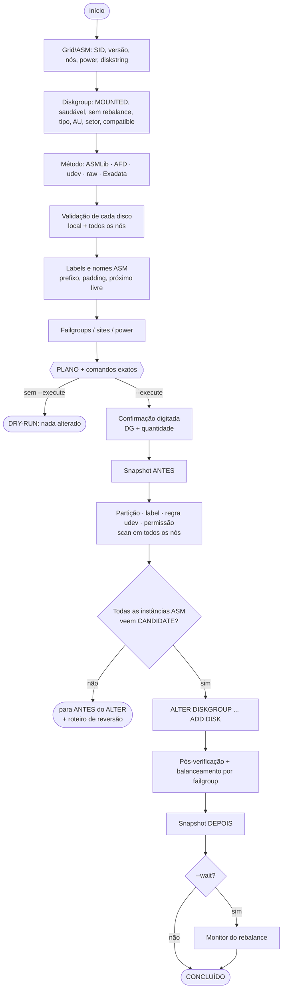

<div align="center">

```
   ____  ____    _      ____  ____      _    ____   ___
  |  _ \| __ )  / \    | __ )|  _ \    / \  | __ ) / _ \
  | | | |  _ \ / _ \   |  _ \| |_) |  / _ \ |  _ \| | | |
  | |_| | |_) / ___ \  | |_) |  _ <  / ___ \| |_) | |_| |
  |____/|____/_/   \_\ |____/|_| \_\/_/   \_\____/ \___/
```

# ASM ADD DISK BRABO

**Adição SEGURA de discos no Oracle ASM — do disco cru ao rebalance concluído.**

*Dry-run por padrão. Valida tudo em todos os nós antes de tocar em qualquer coisa.*

[](asm_add_disk_brabo.sh)
[](https://docs.oracle.com/en/database/oracle/oracle-database/19/ostmg/)
[](#ambientes-suportados)
[](#ambientes-suportados)
[](#exadata)
[](asm_add_disk_brabo.sh)
[](https://dbabrabo.com.br)

🇧🇷 Português · [🇺🇸 English](README.en.md)

</div>

---

## Por que existe

Adicionar disco no ASM parece simples: `ALTER DISKGROUP DATA ADD DISK ...`. Na prática, é uma das
mudanças que mais derrubam ambiente:

- a LUN que "estava livre" era o disco de outro servidor, de um VG ou do próprio SO;
- o disco aparece como `/dev/sdt` num nó e `/dev/sdv` no outro;
- o label sai `DSK_DATA_4` num DG onde todos são `DSK_DATA_04`;
- uma instância do RAC não enxerga o disco e o `ALTER` falha no meio;
- um disco menor entra no DG e o espaço útil some;
- o rebalance com power alto derruba o I/O em horário de produção.

O **ASM ADD DISK BRABO** faz o procedimento inteiro — provisionamento no SO, scan em todos os nós,
descoberta em **todas** as instâncias ASM, `ALTER DISKGROUP`, pós-verificação e acompanhamento do
rebalance — com dezenas de travas. **Sem `--execute`, nada é alterado**: você vê o plano e os
comandos exatos.

## Sumário

- [Início rápido](#início-rápido)
- [Como funciona](#como-funciona)
- [Ambientes suportados](#ambientes-suportados)
- [O que é validado](#o-que-é-validado-antes-de-qualquer-alteração)
- [Opções](#opções)
- [Exemplos com saída](#exemplos-com-saída) (os 27 do `--help`)
- [As travas em ação](#as-travas-em-ação)
- [Códigos de saída, log e snapshots](#códigos-de-saída-log-e-snapshots)
- [Simulador](#simulador)
- [Aviso](#aviso)

## Início rápido

```bash
# como root, no nó de banco (qualquer nó do RAC)
curl -fsSLO https://raw.githubusercontent.com/acaciolr/asm-add-disk-brabo/main/asm_add_disk_brabo.sh
chmod 700 asm_add_disk_brabo.sh

./asm_add_disk_brabo.sh --scan                       # quais discos estão livres?
./asm_add_disk_brabo.sh -g DATA -d /dev/sdt          # DRY-RUN: plano + comandos
./asm_add_disk_brabo.sh -g DATA -d /dev/sdt --execute
```

Requisitos: `root`, `bash >= 4`, ASM no ar e conexão `/ as sysasm` pelo dono do Grid. No RAC,
`ssh` root sem senha entre os nós (ou `--remote manual`).

## Como funciona



## Ambientes suportados

| Plataforma | Suporte |
|---|---|
| **Linux** | OL/RHEL/SLES 6 a 9 · ASMLib v2/v3 · ASMFD (AFD) · udev · multipath · VMware/KVM/Hyper-V · AWS EBS (Nitro/NVMe) · OCI · Azure · GCP |
| **AIX** | `rhdisk` raw (chown/chmod + `reserve_policy`) · RAC com mapeamento por `unique_id` |
| **Solaris e outros** | provisione o slice manualmente e use `--add-only` |
| **Grid** | Standalone/Oracle Restart, RAC, Flex ASM · ASM 11.2, 12.1, 12.2, 18c, 19c, 21c, 23ai |
| **Diskgroup** | EXTERNAL, NORMAL, HIGH, FLEX, EXTENDED (com `SITE`) |
| **Exadata** | on-premises X2 a X11M (HC, EF, XT), cells via ssh `root`/`celladmin` · ExaCS/ExaCC/ExaDB-D **recusados** |

## O que é validado antes de qualquer alteração

- **Ambiente:** root, bash >= 4, lock contra execução concorrente, ASM no ar, conexão SYSASM.
- **Diskgroup:** MOUNTED, sem rebalance em curso, sem disco OFFLINE/DROPPING/HUNG.
- **Cada disco:** disco inteiro (ou mpath) e **não** caminho de multipath; sem partição,
  filhos ou holders; não montado; não é swap/LVM/md; não está aberto por processo; sem
  assinatura (`blkid`/`wipefs`); sem marca ASMLib; sem header ASM (`kfed`); início e fim
  zerados; `maj:min` não usado por nenhum disco ASM/ASMLib/AFD; tamanho e setor compatíveis
  com o DG; não repetido na linha de comando.
- **RAC:** disco visível e limpo em **todos** os nós (by-id/WWN no Linux, `unique_id` no AIX);
  ASMLib/AFD/udev consistentes nos nós.
- **Descoberta:** o caminho novo casa com `asm_diskstring` e **todas** as instâncias ASM
  (`gv$asm_disk`) enxergam o disco como CANDIDATE/PROVISIONED/FORMER. Se não, para **antes** do
  `ALTER`.
- **Labels/nomes:** prefixo dominante, zero-padding e próximo número livre (máximo + 1),
  considerando DG, ASMLib/AFD/udev e regras existentes. `08` e `09` não viram octal.
  Inconsistências como `DSK_DATA_4` junto de `DSK_DATA_04` são reportadas.
- **Failgroups:** DG NORMAL/HIGH com failgroup nomeado exige `--failgroup`; o balanceamento por
  failgroup aparece depois do ADD.
- **Exadata:** ambiente cloud recusado; cell online; griddisks `active`/`UNUSED`, sem DG, mesmo
  `diskType` e **mesmo tamanho**; quantidade por cell = griddisks por failgroup do DG; celldisks
  `normal` e com espaço (na criação); todos vistos como CANDIDATE em todas as instâncias.
- **Execução:** confirmação digitada (nome do DG + quantidade de discos), snapshot antes/depois e
  roteiro de reversão impresso se algo falhar no meio.

## Opções

<details open>
<summary><b>Ações</b> (uma por execução; padrão = adicionar)</summary>

| Opção | O que faz |
|---|---|
| *(padrão)* | Provisiona no SO (partição + ASMLib/AFD/udev/permissão), scan em todos os nós, valida a descoberta em todas as instâncias e executa o `ALTER DISKGROUP ... ADD DISK` |
| `--provision-only` | Só provisiona e valida a descoberta. **Não** executa o `ALTER` |
| `--add-only` | Disco já provisionado: só valida e executa o `ALTER`. `-d` aceita caminho ASM (`ORCL:X`, `AFD:X`, `/dev/oracleasm/disks/X`, `/dev/rhdiskN`, `/dev/...`) ou só o label |
| `--status` | Diskgroup, failgroups, discos (`gv$asm_disk`) e rebalance |
| `--scan` | Lista os discos do SO e classifica LIVRE / EM USO / SUJO |
| `--rescan` | Rescan de barramento (SCSI no Linux, `cfgmgr` no AIX) em todos os nós + `--scan`. Exige `--execute` |
| `--set-power <N>` | `ALTER DISKGROUP <DG> REBALANCE POWER N NOWAIT`. Exige `--execute` |
| `--monitor` | Acompanha o rebalance (`gv$asm_operation`) até terminar |

</details>

<details>
<summary><b>Parâmetros principais e rebalance</b></summary>

| Opção | O que faz |
|---|---|
| `-g, --diskgroup <DG>` | Diskgroup (DATA, RECO, REDO, OCR...) |
| `-d, --disk <DEV>` | Disco(s), repetível ou separado por vírgula. Linux: `/dev/sdj`, `sdj`, `/dev/nvme3n1`, `/dev/xvdf`, `/dev/mapper/mpathk`, `/dev/disk/by-id/...` · AIX: `hdisk12`, `/dev/hdisk12`, `/dev/rhdisk12` |
| `--execute` | Executa de verdade |
| `--yes` | Dispensa a confirmação digitada (automação). Só com `--execute` e com **muito** cuidado |
| `-p, --power <N>` | Power 0-1024 (`COMPATIBLE.ASM >= 11.2.0.2`) ou 1-11. Padrão: `ASM_POWER_LIMIT` |
| `--no-rebalance` | ADD com `REBALANCE POWER 0` (rode `--set-power` depois) |
| `--wait` / `--nowait` | Acompanha o rebalance após o ADD / retorna logo (padrão) |
| `--wait-timeout <min>` | Limite do acompanhamento (0 = sem limite). O rebalance continua no ASM |
| `--poll <seg>` | Intervalo de consulta (padrão 30, mínimo 5) |

</details>

<details>
<summary><b>Label / nome ASM e provisionamento</b></summary>

| Opção | O que faz |
|---|---|
| `--prefix <TXT>` | Força o prefixo (ex.: `DSK_DATA_`) |
| `--width <N>` | Força o zero-padding (2 → `_07`, 3 → `_007`, 0 → sem padding) |
| `--start <N>` | Força o número inicial (aborta se já estiver em uso) |
| `--labels <L1,L2>` | Labels explícitos (ASMLib/AFD/udev), um por disco |
| `--names <N1,N2>` | Nomes ASM explícitos (cláusula `NAME`), um por disco |
| `--method <M>` | `auto` \| `asmlib` \| `afd` \| `udev` \| `raw` (padrão `auto`) |
| `--partition` / `--no-partition` | Força partição única (início 1MiB) / disco inteiro |
| `--pttype <T>` | `gpt` \| `msdos` (padrão: igual aos discos atuais; > 2 TiB = gpt) |
| `--use-existing-partition` | Aceita `-d` apontando para partição existente e vazia |
| `--owner` `--group` `--perm` | Permissão do device (raw/AIX). Padrão: igual aos atuais |
| `--fix-aix-attrs` | AIX/RAC: ajusta `reserve_policy=no_reserve` em todos os nós |

</details>

<details>
<summary><b>Exadata</b></summary>

| Opção | O que faz |
|---|---|
| `--exa-cell <c1,c2>` | Cell(s) cujos griddisks entram no DG. Substitui `-d`. Root no nó de banco |
| `--exa-prefix <P>` | Prefixo dos griddisks (padrão: deduzido do DG: DATA, RECO, DATAC1...) |
| `--exa-user <u>` | Usuário ssh nas cells: `root` (padrão) ou `celladmin` |
| `--exa-create-griddisk` | Também **cria** os griddisks (`CREATE GRIDDISK ALL HARDDISK\|FLASHDISK PREFIX=<P>, SIZE=<igual ao DG>`) |
| `--exa-size <tam>` | Tamanho na criação (padrão: `OS_MB` exato dos atuais). Ex.: `5562G`, `1.5T`, `870400M` |
| `--exa-allow-partial` | Aceita cell com quantidade de griddisks diferente dos failgroups atuais |

</details>

<details>
<summary><b>Failgroup / site, ambiente Grid e cluster</b></summary>

| Opção | O que faz |
|---|---|
| `--failgroup <FG>` | Um failgroup para todos ou lista `FG1,FG2` (um por disco) |
| `--allow-new-failgroup` | Permite criar failgroup que ainda não existe |
| `--site <S>` | Site (Extended Diskgroup 12.2+): um para todos ou lista |
| `--grid-user` `--grid-home` `--asm-sid` `--oracle-base` | Ambiente Grid explícito (padrão: autodetecção via `asm_pmon`, `olr.loc`, `oratab`) |
| `--env-file <arq>` | Arquivo de ambiente carregado antes (ex.: `.profile_infra`) |
| `--nodes <n1,n2>` | Força a lista de nós (padrão: `olsnodes`) |
| `--remote <modo>` | `auto` (ssh se houver, senão manual) · `ssh` (exige BatchMode root) · `manual` (mostra os comandos por nó e espera OK) · `none` |

</details>

<details>
<summary><b>Travas que podem ser desligadas</b> (só sabendo exatamente o porquê) e saída</summary>

| Opção | O que faz |
|---|---|
| `--size-tolerance <%>` | Diferença de tamanho aceita vs. discos do DG (padrão 2) |
| `--allow-size-mismatch` | Tamanho diferente vira apenas aviso |
| `--allow-dirty` | Aceita disco com bytes não zerados no início/fim (sem assinatura). O script **nunca** apaga nada |
| `--allow-running-rebalance` | Aceita adicionar com rebalance em curso |
| `--allow-unhealthy-dg` | Aceita DG com disco OFFLINE/DROPPING/HUNG |
| `--log-dir <dir>` | Padrão `/var/log/dbabrabo` (log + snapshots antes/depois) |
| `--no-color` · `-h, --help` · `-V, --version` | |

</details>

## Exemplos com saída

> Todas as saídas abaixo foram geradas pelo [simulador](#simulador): o script **real, sem nenhuma
> alteração**, rodando num container com Grid/ASM, discos, ASMLib, AFD, udev, multipath, AIX e
> cells Exadata falsos. Onde há confirmação, o "operador" do simulador digita as respostas.
> Linhas repetidas do monitor de rebalance foram resumidas.

Cenário principal (exemplos 1-9, 17, 18 e 22): RAC 19c `racdb01`/`racdb02`, diskgroup `DATA`
EXTERNAL com 16 discos ASMLib de 512 GiB (`DSK_DATA_01..16`), discos novos `/dev/sdt` e `/dev/sdu`.

### 1) Ver o que seria feito (dry-run) para um disco no DATA

```bash
./asm_add_disk_brabo.sh -g DATA -d /dev/sdt
```

<!-- SAIDA:1 -->
<details>
<summary><b>Saída (simulador)</b></summary>

```text
[root@racdb01 dbabrabo]# ./asm_add_disk_brabo.sh -g DATA -d /dev/sdt

   ____  ____    _      ____  ____      _    ____   ___
  |  _ \| __ )  / \    | __ )|  _ \    / \  | __ ) / _ \
  | | | |  _ \ / _ \   |  _ \| |_) |  / _ \ |  _ \| | | |
  | |_| | |_) / ___ \  | |_) |  _ <  / ___ \| |_) | |_| |
  |____/|____/_/   \_\ |____/|_| \_\/_/   \_\____/ \___/
  ASM ADD DISK BRABO v1.1.0 (2026-11-10) — adição segura de discos no Oracle ASM
  by • DBA BRABO — dbabrabo.com.br

2026-11-10 22:00:00 [INFO] Ação=add | modo=DRY-RUN | host=racdb01 | usuário=root | SO=Linux
2026-11-10 22:00:00 [INFO] Linha de comando: ./asm_add_disk_brabo.sh -g DATA -d /dev/sdt

==[ Ambiente Grid / ASM ]==
2026-11-10 22:00:00 [ OK ] ASM: SID=+ASM1 versão=19.0.0.0.0 instâncias=2
2026-11-10 22:00:00 [INFO] Grid: user=grid home=/u01/app/19.0.0/grid base=/u01/app/grid
2026-11-10 22:00:00 [INFO] asm_power_limit=1 | asm_diskstring=ORCL:*
2026-11-10 22:00:01 [ OK ] Cluster: RAC com 2 nós (racdb01 racdb02) | local=racdb01
2026-11-10 22:00:01 [ OK ] Execução remota: ssh (nós: racdb02)

==[ Diskgroup DATA ]==
2026-11-10 22:00:01 [ OK ] DG=DATA tipo=EXTERN estado=MOUNTED discos=16 total=8388576MB livre=1449984MB usable=1449984MB
2026-11-10 22:00:01 [INFO] AU=4MB setor=512 compatible.asm=19.0.0.0.0 | tamanho de referência dos discos: 524286MB

==[ Método de provisionamento ]==
2026-11-10 22:00:01 [ OK ] Método: asmlib | estilo de caminho: orcl
2026-11-10 22:00:03 [INFO] Discos atuais: particionados=16 inteiros=0 | tabela=gpt

==[ Validação dos discos (1) ]==
2026-11-10 22:00:03 [ OK ] /dev/sdt -> /dev/sdt (disk, 524288MB, setor 512) by-id: scsi-36000c29f1111111e8d2c41b9a7f03e5
2026-11-10 22:00:03 [ OK ] [racdb02] /dev/sdt visível como /dev/sdt e limpo

==[ Labels e nomes ASM ]==
2026-11-10 22:00:03 [INFO] Padrão de label: prefixo='DSK_DATA_' padding=2 maior número em uso=16 → DSK_DATA_17
2026-11-10 22:00:03 [INFO] Convenção do DG: nome ASM = label
2026-11-10 22:00:03 [ OK ] Disco 1: label=DSK_DATA_17 nome=DSK_DATA_17 caminho=ORCL:DSK_DATA_17

==[ Failgroups / Sites / Rebalance ]==
2026-11-10 22:00:03 [INFO] Rebalance: power=1 (asm_power_limit) | acompanhar=não
2026-11-10 22:00:03 [INFO] Particionamento: yes (tabela gpt, início 1MiB)

==[ PLANO DE EXECUÇÃO ]==
  Host/Nó    : racdb01 (racdb01) | SO=Linux | modo=DRY-RUN
  Cluster    : RAC (racdb01 racdb02) | remoto=ssh
  Diskgroup  : DATA (EXTERN) AU=4MB setor=512 compatible.asm=19.0.0.0.0
  Método     : asmlib | partição=yes (gpt) | ação=add

  #  DISCO                    DEVICE REAL                MB LABEL          NOME ASM                 FAILGROUP
  --------------------------------------------------------------------------------------------------------------------
  1  /dev/sdt                 /dev/sdt               524288 DSK_DATA_17    DSK_DATA_17              (padrão)
     caminho ASM: ORCL:DSK_DATA_17
     by-id      : scsi-36000c29f1111111e8d2c41b9a7f03e5
     id         : ID_SERIAL=36000c29f1111111e8d2c41b9a7f03e5 ID_WWN=0x6000c29f1111111e8d2
     outros nós : racdb02=/dev/sdt

  Capacidade : total 8388576MB -> ~8912864MB (+524288MB brutos) | livre 1449984MB -> ~1974272MB

  Statement que será executado:
    ALTER DISKGROUP DATA ADD
      DISK
        'ORCL:DSK_DATA_17' NAME DSK_DATA_17
      REBALANCE NOWAIT;

==[ DRY-RUN — comandos que seriam executados ]==
         [DRY-RUN] parted -s -a optimal /dev/sdt mklabel gpt mkpart primary 1MiB 100%
         [DRY-RUN] partprobe /dev/sdt
         [DRY-RUN] udevadm settle
         [DRY-RUN] [racdb02] partprobe /dev/sdt && udevadm settle
         [DRY-RUN] /usr/sbin/oracleasm createdisk DSK_DATA_17 /dev/sdt1
         [DRY-RUN] /usr/sbin/oracleasm scandisks
         [DRY-RUN] [racdb02] /usr/sbin/oracleasm scandisks && /usr/sbin/oracleasm querydisk -p DSK_DATA_17

==[ Descoberta pelo ASM em TODAS as instâncias ]==
         [DRY-RUN] gv$asm_disk: cada disco precisa aparecer em 2 instância(s) como CANDIDATE/PROVISIONED/FORMER

==[ ALTER DISKGROUP DATA ]==
    ALTER DISKGROUP DATA ADD
      DISK
        'ORCL:DSK_DATA_17' NAME DSK_DATA_17
      REBALANCE NOWAIT;
         [DRY-RUN] (statement acima)

DRY-RUN concluído: NADA foi alterado. Revise o plano e rode novamente com --execute.

  Log completo: /var/log/dbabrabo/asm_add_disk_brabo_DATA_add_20261110_220000.log
```

</details>
<!-- /SAIDA:1 -->

### 2) Adicionar dois discos com power 4, sem esperar o rebalance

```bash
./asm_add_disk_brabo.sh -g DATA -d /dev/sdt,/dev/sdu -p 4 --execute
```

<!-- SAIDA:2 -->
<details>
<summary><b>Saída (simulador)</b></summary>

```text
[root@racdb01 dbabrabo]# ./asm_add_disk_brabo.sh -g DATA -d /dev/sdt,/dev/sdu -p 4 --execute

   ____  ____    _      ____  ____      _    ____   ___
  |  _ \| __ )  / \    | __ )|  _ \    / \  | __ ) / _ \
  | | | |  _ \ / _ \   |  _ \| |_) |  / _ \ |  _ \| | | |
  | |_| | |_) / ___ \  | |_) |  _ <  / ___ \| |_) | |_| |
  |____/|____/_/   \_\ |____/|_| \_\/_/   \_\____/ \___/
  ASM ADD DISK BRABO v1.1.0 (2026-11-10) — adição segura de discos no Oracle ASM
  by • DBA BRABO — dbabrabo.com.br

2026-11-10 22:00:00 [INFO] Ação=add | modo=EXECUTE | host=racdb01 | usuário=root | SO=Linux
2026-11-10 22:00:00 [INFO] Linha de comando: ./asm_add_disk_brabo.sh -g DATA -d /dev/sdt,/dev/sdu -p 4 --execute

==[ Ambiente Grid / ASM ]==
2026-11-10 22:00:00 [ OK ] ASM: SID=+ASM1 versão=19.0.0.0.0 instâncias=2
2026-11-10 22:00:00 [INFO] Grid: user=grid home=/u01/app/19.0.0/grid base=/u01/app/grid
2026-11-10 22:00:00 [INFO] asm_power_limit=1 | asm_diskstring=ORCL:*
2026-11-10 22:00:00 [ OK ] Cluster: RAC com 2 nós (racdb01 racdb02) | local=racdb01
2026-11-10 22:00:00 [ OK ] Execução remota: ssh (nós: racdb02)

==[ Diskgroup DATA ]==
2026-11-10 22:00:00 [ OK ] DG=DATA tipo=EXTERN estado=MOUNTED discos=16 total=8388576MB livre=1449984MB usable=1449984MB
2026-11-10 22:00:00 [INFO] AU=4MB setor=512 compatible.asm=19.0.0.0.0 | tamanho de referência dos discos: 524286MB

==[ Método de provisionamento ]==
2026-11-10 22:00:01 [ OK ] Método: asmlib | estilo de caminho: orcl
2026-11-10 22:00:03 [INFO] Discos atuais: particionados=16 inteiros=0 | tabela=gpt

==[ Validação dos discos (2) ]==
2026-11-10 22:00:03 [ OK ] /dev/sdt -> /dev/sdt (disk, 524288MB, setor 512) by-id: scsi-36000c29f1111111e8d2c41b9a7f03e5
2026-11-10 22:00:03 [ OK ] /dev/sdu -> /dev/sdu (disk, 524288MB, setor 512) by-id: scsi-36000c29f2222222e8d2c41b9a7f03e5
2026-11-10 22:00:03 [ OK ] [racdb02] /dev/sdt visível como /dev/sdt e limpo
2026-11-10 22:00:03 [ OK ] [racdb02] /dev/sdu visível como /dev/sdu e limpo

==[ Labels e nomes ASM ]==
2026-11-10 22:00:03 [INFO] Padrão de label: prefixo='DSK_DATA_' padding=2 maior número em uso=16 → DSK_DATA_17 DSK_DATA_18
2026-11-10 22:00:03 [INFO] Convenção do DG: nome ASM = label
2026-11-10 22:00:03 [ OK ] Disco 1: label=DSK_DATA_17 nome=DSK_DATA_17 caminho=ORCL:DSK_DATA_17
2026-11-10 22:00:03 [ OK ] Disco 2: label=DSK_DATA_18 nome=DSK_DATA_18 caminho=ORCL:DSK_DATA_18

==[ Failgroups / Sites / Rebalance ]==
2026-11-10 22:00:03 [INFO] Rebalance: power=4 | acompanhar=não
2026-11-10 22:00:03 [INFO] Particionamento: yes (tabela gpt, início 1MiB)

==[ PLANO DE EXECUÇÃO ]==
  Host/Nó    : racdb01 (racdb01) | SO=Linux | modo=EXECUTE
  Cluster    : RAC (racdb01 racdb02) | remoto=ssh
  Diskgroup  : DATA (EXTERN) AU=4MB setor=512 compatible.asm=19.0.0.0.0
  Método     : asmlib | partição=yes (gpt) | ação=add

  #  DISCO                    DEVICE REAL                MB LABEL          NOME ASM                 FAILGROUP
  --------------------------------------------------------------------------------------------------------------------
  1  /dev/sdt                 /dev/sdt               524288 DSK_DATA_17    DSK_DATA_17              (padrão)
     caminho ASM: ORCL:DSK_DATA_17
     by-id      : scsi-36000c29f1111111e8d2c41b9a7f03e5
     id         : ID_SERIAL=36000c29f1111111e8d2c41b9a7f03e5 ID_WWN=0x6000c29f1111111e8d2
     outros nós : racdb02=/dev/sdt
  2  /dev/sdu                 /dev/sdu               524288 DSK_DATA_18    DSK_DATA_18              (padrão)
     caminho ASM: ORCL:DSK_DATA_18
     by-id      : scsi-36000c29f2222222e8d2c41b9a7f03e5
     id         : ID_SERIAL=36000c29f2222222e8d2c41b9a7f03e5 ID_WWN=0x6000c29f2222222e8d2
     outros nós : racdb02=/dev/sdu

  Capacidade : total 8388576MB -> ~9437152MB (+1048576MB brutos) | livre 1449984MB -> ~2498560MB

  Statement que será executado:
    ALTER DISKGROUP DATA ADD
      DISK
        'ORCL:DSK_DATA_17' NAME DSK_DATA_17,
        'ORCL:DSK_DATA_18' NAME DSK_DATA_18
      REBALANCE POWER 4 NOWAIT;

==[ CONFIRMAÇÃO ]==
  Esta operação vai alterar o storage e o diskgroup DATA em racdb01.
  Digite o nome do diskgroup (DATA): DATA
  Digite a quantidade de discos (2): 2
2026-11-10 22:00:05 [INFO] Snapshot (antes): /var/log/dbabrabo/asm_add_disk_brabo_DATA_20261110_220000_snap_antes.txt

==[ Provisionando 1/2: /dev/sdt -> DSK_DATA_17 ]==
2026-11-10 22:00:05 [INFO] EXEC: parted -s -a optimal /dev/sdt mklabel gpt mkpart primary 1MiB 100%
2026-11-10 22:00:05 [INFO] EXEC: partprobe /dev/sdt
2026-11-10 22:00:05 [INFO] EXEC: udevadm settle
2026-11-10 22:00:05 [ OK ] Partição criada: /dev/sdt1
2026-11-10 22:00:05 [INFO] EXEC [racdb02]: partprobe /dev/sdt && udevadm settle
2026-11-10 22:00:05 [INFO] EXEC: /usr/sbin/oracleasm createdisk DSK_DATA_17 /dev/sdt1
Writing disk header: done
Instantiating disk: done
Disk "DSK_DATA_17" is a valid ASM disk
/dev/sdt1: LABEL="DSK_DATA_17" TYPE="oracleasm"
2026-11-10 22:00:05 [INFO] EXEC: /usr/sbin/oracleasm scandisks
Reloading disk partitions: done
Cleaning any stale ASM disks...
Scanning system for ASM disks...
2026-11-10 22:00:05 [INFO] EXEC [racdb02]: /usr/sbin/oracleasm scandisks && /usr/sbin/oracleasm querydisk -p DSK_DATA_17
Reloading disk partitions: done
Cleaning any stale ASM disks...
Scanning system for ASM disks...
Disk "DSK_DATA_17" is a valid ASM disk
/dev/sdt1: LABEL="DSK_DATA_17" TYPE="oracleasm"

==[ Provisionando 2/2: /dev/sdu -> DSK_DATA_18 ]==
2026-11-10 22:00:05 [INFO] EXEC: parted -s -a optimal /dev/sdu mklabel gpt mkpart primary 1MiB 100%
2026-11-10 22:00:05 [INFO] EXEC: partprobe /dev/sdu
2026-11-10 22:00:05 [INFO] EXEC: udevadm settle
2026-11-10 22:00:05 [ OK ] Partição criada: /dev/sdu1
2026-11-10 22:00:05 [INFO] EXEC [racdb02]: partprobe /dev/sdu && udevadm settle
2026-11-10 22:00:05 [INFO] EXEC: /usr/sbin/oracleasm createdisk DSK_DATA_18 /dev/sdu1
Writing disk header: done
Instantiating disk: done
Disk "DSK_DATA_18" is a valid ASM disk
/dev/sdu1: LABEL="DSK_DATA_18" TYPE="oracleasm"
2026-11-10 22:00:05 [INFO] EXEC: /usr/sbin/oracleasm scandisks
Reloading disk partitions: done
Cleaning any stale ASM disks...
Scanning system for ASM disks...
2026-11-10 22:00:05 [INFO] EXEC [racdb02]: /usr/sbin/oracleasm scandisks && /usr/sbin/oracleasm querydisk -p DSK_DATA_18
Reloading disk partitions: done
Cleaning any stale ASM disks...
Scanning system for ASM disks...
Disk "DSK_DATA_18" is a valid ASM disk
/dev/sdu1: LABEL="DSK_DATA_18" TYPE="oracleasm"

==[ Descoberta pelo ASM em TODAS as instâncias ]==
2026-11-10 22:00:06 [ OK ] Todos os discos descobertos em 2 instância(s).

==[ ALTER DISKGROUP DATA ]==
    ALTER DISKGROUP DATA ADD
      DISK
        'ORCL:DSK_DATA_17' NAME DSK_DATA_17,
        'ORCL:DSK_DATA_18' NAME DSK_DATA_18
      REBALANCE POWER 4 NOWAIT;
2026-11-10 22:00:06 [ OK ] ALTER DISKGROUP DATA ADD executado.

==[ Verificação pós-ADD ]==
2026-11-10 22:00:06 [ OK ] DSK_DATA_17 ORCL:DSK_DATA_17 MEMBER/ONLINE/NORMAL fg=DSK_DATA_17 524286MB
2026-11-10 22:00:06 [ OK ] DSK_DATA_18 ORCL:DSK_DATA_18 MEMBER/ONLINE/NORMAL fg=DSK_DATA_18 524286MB
2026-11-10 22:00:06 [INFO] Snapshot (depois): /var/log/dbabrabo/asm_add_disk_brabo_DATA_20261110_220000_snap_depois.txt

==[ CONCLUÍDO ]==
  Discos adicionados ao DATA: DSK_DATA_17 DSK_DATA_18
  Acompanhar : ./asm_add_disk_brabo.sh -g DATA --monitor
  Status     : ./asm_add_disk_brabo.sh -g DATA --status
  Power      : ./asm_add_disk_brabo.sh -g DATA --set-power <N> --execute
  Reverter   : ALTER DISKGROUP DATA DROP DISK DSK_DATA_17,DSK_DATA_18 REBALANCE POWER <N>;  (só depois de avaliar espaço!)

  Log completo: /var/log/dbabrabo/asm_add_disk_brabo_DATA_add_20261110_220000.log
```

</details>
<!-- /SAIDA:2 -->

### 3) Adicionar e acompanhar o rebalance até o fim (no máximo 3h)

```bash
./asm_add_disk_brabo.sh -g DATA -d /dev/sdt -d /dev/sdu -p 8 --wait --wait-timeout 180 --execute
```

<!-- SAIDA:3 -->
<details>
<summary><b>Saída (simulador)</b></summary>

```text
[root@racdb01 dbabrabo]# ./asm_add_disk_brabo.sh -g DATA -d /dev/sdt -d /dev/sdu -p 8 --wait --wait-timeout 180 --execute

   ____  ____    _      ____  ____      _    ____   ___
  |  _ \| __ )  / \    | __ )|  _ \    / \  | __ ) / _ \
  | | | |  _ \ / _ \   |  _ \| |_) |  / _ \ |  _ \| | | |
  | |_| | |_) / ___ \  | |_) |  _ <  / ___ \| |_) | |_| |
  |____/|____/_/   \_\ |____/|_| \_\/_/   \_\____/ \___/
  ASM ADD DISK BRABO v1.1.0 (2026-11-10) — adição segura de discos no Oracle ASM
  by • DBA BRABO — dbabrabo.com.br

2026-11-10 22:00:00 [INFO] Ação=add | modo=EXECUTE | host=racdb01 | usuário=root | SO=Linux
2026-11-10 22:00:00 [INFO] Linha de comando: ./asm_add_disk_brabo.sh -g DATA -d /dev/sdt -d /dev/sdu -p 8 --wait --wait-timeout 180 --execute

==[ Ambiente Grid / ASM ]==
2026-11-10 22:00:01 [ OK ] ASM: SID=+ASM1 versão=19.0.0.0.0 instâncias=2
2026-11-10 22:00:01 [INFO] Grid: user=grid home=/u01/app/19.0.0/grid base=/u01/app/grid
2026-11-10 22:00:01 [INFO] asm_power_limit=1 | asm_diskstring=ORCL:*
2026-11-10 22:00:01 [ OK ] Cluster: RAC com 2 nós (racdb01 racdb02) | local=racdb01
2026-11-10 22:00:01 [ OK ] Execução remota: ssh (nós: racdb02)

==[ Diskgroup DATA ]==
2026-11-10 22:00:01 [ OK ] DG=DATA tipo=EXTERN estado=MOUNTED discos=16 total=8388576MB livre=1449984MB usable=1449984MB
2026-11-10 22:00:01 [INFO] AU=4MB setor=512 compatible.asm=19.0.0.0.0 | tamanho de referência dos discos: 524286MB

==[ Método de provisionamento ]==
2026-11-10 22:00:01 [ OK ] Método: asmlib | estilo de caminho: orcl
2026-11-10 22:00:04 [INFO] Discos atuais: particionados=16 inteiros=0 | tabela=gpt

==[ Validação dos discos (2) ]==
2026-11-10 22:00:04 [ OK ] /dev/sdt -> /dev/sdt (disk, 524288MB, setor 512) by-id: scsi-36000c29f1111111e8d2c41b9a7f03e5
2026-11-10 22:00:04 [ OK ] /dev/sdu -> /dev/sdu (disk, 524288MB, setor 512) by-id: scsi-36000c29f2222222e8d2c41b9a7f03e5
2026-11-10 22:00:04 [ OK ] [racdb02] /dev/sdt visível como /dev/sdt e limpo
2026-11-10 22:00:04 [ OK ] [racdb02] /dev/sdu visível como /dev/sdu e limpo

==[ Labels e nomes ASM ]==
2026-11-10 22:00:04 [INFO] Padrão de label: prefixo='DSK_DATA_' padding=2 maior número em uso=16 → DSK_DATA_17 DSK_DATA_18
2026-11-10 22:00:04 [INFO] Convenção do DG: nome ASM = label
2026-11-10 22:00:04 [ OK ] Disco 1: label=DSK_DATA_17 nome=DSK_DATA_17 caminho=ORCL:DSK_DATA_17
2026-11-10 22:00:04 [ OK ] Disco 2: label=DSK_DATA_18 nome=DSK_DATA_18 caminho=ORCL:DSK_DATA_18

==[ Failgroups / Sites / Rebalance ]==
2026-11-10 22:00:04 [INFO] Rebalance: power=8 | acompanhar=sim
2026-11-10 22:00:04 [INFO] Particionamento: yes (tabela gpt, início 1MiB)

==[ PLANO DE EXECUÇÃO ]==
  Host/Nó    : racdb01 (racdb01) | SO=Linux | modo=EXECUTE
  Cluster    : RAC (racdb01 racdb02) | remoto=ssh
  Diskgroup  : DATA (EXTERN) AU=4MB setor=512 compatible.asm=19.0.0.0.0
  Método     : asmlib | partição=yes (gpt) | ação=add

  #  DISCO                    DEVICE REAL                MB LABEL          NOME ASM                 FAILGROUP
  --------------------------------------------------------------------------------------------------------------------
  1  /dev/sdt                 /dev/sdt               524288 DSK_DATA_17    DSK_DATA_17              (padrão)
     caminho ASM: ORCL:DSK_DATA_17
     by-id      : scsi-36000c29f1111111e8d2c41b9a7f03e5
     id         : ID_SERIAL=36000c29f1111111e8d2c41b9a7f03e5 ID_WWN=0x6000c29f1111111e8d2
     outros nós : racdb02=/dev/sdt
  2  /dev/sdu                 /dev/sdu               524288 DSK_DATA_18    DSK_DATA_18              (padrão)
     caminho ASM: ORCL:DSK_DATA_18
     by-id      : scsi-36000c29f2222222e8d2c41b9a7f03e5
     id         : ID_SERIAL=36000c29f2222222e8d2c41b9a7f03e5 ID_WWN=0x6000c29f2222222e8d2
     outros nós : racdb02=/dev/sdu

  Capacidade : total 8388576MB -> ~9437152MB (+1048576MB brutos) | livre 1449984MB -> ~2498560MB

  Statement que será executado:
    ALTER DISKGROUP DATA ADD
      DISK
        'ORCL:DSK_DATA_17' NAME DSK_DATA_17,
        'ORCL:DSK_DATA_18' NAME DSK_DATA_18
      REBALANCE POWER 8 NOWAIT;

==[ CONFIRMAÇÃO ]==
  Esta operação vai alterar o storage e o diskgroup DATA em racdb01.
  Digite o nome do diskgroup (DATA): DATA
  Digite a quantidade de discos (2): 2
2026-11-10 22:00:06 [INFO] Snapshot (antes): /var/log/dbabrabo/asm_add_disk_brabo_DATA_20261110_220000_snap_antes.txt

==[ Provisionando 1/2: /dev/sdt -> DSK_DATA_17 ]==
2026-11-10 22:00:06 [INFO] EXEC: parted -s -a optimal /dev/sdt mklabel gpt mkpart primary 1MiB 100%
2026-11-10 22:00:06 [INFO] EXEC: partprobe /dev/sdt
2026-11-10 22:00:06 [INFO] EXEC: udevadm settle
2026-11-10 22:00:06 [ OK ] Partição criada: /dev/sdt1
2026-11-10 22:00:06 [INFO] EXEC [racdb02]: partprobe /dev/sdt && udevadm settle
2026-11-10 22:00:06 [INFO] EXEC: /usr/sbin/oracleasm createdisk DSK_DATA_17 /dev/sdt1
Writing disk header: done
Instantiating disk: done
Disk "DSK_DATA_17" is a valid ASM disk
/dev/sdt1: LABEL="DSK_DATA_17" TYPE="oracleasm"
2026-11-10 22:00:06 [INFO] EXEC: /usr/sbin/oracleasm scandisks
Reloading disk partitions: done
Cleaning any stale ASM disks...
Scanning system for ASM disks...
2026-11-10 22:00:06 [INFO] EXEC [racdb02]: /usr/sbin/oracleasm scandisks && /usr/sbin/oracleasm querydisk -p DSK_DATA_17
Reloading disk partitions: done
Cleaning any stale ASM disks...
Scanning system for ASM disks...
Disk "DSK_DATA_17" is a valid ASM disk
/dev/sdt1: LABEL="DSK_DATA_17" TYPE="oracleasm"

==[ Provisionando 2/2: /dev/sdu -> DSK_DATA_18 ]==
2026-11-10 22:00:06 [INFO] EXEC: parted -s -a optimal /dev/sdu mklabel gpt mkpart primary 1MiB 100%
2026-11-10 22:00:07 [INFO] EXEC: partprobe /dev/sdu
2026-11-10 22:00:07 [INFO] EXEC: udevadm settle
2026-11-10 22:00:07 [ OK ] Partição criada: /dev/sdu1
2026-11-10 22:00:07 [INFO] EXEC [racdb02]: partprobe /dev/sdu && udevadm settle
2026-11-10 22:00:07 [INFO] EXEC: /usr/sbin/oracleasm createdisk DSK_DATA_18 /dev/sdu1
Writing disk header: done
Instantiating disk: done
Disk "DSK_DATA_18" is a valid ASM disk
/dev/sdu1: LABEL="DSK_DATA_18" TYPE="oracleasm"
2026-11-10 22:00:07 [INFO] EXEC: /usr/sbin/oracleasm scandisks
Reloading disk partitions: done
Cleaning any stale ASM disks...
Scanning system for ASM disks...
2026-11-10 22:00:07 [INFO] EXEC [racdb02]: /usr/sbin/oracleasm scandisks && /usr/sbin/oracleasm querydisk -p DSK_DATA_18
Reloading disk partitions: done
Cleaning any stale ASM disks...
Scanning system for ASM disks...
Disk "DSK_DATA_18" is a valid ASM disk
/dev/sdu1: LABEL="DSK_DATA_18" TYPE="oracleasm"

==[ Descoberta pelo ASM em TODAS as instâncias ]==
2026-11-10 22:00:07 [ OK ] Todos os discos descobertos em 2 instância(s).

==[ ALTER DISKGROUP DATA ]==
    ALTER DISKGROUP DATA ADD
      DISK
        'ORCL:DSK_DATA_17' NAME DSK_DATA_17,
        'ORCL:DSK_DATA_18' NAME DSK_DATA_18
      REBALANCE POWER 8 NOWAIT;
2026-11-10 22:00:07 [ OK ] ALTER DISKGROUP DATA ADD executado.

==[ Verificação pós-ADD ]==
2026-11-10 22:00:07 [ OK ] DSK_DATA_17 ORCL:DSK_DATA_17 MEMBER/ONLINE/NORMAL fg=DSK_DATA_17 524286MB
2026-11-10 22:00:07 [ OK ] DSK_DATA_18 ORCL:DSK_DATA_18 MEMBER/ONLINE/NORMAL fg=DSK_DATA_18 524286MB

==[ Rebalance do DATA (Ctrl+C sai do monitor; o rebalance NÃO é afetado) ]==
  2026-11-10 22:00:07 inst=1 REBAL/RUN pass=REBALANCE power=8 0/131071 AU (3600 AU/min) est=37 min
  2026-11-10 22:00:37 inst=1 REBAL/RUN pass=REBALANCE power=8 1800/131071 AU (3600 AU/min) est=36 min
  2026-11-10 22:01:07 inst=1 REBAL/RUN pass=REBALANCE power=8 3600/131071 AU (3600 AU/min) est=36 min
  [... 67 linhas do monitor omitidas ...]
  2026-11-10 22:35:11 inst=1 REBAL/RUN pass=COMPACT power=8 126240/131071 AU (3600 AU/min) est=2 min
  2026-11-10 22:35:41 inst=1 REBAL/RUN pass=COMPACT power=8 128040/131071 AU (3600 AU/min) est=1 min
  2026-11-10 22:36:11 inst=1 REBAL/RUN pass=COMPACT power=8 129840/131071 AU (3600 AU/min) est=1 min
2026-11-10 22:36:41 [ OK ] Nenhuma operação em andamento no DATA — rebalance concluído.
2026-11-10 22:36:42 [INFO] Snapshot (depois): /var/log/dbabrabo/asm_add_disk_brabo_DATA_20261110_220000_snap_depois.txt

==[ CONCLUÍDO ]==
  Discos adicionados ao DATA: DSK_DATA_17 DSK_DATA_18
  Acompanhar : ./asm_add_disk_brabo.sh -g DATA --monitor
  Status     : ./asm_add_disk_brabo.sh -g DATA --status
  Power      : ./asm_add_disk_brabo.sh -g DATA --set-power <N> --execute
  Reverter   : ALTER DISKGROUP DATA DROP DISK DSK_DATA_17,DSK_DATA_18 REBALANCE POWER <N>;  (só depois de avaliar espaço!)

  Log completo: /var/log/dbabrabo/asm_add_disk_brabo_DATA_add_20261110_220000.log
```

</details>
<!-- /SAIDA:3 -->

### 4) Adicionar SEM rebalance agora e rebalancear na janela

```bash
./asm_add_disk_brabo.sh -g DATA -d /dev/sdt --no-rebalance --execute
./asm_add_disk_brabo.sh -g DATA --set-power 8 --execute
```

<!-- SAIDA:4 -->
<details>
<summary><b>Saída (simulador)</b></summary>

```text
[root@racdb01 dbabrabo]# ./asm_add_disk_brabo.sh -g DATA -d /dev/sdt --no-rebalance --execute

   ____  ____    _      ____  ____      _    ____   ___
  |  _ \| __ )  / \    | __ )|  _ \    / \  | __ ) / _ \
  | | | |  _ \ / _ \   |  _ \| |_) |  / _ \ |  _ \| | | |
  | |_| | |_) / ___ \  | |_) |  _ <  / ___ \| |_) | |_| |
  |____/|____/_/   \_\ |____/|_| \_\/_/   \_\____/ \___/
  ASM ADD DISK BRABO v1.1.0 (2026-11-10) — adição segura de discos no Oracle ASM
  by • DBA BRABO — dbabrabo.com.br

2026-11-10 22:00:01 [INFO] Ação=add | modo=EXECUTE | host=racdb01 | usuário=root | SO=Linux
2026-11-10 22:00:01 [INFO] Linha de comando: ./asm_add_disk_brabo.sh -g DATA -d /dev/sdt --no-rebalance --execute

==[ Ambiente Grid / ASM ]==
2026-11-10 22:00:01 [ OK ] ASM: SID=+ASM1 versão=19.0.0.0.0 instâncias=2
2026-11-10 22:00:01 [INFO] Grid: user=grid home=/u01/app/19.0.0/grid base=/u01/app/grid
2026-11-10 22:00:01 [INFO] asm_power_limit=1 | asm_diskstring=ORCL:*
2026-11-10 22:00:01 [ OK ] Cluster: RAC com 2 nós (racdb01 racdb02) | local=racdb01
2026-11-10 22:00:01 [ OK ] Execução remota: ssh (nós: racdb02)

==[ Diskgroup DATA ]==
2026-11-10 22:00:01 [ OK ] DG=DATA tipo=EXTERN estado=MOUNTED discos=16 total=8388576MB livre=1449984MB usable=1449984MB
2026-11-10 22:00:01 [INFO] AU=4MB setor=512 compatible.asm=19.0.0.0.0 | tamanho de referência dos discos: 524286MB

==[ Método de provisionamento ]==
2026-11-10 22:00:01 [ OK ] Método: asmlib | estilo de caminho: orcl
2026-11-10 22:00:03 [INFO] Discos atuais: particionados=16 inteiros=0 | tabela=gpt

==[ Validação dos discos (1) ]==
2026-11-10 22:00:03 [ OK ] /dev/sdt -> /dev/sdt (disk, 524288MB, setor 512) by-id: scsi-36000c29f1111111e8d2c41b9a7f03e5
2026-11-10 22:00:04 [ OK ] [racdb02] /dev/sdt visível como /dev/sdt e limpo

==[ Labels e nomes ASM ]==
2026-11-10 22:00:04 [INFO] Padrão de label: prefixo='DSK_DATA_' padding=2 maior número em uso=16 → DSK_DATA_17
2026-11-10 22:00:04 [INFO] Convenção do DG: nome ASM = label
2026-11-10 22:00:04 [ OK ] Disco 1: label=DSK_DATA_17 nome=DSK_DATA_17 caminho=ORCL:DSK_DATA_17

==[ Failgroups / Sites / Rebalance ]==
2026-11-10 22:00:04 [WARN] REBALANCE POWER 0: os dados NÃO serão redistribuídos até você rodar --set-power.
2026-11-10 22:00:04 [INFO] Rebalance: power=0 | acompanhar=não
2026-11-10 22:00:04 [INFO] Particionamento: yes (tabela gpt, início 1MiB)

==[ PLANO DE EXECUÇÃO ]==
  Host/Nó    : racdb01 (racdb01) | SO=Linux | modo=EXECUTE
  Cluster    : RAC (racdb01 racdb02) | remoto=ssh
  Diskgroup  : DATA (EXTERN) AU=4MB setor=512 compatible.asm=19.0.0.0.0
  Método     : asmlib | partição=yes (gpt) | ação=add

  #  DISCO                    DEVICE REAL                MB LABEL          NOME ASM                 FAILGROUP
  --------------------------------------------------------------------------------------------------------------------
  1  /dev/sdt                 /dev/sdt               524288 DSK_DATA_17    DSK_DATA_17              (padrão)
     caminho ASM: ORCL:DSK_DATA_17
     by-id      : scsi-36000c29f1111111e8d2c41b9a7f03e5
     id         : ID_SERIAL=36000c29f1111111e8d2c41b9a7f03e5 ID_WWN=0x6000c29f1111111e8d2
     outros nós : racdb02=/dev/sdt

  Capacidade : total 8388576MB -> ~8912864MB (+524288MB brutos) | livre 1449984MB -> ~1974272MB

  Statement que será executado:
    ALTER DISKGROUP DATA ADD
      DISK
        'ORCL:DSK_DATA_17' NAME DSK_DATA_17
      REBALANCE POWER 0 NOWAIT;

  Atenção: 1 aviso(s) acima. Leia antes de prosseguir.

==[ CONFIRMAÇÃO ]==
  Esta operação vai alterar o storage e o diskgroup DATA em racdb01.
  Digite o nome do diskgroup (DATA): DATA
  Digite a quantidade de discos (1): 1
2026-11-10 22:00:05 [INFO] Snapshot (antes): /var/log/dbabrabo/asm_add_disk_brabo_DATA_20261110_220001_snap_antes.txt

==[ Provisionando 1/1: /dev/sdt -> DSK_DATA_17 ]==
2026-11-10 22:00:06 [INFO] EXEC: parted -s -a optimal /dev/sdt mklabel gpt mkpart primary 1MiB 100%
2026-11-10 22:00:06 [INFO] EXEC: partprobe /dev/sdt
2026-11-10 22:00:06 [INFO] EXEC: udevadm settle
2026-11-10 22:00:06 [ OK ] Partição criada: /dev/sdt1
2026-11-10 22:00:06 [INFO] EXEC [racdb02]: partprobe /dev/sdt && udevadm settle
2026-11-10 22:00:06 [INFO] EXEC: /usr/sbin/oracleasm createdisk DSK_DATA_17 /dev/sdt1
Writing disk header: done
Instantiating disk: done
Disk "DSK_DATA_17" is a valid ASM disk
/dev/sdt1: LABEL="DSK_DATA_17" TYPE="oracleasm"
2026-11-10 22:00:06 [INFO] EXEC: /usr/sbin/oracleasm scandisks
Reloading disk partitions: done
Cleaning any stale ASM disks...
Scanning system for ASM disks...
2026-11-10 22:00:06 [INFO] EXEC [racdb02]: /usr/sbin/oracleasm scandisks && /usr/sbin/oracleasm querydisk -p DSK_DATA_17
Reloading disk partitions: done
Cleaning any stale ASM disks...
Scanning system for ASM disks...
Disk "DSK_DATA_17" is a valid ASM disk
/dev/sdt1: LABEL="DSK_DATA_17" TYPE="oracleasm"

==[ Descoberta pelo ASM em TODAS as instâncias ]==
2026-11-10 22:00:06 [ OK ] Todos os discos descobertos em 2 instância(s).

==[ ALTER DISKGROUP DATA ]==
    ALTER DISKGROUP DATA ADD
      DISK
        'ORCL:DSK_DATA_17' NAME DSK_DATA_17
      REBALANCE POWER 0 NOWAIT;
2026-11-10 22:00:06 [ OK ] ALTER DISKGROUP DATA ADD executado.

==[ Verificação pós-ADD ]==
2026-11-10 22:00:06 [ OK ] DSK_DATA_17 ORCL:DSK_DATA_17 MEMBER/ONLINE/NORMAL fg=DSK_DATA_17 524286MB
2026-11-10 22:00:07 [INFO] Snapshot (depois): /var/log/dbabrabo/asm_add_disk_brabo_DATA_20261110_220001_snap_depois.txt

==[ CONCLUÍDO ]==
  Discos adicionados ao DATA: DSK_DATA_17
  Acompanhar : ./asm_add_disk_brabo.sh -g DATA --monitor
  Status     : ./asm_add_disk_brabo.sh -g DATA --status
  Power      : ./asm_add_disk_brabo.sh -g DATA --set-power <N> --execute
  Reverter   : ALTER DISKGROUP DATA DROP DISK DSK_DATA_17 REBALANCE POWER <N>;  (só depois de avaliar espaço!)
2026-11-10 22:00:07 [WARN] Execução com 1 aviso(s) — revise o log.

  Log completo: /var/log/dbabrabo/asm_add_disk_brabo_DATA_add_20261110_220001.log


[root@racdb01 dbabrabo]# ./asm_add_disk_brabo.sh -g DATA --set-power 8 --execute

   ____  ____    _      ____  ____      _    ____   ___
  |  _ \| __ )  / \    | __ )|  _ \    / \  | __ ) / _ \
  | | | |  _ \ / _ \   |  _ \| |_) |  / _ \ |  _ \| | | |
  | |_| | |_) / ___ \  | |_) |  _ <  / ___ \| |_) | |_| |
  |____/|____/_/   \_\ |____/|_| \_\/_/   \_\____/ \___/
  ASM ADD DISK BRABO v1.1.0 (2026-11-10) — adição segura de discos no Oracle ASM
  by • DBA BRABO — dbabrabo.com.br

2026-11-10 22:00:07 [INFO] Ação=set-power | modo=EXECUTE | host=racdb01 | usuário=root | SO=Linux
2026-11-10 22:00:07 [INFO] Linha de comando: ./asm_add_disk_brabo.sh -g DATA --set-power 8 --execute

==[ Ambiente Grid / ASM ]==
2026-11-10 22:00:07 [ OK ] ASM: SID=+ASM1 versão=19.0.0.0.0 instâncias=2
2026-11-10 22:00:07 [INFO] Grid: user=grid home=/u01/app/19.0.0/grid base=/u01/app/grid
2026-11-10 22:00:07 [INFO] asm_power_limit=1 | asm_diskstring=ORCL:*

==[ Rebalance power do DATA ]==
2026-11-10 22:00:07 [INFO] Operação atual:
        1|REBAL|WAIT|0|0|65535|0|0|-|REBALANCE
    ALTER DISKGROUP DATA REBALANCE POWER 8 NOWAIT;
Digite o nome do diskgroup (DATA) para confirmar: DATA
2026-11-10 22:00:07 [ OK ] Power alterado para 8.
        1|REBAL|RUN|8|180|65535|3600|19|-|REBALANCE
```

</details>
<!-- /SAIDA:4 -->

### 5) Reduzir o power de um rebalance que está pesando no I/O

Cenário: `DSK_DATA_17` acabou de entrar e o rebalance está rodando com power 4.

```bash
./asm_add_disk_brabo.sh -g DATA --set-power 2 --execute
```

<!-- SAIDA:5 -->
<details>
<summary><b>Saída (simulador)</b></summary>

```text
[root@racdb01 dbabrabo]# ./asm_add_disk_brabo.sh -g DATA --set-power 2 --execute

   ____  ____    _      ____  ____      _    ____   ___
  |  _ \| __ )  / \    | __ )|  _ \    / \  | __ ) / _ \
  | | | |  _ \ / _ \   |  _ \| |_) |  / _ \ |  _ \| | | |
  | |_| | |_) / ___ \  | |_) |  _ <  / ___ \| |_) | |_| |
  |____/|____/_/   \_\ |____/|_| \_\/_/   \_\____/ \___/
  ASM ADD DISK BRABO v1.1.0 (2026-11-10) — adição segura de discos no Oracle ASM
  by • DBA BRABO — dbabrabo.com.br

2026-11-10 22:00:00 [INFO] Ação=set-power | modo=EXECUTE | host=racdb01 | usuário=root | SO=Linux
2026-11-10 22:00:00 [INFO] Linha de comando: ./asm_add_disk_brabo.sh -g DATA --set-power 2 --execute

==[ Ambiente Grid / ASM ]==
2026-11-10 22:00:00 [ OK ] ASM: SID=+ASM1 versão=19.0.0.0.0 instâncias=2
2026-11-10 22:00:00 [INFO] Grid: user=grid home=/u01/app/19.0.0/grid base=/u01/app/grid
2026-11-10 22:00:00 [INFO] asm_power_limit=1 | asm_diskstring=ORCL:*

==[ Rebalance power do DATA ]==
2026-11-10 22:00:01 [INFO] Operação atual:
        1|REBAL|RUN|4|21400|65535|1800|25|-|REBALANCE
    ALTER DISKGROUP DATA REBALANCE POWER 2 NOWAIT;
Digite o nome do diskgroup (DATA) para confirmar: DATA
2026-11-10 22:00:01 [ OK ] Power alterado para 2.
        1|REBAL|RUN|2|21475|65535|900|49|-|REBALANCE

  Log completo: /var/log/dbabrabo/asm_add_disk_brabo_DATA_set-power_20261110_220000.log
```

</details>
<!-- /SAIDA:5 -->

### 6) Acompanhar o rebalance / ver o status do diskgroup

```bash
./asm_add_disk_brabo.sh -g DATA --monitor --poll 60
./asm_add_disk_brabo.sh -g DATA --status
```

<!-- SAIDA:6 -->
<details>
<summary><b>Saída (simulador)</b></summary>

```text
[root@racdb01 dbabrabo]# ./asm_add_disk_brabo.sh -g DATA --monitor --poll 60

   ____  ____    _      ____  ____      _    ____   ___
  |  _ \| __ )  / \    | __ )|  _ \    / \  | __ ) / _ \
  | | | |  _ \ / _ \   |  _ \| |_) |  / _ \ |  _ \| | | |
  | |_| | |_) / ___ \  | |_) |  _ <  / ___ \| |_) | |_| |
  |____/|____/_/   \_\ |____/|_| \_\/_/   \_\____/ \___/
  ASM ADD DISK BRABO v1.1.0 (2026-11-10) — adição segura de discos no Oracle ASM
  by • DBA BRABO — dbabrabo.com.br

2026-11-10 22:00:00 [INFO] Ação=monitor | modo=DRY-RUN | host=racdb01 | usuário=root | SO=Linux
2026-11-10 22:00:00 [INFO] Linha de comando: ./asm_add_disk_brabo.sh -g DATA --monitor --poll 60

==[ Ambiente Grid / ASM ]==
2026-11-10 22:00:00 [ OK ] ASM: SID=+ASM1 versão=19.0.0.0.0 instâncias=2
2026-11-10 22:00:00 [INFO] Grid: user=grid home=/u01/app/19.0.0/grid base=/u01/app/grid
2026-11-10 22:00:00 [INFO] asm_power_limit=1 | asm_diskstring=ORCL:*

==[ Rebalance do DATA (Ctrl+C sai do monitor; o rebalance NÃO é afetado) ]==
  2026-11-10 22:00:00 inst=1 REBAL/RUN pass=REBALANCE power=4 21400/65535 AU (1800 AU/min) est=25 min
  2026-11-10 22:01:00 inst=1 REBAL/RUN pass=REBALANCE power=4 23200/65535 AU (1800 AU/min) est=24 min
  2026-11-10 22:02:00 inst=1 REBAL/RUN pass=REBALANCE power=4 25000/65535 AU (1800 AU/min) est=23 min
  [... 19 linhas do monitor omitidas ...]
  2026-11-10 22:22:01 inst=1 REBAL/RUN pass=COMPACT power=4 61030/65535 AU (1800 AU/min) est=3 min
  2026-11-10 22:23:01 inst=1 REBAL/RUN pass=COMPACT power=4 62830/65535 AU (1800 AU/min) est=2 min
  2026-11-10 22:24:01 inst=1 REBAL/RUN pass=COMPACT power=4 64630/65535 AU (1800 AU/min) est=1 min
2026-11-10 22:25:01 [ OK ] Nenhuma operação em andamento no DATA — rebalance concluído.

  Log completo: /var/log/dbabrabo/asm_add_disk_brabo_DATA_monitor_20261110_220000.log


[root@racdb01 dbabrabo]# ./asm_add_disk_brabo.sh -g DATA --status

   ____  ____    _      ____  ____      _    ____   ___
  |  _ \| __ )  / \    | __ )|  _ \    / \  | __ ) / _ \
  | | | |  _ \ / _ \   |  _ \| |_) |  / _ \ |  _ \| | | |
  | |_| | |_) / ___ \  | |_) |  _ <  / ___ \| |_) | |_| |
  |____/|____/_/   \_\ |____/|_| \_\/_/   \_\____/ \___/
  ASM ADD DISK BRABO v1.1.0 (2026-11-10) — adição segura de discos no Oracle ASM
  by • DBA BRABO — dbabrabo.com.br

2026-11-10 22:25:01 [INFO] Ação=status | modo=DRY-RUN | host=racdb01 | usuário=root | SO=Linux
2026-11-10 22:25:01 [INFO] Linha de comando: ./asm_add_disk_brabo.sh -g DATA --status

==[ Ambiente Grid / ASM ]==
2026-11-10 22:25:01 [ OK ] ASM: SID=+ASM1 versão=19.0.0.0.0 instâncias=2
2026-11-10 22:25:01 [INFO] Grid: user=grid home=/u01/app/19.0.0/grid base=/u01/app/grid
2026-11-10 22:25:01 [INFO] asm_power_limit=1 | asm_diskstring=ORCL:*

==[ Status do diskgroup DATA ]==

NAME                 STATE      TYPE      TOTAL_MB    FREE_MB USABLE_FILE_MB REQUIRED_MIRROR_FREE_MB      AU_MB SECTOR_SIZE
-------------------- ---------- ------- ---------- ---------- -------------- ----------------------- ---------- -----------
DATA                 MOUNTED    EXTERN     8912862    1749984        1749984                       0          4         512

==== Failgroups ====

FAILGROUP                      FAILGRO     DISCOS   TOTAL_MB    FREE_MB
------------------------------ ------- ---------- ---------- ----------
DSK_DATA_01                    REGULAR          1     524286      82944
DSK_DATA_02                    REGULAR          1     524286      83968
DSK_DATA_03                    REGULAR          1     524286      84992
DSK_DATA_04                    REGULAR          1     524286      86016
DSK_DATA_05                    REGULAR          1     524286      87040
DSK_DATA_06                    REGULAR          1     524286      88064
DSK_DATA_07                    REGULAR          1     524286      89088
DSK_DATA_08                    REGULAR          1     524286      90112
DSK_DATA_09                    REGULAR          1     524286      91136
DSK_DATA_10                    REGULAR          1     524286      92160
DSK_DATA_11                    REGULAR          1     524286      93184
DSK_DATA_12                    REGULAR          1     524286      94208
DSK_DATA_13                    REGULAR          1     524286      95232
DSK_DATA_14                    REGULAR          1     524286      96256
DSK_DATA_15                    REGULAR          1     524286      97280
DSK_DATA_16                    REGULAR          1     524286      98304
DSK_DATA_17                    REGULAR          1     524286     300000

==== Discos (gv$asm_disk) do DATA e candidatos (grupo 0) ====

                                       ASM Disks - General Information (From GV$ASM_DISK)

       ASM   ASM                                      Total
      Disk  Disk                                       Disk Mount   Header       Mode     Disk
Inst Grp #     # ASM Disk Name                    Space(MB) Status  Status       Status   State    Failgroup            OS Disk Path Name
---- ----- ----- -------------------------------- --------- ------- ------------ -------- -------- -------------------- ----------------------------------------
   1     1     0 DSK_DATA_01                         524286 CACHED  MEMBER       ONLINE   NORMAL   DSK_DATA_01          ORCL:DSK_DATA_01
   2     1     0 DSK_DATA_01                         524286 CACHED  MEMBER       ONLINE   NORMAL   DSK_DATA_01          ORCL:DSK_DATA_01
   1     1     1 DSK_DATA_02                         524286 CACHED  MEMBER       ONLINE   NORMAL   DSK_DATA_02          ORCL:DSK_DATA_02
   2     1     1 DSK_DATA_02                         524286 CACHED  MEMBER       ONLINE   NORMAL   DSK_DATA_02          ORCL:DSK_DATA_02
   1     1     2 DSK_DATA_03                         524286 CACHED  MEMBER       ONLINE   NORMAL   DSK_DATA_03          ORCL:DSK_DATA_03
   2     1     2 DSK_DATA_03                         524286 CACHED  MEMBER       ONLINE   NORMAL   DSK_DATA_03          ORCL:DSK_DATA_03
   1     1     3 DSK_DATA_04                         524286 CACHED  MEMBER       ONLINE   NORMAL   DSK_DATA_04          ORCL:DSK_DATA_04
   2     1     3 DSK_DATA_04                         524286 CACHED  MEMBER       ONLINE   NORMAL   DSK_DATA_04          ORCL:DSK_DATA_04
   1     1     4 DSK_DATA_05                         524286 CACHED  MEMBER       ONLINE   NORMAL   DSK_DATA_05          ORCL:DSK_DATA_05
   2     1     4 DSK_DATA_05                         524286 CACHED  MEMBER       ONLINE   NORMAL   DSK_DATA_05          ORCL:DSK_DATA_05
   1     1     5 DSK_DATA_06                         524286 CACHED  MEMBER       ONLINE   NORMAL   DSK_DATA_06          ORCL:DSK_DATA_06
   2     1     5 DSK_DATA_06                         524286 CACHED  MEMBER       ONLINE   NORMAL   DSK_DATA_06          ORCL:DSK_DATA_06
   1     1     6 DSK_DATA_07                         524286 CACHED  MEMBER       ONLINE   NORMAL   DSK_DATA_07          ORCL:DSK_DATA_07
   2     1     6 DSK_DATA_07                         524286 CACHED  MEMBER       ONLINE   NORMAL   DSK_DATA_07          ORCL:DSK_DATA_07
   1     1     7 DSK_DATA_08                         524286 CACHED  MEMBER       ONLINE   NORMAL   DSK_DATA_08          ORCL:DSK_DATA_08
   2     1     7 DSK_DATA_08                         524286 CACHED  MEMBER       ONLINE   NORMAL   DSK_DATA_08          ORCL:DSK_DATA_08
   1     1     8 DSK_DATA_09                         524286 CACHED  MEMBER       ONLINE   NORMAL   DSK_DATA_09          ORCL:DSK_DATA_09
   2     1     8 DSK_DATA_09                         524286 CACHED  MEMBER       ONLINE   NORMAL   DSK_DATA_09          ORCL:DSK_DATA_09
   1     1     9 DSK_DATA_10                         524286 CACHED  MEMBER       ONLINE   NORMAL   DSK_DATA_10          ORCL:DSK_DATA_10
   2     1     9 DSK_DATA_10                         524286 CACHED  MEMBER       ONLINE   NORMAL   DSK_DATA_10          ORCL:DSK_DATA_10
   1     1    10 DSK_DATA_11                         524286 CACHED  MEMBER       ONLINE   NORMAL   DSK_DATA_11          ORCL:DSK_DATA_11
   2     1    10 DSK_DATA_11                         524286 CACHED  MEMBER       ONLINE   NORMAL   DSK_DATA_11          ORCL:DSK_DATA_11
   1     1    11 DSK_DATA_12                         524286 CACHED  MEMBER       ONLINE   NORMAL   DSK_DATA_12          ORCL:DSK_DATA_12
   2     1    11 DSK_DATA_12                         524286 CACHED  MEMBER       ONLINE   NORMAL   DSK_DATA_12          ORCL:DSK_DATA_12
   1     1    12 DSK_DATA_13                         524286 CACHED  MEMBER       ONLINE   NORMAL   DSK_DATA_13          ORCL:DSK_DATA_13
   2     1    12 DSK_DATA_13                         524286 CACHED  MEMBER       ONLINE   NORMAL   DSK_DATA_13          ORCL:DSK_DATA_13
   1     1    13 DSK_DATA_14                         524286 CACHED  MEMBER       ONLINE   NORMAL   DSK_DATA_14          ORCL:DSK_DATA_14
   2     1    13 DSK_DATA_14                         524286 CACHED  MEMBER       ONLINE   NORMAL   DSK_DATA_14          ORCL:DSK_DATA_14
   1     1    14 DSK_DATA_15                         524286 CACHED  MEMBER       ONLINE   NORMAL   DSK_DATA_15          ORCL:DSK_DATA_15
   2     1    14 DSK_DATA_15                         524286 CACHED  MEMBER       ONLINE   NORMAL   DSK_DATA_15          ORCL:DSK_DATA_15
   1     1    15 DSK_DATA_16                         524286 CACHED  MEMBER       ONLINE   NORMAL   DSK_DATA_16          ORCL:DSK_DATA_16
   2     1    15 DSK_DATA_16                         524286 CACHED  MEMBER       ONLINE   NORMAL   DSK_DATA_16          ORCL:DSK_DATA_16
   1     1    16 DSK_DATA_17                         524286 CACHED  MEMBER       ONLINE   NORMAL   DSK_DATA_17          ORCL:DSK_DATA_17
   2     1    16 DSK_DATA_17                         524286 CACHED  MEMBER       ONLINE   NORMAL   DSK_DATA_17          ORCL:DSK_DATA_17

==== Operações (gv$asm_operation) ====

no rows selected

  Log completo: /var/log/dbabrabo/asm_add_disk_brabo_DATA_status_20261110_222501.log
```

</details>
<!-- /SAIDA:6 -->

### 7) Descobrir quais discos estão livres (somente leitura)

```bash
./asm_add_disk_brabo.sh --scan
./asm_add_disk_brabo.sh --rescan --execute        # LUN nova ainda não apareceu
```

<!-- SAIDA:7 -->
<details>
<summary><b>Saída (simulador)</b></summary>

```text
[root@racdb01 dbabrabo]# ./asm_add_disk_brabo.sh --scan

   ____  ____    _      ____  ____      _    ____   ___
  |  _ \| __ )  / \    | __ )|  _ \    / \  | __ ) / _ \
  | | | |  _ \ / _ \   |  _ \| |_) |  / _ \ |  _ \| | | |
  | |_| | |_) / ___ \  | |_) |  _ <  / ___ \| |_) | |_| |
  |____/|____/_/   \_\ |____/|_| \_\/_/   \_\____/ \___/
  ASM ADD DISK BRABO v1.1.0 (2026-11-10) — adição segura de discos no Oracle ASM
  by • DBA BRABO — dbabrabo.com.br

2026-11-10 22:00:00 [INFO] Ação=scan | modo=DRY-RUN | host=racdb01 | usuário=root | SO=Linux
2026-11-10 22:00:00 [INFO] Linha de comando: ./asm_add_disk_brabo.sh --scan

==[ Ambiente Grid / ASM ]==
2026-11-10 22:00:00 [ OK ] ASM: SID=+ASM1 versão=19.0.0.0.0 instâncias=2
2026-11-10 22:00:00 [INFO] Grid: user=grid home=/u01/app/19.0.0/grid base=/u01/app/grid
2026-11-10 22:00:00 [INFO] asm_power_limit=1 | asm_diskstring=ORCL:*

==[ Scan de discos do SO (somente leitura) ]==
  DEVICE                     TIPO           MB  SITUAÇÃO
  -----------------------------------------------------------------------------------------
  /dev/sda                   disk            0  EM USO/INAPTO: possui partições/dependentes: part:sda1 part:sda2
  /dev/sdb                   disk            0  EM USO/INAPTO: montado em /u01
  /dev/sdc                   disk            0  EM USO/INAPTO: possui partições/dependentes: part:sdc1
  /dev/sdd                   disk            0  EM USO/INAPTO: possui partições/dependentes: part:sdd1
  /dev/sde                   disk            0  EM USO/INAPTO: possui partições/dependentes: part:sde1
  /dev/sdf                   disk            0  EM USO/INAPTO: possui partições/dependentes: part:sdf1
  /dev/sdg                   disk            0  EM USO/INAPTO: possui partições/dependentes: part:sdg1
  /dev/sdh                   disk            0  EM USO/INAPTO: possui partições/dependentes: part:sdh1
  /dev/sdi                   disk            0  EM USO/INAPTO: possui partições/dependentes: part:sdi1
  /dev/sdj                   disk            0  EM USO/INAPTO: possui partições/dependentes: part:sdj1
  /dev/sdk                   disk            0  EM USO/INAPTO: possui partições/dependentes: part:sdk1
  /dev/sdl                   disk            0  EM USO/INAPTO: possui partições/dependentes: part:sdl1
  /dev/sdm                   disk            0  EM USO/INAPTO: possui partições/dependentes: part:sdm1
  /dev/sdn                   disk            0  EM USO/INAPTO: possui partições/dependentes: part:sdn1
  /dev/sdo                   disk            0  EM USO/INAPTO: possui partições/dependentes: part:sdo1
  /dev/sdp                   disk            0  EM USO/INAPTO: possui partições/dependentes: part:sdp1
  /dev/sdq                   disk            0  EM USO/INAPTO: possui partições/dependentes: part:sdq1
  /dev/sdr                   disk            0  EM USO/INAPTO: possui partições/dependentes: part:sdr1
  /dev/sds                   disk            0  EM USO/INAPTO: possui partições/dependentes: part:sds1
  /dev/sdt                   disk       524288  LIVRE scsi-36000c29f1111111e8d2c41b9a7f03e5
  /dev/sdu                   disk       524288  LIVRE scsi-36000c29f2222222e8d2c41b9a7f03e5
  /dev/sdv                   disk       524288  EM USO/INAPTO: NÃO está zerado (bytes não-nulos: início=23, fim=23). Pode ter dados antigos. Se tiver CERTEZA use --allow-dirty
  /dev/sdw                   disk       262144  LIVRE scsi-36000c29f4444444e8d2c41b9a7f03e5
  /dev/sdx                   disk            0  EM USO/INAPTO: possui HEADER ASM (status/grupo: KFDHDR_MEMBER OLD_DATA)

==[ Discos que o ASM enxerga fora de diskgroup (grupo 0) ]==

  Log completo: /var/log/dbabrabo/asm_add_disk_brabo_NODG_scan_20261110_220000.log


[root@racdb01 dbabrabo]# ./asm_add_disk_brabo.sh --rescan --execute

   ____  ____    _      ____  ____      _    ____   ___
  |  _ \| __ )  / \    | __ )|  _ \    / \  | __ ) / _ \
  | | | |  _ \ / _ \   |  _ \| |_) |  / _ \ |  _ \| | | |
  | |_| | |_) / ___ \  | |_) |  _ <  / ___ \| |_) | |_| |
  |____/|____/_/   \_\ |____/|_| \_\/_/   \_\____/ \___/
  ASM ADD DISK BRABO v1.1.0 (2026-11-10) — adição segura de discos no Oracle ASM
  by • DBA BRABO — dbabrabo.com.br

2026-11-10 22:00:02 [INFO] Ação=rescan | modo=EXECUTE | host=racdb01 | usuário=root | SO=Linux
2026-11-10 22:00:02 [INFO] Linha de comando: ./asm_add_disk_brabo.sh --rescan --execute

==[ Ambiente Grid / ASM ]==
2026-11-10 22:00:02 [ OK ] ASM: SID=+ASM1 versão=19.0.0.0.0 instâncias=2
2026-11-10 22:00:02 [INFO] Grid: user=grid home=/u01/app/19.0.0/grid base=/u01/app/grid
2026-11-10 22:00:02 [INFO] asm_power_limit=1 | asm_diskstring=ORCL:*
2026-11-10 22:00:02 [ OK ] Cluster: RAC com 2 nós (racdb01 racdb02) | local=racdb01
2026-11-10 22:00:02 [ OK ] Execução remota: ssh (nós: racdb02)

==[ Rescan de barramento ]==
2026-11-10 22:00:02 [INFO] EXEC: sh -c echo\ \'-\ -\ -\'\ \>\ /sys/class/scsi_host/host0/scan
2026-11-10 22:00:02 [INFO] EXEC: sh -c echo\ \'-\ -\ -\'\ \>\ /sys/class/scsi_host/host1/scan
2026-11-10 22:00:02 [INFO] EXEC: sh -c echo\ \'-\ -\ -\'\ \>\ /sys/class/scsi_host/host2/scan
2026-11-10 22:00:02 [INFO] EXEC: udevadm settle
2026-11-10 22:00:02 [INFO] EXEC [racdb02]: for h in /sys/class/scsi_host/host*/scan; do echo '- - -' > $h; done; udevadm settle

==[ Scan de discos do SO (somente leitura) ]==
  DEVICE                     TIPO           MB  SITUAÇÃO
  -----------------------------------------------------------------------------------------
  /dev/sda                   disk            0  EM USO/INAPTO: possui partições/dependentes: part:sda1 part:sda2
  /dev/sdb                   disk            0  EM USO/INAPTO: montado em /u01
  /dev/sdc                   disk            0  EM USO/INAPTO: possui partições/dependentes: part:sdc1
  /dev/sdd                   disk            0  EM USO/INAPTO: possui partições/dependentes: part:sdd1
  /dev/sde                   disk            0  EM USO/INAPTO: possui partições/dependentes: part:sde1
  /dev/sdf                   disk            0  EM USO/INAPTO: possui partições/dependentes: part:sdf1
  /dev/sdg                   disk            0  EM USO/INAPTO: possui partições/dependentes: part:sdg1
  /dev/sdh                   disk            0  EM USO/INAPTO: possui partições/dependentes: part:sdh1
  /dev/sdi                   disk            0  EM USO/INAPTO: possui partições/dependentes: part:sdi1
  /dev/sdj                   disk            0  EM USO/INAPTO: possui partições/dependentes: part:sdj1
  /dev/sdk                   disk            0  EM USO/INAPTO: possui partições/dependentes: part:sdk1
  /dev/sdl                   disk            0  EM USO/INAPTO: possui partições/dependentes: part:sdl1
  /dev/sdm                   disk            0  EM USO/INAPTO: possui partições/dependentes: part:sdm1
  /dev/sdn                   disk            0  EM USO/INAPTO: possui partições/dependentes: part:sdn1
  /dev/sdo                   disk            0  EM USO/INAPTO: possui partições/dependentes: part:sdo1
  /dev/sdp                   disk            0  EM USO/INAPTO: possui partições/dependentes: part:sdp1
  /dev/sdq                   disk            0  EM USO/INAPTO: possui partições/dependentes: part:sdq1
  /dev/sdr                   disk            0  EM USO/INAPTO: possui partições/dependentes: part:sdr1
  /dev/sds                   disk            0  EM USO/INAPTO: possui partições/dependentes: part:sds1
  /dev/sdt                   disk       524288  LIVRE scsi-36000c29f1111111e8d2c41b9a7f03e5
  /dev/sdu                   disk       524288  LIVRE scsi-36000c29f2222222e8d2c41b9a7f03e5
  /dev/sdv                   disk       524288  EM USO/INAPTO: NÃO está zerado (bytes não-nulos: início=23, fim=23). Pode ter dados antigos. Se tiver CERTEZA use --allow-dirty
  /dev/sdw                   disk       262144  LIVRE scsi-36000c29f4444444e8d2c41b9a7f03e5
  /dev/sdx                   disk            0  EM USO/INAPTO: possui HEADER ASM (status/grupo: KFDHDR_MEMBER OLD_DATA)

==[ Discos que o ASM enxerga fora de diskgroup (grupo 0) ]==

  Log completo: /var/log/dbabrabo/asm_add_disk_brabo_NODG_rescan_20261110_220002.log
```

</details>
<!-- /SAIDA:7 -->

### 8) DG com nomes inconsistentes (DSK_DATA_4 e DSK_DATA_04): força o padrão

Cenário: alguém criou `DSK_DATA_4` no meio dos `DSK_DATA_04`.

```bash
./asm_add_disk_brabo.sh -g DATA -d /dev/sdt --prefix DSK_DATA_ --width 2
```

<!-- SAIDA:8 -->
<details>
<summary><b>Saída (simulador)</b></summary>

```text
[root@racdb01 dbabrabo]# ./asm_add_disk_brabo.sh -g DATA -d /dev/sdt --prefix DSK_DATA_ --width 2

   ____  ____    _      ____  ____      _    ____   ___
  |  _ \| __ )  / \    | __ )|  _ \    / \  | __ ) / _ \
  | | | |  _ \ / _ \   |  _ \| |_) |  / _ \ |  _ \| | | |
  | |_| | |_) / ___ \  | |_) |  _ <  / ___ \| |_) | |_| |
  |____/|____/_/   \_\ |____/|_| \_\/_/   \_\____/ \___/
  ASM ADD DISK BRABO v1.1.0 (2026-11-10) — adição segura de discos no Oracle ASM
  by • DBA BRABO — dbabrabo.com.br

2026-11-10 22:00:01 [INFO] Ação=add | modo=DRY-RUN | host=racdb01 | usuário=root | SO=Linux
2026-11-10 22:00:01 [INFO] Linha de comando: ./asm_add_disk_brabo.sh -g DATA -d /dev/sdt --prefix DSK_DATA_ --width 2

==[ Ambiente Grid / ASM ]==
2026-11-10 22:00:01 [ OK ] ASM: SID=+ASM1 versão=19.0.0.0.0 instâncias=2
2026-11-10 22:00:01 [INFO] Grid: user=grid home=/u01/app/19.0.0/grid base=/u01/app/grid
2026-11-10 22:00:01 [INFO] asm_power_limit=1 | asm_diskstring=ORCL:*
2026-11-10 22:00:01 [ OK ] Cluster: RAC com 2 nós (racdb01 racdb02) | local=racdb01
2026-11-10 22:00:01 [ OK ] Execução remota: ssh (nós: racdb02)

==[ Diskgroup DATA ]==
2026-11-10 22:00:01 [ OK ] DG=DATA tipo=EXTERN estado=MOUNTED discos=16 total=8388576MB livre=1449984MB usable=1449984MB
2026-11-10 22:00:01 [INFO] AU=4MB setor=512 compatible.asm=19.0.0.0.0 | tamanho de referência dos discos: 524286MB

==[ Método de provisionamento ]==
2026-11-10 22:00:01 [ OK ] Método: asmlib | estilo de caminho: orcl
2026-11-10 22:00:03 [INFO] Discos atuais: particionados=16 inteiros=0 | tabela=gpt

==[ Validação dos discos (1) ]==
2026-11-10 22:00:03 [ OK ] /dev/sdt -> /dev/sdt (disk, 524288MB, setor 512) by-id: scsi-36000c29f1111111e8d2c41b9a7f03e5
2026-11-10 22:00:03 [ OK ] [racdb02] /dev/sdt visível como /dev/sdt e limpo

==[ Labels e nomes ASM ]==
2026-11-10 22:00:03 [WARN] Inconsistência de padding em label (padrão 2 dígitos): DSK_DATA_4
2026-11-10 22:00:03 [INFO] Padrão de label: prefixo='DSK_DATA_' padding=2 maior número em uso=16 → DSK_DATA_17
2026-11-10 22:00:03 [INFO] Convenção do DG: nome ASM = label
2026-11-10 22:00:03 [ OK ] Disco 1: label=DSK_DATA_17 nome=DSK_DATA_17 caminho=ORCL:DSK_DATA_17

==[ Failgroups / Sites / Rebalance ]==
2026-11-10 22:00:03 [INFO] Rebalance: power=1 (asm_power_limit) | acompanhar=não
2026-11-10 22:00:03 [INFO] Particionamento: yes (tabela gpt, início 1MiB)

==[ PLANO DE EXECUÇÃO ]==
  Host/Nó    : racdb01 (racdb01) | SO=Linux | modo=DRY-RUN
  Cluster    : RAC (racdb01 racdb02) | remoto=ssh
  Diskgroup  : DATA (EXTERN) AU=4MB setor=512 compatible.asm=19.0.0.0.0
  Método     : asmlib | partição=yes (gpt) | ação=add

  #  DISCO                    DEVICE REAL                MB LABEL          NOME ASM                 FAILGROUP
  --------------------------------------------------------------------------------------------------------------------
  1  /dev/sdt                 /dev/sdt               524288 DSK_DATA_17    DSK_DATA_17              (padrão)
     caminho ASM: ORCL:DSK_DATA_17
     by-id      : scsi-36000c29f1111111e8d2c41b9a7f03e5
     id         : ID_SERIAL=36000c29f1111111e8d2c41b9a7f03e5 ID_WWN=0x6000c29f1111111e8d2
     outros nós : racdb02=/dev/sdt

  Capacidade : total 8388576MB -> ~8912864MB (+524288MB brutos) | livre 1449984MB -> ~1974272MB

  Statement que será executado:
    ALTER DISKGROUP DATA ADD
      DISK
        'ORCL:DSK_DATA_17' NAME DSK_DATA_17
      REBALANCE NOWAIT;

  Atenção: 1 aviso(s) acima. Leia antes de prosseguir.

==[ DRY-RUN — comandos que seriam executados ]==
         [DRY-RUN] parted -s -a optimal /dev/sdt mklabel gpt mkpart primary 1MiB 100%
         [DRY-RUN] partprobe /dev/sdt
         [DRY-RUN] udevadm settle
         [DRY-RUN] [racdb02] partprobe /dev/sdt && udevadm settle
         [DRY-RUN] /usr/sbin/oracleasm createdisk DSK_DATA_17 /dev/sdt1
         [DRY-RUN] /usr/sbin/oracleasm scandisks
         [DRY-RUN] [racdb02] /usr/sbin/oracleasm scandisks && /usr/sbin/oracleasm querydisk -p DSK_DATA_17

==[ Descoberta pelo ASM em TODAS as instâncias ]==
         [DRY-RUN] gv$asm_disk: cada disco precisa aparecer em 2 instância(s) como CANDIDATE/PROVISIONED/FORMER

==[ ALTER DISKGROUP DATA ]==
    ALTER DISKGROUP DATA ADD
      DISK
        'ORCL:DSK_DATA_17' NAME DSK_DATA_17
      REBALANCE NOWAIT;
         [DRY-RUN] (statement acima)

DRY-RUN concluído: NADA foi alterado. Revise o plano e rode novamente com --execute.

  Log completo: /var/log/dbabrabo/asm_add_disk_brabo_DATA_add_20261110_220001.log
```

</details>
<!-- /SAIDA:8 -->

### 9) Labels e nomes explícitos

```bash
./asm_add_disk_brabo.sh -g DATA -d /dev/sdt,/dev/sdu \
    --labels DSK_DATA_17,DSK_DATA_18 --names DSK_DATA_17,DSK_DATA_18 --execute
```

<!-- SAIDA:9 -->
<details>
<summary><b>Saída (simulador)</b></summary>

```text
[root@racdb01 dbabrabo]# ./asm_add_disk_brabo.sh -g DATA -d /dev/sdt,/dev/sdu --labels DSK_DATA_17,DSK_DATA_18 --names DSK_DATA_17,DSK_DATA_18 --execute

   ____  ____    _      ____  ____      _    ____   ___
  |  _ \| __ )  / \    | __ )|  _ \    / \  | __ ) / _ \
  | | | |  _ \ / _ \   |  _ \| |_) |  / _ \ |  _ \| | | |
  | |_| | |_) / ___ \  | |_) |  _ <  / ___ \| |_) | |_| |
  |____/|____/_/   \_\ |____/|_| \_\/_/   \_\____/ \___/
  ASM ADD DISK BRABO v1.1.0 (2026-11-10) — adição segura de discos no Oracle ASM
  by • DBA BRABO — dbabrabo.com.br

2026-11-10 22:00:00 [INFO] Ação=add | modo=EXECUTE | host=racdb01 | usuário=root | SO=Linux
2026-11-10 22:00:00 [INFO] Linha de comando: ./asm_add_disk_brabo.sh -g DATA -d /dev/sdt,/dev/sdu --labels DSK_DATA_17,DSK_DATA_18 --names DSK_DATA_17,DSK_DATA_18 --execute

==[ Ambiente Grid / ASM ]==
2026-11-10 22:00:00 [ OK ] ASM: SID=+ASM1 versão=19.0.0.0.0 instâncias=2
2026-11-10 22:00:00 [INFO] Grid: user=grid home=/u01/app/19.0.0/grid base=/u01/app/grid
2026-11-10 22:00:00 [INFO] asm_power_limit=1 | asm_diskstring=ORCL:*
2026-11-10 22:00:00 [ OK ] Cluster: RAC com 2 nós (racdb01 racdb02) | local=racdb01
2026-11-10 22:00:00 [ OK ] Execução remota: ssh (nós: racdb02)

==[ Diskgroup DATA ]==
2026-11-10 22:00:01 [ OK ] DG=DATA tipo=EXTERN estado=MOUNTED discos=16 total=8388576MB livre=1449984MB usable=1449984MB
2026-11-10 22:00:01 [INFO] AU=4MB setor=512 compatible.asm=19.0.0.0.0 | tamanho de referência dos discos: 524286MB

==[ Método de provisionamento ]==
2026-11-10 22:00:01 [ OK ] Método: asmlib | estilo de caminho: orcl
2026-11-10 22:00:03 [INFO] Discos atuais: particionados=16 inteiros=0 | tabela=gpt

==[ Validação dos discos (2) ]==
2026-11-10 22:00:03 [ OK ] /dev/sdt -> /dev/sdt (disk, 524288MB, setor 512) by-id: scsi-36000c29f1111111e8d2c41b9a7f03e5
2026-11-10 22:00:03 [ OK ] /dev/sdu -> /dev/sdu (disk, 524288MB, setor 512) by-id: scsi-36000c29f2222222e8d2c41b9a7f03e5
2026-11-10 22:00:03 [ OK ] [racdb02] /dev/sdt visível como /dev/sdt e limpo
2026-11-10 22:00:03 [ OK ] [racdb02] /dev/sdu visível como /dev/sdu e limpo

==[ Labels e nomes ASM ]==
2026-11-10 22:00:03 [INFO] Convenção do DG: nome ASM = label
2026-11-10 22:00:03 [ OK ] Disco 1: label=DSK_DATA_17 nome=DSK_DATA_17 caminho=ORCL:DSK_DATA_17
2026-11-10 22:00:03 [ OK ] Disco 2: label=DSK_DATA_18 nome=DSK_DATA_18 caminho=ORCL:DSK_DATA_18

==[ Failgroups / Sites / Rebalance ]==
2026-11-10 22:00:03 [INFO] Rebalance: power=1 (asm_power_limit) | acompanhar=não
2026-11-10 22:00:03 [INFO] Particionamento: yes (tabela gpt, início 1MiB)

==[ PLANO DE EXECUÇÃO ]==
  Host/Nó    : racdb01 (racdb01) | SO=Linux | modo=EXECUTE
  Cluster    : RAC (racdb01 racdb02) | remoto=ssh
  Diskgroup  : DATA (EXTERN) AU=4MB setor=512 compatible.asm=19.0.0.0.0
  Método     : asmlib | partição=yes (gpt) | ação=add

  #  DISCO                    DEVICE REAL                MB LABEL          NOME ASM                 FAILGROUP
  --------------------------------------------------------------------------------------------------------------------
  1  /dev/sdt                 /dev/sdt               524288 DSK_DATA_17    DSK_DATA_17              (padrão)
     caminho ASM: ORCL:DSK_DATA_17
     by-id      : scsi-36000c29f1111111e8d2c41b9a7f03e5
     id         : ID_SERIAL=36000c29f1111111e8d2c41b9a7f03e5 ID_WWN=0x6000c29f1111111e8d2
     outros nós : racdb02=/dev/sdt
  2  /dev/sdu                 /dev/sdu               524288 DSK_DATA_18    DSK_DATA_18              (padrão)
     caminho ASM: ORCL:DSK_DATA_18
     by-id      : scsi-36000c29f2222222e8d2c41b9a7f03e5
     id         : ID_SERIAL=36000c29f2222222e8d2c41b9a7f03e5 ID_WWN=0x6000c29f2222222e8d2
     outros nós : racdb02=/dev/sdu

  Capacidade : total 8388576MB -> ~9437152MB (+1048576MB brutos) | livre 1449984MB -> ~2498560MB

  Statement que será executado:
    ALTER DISKGROUP DATA ADD
      DISK
        'ORCL:DSK_DATA_17' NAME DSK_DATA_17,
        'ORCL:DSK_DATA_18' NAME DSK_DATA_18
      REBALANCE NOWAIT;

==[ CONFIRMAÇÃO ]==
  Esta operação vai alterar o storage e o diskgroup DATA em racdb01.
  Digite o nome do diskgroup (DATA): DATA
  Digite a quantidade de discos (2): 2
2026-11-10 22:00:05 [INFO] Snapshot (antes): /var/log/dbabrabo/asm_add_disk_brabo_DATA_20261110_220000_snap_antes.txt

==[ Provisionando 1/2: /dev/sdt -> DSK_DATA_17 ]==
2026-11-10 22:00:05 [INFO] EXEC: parted -s -a optimal /dev/sdt mklabel gpt mkpart primary 1MiB 100%
2026-11-10 22:00:05 [INFO] EXEC: partprobe /dev/sdt
2026-11-10 22:00:05 [INFO] EXEC: udevadm settle
2026-11-10 22:00:05 [ OK ] Partição criada: /dev/sdt1
2026-11-10 22:00:05 [INFO] EXEC [racdb02]: partprobe /dev/sdt && udevadm settle
2026-11-10 22:00:05 [INFO] EXEC: /usr/sbin/oracleasm createdisk DSK_DATA_17 /dev/sdt1
Writing disk header: done
Instantiating disk: done
Disk "DSK_DATA_17" is a valid ASM disk
/dev/sdt1: LABEL="DSK_DATA_17" TYPE="oracleasm"
2026-11-10 22:00:05 [INFO] EXEC: /usr/sbin/oracleasm scandisks
Reloading disk partitions: done
Cleaning any stale ASM disks...
Scanning system for ASM disks...
2026-11-10 22:00:05 [INFO] EXEC [racdb02]: /usr/sbin/oracleasm scandisks && /usr/sbin/oracleasm querydisk -p DSK_DATA_17
Reloading disk partitions: done
Cleaning any stale ASM disks...
Scanning system for ASM disks...
Disk "DSK_DATA_17" is a valid ASM disk
/dev/sdt1: LABEL="DSK_DATA_17" TYPE="oracleasm"

==[ Provisionando 2/2: /dev/sdu -> DSK_DATA_18 ]==
2026-11-10 22:00:05 [INFO] EXEC: parted -s -a optimal /dev/sdu mklabel gpt mkpart primary 1MiB 100%
2026-11-10 22:00:05 [INFO] EXEC: partprobe /dev/sdu
2026-11-10 22:00:05 [INFO] EXEC: udevadm settle
2026-11-10 22:00:05 [ OK ] Partição criada: /dev/sdu1
2026-11-10 22:00:05 [INFO] EXEC [racdb02]: partprobe /dev/sdu && udevadm settle
2026-11-10 22:00:05 [INFO] EXEC: /usr/sbin/oracleasm createdisk DSK_DATA_18 /dev/sdu1
Writing disk header: done
Instantiating disk: done
Disk "DSK_DATA_18" is a valid ASM disk
/dev/sdu1: LABEL="DSK_DATA_18" TYPE="oracleasm"
2026-11-10 22:00:05 [INFO] EXEC: /usr/sbin/oracleasm scandisks
Reloading disk partitions: done
Cleaning any stale ASM disks...
Scanning system for ASM disks...
2026-11-10 22:00:05 [INFO] EXEC [racdb02]: /usr/sbin/oracleasm scandisks && /usr/sbin/oracleasm querydisk -p DSK_DATA_18
Reloading disk partitions: done
Cleaning any stale ASM disks...
Scanning system for ASM disks...
Disk "DSK_DATA_18" is a valid ASM disk
/dev/sdu1: LABEL="DSK_DATA_18" TYPE="oracleasm"

==[ Descoberta pelo ASM em TODAS as instâncias ]==
2026-11-10 22:00:05 [ OK ] Todos os discos descobertos em 2 instância(s).

==[ ALTER DISKGROUP DATA ]==
    ALTER DISKGROUP DATA ADD
      DISK
        'ORCL:DSK_DATA_17' NAME DSK_DATA_17,
        'ORCL:DSK_DATA_18' NAME DSK_DATA_18
      REBALANCE NOWAIT;
2026-11-10 22:00:06 [ OK ] ALTER DISKGROUP DATA ADD executado.

==[ Verificação pós-ADD ]==
2026-11-10 22:00:06 [ OK ] DSK_DATA_17 ORCL:DSK_DATA_17 MEMBER/ONLINE/NORMAL fg=DSK_DATA_17 524286MB
2026-11-10 22:00:06 [ OK ] DSK_DATA_18 ORCL:DSK_DATA_18 MEMBER/ONLINE/NORMAL fg=DSK_DATA_18 524286MB
2026-11-10 22:00:06 [INFO] Snapshot (depois): /var/log/dbabrabo/asm_add_disk_brabo_DATA_20261110_220000_snap_depois.txt

==[ CONCLUÍDO ]==
  Discos adicionados ao DATA: DSK_DATA_17 DSK_DATA_18
  Acompanhar : ./asm_add_disk_brabo.sh -g DATA --monitor
  Status     : ./asm_add_disk_brabo.sh -g DATA --status
  Power      : ./asm_add_disk_brabo.sh -g DATA --set-power <N> --execute
  Reverter   : ALTER DISKGROUP DATA DROP DISK DSK_DATA_17,DSK_DATA_18 REBALANCE POWER <N>;  (só depois de avaliar espaço!)

  Log completo: /var/log/dbabrabo/asm_add_disk_brabo_DATA_add_20261110_220000.log
```

</details>
<!-- /SAIDA:9 -->

### 10) AWS EBS em instância Nitro (o nome /dev/sdX pode mudar no reboot: use by-id)

Cenário: standalone (Oracle Restart) em EC2, DG `DATA` com `DATA01..04` em NVMe.

```bash
./asm_add_disk_brabo.sh -g DATA -d /dev/disk/by-id/nvme-Amazon_Elastic_Block_Store_vol0abc123 -p 4 --execute
```

<!-- SAIDA:10 -->
<details>
<summary><b>Saída (simulador)</b></summary>

```text
[root@ip-10-20-1-25 dbabrabo]# ./asm_add_disk_brabo.sh -g DATA -d /dev/disk/by-id/nvme-Amazon_Elastic_Block_Store_vol0abc123 -p 4 --execute

   ____  ____    _      ____  ____      _    ____   ___
  |  _ \| __ )  / \    | __ )|  _ \    / \  | __ ) / _ \
  | | | |  _ \ / _ \   |  _ \| |_) |  / _ \ |  _ \| | | |
  | |_| | |_) / ___ \  | |_) |  _ <  / ___ \| |_) | |_| |
  |____/|____/_/   \_\ |____/|_| \_\/_/   \_\____/ \___/
  ASM ADD DISK BRABO v1.1.0 (2026-11-10) — adição segura de discos no Oracle ASM
  by • DBA BRABO — dbabrabo.com.br

2026-11-10 22:00:00 [INFO] Ação=add | modo=EXECUTE | host=ip-10-20-1-25 | usuário=root | SO=Linux
2026-11-10 22:00:00 [INFO] Linha de comando: ./asm_add_disk_brabo.sh -g DATA -d /dev/disk/by-id/nvme-Amazon_Elastic_Block_Store_vol0abc123 -p 4 --execute

==[ Ambiente Grid / ASM ]==
2026-11-10 22:00:00 [ OK ] ASM: SID=+ASM1 versão=19.0.0.0.0 instâncias=1
2026-11-10 22:00:00 [INFO] Grid: user=grid home=/u01/app/19.0.0/grid base=/u01/app/grid
2026-11-10 22:00:00 [INFO] asm_power_limit=1 | asm_diskstring=ORCL:*
2026-11-10 22:00:00 [ OK ] Standalone / Oracle Restart (nó ip-10-20-1-25)

==[ Diskgroup DATA ]==
2026-11-10 22:00:00 [ OK ] DG=DATA tipo=EXTERN estado=MOUNTED discos=4 total=4194296MB livre=620480MB usable=620480MB
2026-11-10 22:00:00 [INFO] AU=4MB setor=512 compatible.asm=19.0.0.0.0 | tamanho de referência dos discos: 1048574MB

==[ Método de provisionamento ]==
2026-11-10 22:00:00 [ OK ] Método: asmlib | estilo de caminho: orcl
2026-11-10 22:00:01 [INFO] Discos atuais: particionados=4 inteiros=0 | tabela=gpt

==[ Validação dos discos (1) ]==
2026-11-10 22:00:01 [ OK ] /dev/disk/by-id/nvme-Amazon_Elastic_Block_Store_vol0abc123 -> /dev/nvme5n1 (disk, 1048576MB, setor 512) by-id: nvme-Amazon_Elastic_Block_Store_vol0abc123

==[ Labels e nomes ASM ]==
2026-11-10 22:00:01 [INFO] Padrão de label: prefixo='DATA' padding=2 maior número em uso=4 → DATA05
2026-11-10 22:00:01 [INFO] Convenção do DG: nome ASM = label
2026-11-10 22:00:01 [ OK ] Disco 1: label=DATA05 nome=DATA05 caminho=ORCL:DATA05

==[ Failgroups / Sites / Rebalance ]==
2026-11-10 22:00:01 [INFO] Rebalance: power=4 | acompanhar=não
2026-11-10 22:00:01 [INFO] Particionamento: yes (tabela gpt, início 1MiB)

==[ PLANO DE EXECUÇÃO ]==
  Host/Nó    : ip-10-20-1-25 (ip-10-20-1-25) | SO=Linux | modo=EXECUTE
  Cluster    : standalone | remoto=none
  Diskgroup  : DATA (EXTERN) AU=4MB setor=512 compatible.asm=19.0.0.0.0
  Método     : asmlib | partição=yes (gpt) | ação=add

  #  DISCO                    DEVICE REAL                MB LABEL          NOME ASM                 FAILGROUP
  --------------------------------------------------------------------------------------------------------------------
  1  /dev/disk/by-id/nvme-Amazon_Elastic_Block_Store_vol0abc123 /dev/nvme5n1          1048576 DATA05         DATA05                   (padrão)
     caminho ASM: ORCL:DATA05
     by-id      : nvme-Amazon_Elastic_Block_Store_vol0abc123
     id         : ID_SERIAL=Amazon Elastic Block Store_vol0abc123

  Capacidade : total 4194296MB -> ~5242872MB (+1048576MB brutos) | livre 620480MB -> ~1669056MB

  Statement que será executado:
    ALTER DISKGROUP DATA ADD
      DISK
        'ORCL:DATA05' NAME DATA05
      REBALANCE POWER 4 NOWAIT;

==[ CONFIRMAÇÃO ]==
  Esta operação vai alterar o storage e o diskgroup DATA em ip-10-20-1-25.
  Digite o nome do diskgroup (DATA): DATA
  Digite a quantidade de discos (1): 1
2026-11-10 22:00:02 [INFO] Snapshot (antes): /var/log/dbabrabo/asm_add_disk_brabo_DATA_20261110_220000_snap_antes.txt

==[ Provisionando 1/1: /dev/disk/by-id/nvme-Amazon_Elastic_Block_Store_vol0abc123 -> DATA05 ]==
2026-11-10 22:00:02 [INFO] EXEC: parted -s -a optimal /dev/nvme5n1 mklabel gpt mkpart primary 1MiB 100%
2026-11-10 22:00:02 [INFO] EXEC: partprobe /dev/nvme5n1
2026-11-10 22:00:02 [INFO] EXEC: udevadm settle
2026-11-10 22:00:02 [ OK ] Partição criada: /dev/nvme5n1p1
2026-11-10 22:00:02 [INFO] EXEC: /usr/sbin/oracleasm createdisk DATA05 /dev/nvme5n1p1
Writing disk header: done
Instantiating disk: done
Disk "DATA05" is a valid ASM disk
/dev/nvme5n1p1: LABEL="DATA05" TYPE="oracleasm"
2026-11-10 22:00:02 [INFO] EXEC: /usr/sbin/oracleasm scandisks
Reloading disk partitions: done
Cleaning any stale ASM disks...
Scanning system for ASM disks...

==[ Descoberta pelo ASM em TODAS as instâncias ]==
2026-11-10 22:00:02 [ OK ] Todos os discos descobertos em 1 instância(s).

==[ ALTER DISKGROUP DATA ]==
    ALTER DISKGROUP DATA ADD
      DISK
        'ORCL:DATA05' NAME DATA05
      REBALANCE POWER 4 NOWAIT;
2026-11-10 22:00:02 [ OK ] ALTER DISKGROUP DATA ADD executado.

==[ Verificação pós-ADD ]==
2026-11-10 22:00:02 [ OK ] DATA05 ORCL:DATA05 MEMBER/ONLINE/NORMAL fg=DATA05 1048574MB
2026-11-10 22:00:03 [INFO] Snapshot (depois): /var/log/dbabrabo/asm_add_disk_brabo_DATA_20261110_220000_snap_depois.txt

==[ CONCLUÍDO ]==
  Discos adicionados ao DATA: DATA05
  Acompanhar : ./asm_add_disk_brabo.sh -g DATA --monitor
  Status     : ./asm_add_disk_brabo.sh -g DATA --status
  Power      : ./asm_add_disk_brabo.sh -g DATA --set-power <N> --execute
  Reverter   : ALTER DISKGROUP DATA DROP DISK DATA05 REBALANCE POWER <N>;  (só depois de avaliar espaço!)

  Log completo: /var/log/dbabrabo/asm_add_disk_brabo_DATA_add_20261110_220000.log
```

</details>
<!-- /SAIDA:10 -->

### 11) Storage com multipath

Cenário: RAC `racprd01`/`racprd02`, `ASM_DATA01..08` em `/dev/mapper/mpatha..h`.

```bash
./asm_add_disk_brabo.sh -g DATA -d /dev/mapper/mpathk,/dev/mapper/mpathl --execute
```

<!-- SAIDA:11 -->
<details>
<summary><b>Saída (simulador)</b></summary>

```text
[root@racprd01 dbabrabo]# ./asm_add_disk_brabo.sh -g DATA -d /dev/mapper/mpathk,/dev/mapper/mpathl --execute

   ____  ____    _      ____  ____      _    ____   ___
  |  _ \| __ )  / \    | __ )|  _ \    / \  | __ ) / _ \
  | | | |  _ \ / _ \   |  _ \| |_) |  / _ \ |  _ \| | | |
  | |_| | |_) / ___ \  | |_) |  _ <  / ___ \| |_) | |_| |
  |____/|____/_/   \_\ |____/|_| \_\/_/   \_\____/ \___/
  ASM ADD DISK BRABO v1.1.0 (2026-11-10) — adição segura de discos no Oracle ASM
  by • DBA BRABO — dbabrabo.com.br

2026-11-10 22:00:00 [INFO] Ação=add | modo=EXECUTE | host=racprd01 | usuário=root | SO=Linux
2026-11-10 22:00:00 [INFO] Linha de comando: ./asm_add_disk_brabo.sh -g DATA -d /dev/mapper/mpathk,/dev/mapper/mpathl --execute

==[ Ambiente Grid / ASM ]==
2026-11-10 22:00:00 [ OK ] ASM: SID=+ASM1 versão=19.0.0.0.0 instâncias=2
2026-11-10 22:00:00 [INFO] Grid: user=grid home=/u01/app/19.0.0/grid base=/u01/app/grid
2026-11-10 22:00:00 [INFO] asm_power_limit=1 | asm_diskstring=ORCL:*
2026-11-10 22:00:00 [ OK ] Cluster: RAC com 2 nós (racprd01 racprd02) | local=racprd01
2026-11-10 22:00:00 [ OK ] Execução remota: ssh (nós: racprd02)

==[ Diskgroup DATA ]==
2026-11-10 22:00:00 [ OK ] DG=DATA tipo=EXTERN estado=MOUNTED discos=8 total=4095984MB livre=596864MB usable=596864MB
2026-11-10 22:00:00 [INFO] AU=4MB setor=512 compatible.asm=19.0.0.0.0 | tamanho de referência dos discos: 511998MB

==[ Método de provisionamento ]==
2026-11-10 22:00:00 [ OK ] Método: asmlib | estilo de caminho: orcl
2026-11-10 22:00:02 [INFO] Discos atuais: particionados=8 inteiros=0 | tabela=gpt

==[ Validação dos discos (2) ]==
2026-11-10 22:00:02 [ OK ] /dev/mapper/mpathk -> /dev/dm-16 (mpath, 512000MB, setor 512) by-id: dm-name-mpathk
2026-11-10 22:00:02 [ OK ] /dev/mapper/mpathl -> /dev/dm-17 (mpath, 512000MB, setor 512) by-id: dm-name-mpathl
2026-11-10 22:00:02 [ OK ] [racprd02] /dev/mapper/mpathk visível como /dev/mapper/mpathk e limpo
2026-11-10 22:00:02 [ OK ] [racprd02] /dev/mapper/mpathl visível como /dev/mapper/mpathl e limpo

==[ Labels e nomes ASM ]==
2026-11-10 22:00:02 [INFO] Padrão de label: prefixo='ASM_DATA' padding=2 maior número em uso=8 → ASM_DATA09 ASM_DATA10
2026-11-10 22:00:02 [INFO] Convenção do DG: nome ASM = label
2026-11-10 22:00:02 [ OK ] Disco 1: label=ASM_DATA09 nome=ASM_DATA09 caminho=ORCL:ASM_DATA09
2026-11-10 22:00:02 [ OK ] Disco 2: label=ASM_DATA10 nome=ASM_DATA10 caminho=ORCL:ASM_DATA10

==[ Failgroups / Sites / Rebalance ]==
2026-11-10 22:00:02 [INFO] Rebalance: power=1 (asm_power_limit) | acompanhar=não
2026-11-10 22:00:02 [INFO] Particionamento: yes (tabela gpt, início 1MiB)

==[ PLANO DE EXECUÇÃO ]==
  Host/Nó    : racprd01 (racprd01) | SO=Linux | modo=EXECUTE
  Cluster    : RAC (racprd01 racprd02) | remoto=ssh
  Diskgroup  : DATA (EXTERN) AU=4MB setor=512 compatible.asm=19.0.0.0.0
  Método     : asmlib | partição=yes (gpt) | ação=add

  #  DISCO                    DEVICE REAL                MB LABEL          NOME ASM                 FAILGROUP
  --------------------------------------------------------------------------------------------------------------------
  1  /dev/mapper/mpathk       /dev/dm-16             512000 ASM_DATA09     ASM_DATA09               (padrão)
     caminho ASM: ORCL:ASM_DATA09
     by-id      : dm-name-mpathk
     id         : DM_UUID=mpath-3600a098038304437095d4a6e4f6b4a09
     outros nós : racprd02=/dev/mapper/mpathk
  2  /dev/mapper/mpathl       /dev/dm-17             512000 ASM_DATA10     ASM_DATA10               (padrão)
     caminho ASM: ORCL:ASM_DATA10
     by-id      : dm-name-mpathl
     id         : DM_UUID=mpath-3600a098038304437105d4a6e4f6b4a10
     outros nós : racprd02=/dev/mapper/mpathl

  Capacidade : total 4095984MB -> ~5119984MB (+1024000MB brutos) | livre 596864MB -> ~1620864MB

  Statement que será executado:
    ALTER DISKGROUP DATA ADD
      DISK
        'ORCL:ASM_DATA09' NAME ASM_DATA09,
        'ORCL:ASM_DATA10' NAME ASM_DATA10
      REBALANCE NOWAIT;

==[ CONFIRMAÇÃO ]==
  Esta operação vai alterar o storage e o diskgroup DATA em racprd01.
  Digite o nome do diskgroup (DATA): DATA
  Digite a quantidade de discos (2): 2
2026-11-10 22:00:04 [INFO] Snapshot (antes): /var/log/dbabrabo/asm_add_disk_brabo_DATA_20261110_220000_snap_antes.txt

==[ Provisionando 1/2: /dev/mapper/mpathk -> ASM_DATA09 ]==
2026-11-10 22:00:04 [INFO] EXEC: parted -s -a optimal /dev/mapper/mpathk mklabel gpt mkpart primary 1MiB 100%
2026-11-10 22:00:04 [INFO] EXEC: kpartx -a /dev/mapper/mpathk
2026-11-10 22:00:04 [INFO] EXEC: udevadm settle
2026-11-10 22:00:04 [ OK ] Partição criada: /dev/mapper/mpathk1
2026-11-10 22:00:04 [INFO] EXEC [racprd02]: kpartx -a /dev/mapper/mpathk && udevadm settle
2026-11-10 22:00:04 [INFO] EXEC: /usr/sbin/oracleasm createdisk ASM_DATA09 /dev/mapper/mpathk1
Writing disk header: done
Instantiating disk: done
Disk "ASM_DATA09" is a valid ASM disk
/dev/dm-18: LABEL="ASM_DATA09" TYPE="oracleasm"
2026-11-10 22:00:04 [INFO] EXEC: /usr/sbin/oracleasm scandisks
Reloading disk partitions: done
Cleaning any stale ASM disks...
Scanning system for ASM disks...
2026-11-10 22:00:04 [INFO] EXEC [racprd02]: /usr/sbin/oracleasm scandisks && /usr/sbin/oracleasm querydisk -p ASM_DATA09
Reloading disk partitions: done
Cleaning any stale ASM disks...
Scanning system for ASM disks...
Disk "ASM_DATA09" is a valid ASM disk
/dev/dm-18: LABEL="ASM_DATA09" TYPE="oracleasm"

==[ Provisionando 2/2: /dev/mapper/mpathl -> ASM_DATA10 ]==
2026-11-10 22:00:04 [INFO] EXEC: parted -s -a optimal /dev/mapper/mpathl mklabel gpt mkpart primary 1MiB 100%
2026-11-10 22:00:04 [INFO] EXEC: kpartx -a /dev/mapper/mpathl
2026-11-10 22:00:05 [INFO] EXEC: udevadm settle
2026-11-10 22:00:05 [ OK ] Partição criada: /dev/mapper/mpathl1
2026-11-10 22:00:05 [INFO] EXEC [racprd02]: kpartx -a /dev/mapper/mpathl && udevadm settle
2026-11-10 22:00:05 [INFO] EXEC: /usr/sbin/oracleasm createdisk ASM_DATA10 /dev/mapper/mpathl1
Writing disk header: done
Instantiating disk: done
Disk "ASM_DATA10" is a valid ASM disk
/dev/dm-19: LABEL="ASM_DATA10" TYPE="oracleasm"
2026-11-10 22:00:05 [INFO] EXEC: /usr/sbin/oracleasm scandisks
Reloading disk partitions: done
Cleaning any stale ASM disks...
Scanning system for ASM disks...
2026-11-10 22:00:05 [INFO] EXEC [racprd02]: /usr/sbin/oracleasm scandisks && /usr/sbin/oracleasm querydisk -p ASM_DATA10
Reloading disk partitions: done
Cleaning any stale ASM disks...
Scanning system for ASM disks...
Disk "ASM_DATA10" is a valid ASM disk
/dev/dm-19: LABEL="ASM_DATA10" TYPE="oracleasm"

==[ Descoberta pelo ASM em TODAS as instâncias ]==
2026-11-10 22:00:05 [ OK ] Todos os discos descobertos em 2 instância(s).

==[ ALTER DISKGROUP DATA ]==
    ALTER DISKGROUP DATA ADD
      DISK
        'ORCL:ASM_DATA09' NAME ASM_DATA09,
        'ORCL:ASM_DATA10' NAME ASM_DATA10
      REBALANCE NOWAIT;
2026-11-10 22:00:05 [ OK ] ALTER DISKGROUP DATA ADD executado.

==[ Verificação pós-ADD ]==
2026-11-10 22:00:05 [ OK ] ASM_DATA09 ORCL:ASM_DATA09 MEMBER/ONLINE/NORMAL fg=ASM_DATA09 511998MB
2026-11-10 22:00:05 [ OK ] ASM_DATA10 ORCL:ASM_DATA10 MEMBER/ONLINE/NORMAL fg=ASM_DATA10 511998MB
2026-11-10 22:00:06 [INFO] Snapshot (depois): /var/log/dbabrabo/asm_add_disk_brabo_DATA_20261110_220000_snap_depois.txt

==[ CONCLUÍDO ]==
  Discos adicionados ao DATA: ASM_DATA09 ASM_DATA10
  Acompanhar : ./asm_add_disk_brabo.sh -g DATA --monitor
  Status     : ./asm_add_disk_brabo.sh -g DATA --status
  Power      : ./asm_add_disk_brabo.sh -g DATA --set-power <N> --execute
  Reverter   : ALTER DISKGROUP DATA DROP DISK ASM_DATA09,ASM_DATA10 REBALANCE POWER <N>;  (só depois de avaliar espaço!)

  Log completo: /var/log/dbabrabo/asm_add_disk_brabo_DATA_add_20261110_220000.log
```

</details>
<!-- /SAIDA:11 -->

### 12) ASMFD (AFD), disco inteiro

Cenário: RAC `dbafd01`/`dbafd02` com `AFD:DATA1..6`.

```bash
./asm_add_disk_brabo.sh -g DATA -d /dev/sdk --method afd --no-partition --execute
```

<!-- SAIDA:12 -->
<details>
<summary><b>Saída (simulador)</b></summary>

```text
[root@dbafd01 dbabrabo]# ./asm_add_disk_brabo.sh -g DATA -d /dev/sdk --method afd --no-partition --execute

   ____  ____    _      ____  ____      _    ____   ___
  |  _ \| __ )  / \    | __ )|  _ \    / \  | __ ) / _ \
  | | | |  _ \ / _ \   |  _ \| |_) |  / _ \ |  _ \| | | |
  | |_| | |_) / ___ \  | |_) |  _ <  / ___ \| |_) | |_| |
  |____/|____/_/   \_\ |____/|_| \_\/_/   \_\____/ \___/
  ASM ADD DISK BRABO v1.1.0 (2026-11-10) — adição segura de discos no Oracle ASM
  by • DBA BRABO — dbabrabo.com.br

2026-11-10 22:00:01 [INFO] Ação=add | modo=EXECUTE | host=dbafd01 | usuário=root | SO=Linux
2026-11-10 22:00:01 [INFO] Linha de comando: ./asm_add_disk_brabo.sh -g DATA -d /dev/sdk --method afd --no-partition --execute

==[ Ambiente Grid / ASM ]==
2026-11-10 22:00:01 [ OK ] ASM: SID=+ASM1 versão=19.0.0.0.0 instâncias=2
2026-11-10 22:00:01 [INFO] Grid: user=grid home=/u01/app/19.0.0/grid base=/u01/app/grid
2026-11-10 22:00:01 [INFO] asm_power_limit=1 | asm_diskstring=AFD:*
2026-11-10 22:00:01 [ OK ] Cluster: RAC com 2 nós (dbafd01 dbafd02) | local=dbafd01
2026-11-10 22:00:01 [ OK ] Execução remota: ssh (nós: dbafd02)

==[ Diskgroup DATA ]==
2026-11-10 22:00:01 [ OK ] DG=DATA tipo=EXTERN estado=MOUNTED discos=6 total=3145728MB livre=561504MB usable=561504MB
2026-11-10 22:00:01 [INFO] AU=4MB setor=512 compatible.asm=19.0.0.0.0 | tamanho de referência dos discos: 524288MB

==[ Método de provisionamento ]==
2026-11-10 22:00:01 [ OK ] Método: afd | estilo de caminho: afd
2026-11-10 22:00:01 [INFO] Discos atuais: particionados=0 inteiros=6 | tabela=?

==[ Validação dos discos (1) ]==
2026-11-10 22:00:01 [ OK ] /dev/sdk -> /dev/sdk (disk, 524288MB, setor 512) by-id: scsi-36000c29e77777774b2a9f1e7c3d5a0c
2026-11-10 22:00:01 [ OK ] [dbafd02] /dev/sdk visível como /dev/sdk e limpo

==[ Labels e nomes ASM ]==
2026-11-10 22:00:01 [INFO] Padrão de label: prefixo='DATA' padding=0 maior número em uso=6 → DATA7
2026-11-10 22:00:01 [INFO] Convenção do DG: nome ASM = label
2026-11-10 22:00:01 [ OK ] Disco 1: label=DATA7 nome=DATA7 caminho=AFD:DATA7

==[ Failgroups / Sites / Rebalance ]==
2026-11-10 22:00:02 [INFO] Rebalance: power=1 (asm_power_limit) | acompanhar=não
2026-11-10 22:00:02 [INFO] Particionamento: no (tabela gpt, início 1MiB)

==[ PLANO DE EXECUÇÃO ]==
  Host/Nó    : dbafd01 (dbafd01) | SO=Linux | modo=EXECUTE
  Cluster    : RAC (dbafd01 dbafd02) | remoto=ssh
  Diskgroup  : DATA (EXTERN) AU=4MB setor=512 compatible.asm=19.0.0.0.0
  Método     : afd | partição=no (gpt) | ação=add

  #  DISCO                    DEVICE REAL                MB LABEL          NOME ASM                 FAILGROUP
  --------------------------------------------------------------------------------------------------------------------
  1  /dev/sdk                 /dev/sdk               524288 DATA7          DATA7                    (padrão)
     caminho ASM: AFD:DATA7
     by-id      : scsi-36000c29e77777774b2a9f1e7c3d5a0c
     id         : ID_SERIAL=36000c29e77777774b2a9f1e7c3d5a0c ID_WWN=0x6000c29e7777777
     outros nós : dbafd02=/dev/sdk

  Capacidade : total 3145728MB -> ~3670016MB (+524288MB brutos) | livre 561504MB -> ~1085792MB

  Statement que será executado:
    ALTER DISKGROUP DATA ADD
      DISK
        'AFD:DATA7' NAME DATA7
      REBALANCE NOWAIT;

==[ CONFIRMAÇÃO ]==
  Esta operação vai alterar o storage e o diskgroup DATA em dbafd01.
  Digite o nome do diskgroup (DATA): DATA
  Digite a quantidade de discos (1): 1
2026-11-10 22:00:03 [INFO] Snapshot (antes): /var/log/dbabrabo/asm_add_disk_brabo_DATA_20261110_220001_snap_antes.txt

==[ Provisionando 1/1: /dev/sdk -> DATA7 ]==
2026-11-10 22:00:03 [INFO] EXEC: grid_env_root /u01/app/19.0.0/grid/bin/asmcmd afd_label DATA7 /dev/sdk
2026-11-10 22:00:03 [INFO] EXEC [dbafd02]: ORACLE_HOME=/u01/app/19.0.0/grid ORACLE_BASE=/u01/app/grid /u01/app/19.0.0/grid/bin/asmcmd afd_scan && ORACLE_HOME=/u01/app/19.0.0/grid /u01/app/19.0.0/grid/bin/asmcmd afd_lslbl | grep -w DATA7
DATA7                       ENABLED   /dev/sdk

==[ Descoberta pelo ASM em TODAS as instâncias ]==
2026-11-10 22:00:03 [ OK ] Todos os discos descobertos em 2 instância(s).

==[ ALTER DISKGROUP DATA ]==
    ALTER DISKGROUP DATA ADD
      DISK
        'AFD:DATA7' NAME DATA7
      REBALANCE NOWAIT;
2026-11-10 22:00:03 [ OK ] ALTER DISKGROUP DATA ADD executado.

==[ Verificação pós-ADD ]==
2026-11-10 22:00:03 [ OK ] DATA7 AFD:DATA7 MEMBER/ONLINE/NORMAL fg=DATA7 524288MB
2026-11-10 22:00:03 [INFO] Snapshot (depois): /var/log/dbabrabo/asm_add_disk_brabo_DATA_20261110_220001_snap_depois.txt

==[ CONCLUÍDO ]==
  Discos adicionados ao DATA: DATA7
  Acompanhar : ./asm_add_disk_brabo.sh -g DATA --monitor
  Status     : ./asm_add_disk_brabo.sh -g DATA --status
  Power      : ./asm_add_disk_brabo.sh -g DATA --set-power <N> --execute
  Reverter   : ALTER DISKGROUP DATA DROP DISK DATA7 REBALANCE POWER <N>;  (só depois de avaliar espaço!)

  Log completo: /var/log/dbabrabo/asm_add_disk_brabo_DATA_add_20261110_220001.log
```

</details>
<!-- /SAIDA:12 -->

### 13) udev (a regra é gerada a partir da regra de um disco atual do DG)

Cenário: RAC `orarac01`/`orarac02`, `RECO` em `/dev/asmdisks/DSK_RECO_01..04` via
`99-oracle-asmdevices.rules` com `scsi_id`.

```bash
./asm_add_disk_brabo.sh -g RECO -d /dev/sdm --execute
```

<!-- SAIDA:13 -->
<details>
<summary><b>Saída (simulador)</b></summary>

```text
[root@orarac01 dbabrabo]# ./asm_add_disk_brabo.sh -g RECO -d /dev/sdm --execute

   ____  ____    _      ____  ____      _    ____   ___
  |  _ \| __ )  / \    | __ )|  _ \    / \  | __ ) / _ \
  | | | |  _ \ / _ \   |  _ \| |_) |  / _ \ |  _ \| | | |
  | |_| | |_) / ___ \  | |_) |  _ <  / ___ \| |_) | |_| |
  |____/|____/_/   \_\ |____/|_| \_\/_/   \_\____/ \___/
  ASM ADD DISK BRABO v1.1.0 (2026-11-10) — adição segura de discos no Oracle ASM
  by • DBA BRABO — dbabrabo.com.br

2026-11-10 22:00:01 [INFO] Ação=add | modo=EXECUTE | host=orarac01 | usuário=root | SO=Linux
2026-11-10 22:00:01 [INFO] Linha de comando: ./asm_add_disk_brabo.sh -g RECO -d /dev/sdm --execute

==[ Ambiente Grid / ASM ]==
2026-11-10 22:00:01 [ OK ] ASM: SID=+ASM1 versão=19.0.0.0.0 instâncias=2
2026-11-10 22:00:01 [INFO] Grid: user=grid home=/u01/app/19.0.0/grid base=/u01/app/grid
2026-11-10 22:00:01 [INFO] asm_power_limit=1 | asm_diskstring=/dev/asmdisks/*
2026-11-10 22:00:01 [ OK ] Cluster: RAC com 2 nós (orarac01 orarac02) | local=orarac01
2026-11-10 22:00:01 [ OK ] Execução remota: ssh (nós: orarac02)

==[ Diskgroup RECO ]==
2026-11-10 22:00:01 [ OK ] DG=RECO tipo=EXTERN estado=MOUNTED discos=4 total=1048568MB livre=485120MB usable=485120MB
2026-11-10 22:00:01 [INFO] AU=4MB setor=512 compatible.asm=19.0.0.0.0 | tamanho de referência dos discos: 262142MB

==[ Método de provisionamento ]==
2026-11-10 22:00:01 [ OK ] Método: udev | estilo de caminho: path
2026-11-10 22:00:01 [ OK ] Template udev: /etc/udev/rules.d/99-oracle-asmdevices.rules (RESULT==, regra de partição)
2026-11-10 22:00:01 [INFO]   KERNEL=="sd?1", SUBSYSTEM=="block", PROGRAM=="/usr/lib/udev/scsi_id -g -u -d /dev/$parent", RESULT=="36000c2961a1b2c3d4e5f60718293a4b5c1", SYMLINK+="asmdisks/DSK_RECO_01", OWNER="grid", GROUP="asmadmin", MODE="0660"
2026-11-10 22:00:01 [INFO] Permissão de referência: grid:asmadmin 660 (de /dev/asmdisks/DSK_RECO_01)
2026-11-10 22:00:01 [INFO] Discos atuais: particionados=4 inteiros=0 | tabela=gpt

==[ Validação dos discos (1) ]==
2026-11-10 22:00:01 [ OK ] /dev/sdm -> /dev/sdm (disk, 262144MB, setor 512) by-id: scsi-36000c2961a9b2c3d4e5f60718293a4b5c9
2026-11-10 22:00:01 [ OK ] [orarac02] /dev/sdm visível como /dev/sdm e limpo

==[ Labels e nomes ASM ]==
2026-11-10 22:00:01 [INFO] Padrão de label: prefixo='DSK_RECO_' padding=2 maior número em uso=4 → DSK_RECO_05
2026-11-10 22:00:01 [INFO] Convenção do DG: nome ASM = label
2026-11-10 22:00:01 [ OK ] Disco 1: label=DSK_RECO_05 nome=DSK_RECO_05 caminho=/dev/asmdisks/DSK_RECO_05

==[ Failgroups / Sites / Rebalance ]==
2026-11-10 22:00:01 [INFO] Rebalance: power=1 (asm_power_limit) | acompanhar=não
2026-11-10 22:00:01 [INFO] Particionamento: yes (tabela gpt, início 1MiB)

==[ PLANO DE EXECUÇÃO ]==
  Host/Nó    : orarac01 (orarac01) | SO=Linux | modo=EXECUTE
  Cluster    : RAC (orarac01 orarac02) | remoto=ssh
  Diskgroup  : RECO (EXTERN) AU=4MB setor=512 compatible.asm=19.0.0.0.0
  Método     : udev | partição=yes (gpt) | ação=add

  #  DISCO                    DEVICE REAL                MB LABEL          NOME ASM                 FAILGROUP
  --------------------------------------------------------------------------------------------------------------------
  1  /dev/sdm                 /dev/sdm               262144 DSK_RECO_05    DSK_RECO_05              (padrão)
     caminho ASM: /dev/asmdisks/DSK_RECO_05
     by-id      : scsi-36000c2961a9b2c3d4e5f60718293a4b5c9
     id         : ID_SERIAL=36000c2961a9b2c3d4e5f60718293a4b5c9 ID_WWN=0x6000c2961a9b2c3d
     outros nós : orarac02=/dev/sdm

  Capacidade : total 1048568MB -> ~1310712MB (+262144MB brutos) | livre 485120MB -> ~747264MB

  Statement que será executado:
    ALTER DISKGROUP RECO ADD
      DISK
        '/dev/asmdisks/DSK_RECO_05' NAME DSK_RECO_05
      REBALANCE NOWAIT;

==[ CONFIRMAÇÃO ]==
  Esta operação vai alterar o storage e o diskgroup RECO em orarac01.
  Digite o nome do diskgroup (RECO): RECO
  Digite a quantidade de discos (1): 1
2026-11-10 22:00:02 [INFO] Snapshot (antes): /var/log/dbabrabo/asm_add_disk_brabo_RECO_20261110_220001_snap_antes.txt

==[ Provisionando 1/1: /dev/sdm -> DSK_RECO_05 ]==
2026-11-10 22:00:02 [INFO] EXEC: parted -s -a optimal /dev/sdm mklabel gpt mkpart primary 1MiB 100%
2026-11-10 22:00:02 [INFO] EXEC: partprobe /dev/sdm
2026-11-10 22:00:02 [INFO] EXEC: udevadm settle
2026-11-10 22:00:03 [ OK ] Partição criada: /dev/sdm1
2026-11-10 22:00:03 [INFO] EXEC [orarac02]: partprobe /dev/sdm && udevadm settle
2026-11-10 22:00:03 [INFO] EXEC: append em /etc/udev/rules.d/99-oracle-asmdevices.rules: KERNEL=="sd?1", SUBSYSTEM=="block", PROGRAM=="/usr/lib/udev/scsi_id -g -u -d /dev/$parent", RESULT=="36000c2961a9b2c3d4e5f60718293a4b5c9", SYMLINK+="asmdisks/DSK_RECO_05", OWNER="grid", GROUP="asmadmin", MODE="0660"
2026-11-10 22:00:03 [INFO] EXEC: udevadm control --reload-rules
2026-11-10 22:00:03 [INFO] EXEC: udevadm trigger --action=change --sysname-match=sdm1
2026-11-10 22:00:03 [INFO] EXEC: udevadm settle
2026-11-10 22:00:03 [ OK ] /dev/asmdisks/DSK_RECO_05 -> /dev/sdm1 (grid:asmadmin 660)
2026-11-10 22:00:03 [INFO] EXEC [orarac02]: [ -e '/etc/udev/rules.d/99-oracle-asmdevices.rules.bak_asmbrabo_20261110_220001' ] || cp -p '/etc/udev/rules.d/99-oracle-asmdevices.rules' '/etc/udev/rules.d/99-oracle-asmdevices.rules.bak_asmbrabo_20261110_220001'; printf '%s\n' KERNEL==\"sd\?1\"\,\ SUBSYSTEM==\"block\"\,\ PROGRAM==\"/usr/lib/udev/scsi_id\ -g\ -u\ -d\ /dev/\$parent\"\,\ RESULT==\"36000c2961a9b2c3d4e5f60718293a4b5c9\"\,\ SYMLINK+=\"asmdisks/DSK_RECO_05\"\,\ OWNER=\"grid\"\,\ GROUP=\"asmadmin\"\,\ MODE=\"0660\" >> '/etc/udev/rules.d/99-oracle-asmdevices.rules' && udevadm control --reload-rules && udevadm trigger --action=change --sysname-match=$(basename $(readlink -f $(lsblk -nlpo NAME,TYPE /dev/sdm | awk '$2=="part"{print $1; exit}'))) && udevadm settle && sleep 2 && ls -lL '/dev/asmdisks/DSK_RECO_05'
brw-rw---- 1 grid asmadmin 8, 193 Nov 10 19:13 /dev/asmdisks/DSK_RECO_05

==[ Descoberta pelo ASM em TODAS as instâncias ]==
2026-11-10 22:00:05 [ OK ] Todos os discos descobertos em 2 instância(s).

==[ ALTER DISKGROUP RECO ]==
    ALTER DISKGROUP RECO ADD
      DISK
        '/dev/asmdisks/DSK_RECO_05' NAME DSK_RECO_05
      REBALANCE NOWAIT;
2026-11-10 22:00:05 [ OK ] ALTER DISKGROUP RECO ADD executado.

==[ Verificação pós-ADD ]==
2026-11-10 22:00:05 [ OK ] DSK_RECO_05 /dev/asmdisks/DSK_RECO_05 MEMBER/ONLINE/NORMAL fg=DSK_RECO_05 262142MB
2026-11-10 22:00:05 [INFO] Snapshot (depois): /var/log/dbabrabo/asm_add_disk_brabo_RECO_20261110_220001_snap_depois.txt

==[ CONCLUÍDO ]==
  Discos adicionados ao RECO: DSK_RECO_05
  Acompanhar : ./asm_add_disk_brabo.sh -g RECO --monitor
  Status     : ./asm_add_disk_brabo.sh -g RECO --status
  Power      : ./asm_add_disk_brabo.sh -g RECO --set-power <N> --execute
  Reverter   : ALTER DISKGROUP RECO DROP DISK DSK_RECO_05 REBALANCE POWER <N>;  (só depois de avaliar espaço!)

  Log completo: /var/log/dbabrabo/asm_add_disk_brabo_RECO_add_20261110_220001.log
```

</details>
<!-- /SAIDA:13 -->

### 14) DG NORMAL com failgroups nomeados (um disco em cada failgroup)

Cenário: `DATA` NORMAL espelhado entre dois storages (`FG_STG1`, `FG_STG2`).

```bash
./asm_add_disk_brabo.sh -g DATA -d /dev/sdt,/dev/sdu --failgroup FG_STG1,FG_STG2 --execute
```

<!-- SAIDA:14 -->
<details>
<summary><b>Saída (simulador)</b></summary>

```text
[root@racdb01 dbabrabo]# ./asm_add_disk_brabo.sh -g DATA -d /dev/sdt,/dev/sdu --failgroup FG_STG1,FG_STG2 --execute

   ____  ____    _      ____  ____      _    ____   ___
  |  _ \| __ )  / \    | __ )|  _ \    / \  | __ ) / _ \
  | | | |  _ \ / _ \   |  _ \| |_) |  / _ \ |  _ \| | | |
  | |_| | |_) / ___ \  | |_) |  _ <  / ___ \| |_) | |_| |
  |____/|____/_/   \_\ |____/|_| \_\/_/   \_\____/ \___/
  ASM ADD DISK BRABO v1.1.0 (2026-11-10) — adição segura de discos no Oracle ASM
  by • DBA BRABO — dbabrabo.com.br

2026-11-10 22:00:00 [INFO] Ação=add | modo=EXECUTE | host=racdb01 | usuário=root | SO=Linux
2026-11-10 22:00:00 [INFO] Linha de comando: ./asm_add_disk_brabo.sh -g DATA -d /dev/sdt,/dev/sdu --failgroup FG_STG1,FG_STG2 --execute

==[ Ambiente Grid / ASM ]==
2026-11-10 22:00:00 [ OK ] ASM: SID=+ASM1 versão=19.0.0.0.0 instâncias=2
2026-11-10 22:00:00 [INFO] Grid: user=grid home=/u01/app/19.0.0/grid base=/u01/app/grid
2026-11-10 22:00:00 [INFO] asm_power_limit=1 | asm_diskstring=ORCL:*
2026-11-10 22:00:00 [ OK ] Cluster: RAC com 2 nós (racdb01 racdb02) | local=racdb01
2026-11-10 22:00:00 [ OK ] Execução remota: ssh (nós: racdb02)

==[ Diskgroup DATA ]==
2026-11-10 22:00:01 [ OK ] DG=DATA tipo=NORMAL estado=MOUNTED discos=16 total=8388576MB livre=1449984MB usable=462849MB
2026-11-10 22:00:01 [INFO] AU=4MB setor=512 compatible.asm=19.0.0.0.0 | tamanho de referência dos discos: 524286MB

==[ Método de provisionamento ]==
2026-11-10 22:00:01 [ OK ] Método: asmlib | estilo de caminho: orcl
2026-11-10 22:00:03 [INFO] Discos atuais: particionados=16 inteiros=0 | tabela=gpt

==[ Validação dos discos (2) ]==
2026-11-10 22:00:03 [ OK ] /dev/sdt -> /dev/sdt (disk, 524288MB, setor 512) by-id: scsi-36000c29f1111111e8d2c41b9a7f03e5
2026-11-10 22:00:03 [ OK ] /dev/sdu -> /dev/sdu (disk, 524288MB, setor 512) by-id: scsi-36000c29f2222222e8d2c41b9a7f03e5
2026-11-10 22:00:03 [ OK ] [racdb02] /dev/sdt visível como /dev/sdt e limpo
2026-11-10 22:00:03 [ OK ] [racdb02] /dev/sdu visível como /dev/sdu e limpo

==[ Labels e nomes ASM ]==
2026-11-10 22:00:03 [INFO] Padrão de label: prefixo='DSK_DATA_' padding=2 maior número em uso=16 → DSK_DATA_17 DSK_DATA_18
2026-11-10 22:00:04 [INFO] Convenção do DG: nome ASM = label
2026-11-10 22:00:04 [ OK ] Disco 1: label=DSK_DATA_17 nome=DSK_DATA_17 caminho=ORCL:DSK_DATA_17
2026-11-10 22:00:04 [ OK ] Disco 2: label=DSK_DATA_18 nome=DSK_DATA_18 caminho=ORCL:DSK_DATA_18

==[ Failgroups / Sites / Rebalance ]==
2026-11-10 22:00:04 [INFO] Capacidade por failgroup DEPOIS do ADD (MB):
        FG_STG1                             4718576
        FG_STG2                             4718576
2026-11-10 22:00:04 [INFO] Rebalance: power=1 (asm_power_limit) | acompanhar=não
2026-11-10 22:00:04 [INFO] Particionamento: yes (tabela gpt, início 1MiB)

==[ PLANO DE EXECUÇÃO ]==
  Host/Nó    : racdb01 (racdb01) | SO=Linux | modo=EXECUTE
  Cluster    : RAC (racdb01 racdb02) | remoto=ssh
  Diskgroup  : DATA (NORMAL) AU=4MB setor=512 compatible.asm=19.0.0.0.0
  Método     : asmlib | partição=yes (gpt) | ação=add

  #  DISCO                    DEVICE REAL                MB LABEL          NOME ASM                 FAILGROUP
  --------------------------------------------------------------------------------------------------------------------
  1  /dev/sdt                 /dev/sdt               524288 DSK_DATA_17    DSK_DATA_17              FG_STG1
     caminho ASM: ORCL:DSK_DATA_17
     by-id      : scsi-36000c29f1111111e8d2c41b9a7f03e5
     id         : ID_SERIAL=36000c29f1111111e8d2c41b9a7f03e5 ID_WWN=0x6000c29f1111111e8d2
     outros nós : racdb02=/dev/sdt
  2  /dev/sdu                 /dev/sdu               524288 DSK_DATA_18    DSK_DATA_18              FG_STG2
     caminho ASM: ORCL:DSK_DATA_18
     by-id      : scsi-36000c29f2222222e8d2c41b9a7f03e5
     id         : ID_SERIAL=36000c29f2222222e8d2c41b9a7f03e5 ID_WWN=0x6000c29f2222222e8d2
     outros nós : racdb02=/dev/sdu

  Capacidade : total 8388576MB -> ~9437152MB (+1048576MB brutos) | livre 1449984MB -> ~2498560MB
               (NORMAL: espaço utilizável ganho ~ 524288MB)

  Statement que será executado:
    ALTER DISKGROUP DATA ADD
      FAILGROUP FG_STG1 DISK
        'ORCL:DSK_DATA_17' NAME DSK_DATA_17
      FAILGROUP FG_STG2 DISK
        'ORCL:DSK_DATA_18' NAME DSK_DATA_18
      REBALANCE NOWAIT;

==[ CONFIRMAÇÃO ]==
  Esta operação vai alterar o storage e o diskgroup DATA em racdb01.
  Digite o nome do diskgroup (DATA): DATA
  Digite a quantidade de discos (2): 2
2026-11-10 22:00:05 [INFO] Snapshot (antes): /var/log/dbabrabo/asm_add_disk_brabo_DATA_20261110_220000_snap_antes.txt

==[ Provisionando 1/2: /dev/sdt -> DSK_DATA_17 ]==
2026-11-10 22:00:05 [INFO] EXEC: parted -s -a optimal /dev/sdt mklabel gpt mkpart primary 1MiB 100%
2026-11-10 22:00:05 [INFO] EXEC: partprobe /dev/sdt
2026-11-10 22:00:05 [INFO] EXEC: udevadm settle
2026-11-10 22:00:05 [ OK ] Partição criada: /dev/sdt1
2026-11-10 22:00:05 [INFO] EXEC [racdb02]: partprobe /dev/sdt && udevadm settle
2026-11-10 22:00:05 [INFO] EXEC: /usr/sbin/oracleasm createdisk DSK_DATA_17 /dev/sdt1
Writing disk header: done
Instantiating disk: done
Disk "DSK_DATA_17" is a valid ASM disk
/dev/sdt1: LABEL="DSK_DATA_17" TYPE="oracleasm"
2026-11-10 22:00:05 [INFO] EXEC: /usr/sbin/oracleasm scandisks
Reloading disk partitions: done
Cleaning any stale ASM disks...
Scanning system for ASM disks...
2026-11-10 22:00:05 [INFO] EXEC [racdb02]: /usr/sbin/oracleasm scandisks && /usr/sbin/oracleasm querydisk -p DSK_DATA_17
Reloading disk partitions: done
Cleaning any stale ASM disks...
Scanning system for ASM disks...
Disk "DSK_DATA_17" is a valid ASM disk
/dev/sdt1: LABEL="DSK_DATA_17" TYPE="oracleasm"

==[ Provisionando 2/2: /dev/sdu -> DSK_DATA_18 ]==
2026-11-10 22:00:05 [INFO] EXEC: parted -s -a optimal /dev/sdu mklabel gpt mkpart primary 1MiB 100%
2026-11-10 22:00:06 [INFO] EXEC: partprobe /dev/sdu
2026-11-10 22:00:06 [INFO] EXEC: udevadm settle
2026-11-10 22:00:06 [ OK ] Partição criada: /dev/sdu1
2026-11-10 22:00:06 [INFO] EXEC [racdb02]: partprobe /dev/sdu && udevadm settle
2026-11-10 22:00:06 [INFO] EXEC: /usr/sbin/oracleasm createdisk DSK_DATA_18 /dev/sdu1
Writing disk header: done
Instantiating disk: done
Disk "DSK_DATA_18" is a valid ASM disk
/dev/sdu1: LABEL="DSK_DATA_18" TYPE="oracleasm"
2026-11-10 22:00:06 [INFO] EXEC: /usr/sbin/oracleasm scandisks
Reloading disk partitions: done
Cleaning any stale ASM disks...
Scanning system for ASM disks...
2026-11-10 22:00:06 [INFO] EXEC [racdb02]: /usr/sbin/oracleasm scandisks && /usr/sbin/oracleasm querydisk -p DSK_DATA_18
Reloading disk partitions: done
Cleaning any stale ASM disks...
Scanning system for ASM disks...
Disk "DSK_DATA_18" is a valid ASM disk
/dev/sdu1: LABEL="DSK_DATA_18" TYPE="oracleasm"

==[ Descoberta pelo ASM em TODAS as instâncias ]==
2026-11-10 22:00:06 [ OK ] Todos os discos descobertos em 2 instância(s).

==[ ALTER DISKGROUP DATA ]==
    ALTER DISKGROUP DATA ADD
      FAILGROUP FG_STG1 DISK
        'ORCL:DSK_DATA_17' NAME DSK_DATA_17
      FAILGROUP FG_STG2 DISK
        'ORCL:DSK_DATA_18' NAME DSK_DATA_18
      REBALANCE NOWAIT;
2026-11-10 22:00:06 [ OK ] ALTER DISKGROUP DATA ADD executado.

==[ Verificação pós-ADD ]==
2026-11-10 22:00:06 [ OK ] DSK_DATA_17 ORCL:DSK_DATA_17 MEMBER/ONLINE/NORMAL fg=FG_STG1 524286MB
2026-11-10 22:00:06 [ OK ] DSK_DATA_18 ORCL:DSK_DATA_18 MEMBER/ONLINE/NORMAL fg=FG_STG2 524286MB
2026-11-10 22:00:07 [INFO] Snapshot (depois): /var/log/dbabrabo/asm_add_disk_brabo_DATA_20261110_220000_snap_depois.txt

==[ CONCLUÍDO ]==
  Discos adicionados ao DATA: DSK_DATA_17 DSK_DATA_18
  Acompanhar : ./asm_add_disk_brabo.sh -g DATA --monitor
  Status     : ./asm_add_disk_brabo.sh -g DATA --status
  Power      : ./asm_add_disk_brabo.sh -g DATA --set-power <N> --execute
  Reverter   : ALTER DISKGROUP DATA DROP DISK DSK_DATA_17,DSK_DATA_18 REBALANCE POWER <N>;  (só depois de avaliar espaço!)

  Log completo: /var/log/dbabrabo/asm_add_disk_brabo_DATA_add_20261110_220000.log
```

</details>
<!-- /SAIDA:14 -->

### 15) Extended Diskgroup (12.2+)

Cenário: `DATA` EXTENDED com `SITEA`/`SITEB` e disco de quorum.

```bash
./asm_add_disk_brabo.sh -g DATA -d /dev/sdt --site SITEA --failgroup FG_SITEA --execute
```

<!-- SAIDA:15 -->
<details>
<summary><b>Saída (simulador)</b></summary>

```text
[root@racdb01 dbabrabo]# ./asm_add_disk_brabo.sh -g DATA -d /dev/sdt --site SITEA --failgroup FG_SITEA --execute

   ____  ____    _      ____  ____      _    ____   ___
  |  _ \| __ )  / \    | __ )|  _ \    / \  | __ ) / _ \
  | | | |  _ \ / _ \   |  _ \| |_) |  / _ \ |  _ \| | | |
  | |_| | |_) / ___ \  | |_) |  _ <  / ___ \| |_) | |_| |
  |____/|____/_/   \_\ |____/|_| \_\/_/   \_\____/ \___/
  ASM ADD DISK BRABO v1.1.0 (2026-11-10) — adição segura de discos no Oracle ASM
  by • DBA BRABO — dbabrabo.com.br

2026-11-10 22:00:01 [INFO] Ação=add | modo=EXECUTE | host=racdb01 | usuário=root | SO=Linux
2026-11-10 22:00:01 [INFO] Linha de comando: ./asm_add_disk_brabo.sh -g DATA -d /dev/sdt --site SITEA --failgroup FG_SITEA --execute

==[ Ambiente Grid / ASM ]==
2026-11-10 22:00:01 [ OK ] ASM: SID=+ASM1 versão=19.0.0.0.0 instâncias=2
2026-11-10 22:00:01 [INFO] Grid: user=grid home=/u01/app/19.0.0/grid base=/u01/app/grid
2026-11-10 22:00:01 [INFO] asm_power_limit=1 | asm_diskstring=ORCL:*
2026-11-10 22:00:01 [ OK ] Cluster: RAC com 2 nós (racdb01 racdb02) | local=racdb01
2026-11-10 22:00:01 [ OK ] Execução remota: ssh (nós: racdb02)

==[ Diskgroup DATA ]==
2026-11-10 22:00:01 [ OK ] DG=DATA tipo=EXTEND estado=MOUNTED discos=17 total=8389598MB livre=1450974MB usable=1450974MB
2026-11-10 22:00:01 [INFO] AU=4MB setor=512 compatible.asm=19.0.0.0.0 | tamanho de referência dos discos: 524286MB

==[ Método de provisionamento ]==
2026-11-10 22:00:01 [ OK ] Método: asmlib | estilo de caminho: orcl
2026-11-10 22:00:04 [INFO] Discos atuais: particionados=17 inteiros=0 | tabela=gpt

==[ Validação dos discos (1) ]==
2026-11-10 22:00:05 [ OK ] /dev/sdt -> /dev/sdt (disk, 524288MB, setor 512) by-id: scsi-36000c29f1111111e8d2c41b9a7f03e5
2026-11-10 22:00:05 [ OK ] [racdb02] /dev/sdt visível como /dev/sdt e limpo

==[ Labels e nomes ASM ]==
2026-11-10 22:00:05 [WARN] Mais de um prefixo de label no DG (16=DSK_DATA_ 1=DSK_QUORUM_ ); usando o dominante 'DSK_DATA_'.
2026-11-10 22:00:05 [INFO] Padrão de label: prefixo='DSK_DATA_' padding=2 maior número em uso=16 → DSK_DATA_17
2026-11-10 22:00:05 [INFO] Convenção do DG: nome ASM = label
2026-11-10 22:00:05 [ OK ] Disco 1: label=DSK_DATA_17 nome=DSK_DATA_17 caminho=ORCL:DSK_DATA_17

==[ Failgroups / Sites / Rebalance ]==
2026-11-10 22:00:05 [INFO] Capacidade por failgroup DEPOIS do ADD (MB):
        FG_SITEA                            4718576
        FG_SITEB                            4194288
2026-11-10 22:00:05 [WARN] Failgroups ficarão DESBALANCEADOS (>10% de diferença). Em NORMAL/HIGH isso reduz o espaço utilizável.
2026-11-10 22:00:05 [INFO] Rebalance: power=1 (asm_power_limit) | acompanhar=não
2026-11-10 22:00:05 [INFO] Particionamento: yes (tabela gpt, início 1MiB)

==[ PLANO DE EXECUÇÃO ]==
  Host/Nó    : racdb01 (racdb01) | SO=Linux | modo=EXECUTE
  Cluster    : RAC (racdb01 racdb02) | remoto=ssh
  Diskgroup  : DATA (EXTEND) AU=4MB setor=512 compatible.asm=19.0.0.0.0
  Método     : asmlib | partição=yes (gpt) | ação=add

  #  DISCO                    DEVICE REAL                MB LABEL          NOME ASM                 FAILGROUP
  --------------------------------------------------------------------------------------------------------------------
  1  /dev/sdt                 /dev/sdt               524288 DSK_DATA_17    DSK_DATA_17              FG_SITEA
     caminho ASM: ORCL:DSK_DATA_17
     by-id      : scsi-36000c29f1111111e8d2c41b9a7f03e5
     id         : ID_SERIAL=36000c29f1111111e8d2c41b9a7f03e5 ID_WWN=0x6000c29f1111111e8d2
     outros nós : racdb02=/dev/sdt

  Capacidade : total 8389598MB -> ~8913886MB (+524288MB brutos) | livre 1450974MB -> ~1975262MB

  Statement que será executado:
    ALTER DISKGROUP DATA ADD
      SITE SITEA FAILGROUP FG_SITEA DISK
        'ORCL:DSK_DATA_17' NAME DSK_DATA_17
      REBALANCE NOWAIT;

  Atenção: 2 aviso(s) acima. Leia antes de prosseguir.

==[ CONFIRMAÇÃO ]==
  Esta operação vai alterar o storage e o diskgroup DATA em racdb01.
  Digite o nome do diskgroup (DATA): DATA
  Digite a quantidade de discos (1): 1
2026-11-10 22:00:07 [INFO] Snapshot (antes): /var/log/dbabrabo/asm_add_disk_brabo_DATA_20261110_220001_snap_antes.txt

==[ Provisionando 1/1: /dev/sdt -> DSK_DATA_17 ]==
2026-11-10 22:00:07 [INFO] EXEC: parted -s -a optimal /dev/sdt mklabel gpt mkpart primary 1MiB 100%
2026-11-10 22:00:07 [INFO] EXEC: partprobe /dev/sdt
2026-11-10 22:00:07 [INFO] EXEC: udevadm settle
2026-11-10 22:00:07 [ OK ] Partição criada: /dev/sdt1
2026-11-10 22:00:07 [INFO] EXEC [racdb02]: partprobe /dev/sdt && udevadm settle
2026-11-10 22:00:07 [INFO] EXEC: /usr/sbin/oracleasm createdisk DSK_DATA_17 /dev/sdt1
Writing disk header: done
Instantiating disk: done
Disk "DSK_DATA_17" is a valid ASM disk
/dev/sdt1: LABEL="DSK_DATA_17" TYPE="oracleasm"
2026-11-10 22:00:07 [INFO] EXEC: /usr/sbin/oracleasm scandisks
Reloading disk partitions: done
Cleaning any stale ASM disks...
Scanning system for ASM disks...
2026-11-10 22:00:07 [INFO] EXEC [racdb02]: /usr/sbin/oracleasm scandisks && /usr/sbin/oracleasm querydisk -p DSK_DATA_17
Reloading disk partitions: done
Cleaning any stale ASM disks...
Scanning system for ASM disks...
Disk "DSK_DATA_17" is a valid ASM disk
/dev/sdt1: LABEL="DSK_DATA_17" TYPE="oracleasm"

==[ Descoberta pelo ASM em TODAS as instâncias ]==
2026-11-10 22:00:07 [ OK ] Todos os discos descobertos em 2 instância(s).

==[ ALTER DISKGROUP DATA ]==
    ALTER DISKGROUP DATA ADD
      SITE SITEA FAILGROUP FG_SITEA DISK
        'ORCL:DSK_DATA_17' NAME DSK_DATA_17
      REBALANCE NOWAIT;
2026-11-10 22:00:07 [ OK ] ALTER DISKGROUP DATA ADD executado.

==[ Verificação pós-ADD ]==
2026-11-10 22:00:07 [ OK ] DSK_DATA_17 ORCL:DSK_DATA_17 MEMBER/ONLINE/NORMAL fg=FG_SITEA 524286MB
2026-11-10 22:00:08 [INFO] Snapshot (depois): /var/log/dbabrabo/asm_add_disk_brabo_DATA_20261110_220001_snap_depois.txt

==[ CONCLUÍDO ]==
  Discos adicionados ao DATA: DSK_DATA_17
  Acompanhar : ./asm_add_disk_brabo.sh -g DATA --monitor
  Status     : ./asm_add_disk_brabo.sh -g DATA --status
  Power      : ./asm_add_disk_brabo.sh -g DATA --set-power <N> --execute
  Reverter   : ALTER DISKGROUP DATA DROP DISK DSK_DATA_17 REBALANCE POWER <N>;  (só depois de avaliar espaço!)
2026-11-10 22:00:08 [WARN] Execução com 2 aviso(s) — revise o log.

  Log completo: /var/log/dbabrabo/asm_add_disk_brabo_DATA_add_20261110_220001.log
```

</details>
<!-- /SAIDA:15 -->

### 16) RAC sem ssh entre os nós: o script mostra os comandos de cada nó e espera OK

Cenário: `racdb02` não aceita ssh do `racdb01`.

```bash
./asm_add_disk_brabo.sh -g DATA -d /dev/sdt --remote manual --execute
```

<!-- SAIDA:16 -->
<details>
<summary><b>Saída (simulador)</b></summary>

```text
[root@racdb01 dbabrabo]# ./asm_add_disk_brabo.sh -g DATA -d /dev/sdt --remote manual --execute

   ____  ____    _      ____  ____      _    ____   ___
  |  _ \| __ )  / \    | __ )|  _ \    / \  | __ ) / _ \
  | | | |  _ \ / _ \   |  _ \| |_) |  / _ \ |  _ \| | | |
  | |_| | |_) / ___ \  | |_) |  _ <  / ___ \| |_) | |_| |
  |____/|____/_/   \_\ |____/|_| \_\/_/   \_\____/ \___/
  ASM ADD DISK BRABO v1.1.0 (2026-11-10) — adição segura de discos no Oracle ASM
  by • DBA BRABO — dbabrabo.com.br

2026-11-10 22:00:00 [INFO] Ação=add | modo=EXECUTE | host=racdb01 | usuário=root | SO=Linux
2026-11-10 22:00:00 [INFO] Linha de comando: ./asm_add_disk_brabo.sh -g DATA -d /dev/sdt --remote manual --execute

==[ Ambiente Grid / ASM ]==
2026-11-10 22:00:00 [ OK ] ASM: SID=+ASM1 versão=19.0.0.0.0 instâncias=2
2026-11-10 22:00:00 [INFO] Grid: user=grid home=/u01/app/19.0.0/grid base=/u01/app/grid
2026-11-10 22:00:00 [INFO] asm_power_limit=1 | asm_diskstring=ORCL:*
2026-11-10 22:00:00 [ OK ] Cluster: RAC com 2 nós (racdb01 racdb02) | local=racdb01
2026-11-10 22:00:00 [ OK ] Execução remota: manual (nós: racdb02)

==[ Diskgroup DATA ]==
2026-11-10 22:00:00 [ OK ] DG=DATA tipo=EXTERN estado=MOUNTED discos=16 total=8388576MB livre=1449984MB usable=1449984MB
2026-11-10 22:00:00 [INFO] AU=4MB setor=512 compatible.asm=19.0.0.0.0 | tamanho de referência dos discos: 524286MB

==[ Método de provisionamento ]==
2026-11-10 22:00:00 [ OK ] Método: asmlib | estilo de caminho: orcl
2026-11-10 22:00:03 [INFO] Discos atuais: particionados=16 inteiros=0 | tabela=gpt

==[ Validação dos discos (1) ]==
2026-11-10 22:00:03 [ OK ] /dev/sdt -> /dev/sdt (disk, 524288MB, setor 512) by-id: scsi-36000c29f1111111e8d2c41b9a7f03e5
2026-11-10 22:00:03 [WARN] Modo remoto 'manual': a visibilidade nos outros nós será validada pelo ASM (gv$asm_disk) ANTES do ALTER.

==[ Labels e nomes ASM ]==
2026-11-10 22:00:03 [INFO] Padrão de label: prefixo='DSK_DATA_' padding=2 maior número em uso=16 → DSK_DATA_17
2026-11-10 22:00:03 [INFO] Convenção do DG: nome ASM = label
2026-11-10 22:00:03 [ OK ] Disco 1: label=DSK_DATA_17 nome=DSK_DATA_17 caminho=ORCL:DSK_DATA_17

==[ Failgroups / Sites / Rebalance ]==
2026-11-10 22:00:03 [INFO] Rebalance: power=1 (asm_power_limit) | acompanhar=não
2026-11-10 22:00:03 [INFO] Particionamento: yes (tabela gpt, início 1MiB)

==[ PLANO DE EXECUÇÃO ]==
  Host/Nó    : racdb01 (racdb01) | SO=Linux | modo=EXECUTE
  Cluster    : RAC (racdb01 racdb02) | remoto=manual
  Diskgroup  : DATA (EXTERN) AU=4MB setor=512 compatible.asm=19.0.0.0.0
  Método     : asmlib | partição=yes (gpt) | ação=add

  #  DISCO                    DEVICE REAL                MB LABEL          NOME ASM                 FAILGROUP
  --------------------------------------------------------------------------------------------------------------------
  1  /dev/sdt                 /dev/sdt               524288 DSK_DATA_17    DSK_DATA_17              (padrão)
     caminho ASM: ORCL:DSK_DATA_17
     by-id      : scsi-36000c29f1111111e8d2c41b9a7f03e5
     id         : ID_SERIAL=36000c29f1111111e8d2c41b9a7f03e5 ID_WWN=0x6000c29f1111111e8d2

  Capacidade : total 8388576MB -> ~8912864MB (+524288MB brutos) | livre 1449984MB -> ~1974272MB

  Statement que será executado:
    ALTER DISKGROUP DATA ADD
      DISK
        'ORCL:DSK_DATA_17' NAME DSK_DATA_17
      REBALANCE NOWAIT;

  Atenção: 1 aviso(s) acima. Leia antes de prosseguir.

==[ CONFIRMAÇÃO ]==
  Esta operação vai alterar o storage e o diskgroup DATA em racdb01.
  Digite o nome do diskgroup (DATA): DATA
  Digite a quantidade de discos (1): 1
2026-11-10 22:00:05 [INFO] Snapshot (antes): /var/log/dbabrabo/asm_add_disk_brabo_DATA_20261110_220000_snap_antes.txt

==[ Provisionando 1/1: /dev/sdt -> DSK_DATA_17 ]==
2026-11-10 22:00:05 [INFO] EXEC: parted -s -a optimal /dev/sdt mklabel gpt mkpart primary 1MiB 100%
2026-11-10 22:00:05 [INFO] EXEC: partprobe /dev/sdt
2026-11-10 22:00:05 [INFO] EXEC: udevadm settle
2026-11-10 22:00:05 [ OK ] Partição criada: /dev/sdt1
2026-11-10 22:00:05 [INFO] EXEC: /usr/sbin/oracleasm createdisk DSK_DATA_17 /dev/sdt1
Writing disk header: done
Instantiating disk: done
Disk "DSK_DATA_17" is a valid ASM disk
/dev/sdt1: LABEL="DSK_DATA_17" TYPE="oracleasm"
2026-11-10 22:00:05 [INFO] EXEC: /usr/sbin/oracleasm scandisks
Reloading disk partitions: done
Cleaning any stale ASM disks...
Scanning system for ASM disks...

==[ AÇÃO MANUAL NOS OUTROS NÓS ]==
Execute COMO ROOT, NA ORDEM, cada comando no nó indicado entre colchetes:

  [racdb02]  partprobe <device de /dev/sdt em racdb02> && udevadm settle
  [racdb02]  /usr/sbin/oracleasm scandisks && /usr/sbin/oracleasm querydisk -p DSK_DATA_17

Depois de executar TODOS os comandos acima sem erro, digite OK (ou ABORTAR): OK

==[ Descoberta pelo ASM em TODAS as instâncias ]==
2026-11-10 22:00:05 [ OK ] Todos os discos descobertos em 2 instância(s).

==[ ALTER DISKGROUP DATA ]==
    ALTER DISKGROUP DATA ADD
      DISK
        'ORCL:DSK_DATA_17' NAME DSK_DATA_17
      REBALANCE NOWAIT;
2026-11-10 22:00:05 [ OK ] ALTER DISKGROUP DATA ADD executado.

==[ Verificação pós-ADD ]==
2026-11-10 22:00:06 [ OK ] DSK_DATA_17 ORCL:DSK_DATA_17 MEMBER/ONLINE/NORMAL fg=DSK_DATA_17 524286MB
2026-11-10 22:00:06 [INFO] Snapshot (depois): /var/log/dbabrabo/asm_add_disk_brabo_DATA_20261110_220000_snap_depois.txt

==[ CONCLUÍDO ]==
  Discos adicionados ao DATA: DSK_DATA_17
  Acompanhar : ./asm_add_disk_brabo.sh -g DATA --monitor
  Status     : ./asm_add_disk_brabo.sh -g DATA --status
  Power      : ./asm_add_disk_brabo.sh -g DATA --set-power <N> --execute
  Reverter   : ALTER DISKGROUP DATA DROP DISK DSK_DATA_17 REBALANCE POWER <N>;  (só depois de avaliar espaço!)
2026-11-10 22:00:06 [WARN] Execução com 1 aviso(s) — revise o log.

  Log completo: /var/log/dbabrabo/asm_add_disk_brabo_DATA_add_20261110_220000.log
```

</details>
<!-- /SAIDA:16 -->

### 17) Ambiente Grid explícito (ex.: perfil .profile_infra)

```bash
./asm_add_disk_brabo.sh -g DATA -d /dev/sdt --grid-user grid \
    --grid-home /u01/app/19.0.0/grid --asm-sid +ASM1 --env-file /home/grid/.profile_infra
```

<!-- SAIDA:17 -->
<details>
<summary><b>Saída (simulador)</b></summary>

```text
[root@racdb01 dbabrabo]# ./asm_add_disk_brabo.sh -g DATA -d /dev/sdt --grid-user grid --grid-home /u01/app/19.0.0/grid --asm-sid +ASM1 --env-file /home/grid/.profile_infra

   ____  ____    _      ____  ____      _    ____   ___
  |  _ \| __ )  / \    | __ )|  _ \    / \  | __ ) / _ \
  | | | |  _ \ / _ \   |  _ \| |_) |  / _ \ |  _ \| | | |
  | |_| | |_) / ___ \  | |_) |  _ <  / ___ \| |_) | |_| |
  |____/|____/_/   \_\ |____/|_| \_\/_/   \_\____/ \___/
  ASM ADD DISK BRABO v1.1.0 (2026-11-10) — adição segura de discos no Oracle ASM
  by • DBA BRABO — dbabrabo.com.br

2026-11-10 22:00:00 [INFO] Ação=add | modo=DRY-RUN | host=racdb01 | usuário=root | SO=Linux
2026-11-10 22:00:00 [INFO] Linha de comando: ./asm_add_disk_brabo.sh -g DATA -d /dev/sdt --grid-user grid --grid-home /u01/app/19.0.0/grid --asm-sid +ASM1 --env-file /home/grid/.profile_infra

==[ Ambiente Grid / ASM ]==
2026-11-10 22:00:00 [ OK ] ASM: SID=+ASM1 versão=19.0.0.0.0 instâncias=2
2026-11-10 22:00:00 [INFO] Grid: user=grid home=/u01/app/19.0.0/grid base=/u01/app/grid
2026-11-10 22:00:00 [INFO] asm_power_limit=1 | asm_diskstring=ORCL:*
2026-11-10 22:00:00 [ OK ] Cluster: RAC com 2 nós (racdb01 racdb02) | local=racdb01
2026-11-10 22:00:00 [ OK ] Execução remota: ssh (nós: racdb02)

==[ Diskgroup DATA ]==
2026-11-10 22:00:01 [ OK ] DG=DATA tipo=EXTERN estado=MOUNTED discos=16 total=8388576MB livre=1449984MB usable=1449984MB
2026-11-10 22:00:01 [INFO] AU=4MB setor=512 compatible.asm=19.0.0.0.0 | tamanho de referência dos discos: 524286MB

==[ Método de provisionamento ]==
2026-11-10 22:00:01 [ OK ] Método: asmlib | estilo de caminho: orcl
2026-11-10 22:00:02 [INFO] Discos atuais: particionados=16 inteiros=0 | tabela=gpt

==[ Validação dos discos (1) ]==
2026-11-10 22:00:03 [ OK ] /dev/sdt -> /dev/sdt (disk, 524288MB, setor 512) by-id: scsi-36000c29f1111111e8d2c41b9a7f03e5
2026-11-10 22:00:03 [ OK ] [racdb02] /dev/sdt visível como /dev/sdt e limpo

==[ Labels e nomes ASM ]==
2026-11-10 22:00:03 [INFO] Padrão de label: prefixo='DSK_DATA_' padding=2 maior número em uso=16 → DSK_DATA_17
2026-11-10 22:00:03 [INFO] Convenção do DG: nome ASM = label
2026-11-10 22:00:03 [ OK ] Disco 1: label=DSK_DATA_17 nome=DSK_DATA_17 caminho=ORCL:DSK_DATA_17

==[ Failgroups / Sites / Rebalance ]==
2026-11-10 22:00:03 [INFO] Rebalance: power=1 (asm_power_limit) | acompanhar=não
2026-11-10 22:00:03 [INFO] Particionamento: yes (tabela gpt, início 1MiB)

==[ PLANO DE EXECUÇÃO ]==
  Host/Nó    : racdb01 (racdb01) | SO=Linux | modo=DRY-RUN
  Cluster    : RAC (racdb01 racdb02) | remoto=ssh
  Diskgroup  : DATA (EXTERN) AU=4MB setor=512 compatible.asm=19.0.0.0.0
  Método     : asmlib | partição=yes (gpt) | ação=add

  #  DISCO                    DEVICE REAL                MB LABEL          NOME ASM                 FAILGROUP
  --------------------------------------------------------------------------------------------------------------------
  1  /dev/sdt                 /dev/sdt               524288 DSK_DATA_17    DSK_DATA_17              (padrão)
     caminho ASM: ORCL:DSK_DATA_17
     by-id      : scsi-36000c29f1111111e8d2c41b9a7f03e5
     id         : ID_SERIAL=36000c29f1111111e8d2c41b9a7f03e5 ID_WWN=0x6000c29f1111111e8d2
     outros nós : racdb02=/dev/sdt

  Capacidade : total 8388576MB -> ~8912864MB (+524288MB brutos) | livre 1449984MB -> ~1974272MB

  Statement que será executado:
    ALTER DISKGROUP DATA ADD
      DISK
        'ORCL:DSK_DATA_17' NAME DSK_DATA_17
      REBALANCE NOWAIT;

==[ DRY-RUN — comandos que seriam executados ]==
         [DRY-RUN] parted -s -a optimal /dev/sdt mklabel gpt mkpart primary 1MiB 100%
         [DRY-RUN] partprobe /dev/sdt
         [DRY-RUN] udevadm settle
         [DRY-RUN] [racdb02] partprobe /dev/sdt && udevadm settle
         [DRY-RUN] /usr/sbin/oracleasm createdisk DSK_DATA_17 /dev/sdt1
         [DRY-RUN] /usr/sbin/oracleasm scandisks
         [DRY-RUN] [racdb02] /usr/sbin/oracleasm scandisks && /usr/sbin/oracleasm querydisk -p DSK_DATA_17

==[ Descoberta pelo ASM em TODAS as instâncias ]==
         [DRY-RUN] gv$asm_disk: cada disco precisa aparecer em 2 instância(s) como CANDIDATE/PROVISIONED/FORMER

==[ ALTER DISKGROUP DATA ]==
    ALTER DISKGROUP DATA ADD
      DISK
        'ORCL:DSK_DATA_17' NAME DSK_DATA_17
      REBALANCE NOWAIT;
         [DRY-RUN] (statement acima)

DRY-RUN concluído: NADA foi alterado. Revise o plano e rode novamente com --execute.

  Log completo: /var/log/dbabrabo/asm_add_disk_brabo_DATA_add_20261110_220000.log
```

</details>
<!-- /SAIDA:17 -->

### 18) Provisionar hoje e adicionar na janela

```bash
./asm_add_disk_brabo.sh -g DATA -d /dev/sdt,/dev/sdu --provision-only --execute
./asm_add_disk_brabo.sh -g DATA --add-only -d DSK_DATA_17,DSK_DATA_18 -p 4 --execute
```

<!-- SAIDA:18 -->
<details>
<summary><b>Saída (simulador)</b></summary>

```text
[root@racdb01 dbabrabo]# ./asm_add_disk_brabo.sh -g DATA -d /dev/sdt,/dev/sdu --provision-only --execute

   ____  ____    _      ____  ____      _    ____   ___
  |  _ \| __ )  / \    | __ )|  _ \    / \  | __ ) / _ \
  | | | |  _ \ / _ \   |  _ \| |_) |  / _ \ |  _ \| | | |
  | |_| | |_) / ___ \  | |_) |  _ <  / ___ \| |_) | |_| |
  |____/|____/_/   \_\ |____/|_| \_\/_/   \_\____/ \___/
  ASM ADD DISK BRABO v1.1.0 (2026-11-10) — adição segura de discos no Oracle ASM
  by • DBA BRABO — dbabrabo.com.br

2026-11-10 22:00:01 [INFO] Ação=provision-only | modo=EXECUTE | host=racdb01 | usuário=root | SO=Linux
2026-11-10 22:00:01 [INFO] Linha de comando: ./asm_add_disk_brabo.sh -g DATA -d /dev/sdt,/dev/sdu --provision-only --execute

==[ Ambiente Grid / ASM ]==
2026-11-10 22:00:01 [ OK ] ASM: SID=+ASM1 versão=19.0.0.0.0 instâncias=2
2026-11-10 22:00:01 [INFO] Grid: user=grid home=/u01/app/19.0.0/grid base=/u01/app/grid
2026-11-10 22:00:01 [INFO] asm_power_limit=1 | asm_diskstring=ORCL:*
2026-11-10 22:00:01 [ OK ] Cluster: RAC com 2 nós (racdb01 racdb02) | local=racdb01
2026-11-10 22:00:01 [ OK ] Execução remota: ssh (nós: racdb02)

==[ Diskgroup DATA ]==
2026-11-10 22:00:01 [ OK ] DG=DATA tipo=EXTERN estado=MOUNTED discos=16 total=8388576MB livre=1449984MB usable=1449984MB
2026-11-10 22:00:01 [INFO] AU=4MB setor=512 compatible.asm=19.0.0.0.0 | tamanho de referência dos discos: 524286MB

==[ Método de provisionamento ]==
2026-11-10 22:00:01 [ OK ] Método: asmlib | estilo de caminho: orcl
2026-11-10 22:00:03 [INFO] Discos atuais: particionados=16 inteiros=0 | tabela=gpt

==[ Validação dos discos (2) ]==
2026-11-10 22:00:04 [ OK ] /dev/sdt -> /dev/sdt (disk, 524288MB, setor 512) by-id: scsi-36000c29f1111111e8d2c41b9a7f03e5
2026-11-10 22:00:04 [ OK ] /dev/sdu -> /dev/sdu (disk, 524288MB, setor 512) by-id: scsi-36000c29f2222222e8d2c41b9a7f03e5
2026-11-10 22:00:04 [ OK ] [racdb02] /dev/sdt visível como /dev/sdt e limpo
2026-11-10 22:00:04 [ OK ] [racdb02] /dev/sdu visível como /dev/sdu e limpo

==[ Labels e nomes ASM ]==
2026-11-10 22:00:04 [INFO] Padrão de label: prefixo='DSK_DATA_' padding=2 maior número em uso=16 → DSK_DATA_17 DSK_DATA_18
2026-11-10 22:00:04 [INFO] Convenção do DG: nome ASM = label
2026-11-10 22:00:04 [ OK ] Disco 1: label=DSK_DATA_17 nome=DSK_DATA_17 caminho=ORCL:DSK_DATA_17
2026-11-10 22:00:04 [ OK ] Disco 2: label=DSK_DATA_18 nome=DSK_DATA_18 caminho=ORCL:DSK_DATA_18

==[ Failgroups / Sites / Rebalance ]==
2026-11-10 22:00:04 [INFO] Rebalance: power=1 (asm_power_limit) | acompanhar=não
2026-11-10 22:00:04 [INFO] Particionamento: yes (tabela gpt, início 1MiB)

==[ PLANO DE EXECUÇÃO ]==
  Host/Nó    : racdb01 (racdb01) | SO=Linux | modo=EXECUTE
  Cluster    : RAC (racdb01 racdb02) | remoto=ssh
  Diskgroup  : DATA (EXTERN) AU=4MB setor=512 compatible.asm=19.0.0.0.0
  Método     : asmlib | partição=yes (gpt) | ação=provision-only

  #  DISCO                    DEVICE REAL                MB LABEL          NOME ASM                 FAILGROUP
  --------------------------------------------------------------------------------------------------------------------
  1  /dev/sdt                 /dev/sdt               524288 DSK_DATA_17    DSK_DATA_17              (padrão)
     caminho ASM: ORCL:DSK_DATA_17
     by-id      : scsi-36000c29f1111111e8d2c41b9a7f03e5
     id         : ID_SERIAL=36000c29f1111111e8d2c41b9a7f03e5 ID_WWN=0x6000c29f1111111e8d2
     outros nós : racdb02=/dev/sdt
  2  /dev/sdu                 /dev/sdu               524288 DSK_DATA_18    DSK_DATA_18              (padrão)
     caminho ASM: ORCL:DSK_DATA_18
     by-id      : scsi-36000c29f2222222e8d2c41b9a7f03e5
     id         : ID_SERIAL=36000c29f2222222e8d2c41b9a7f03e5 ID_WWN=0x6000c29f2222222e8d2
     outros nós : racdb02=/dev/sdu

  Capacidade : total 8388576MB -> ~9437152MB (+1048576MB brutos) | livre 1449984MB -> ~2498560MB

==[ CONFIRMAÇÃO ]==
  Esta operação vai alterar o storage e o diskgroup DATA em racdb01.
  Digite o nome do diskgroup (DATA): DATA
  Digite a quantidade de discos (2): 2
2026-11-10 22:00:06 [INFO] Snapshot (antes): /var/log/dbabrabo/asm_add_disk_brabo_DATA_20261110_220001_snap_antes.txt

==[ Provisionando 1/2: /dev/sdt -> DSK_DATA_17 ]==
2026-11-10 22:00:06 [INFO] EXEC: parted -s -a optimal /dev/sdt mklabel gpt mkpart primary 1MiB 100%
2026-11-10 22:00:06 [INFO] EXEC: partprobe /dev/sdt
2026-11-10 22:00:06 [INFO] EXEC: udevadm settle
2026-11-10 22:00:06 [ OK ] Partição criada: /dev/sdt1
2026-11-10 22:00:06 [INFO] EXEC [racdb02]: partprobe /dev/sdt && udevadm settle
2026-11-10 22:00:06 [INFO] EXEC: /usr/sbin/oracleasm createdisk DSK_DATA_17 /dev/sdt1
Writing disk header: done
Instantiating disk: done
Disk "DSK_DATA_17" is a valid ASM disk
/dev/sdt1: LABEL="DSK_DATA_17" TYPE="oracleasm"
2026-11-10 22:00:06 [INFO] EXEC: /usr/sbin/oracleasm scandisks
Reloading disk partitions: done
Cleaning any stale ASM disks...
Scanning system for ASM disks...
2026-11-10 22:00:06 [INFO] EXEC [racdb02]: /usr/sbin/oracleasm scandisks && /usr/sbin/oracleasm querydisk -p DSK_DATA_17
Reloading disk partitions: done
Cleaning any stale ASM disks...
Scanning system for ASM disks...
Disk "DSK_DATA_17" is a valid ASM disk
/dev/sdt1: LABEL="DSK_DATA_17" TYPE="oracleasm"

==[ Provisionando 2/2: /dev/sdu -> DSK_DATA_18 ]==
2026-11-10 22:00:06 [INFO] EXEC: parted -s -a optimal /dev/sdu mklabel gpt mkpart primary 1MiB 100%
2026-11-10 22:00:06 [INFO] EXEC: partprobe /dev/sdu
2026-11-10 22:00:06 [INFO] EXEC: udevadm settle
2026-11-10 22:00:06 [ OK ] Partição criada: /dev/sdu1
2026-11-10 22:00:06 [INFO] EXEC [racdb02]: partprobe /dev/sdu && udevadm settle
2026-11-10 22:00:06 [INFO] EXEC: /usr/sbin/oracleasm createdisk DSK_DATA_18 /dev/sdu1
Writing disk header: done
Instantiating disk: done
Disk "DSK_DATA_18" is a valid ASM disk
/dev/sdu1: LABEL="DSK_DATA_18" TYPE="oracleasm"
2026-11-10 22:00:06 [INFO] EXEC: /usr/sbin/oracleasm scandisks
Reloading disk partitions: done
Cleaning any stale ASM disks...
Scanning system for ASM disks...
2026-11-10 22:00:06 [INFO] EXEC [racdb02]: /usr/sbin/oracleasm scandisks && /usr/sbin/oracleasm querydisk -p DSK_DATA_18
Reloading disk partitions: done
Cleaning any stale ASM disks...
Scanning system for ASM disks...
Disk "DSK_DATA_18" is a valid ASM disk
/dev/sdu1: LABEL="DSK_DATA_18" TYPE="oracleasm"

==[ Descoberta pelo ASM em TODAS as instâncias ]==
2026-11-10 22:00:06 [ OK ] Todos os discos descobertos em 2 instância(s).
2026-11-10 22:00:07 [INFO] Snapshot (depois): /var/log/dbabrabo/asm_add_disk_brabo_DATA_20261110_220001_snap_depois.txt

==[ PROVISIONAMENTO CONCLUÍDO ]==
  Discos prontos (não adicionados). Para adicionar:
    ./asm_add_disk_brabo.sh -g DATA --add-only -d DSK_DATA_17,DSK_DATA_18 -p <N> --execute

  Log completo: /var/log/dbabrabo/asm_add_disk_brabo_DATA_provision-only_20261110_220001.log


[root@racdb01 dbabrabo]# ./asm_add_disk_brabo.sh -g DATA --add-only -d DSK_DATA_17,DSK_DATA_18 -p 4 --execute

   ____  ____    _      ____  ____      _    ____   ___
  |  _ \| __ )  / \    | __ )|  _ \    / \  | __ ) / _ \
  | | | |  _ \ / _ \   |  _ \| |_) |  / _ \ |  _ \| | | |
  | |_| | |_) / ___ \  | |_) |  _ <  / ___ \| |_) | |_| |
  |____/|____/_/   \_\ |____/|_| \_\/_/   \_\____/ \___/
  ASM ADD DISK BRABO v1.1.0 (2026-11-10) — adição segura de discos no Oracle ASM
  by • DBA BRABO — dbabrabo.com.br

2026-11-10 22:00:07 [INFO] Ação=add-only | modo=EXECUTE | host=racdb01 | usuário=root | SO=Linux
2026-11-10 22:00:07 [INFO] Linha de comando: ./asm_add_disk_brabo.sh -g DATA --add-only -d DSK_DATA_17,DSK_DATA_18 -p 4 --execute

==[ Ambiente Grid / ASM ]==
2026-11-10 22:00:07 [ OK ] ASM: SID=+ASM1 versão=19.0.0.0.0 instâncias=2
2026-11-10 22:00:07 [INFO] Grid: user=grid home=/u01/app/19.0.0/grid base=/u01/app/grid
2026-11-10 22:00:07 [INFO] asm_power_limit=1 | asm_diskstring=ORCL:*
2026-11-10 22:00:07 [ OK ] Cluster: RAC com 2 nós (racdb01 racdb02) | local=racdb01

==[ Diskgroup DATA ]==
2026-11-10 22:00:07 [ OK ] DG=DATA tipo=EXTERN estado=MOUNTED discos=16 total=8388576MB livre=1449984MB usable=1449984MB
2026-11-10 22:00:07 [INFO] AU=4MB setor=512 compatible.asm=19.0.0.0.0 | tamanho de referência dos discos: 524286MB

==[ Método de provisionamento ]==
2026-11-10 22:00:08 [ OK ] Método: asmlib | estilo de caminho: orcl

==[ Discos já provisionados (--add-only) ]==
2026-11-10 22:00:08 [ OK ] ORCL:DSK_DATA_17: visível em 2/2 instâncias, 524286MB
2026-11-10 22:00:08 [ OK ] ORCL:DSK_DATA_18: visível em 2/2 instâncias, 524286MB

==[ Labels e nomes ASM ]==
2026-11-10 22:00:08 [INFO] Convenção do DG: nome ASM = label
2026-11-10 22:00:08 [ OK ] Disco 1: label=DSK_DATA_17 nome=DSK_DATA_17 caminho=ORCL:DSK_DATA_17
2026-11-10 22:00:08 [ OK ] Disco 2: label=DSK_DATA_18 nome=DSK_DATA_18 caminho=ORCL:DSK_DATA_18

==[ Failgroups / Sites / Rebalance ]==
2026-11-10 22:00:08 [INFO] Rebalance: power=4 | acompanhar=não

==[ PLANO DE EXECUÇÃO ]==
  Host/Nó    : racdb01 (racdb01) | SO=Linux | modo=EXECUTE
  Cluster    : RAC (racdb01 racdb02) | remoto=none
  Diskgroup  : DATA (EXTERN) AU=4MB setor=512 compatible.asm=19.0.0.0.0
  Método     : asmlib | partição=no (gpt) | ação=add-only

  #  DISCO                    DEVICE REAL                MB LABEL          NOME ASM                 FAILGROUP
  --------------------------------------------------------------------------------------------------------------------
  1  DSK_DATA_17              -                      524286 DSK_DATA_17    DSK_DATA_17              (padrão)
     caminho ASM: ORCL:DSK_DATA_17
  2  DSK_DATA_18              -                      524286 DSK_DATA_18    DSK_DATA_18              (padrão)
     caminho ASM: ORCL:DSK_DATA_18

  Capacidade : total 8388576MB -> ~9437148MB (+1048572MB brutos) | livre 1449984MB -> ~2498556MB

  Statement que será executado:
    ALTER DISKGROUP DATA ADD
      DISK
        'ORCL:DSK_DATA_17' NAME DSK_DATA_17,
        'ORCL:DSK_DATA_18' NAME DSK_DATA_18
      REBALANCE POWER 4 NOWAIT;

==[ CONFIRMAÇÃO ]==
  Esta operação vai alterar o storage e o diskgroup DATA em racdb01.
  Digite o nome do diskgroup (DATA): DATA
  Digite a quantidade de discos (2): 2
2026-11-10 22:00:09 [INFO] Snapshot (antes): /var/log/dbabrabo/asm_add_disk_brabo_DATA_20261110_220007_snap_antes.txt

==[ Descoberta pelo ASM em TODAS as instâncias ]==
2026-11-10 22:00:10 [ OK ] Todos os discos descobertos em 2 instância(s).

==[ ALTER DISKGROUP DATA ]==
    ALTER DISKGROUP DATA ADD
      DISK
        'ORCL:DSK_DATA_17' NAME DSK_DATA_17,
        'ORCL:DSK_DATA_18' NAME DSK_DATA_18
      REBALANCE POWER 4 NOWAIT;
2026-11-10 22:00:10 [ OK ] ALTER DISKGROUP DATA ADD executado.

==[ Verificação pós-ADD ]==
2026-11-10 22:00:10 [ OK ] DSK_DATA_17 ORCL:DSK_DATA_17 MEMBER/ONLINE/NORMAL fg=DSK_DATA_17 524286MB
2026-11-10 22:00:10 [ OK ] DSK_DATA_18 ORCL:DSK_DATA_18 MEMBER/ONLINE/NORMAL fg=DSK_DATA_18 524286MB
2026-11-10 22:00:10 [INFO] Snapshot (depois): /var/log/dbabrabo/asm_add_disk_brabo_DATA_20261110_220007_snap_depois.txt

==[ CONCLUÍDO ]==
  Discos adicionados ao DATA: DSK_DATA_17 DSK_DATA_18
  Acompanhar : ./asm_add_disk_brabo.sh -g DATA --monitor
  Status     : ./asm_add_disk_brabo.sh -g DATA --status
  Power      : ./asm_add_disk_brabo.sh -g DATA --set-power <N> --execute
  Reverter   : ALTER DISKGROUP DATA DROP DISK DSK_DATA_17,DSK_DATA_18 REBALANCE POWER <N>;  (só depois de avaliar espaço!)
```

</details>
<!-- /SAIDA:18 -->

### 19) AIX (RAC) ajustando reserve_policy

Cenário: RAC `aixrac01`/`aixrac02`; as LUNs novas são `hdisk12`/`hdisk13` no nó 1 e
`hdisk14`/`hdisk15` no nó 2 (mapeadas por `unique_id`), com `reserve_policy=single_path`.

```bash
./asm_add_disk_brabo.sh -g DATA -d hdisk12,hdisk13 --fix-aix-attrs -p 4 --execute
```

<!-- SAIDA:19 -->
<details>
<summary><b>Saída (simulador)</b></summary>

```text
[root@aixrac01 dbabrabo]# ./asm_add_disk_brabo.sh -g DATA -d hdisk12,hdisk13 --fix-aix-attrs -p 4 --execute

   ____  ____    _      ____  ____      _    ____   ___
  |  _ \| __ )  / \    | __ )|  _ \    / \  | __ ) / _ \
  | | | |  _ \ / _ \   |  _ \| |_) |  / _ \ |  _ \| | | |
  | |_| | |_) / ___ \  | |_) |  _ <  / ___ \| |_) | |_| |
  |____/|____/_/   \_\ |____/|_| \_\/_/   \_\____/ \___/
  ASM ADD DISK BRABO v1.1.0 (2026-11-10) — adição segura de discos no Oracle ASM
  by • DBA BRABO — dbabrabo.com.br

2026-11-10 22:00:00 [INFO] Ação=add | modo=EXECUTE | host=aixrac01 | usuário=root | SO=AIX
2026-11-10 22:00:00 [INFO] Linha de comando: ./asm_add_disk_brabo.sh -g DATA -d hdisk12,hdisk13 --fix-aix-attrs -p 4 --execute

==[ Ambiente Grid / ASM ]==
2026-11-10 22:00:00 [ OK ] ASM: SID=+ASM1 versão=19.0.0.0.0 instâncias=2
2026-11-10 22:00:00 [INFO] Grid: user=grid home=/u01/app/19.0.0/grid base=/u01/app/grid
2026-11-10 22:00:00 [INFO] asm_power_limit=1 | asm_diskstring=/dev/rhdisk*
2026-11-10 22:00:00 [ OK ] Cluster: RAC com 2 nós (aixrac01 aixrac02) | local=aixrac01
2026-11-10 22:00:00 [ OK ] Execução remota: ssh (nós: aixrac02)

==[ Diskgroup DATA ]==
2026-11-10 22:00:00 [ OK ] DG=DATA tipo=EXTERN estado=MOUNTED discos=8 total=4194304MB livre=508000MB usable=508000MB
2026-11-10 22:00:00 [INFO] AU=4MB setor=512 compatible.asm=19.0.0.0.0 | tamanho de referência dos discos: 524288MB

==[ Método de provisionamento ]==
2026-11-10 22:00:01 [ OK ] Método: raw | estilo de caminho: path
2026-11-10 22:00:01 [INFO] Permissão de referência: grid:asmadmin 660 (de /dev/rhdisk2)

==[ Validação dos discos (2) ]==
2026-11-10 22:00:01 [ OK ] hdisk12 -> /dev/rhdisk12 (disk, 524288MB, setor 0)
2026-11-10 22:00:01 [WARN] hdisk12: reserve_policy=single_path será ajustado para no_reserve;
2026-11-10 22:00:01 [ OK ] hdisk13 -> /dev/rhdisk13 (disk, 524288MB, setor 0)
2026-11-10 22:00:01 [WARN] hdisk13: reserve_policy=single_path será ajustado para no_reserve;
2026-11-10 22:00:01 [ OK ] [aixrac02] hdisk12 = hdisk14
2026-11-10 22:00:01 [ OK ] [aixrac02] hdisk13 = hdisk15

==[ Labels e nomes ASM ]==
2026-11-10 22:00:01 [INFO] Convenção do DG: nome ASM ≠ label (padrão próprio)
2026-11-10 22:00:01 [INFO] Padrão de nome ASM: prefixo='DATA_' padding=4 maior número em uso=7 → DATA_0008 DATA_0009
2026-11-10 22:00:01 [ OK ] Disco 1: label=- nome=DATA_0008 caminho=/dev/rhdisk12
2026-11-10 22:00:01 [ OK ] Disco 2: label=- nome=DATA_0009 caminho=/dev/rhdisk13

==[ Failgroups / Sites / Rebalance ]==
2026-11-10 22:00:01 [INFO] Rebalance: power=4 | acompanhar=não

==[ PLANO DE EXECUÇÃO ]==
  Host/Nó    : aixrac01 (aixrac01) | SO=AIX | modo=EXECUTE
  Cluster    : RAC (aixrac01 aixrac02) | remoto=ssh
  Diskgroup  : DATA (EXTERN) AU=4MB setor=512 compatible.asm=19.0.0.0.0
  Método     : raw | partição=no (gpt) | ação=add

  #  DISCO                    DEVICE REAL                MB LABEL          NOME ASM                 FAILGROUP
  --------------------------------------------------------------------------------------------------------------------
  1  hdisk12                  /dev/rhdisk12          524288 -              DATA_0008                (padrão)
     caminho ASM: /dev/rhdisk12
     id         : 3E2136005076802810E9D8000000000012
     outros nós : aixrac02=hdisk14
  2  hdisk13                  /dev/rhdisk13          524288 -              DATA_0009                (padrão)
     caminho ASM: /dev/rhdisk13
     id         : 3E2136005076802810E9D8000000000013
     outros nós : aixrac02=hdisk15

  Capacidade : total 4194304MB -> ~5242880MB (+1048576MB brutos) | livre 508000MB -> ~1556576MB

  Statement que será executado:
    ALTER DISKGROUP DATA ADD
      DISK
        '/dev/rhdisk12' NAME DATA_0008,
        '/dev/rhdisk13' NAME DATA_0009
      REBALANCE POWER 4 NOWAIT;

  Atenção: 2 aviso(s) acima. Leia antes de prosseguir.

==[ CONFIRMAÇÃO ]==
  Esta operação vai alterar o storage e o diskgroup DATA em aixrac01.
  Digite o nome do diskgroup (DATA): DATA
  Digite a quantidade de discos (2): 2
2026-11-10 22:00:02 [INFO] Snapshot (antes): /var/log/dbabrabo/asm_add_disk_brabo_DATA_20261110_220000_snap_antes.txt

==[ Provisionando 1/2: hdisk12 -> - ]==
2026-11-10 22:00:02 [INFO] EXEC: chdev -l hdisk12 -a reserve_policy=no_reserve
hdisk12 changed
2026-11-10 22:00:02 [INFO] EXEC [aixrac02]: chdev -l hdisk14 -a reserve_policy=no_reserve
hdisk12 changed
2026-11-10 22:00:02 [INFO] EXEC: chown grid:asmadmin /dev/rhdisk12
2026-11-10 22:00:02 [INFO] EXEC: chmod 660 /dev/rhdisk12
2026-11-10 22:00:02 [INFO] EXEC [aixrac02]: chown grid:asmadmin /dev/rhdisk14 && chmod 660 /dev/rhdisk14 && ls -l /dev/rhdisk14
crw-rw---- 1 grid asmadmin 20, 14 Nov 10 19:14 /dev/rhdisk14

==[ Provisionando 2/2: hdisk13 -> - ]==
2026-11-10 22:00:02 [INFO] EXEC: chdev -l hdisk13 -a reserve_policy=no_reserve
hdisk13 changed
2026-11-10 22:00:02 [INFO] EXEC [aixrac02]: chdev -l hdisk15 -a reserve_policy=no_reserve
hdisk13 changed
2026-11-10 22:00:02 [INFO] EXEC: chown grid:asmadmin /dev/rhdisk13
2026-11-10 22:00:02 [INFO] EXEC: chmod 660 /dev/rhdisk13
2026-11-10 22:00:02 [INFO] EXEC [aixrac02]: chown grid:asmadmin /dev/rhdisk15 && chmod 660 /dev/rhdisk15 && ls -l /dev/rhdisk15
crw-rw---- 1 grid asmadmin 20, 15 Nov 10 19:14 /dev/rhdisk15

==[ Descoberta pelo ASM em TODAS as instâncias ]==
2026-11-10 22:00:02 [ OK ] Todos os discos descobertos em 2 instância(s).

==[ ALTER DISKGROUP DATA ]==
    ALTER DISKGROUP DATA ADD
      DISK
        '/dev/rhdisk12' NAME DATA_0008,
        '/dev/rhdisk13' NAME DATA_0009
      REBALANCE POWER 4 NOWAIT;
2026-11-10 22:00:03 [ OK ] ALTER DISKGROUP DATA ADD executado.

==[ Verificação pós-ADD ]==
2026-11-10 22:00:03 [ OK ] DATA_0008 /dev/rhdisk12 MEMBER/ONLINE/NORMAL fg=DATA_0008 524288MB
2026-11-10 22:00:03 [ OK ] DATA_0009 /dev/rhdisk13 MEMBER/ONLINE/NORMAL fg=DATA_0009 524288MB
2026-11-10 22:00:03 [INFO] Snapshot (depois): /var/log/dbabrabo/asm_add_disk_brabo_DATA_20261110_220000_snap_depois.txt

==[ CONCLUÍDO ]==
  Discos adicionados ao DATA: DATA_0008 DATA_0009
  Acompanhar : ./asm_add_disk_brabo.sh -g DATA --monitor
  Status     : ./asm_add_disk_brabo.sh -g DATA --status
  Power      : ./asm_add_disk_brabo.sh -g DATA --set-power <N> --execute
  Reverter   : ALTER DISKGROUP DATA DROP DISK DATA_0008,DATA_0009 REBALANCE POWER <N>;  (só depois de avaliar espaço!)
2026-11-10 22:00:03 [WARN] Execução com 2 aviso(s) — revise o log.

  Log completo: /var/log/dbabrabo/asm_add_disk_brabo_DATA_add_20261110_220000.log
```

</details>
<!-- /SAIDA:19 -->

### 20) Solaris ou outro SO (provisionamento manual) — só o ADD

```bash
./asm_add_disk_brabo.sh -g DATA --add-only -d /dev/rdsk/c0t5d0s6 --names DATA_0007 --execute
```

<!-- SAIDA:20 -->
<details>
<summary><b>Saída (simulador)</b></summary>

```text
[root@solsrv01 dbabrabo]# ./asm_add_disk_brabo.sh -g DATA --add-only -d /dev/rdsk/c0t5d0s6 --names DATA_0007 --execute

   ____  ____    _      ____  ____      _    ____   ___
  |  _ \| __ )  / \    | __ )|  _ \    / \  | __ ) / _ \
  | | | |  _ \ / _ \   |  _ \| |_) |  / _ \ |  _ \| | | |
  | |_| | |_) / ___ \  | |_) |  _ <  / ___ \| |_) | |_| |
  |____/|____/_/   \_\ |____/|_| \_\/_/   \_\____/ \___/
  ASM ADD DISK BRABO v1.1.0 (2026-11-10) — adição segura de discos no Oracle ASM
  by • DBA BRABO — dbabrabo.com.br

2026-11-10 22:00:00 [INFO] Ação=add-only | modo=EXECUTE | host=solsrv01 | usuário=root | SO=SunOS
2026-11-10 22:00:00 [INFO] Linha de comando: ./asm_add_disk_brabo.sh -g DATA --add-only -d /dev/rdsk/c0t5d0s6 --names DATA_0007 --execute

==[ Ambiente Grid / ASM ]==
2026-11-10 22:00:00 [ OK ] ASM: SID=+ASM1 versão=19.0.0.0.0 instâncias=1
2026-11-10 22:00:00 [INFO] Grid: user=grid home=/u01/app/19.0.0/grid base=/u01/app/grid
2026-11-10 22:00:00 [INFO] asm_power_limit=1 | asm_diskstring=/dev/rdsk/c0t*d0s6
2026-11-10 22:00:00 [ OK ] Standalone / Oracle Restart (nó solsrv01)

==[ Diskgroup DATA ]==
2026-11-10 22:00:01 [ OK ] DG=DATA tipo=EXTERN estado=MOUNTED discos=7 total=1433600MB livre=220500MB usable=220500MB
2026-11-10 22:00:01 [INFO] AU=1MB setor=512 compatible.asm=19.0.0.0.0 | tamanho de referência dos discos: 204800MB

==[ Método de provisionamento ]==
2026-11-10 22:00:01 [ OK ] Método: path | estilo de caminho: path

==[ Discos já provisionados (--add-only) ]==
2026-11-10 22:00:01 [ OK ] /dev/rdsk/c0t5d0s6: visível em 1/1 instâncias, 204800MB

==[ Labels e nomes ASM ]==
2026-11-10 22:00:01 [INFO] Convenção do DG: nome ASM ≠ label (padrão próprio)
2026-11-10 22:00:01 [ OK ] Disco 1: label=- nome=DATA_0007 caminho=/dev/rdsk/c0t5d0s6

==[ Failgroups / Sites / Rebalance ]==
2026-11-10 22:00:01 [INFO] Rebalance: power=1 (asm_power_limit) | acompanhar=não

==[ PLANO DE EXECUÇÃO ]==
  Host/Nó    : solsrv01 (solsrv01) | SO=SunOS | modo=EXECUTE
  Cluster    : standalone | remoto=none
  Diskgroup  : DATA (EXTERN) AU=1MB setor=512 compatible.asm=19.0.0.0.0
  Método     : path | partição=no (gpt) | ação=add-only

  #  DISCO                    DEVICE REAL                MB LABEL          NOME ASM                 FAILGROUP
  --------------------------------------------------------------------------------------------------------------------
  1  /dev/rdsk/c0t5d0s6       -                      204800 -              DATA_0007                (padrão)
     caminho ASM: /dev/rdsk/c0t5d0s6

  Capacidade : total 1433600MB -> ~1638400MB (+204800MB brutos) | livre 220500MB -> ~425300MB

  Statement que será executado:
    ALTER DISKGROUP DATA ADD
      DISK
        '/dev/rdsk/c0t5d0s6' NAME DATA_0007
      REBALANCE NOWAIT;

==[ CONFIRMAÇÃO ]==
  Esta operação vai alterar o storage e o diskgroup DATA em solsrv01.
  Digite o nome do diskgroup (DATA): DATA
  Digite a quantidade de discos (1): 1
2026-11-10 22:00:02 [INFO] Snapshot (antes): /var/log/dbabrabo/asm_add_disk_brabo_DATA_20261110_220000_snap_antes.txt

==[ Descoberta pelo ASM em TODAS as instâncias ]==
2026-11-10 22:00:02 [ OK ] Todos os discos descobertos em 1 instância(s).

==[ ALTER DISKGROUP DATA ]==
    ALTER DISKGROUP DATA ADD
      DISK
        '/dev/rdsk/c0t5d0s6' NAME DATA_0007
      REBALANCE NOWAIT;
2026-11-10 22:00:02 [ OK ] ALTER DISKGROUP DATA ADD executado.

==[ Verificação pós-ADD ]==
2026-11-10 22:00:02 [ OK ] DATA_0007 /dev/rdsk/c0t5d0s6 MEMBER/ONLINE/NORMAL fg=DATA_0007 204800MB
2026-11-10 22:00:02 [INFO] Snapshot (depois): /var/log/dbabrabo/asm_add_disk_brabo_DATA_20261110_220000_snap_depois.txt

==[ CONCLUÍDO ]==
  Discos adicionados ao DATA: DATA_0007
  Acompanhar : ./asm_add_disk_brabo.sh -g DATA --monitor
  Status     : ./asm_add_disk_brabo.sh -g DATA --status
  Power      : ./asm_add_disk_brabo.sh -g DATA --set-power <N> --execute
  Reverter   : ALTER DISKGROUP DATA DROP DISK DATA_0007 REBALANCE POWER <N>;  (só depois de avaliar espaço!)

  Log completo: /var/log/dbabrabo/asm_add_disk_brabo_DATA_add-only_20261110_220000.log
```

</details>
<!-- /SAIDA:20 -->

### 21) Partição já criada e vazia

Cenário: Oracle Restart `dbprd01`, `/dev/sdj1` criada por outra equipe.

```bash
./asm_add_disk_brabo.sh -g DATA -d /dev/sdj1 --use-existing-partition --execute
```

<!-- SAIDA:21 -->
<details>
<summary><b>Saída (simulador)</b></summary>

```text
[root@dbprd01 dbabrabo]# ./asm_add_disk_brabo.sh -g DATA -d /dev/sdj1 --use-existing-partition --execute

   ____  ____    _      ____  ____      _    ____   ___
  |  _ \| __ )  / \    | __ )|  _ \    / \  | __ ) / _ \
  | | | |  _ \ / _ \   |  _ \| |_) |  / _ \ |  _ \| | | |
  | |_| | |_) / ___ \  | |_) |  _ <  / ___ \| |_) | |_| |
  |____/|____/_/   \_\ |____/|_| \_\/_/   \_\____/ \___/
  ASM ADD DISK BRABO v1.1.0 (2026-11-10) — adição segura de discos no Oracle ASM
  by • DBA BRABO — dbabrabo.com.br

2026-11-10 22:00:01 [INFO] Ação=add | modo=EXECUTE | host=dbprd01 | usuário=root | SO=Linux
2026-11-10 22:00:01 [INFO] Linha de comando: ./asm_add_disk_brabo.sh -g DATA -d /dev/sdj1 --use-existing-partition --execute

==[ Ambiente Grid / ASM ]==
2026-11-10 22:00:01 [ OK ] ASM: SID=+ASM1 versão=19.0.0.0.0 instâncias=1
2026-11-10 22:00:01 [INFO] Grid: user=grid home=/u01/app/19.0.0/grid base=/u01/app/grid
2026-11-10 22:00:01 [INFO] asm_power_limit=2 | asm_diskstring=ORCL:*
2026-11-10 22:00:01 [ OK ] Standalone / Oracle Restart (nó dbprd01)

==[ Diskgroup DATA ]==
2026-11-10 22:00:01 [ OK ] DG=DATA tipo=EXTERN estado=MOUNTED discos=6 total=1572852MB livre=250752MB usable=250752MB
2026-11-10 22:00:01 [INFO] AU=4MB setor=512 compatible.asm=19.0.0.0.0 | tamanho de referência dos discos: 262142MB

==[ Método de provisionamento ]==
2026-11-10 22:00:01 [ OK ] Método: asmlib | estilo de caminho: orcl
2026-11-10 22:00:01 [INFO] Discos atuais: particionados=6 inteiros=0 | tabela=gpt

==[ Validação dos discos (1) ]==
2026-11-10 22:00:01 [ OK ] /dev/sdj1 -> /dev/sdj1 (part, 262142MB, setor 512) by-id: scsi-3600508b1001c7e3f8a2b4d6e8f0a1c9-part1

==[ Labels e nomes ASM ]==
2026-11-10 22:00:01 [INFO] Padrão de label: prefixo='DATA_' padding=4 maior número em uso=6 → DATA_0007
2026-11-10 22:00:01 [INFO] Convenção do DG: nome ASM = label
2026-11-10 22:00:02 [ OK ] Disco 1: label=DATA_0007 nome=DATA_0007 caminho=ORCL:DATA_0007

==[ Failgroups / Sites / Rebalance ]==
2026-11-10 22:00:02 [INFO] Rebalance: power=2 (asm_power_limit) | acompanhar=não
2026-11-10 22:00:02 [INFO] Particionamento: yes (tabela gpt, início 1MiB)

==[ PLANO DE EXECUÇÃO ]==
  Host/Nó    : dbprd01 (dbprd01) | SO=Linux | modo=EXECUTE
  Cluster    : standalone | remoto=none
  Diskgroup  : DATA (EXTERN) AU=4MB setor=512 compatible.asm=19.0.0.0.0
  Método     : asmlib | partição=yes (gpt) | ação=add

  #  DISCO                    DEVICE REAL                MB LABEL          NOME ASM                 FAILGROUP
  --------------------------------------------------------------------------------------------------------------------
  1  /dev/sdj1                /dev/sdj1              262142 DATA_0007      DATA_0007                (padrão)
     caminho ASM: ORCL:DATA_0007
     by-id      : scsi-3600508b1001c7e3f8a2b4d6e8f0a1c9-part1

  Capacidade : total 1572852MB -> ~1834994MB (+262142MB brutos) | livre 250752MB -> ~512894MB

  Statement que será executado:
    ALTER DISKGROUP DATA ADD
      DISK
        'ORCL:DATA_0007' NAME DATA_0007
      REBALANCE NOWAIT;

==[ CONFIRMAÇÃO ]==
  Esta operação vai alterar o storage e o diskgroup DATA em dbprd01.
  Digite o nome do diskgroup (DATA): DATA
  Digite a quantidade de discos (1): 1
2026-11-10 22:00:03 [INFO] Snapshot (antes): /var/log/dbabrabo/asm_add_disk_brabo_DATA_20261110_220001_snap_antes.txt

==[ Provisionando 1/1: /dev/sdj1 -> DATA_0007 ]==
2026-11-10 22:00:03 [INFO] EXEC: /usr/sbin/oracleasm createdisk DATA_0007 /dev/sdj1
Writing disk header: done
Instantiating disk: done
Disk "DATA_0007" is a valid ASM disk
/dev/sdj1: LABEL="DATA_0007" TYPE="oracleasm"
2026-11-10 22:00:03 [INFO] EXEC: /usr/sbin/oracleasm scandisks
Reloading disk partitions: done
Cleaning any stale ASM disks...
Scanning system for ASM disks...

==[ Descoberta pelo ASM em TODAS as instâncias ]==
2026-11-10 22:00:03 [ OK ] Todos os discos descobertos em 1 instância(s).

==[ ALTER DISKGROUP DATA ]==
    ALTER DISKGROUP DATA ADD
      DISK
        'ORCL:DATA_0007' NAME DATA_0007
      REBALANCE NOWAIT;
2026-11-10 22:00:03 [ OK ] ALTER DISKGROUP DATA ADD executado.

==[ Verificação pós-ADD ]==
2026-11-10 22:00:03 [ OK ] DATA_0007 ORCL:DATA_0007 MEMBER/ONLINE/NORMAL fg=DATA_0007 262142MB
2026-11-10 22:00:03 [INFO] Snapshot (depois): /var/log/dbabrabo/asm_add_disk_brabo_DATA_20261110_220001_snap_depois.txt

==[ CONCLUÍDO ]==
  Discos adicionados ao DATA: DATA_0007
  Acompanhar : ./asm_add_disk_brabo.sh -g DATA --monitor
  Status     : ./asm_add_disk_brabo.sh -g DATA --status
  Power      : ./asm_add_disk_brabo.sh -g DATA --set-power <N> --execute
  Reverter   : ALTER DISKGROUP DATA DROP DISK DATA_0007 REBALANCE POWER <N>;  (só depois de avaliar espaço!)

  Log completo: /var/log/dbabrabo/asm_add_disk_brabo_DATA_add_20261110_220001.log
```

</details>
<!-- /SAIDA:21 -->

### 22) Automação (Ansible/cron): sem prompt, ssh obrigatório, acompanha o rebalance

```bash
./asm_add_disk_brabo.sh -g DATA -d /dev/sdt -p 4 --remote ssh --wait --execute --yes
```

<!-- SAIDA:22 -->
<details>
<summary><b>Saída (simulador)</b></summary>

```text
[root@racdb01 dbabrabo]# ./asm_add_disk_brabo.sh -g DATA -d /dev/sdt -p 4 --remote ssh --wait --execute --yes

   ____  ____    _      ____  ____      _    ____   ___
  |  _ \| __ )  / \    | __ )|  _ \    / \  | __ ) / _ \
  | | | |  _ \ / _ \   |  _ \| |_) |  / _ \ |  _ \| | | |
  | |_| | |_) / ___ \  | |_) |  _ <  / ___ \| |_) | |_| |
  |____/|____/_/   \_\ |____/|_| \_\/_/   \_\____/ \___/
  ASM ADD DISK BRABO v1.1.0 (2026-11-10) — adição segura de discos no Oracle ASM
  by • DBA BRABO — dbabrabo.com.br

2026-11-10 22:00:00 [INFO] Ação=add | modo=EXECUTE | host=racdb01 | usuário=root | SO=Linux
2026-11-10 22:00:00 [INFO] Linha de comando: ./asm_add_disk_brabo.sh -g DATA -d /dev/sdt -p 4 --remote ssh --wait --execute --yes

==[ Ambiente Grid / ASM ]==
2026-11-10 22:00:00 [ OK ] ASM: SID=+ASM1 versão=19.0.0.0.0 instâncias=2
2026-11-10 22:00:00 [INFO] Grid: user=grid home=/u01/app/19.0.0/grid base=/u01/app/grid
2026-11-10 22:00:00 [INFO] asm_power_limit=1 | asm_diskstring=ORCL:*
2026-11-10 22:00:00 [ OK ] Cluster: RAC com 2 nós (racdb01 racdb02) | local=racdb01
2026-11-10 22:00:00 [ OK ] Execução remota: ssh (nós: racdb02)

==[ Diskgroup DATA ]==
2026-11-10 22:00:01 [ OK ] DG=DATA tipo=EXTERN estado=MOUNTED discos=16 total=8388576MB livre=1449984MB usable=1449984MB
2026-11-10 22:00:01 [INFO] AU=4MB setor=512 compatible.asm=19.0.0.0.0 | tamanho de referência dos discos: 524286MB

==[ Método de provisionamento ]==
2026-11-10 22:00:01 [ OK ] Método: asmlib | estilo de caminho: orcl
2026-11-10 22:00:03 [INFO] Discos atuais: particionados=16 inteiros=0 | tabela=gpt

==[ Validação dos discos (1) ]==
2026-11-10 22:00:03 [ OK ] /dev/sdt -> /dev/sdt (disk, 524288MB, setor 512) by-id: scsi-36000c29f1111111e8d2c41b9a7f03e5
2026-11-10 22:00:03 [ OK ] [racdb02] /dev/sdt visível como /dev/sdt e limpo

==[ Labels e nomes ASM ]==
2026-11-10 22:00:03 [INFO] Padrão de label: prefixo='DSK_DATA_' padding=2 maior número em uso=16 → DSK_DATA_17
2026-11-10 22:00:03 [INFO] Convenção do DG: nome ASM = label
2026-11-10 22:00:03 [ OK ] Disco 1: label=DSK_DATA_17 nome=DSK_DATA_17 caminho=ORCL:DSK_DATA_17

==[ Failgroups / Sites / Rebalance ]==
2026-11-10 22:00:03 [INFO] Rebalance: power=4 | acompanhar=sim
2026-11-10 22:00:03 [INFO] Particionamento: yes (tabela gpt, início 1MiB)

==[ PLANO DE EXECUÇÃO ]==
  Host/Nó    : racdb01 (racdb01) | SO=Linux | modo=EXECUTE
  Cluster    : RAC (racdb01 racdb02) | remoto=ssh
  Diskgroup  : DATA (EXTERN) AU=4MB setor=512 compatible.asm=19.0.0.0.0
  Método     : asmlib | partição=yes (gpt) | ação=add

  #  DISCO                    DEVICE REAL                MB LABEL          NOME ASM                 FAILGROUP
  --------------------------------------------------------------------------------------------------------------------
  1  /dev/sdt                 /dev/sdt               524288 DSK_DATA_17    DSK_DATA_17              (padrão)
     caminho ASM: ORCL:DSK_DATA_17
     by-id      : scsi-36000c29f1111111e8d2c41b9a7f03e5
     id         : ID_SERIAL=36000c29f1111111e8d2c41b9a7f03e5 ID_WWN=0x6000c29f1111111e8d2
     outros nós : racdb02=/dev/sdt

  Capacidade : total 8388576MB -> ~8912864MB (+524288MB brutos) | livre 1449984MB -> ~1974272MB

  Statement que será executado:
    ALTER DISKGROUP DATA ADD
      DISK
        'ORCL:DSK_DATA_17' NAME DSK_DATA_17
      REBALANCE POWER 4 NOWAIT;

==[ CONFIRMAÇÃO ]==
  Esta operação vai alterar o storage e o diskgroup DATA em racdb01.
2026-11-10 22:00:03 [WARN] Confirmação dispensada por --yes.
2026-11-10 22:00:03 [WARN] Confirmação dispensada por --yes.
2026-11-10 22:00:04 [INFO] Snapshot (antes): /var/log/dbabrabo/asm_add_disk_brabo_DATA_20261110_220000_snap_antes.txt

==[ Provisionando 1/1: /dev/sdt -> DSK_DATA_17 ]==
2026-11-10 22:00:04 [INFO] EXEC: parted -s -a optimal /dev/sdt mklabel gpt mkpart primary 1MiB 100%
2026-11-10 22:00:04 [INFO] EXEC: partprobe /dev/sdt
2026-11-10 22:00:04 [INFO] EXEC: udevadm settle
2026-11-10 22:00:04 [ OK ] Partição criada: /dev/sdt1
2026-11-10 22:00:04 [INFO] EXEC [racdb02]: partprobe /dev/sdt && udevadm settle
2026-11-10 22:00:04 [INFO] EXEC: /usr/sbin/oracleasm createdisk DSK_DATA_17 /dev/sdt1
Writing disk header: done
Instantiating disk: done
Disk "DSK_DATA_17" is a valid ASM disk
/dev/sdt1: LABEL="DSK_DATA_17" TYPE="oracleasm"
2026-11-10 22:00:04 [INFO] EXEC: /usr/sbin/oracleasm scandisks
Reloading disk partitions: done
Cleaning any stale ASM disks...
Scanning system for ASM disks...
2026-11-10 22:00:04 [INFO] EXEC [racdb02]: /usr/sbin/oracleasm scandisks && /usr/sbin/oracleasm querydisk -p DSK_DATA_17
Reloading disk partitions: done
Cleaning any stale ASM disks...
Scanning system for ASM disks...
Disk "DSK_DATA_17" is a valid ASM disk
/dev/sdt1: LABEL="DSK_DATA_17" TYPE="oracleasm"

==[ Descoberta pelo ASM em TODAS as instâncias ]==
2026-11-10 22:00:04 [ OK ] Todos os discos descobertos em 2 instância(s).

==[ ALTER DISKGROUP DATA ]==
    ALTER DISKGROUP DATA ADD
      DISK
        'ORCL:DSK_DATA_17' NAME DSK_DATA_17
      REBALANCE POWER 4 NOWAIT;
2026-11-10 22:00:04 [ OK ] ALTER DISKGROUP DATA ADD executado.

==[ Verificação pós-ADD ]==
2026-11-10 22:00:04 [ OK ] DSK_DATA_17 ORCL:DSK_DATA_17 MEMBER/ONLINE/NORMAL fg=DSK_DATA_17 524286MB

==[ Rebalance do DATA (Ctrl+C sai do monitor; o rebalance NÃO é afetado) ]==
  2026-11-10 22:00:05 inst=1 REBAL/RUN pass=REBALANCE power=4 30/65535 AU (1800 AU/min) est=37 min
  2026-11-10 22:00:35 inst=1 REBAL/RUN pass=REBALANCE power=4 930/65535 AU (1800 AU/min) est=36 min
  2026-11-10 22:01:05 inst=1 REBAL/RUN pass=REBALANCE power=4 1830/65535 AU (1800 AU/min) est=36 min
  [... 67 linhas do monitor omitidas ...]
  2026-11-10 22:35:08 inst=1 REBAL/RUN pass=COMPACT power=4 63120/65535 AU (1800 AU/min) est=2 min
  2026-11-10 22:35:38 inst=1 REBAL/RUN pass=COMPACT power=4 64020/65535 AU (1800 AU/min) est=1 min
  2026-11-10 22:36:08 inst=1 REBAL/RUN pass=COMPACT power=4 64920/65535 AU (1800 AU/min) est=1 min
2026-11-10 22:36:38 [ OK ] Nenhuma operação em andamento no DATA — rebalance concluído.
2026-11-10 22:36:39 [INFO] Snapshot (depois): /var/log/dbabrabo/asm_add_disk_brabo_DATA_20261110_220000_snap_depois.txt

==[ CONCLUÍDO ]==
  Discos adicionados ao DATA: DSK_DATA_17
  Acompanhar : ./asm_add_disk_brabo.sh -g DATA --monitor
  Status     : ./asm_add_disk_brabo.sh -g DATA --status
  Power      : ./asm_add_disk_brabo.sh -g DATA --set-power <N> --execute
  Reverter   : ALTER DISKGROUP DATA DROP DISK DSK_DATA_17 REBALANCE POWER <N>;  (só depois de avaliar espaço!)
2026-11-10 22:36:39 [WARN] Execução com 2 aviso(s) — revise o log.

  Log completo: /var/log/dbabrabo/asm_add_disk_brabo_DATA_add_20261110_220000.log
```

</details>
<!-- /SAIDA:22 -->

### Exadata

Cenário: `exa01dbadm01`/`exa01dbadm02`, 3 cells em uso (`exa01celadm01..03`, 12 griddisks cada
em `DATA` e `RECO`, HIGH redundancy) e storage expansion com as cells `exa01celadm04`/`05`.

### 23) Exadata: storage expansion — griddisks já criados na cell nova (dry-run)

```bash
./asm_add_disk_brabo.sh -g DATA --exa-cell exa01celadm04
```

<!-- SAIDA:23 -->
<details>
<summary><b>Saída (simulador)</b></summary>

```text
[root@exa01dbadm01 dbabrabo]# ./asm_add_disk_brabo.sh -g DATA --exa-cell exa01celadm04

   ____  ____    _      ____  ____      _    ____   ___
  |  _ \| __ )  / \    | __ )|  _ \    / \  | __ ) / _ \
  | | | |  _ \ / _ \   |  _ \| |_) |  / _ \ |  _ \| | | |
  | |_| | |_) / ___ \  | |_) |  _ <  / ___ \| |_) | |_| |
  |____/|____/_/   \_\ |____/|_| \_\/_/   \_\____/ \___/
  ASM ADD DISK BRABO v1.1.0 (2026-11-10) — adição segura de discos no Oracle ASM
  by • DBA BRABO — dbabrabo.com.br

2026-11-10 22:00:00 [INFO] Ação=add | modo=DRY-RUN | host=exa01dbadm01 | usuário=root | SO=Linux
2026-11-10 22:00:00 [INFO] Linha de comando: ./asm_add_disk_brabo.sh -g DATA --exa-cell exa01celadm04

==[ Ambiente Grid / ASM ]==
2026-11-10 22:00:00 [ OK ] ASM: SID=+ASM1 versão=19.0.0.0.0 instâncias=2
2026-11-10 22:00:00 [INFO] Grid: user=grid home=/u01/app/19.0.0/grid base=/u01/app/grid
2026-11-10 22:00:00 [INFO] asm_power_limit=4 | asm_diskstring=o/*/*
2026-11-10 22:00:00 [ OK ] Cluster: RAC com 2 nós (exa01dbadm01 exa01dbadm02) | local=exa01dbadm01

==[ Diskgroup DATA ]==
2026-11-10 22:00:00 [ OK ] DG=DATA tipo=HIGH estado=MOUNTED discos=36 total=205037568MB livre=93600000MB usable=8418048MB
2026-11-10 22:00:00 [INFO] AU=4MB setor=512 compatible.asm=19.0.0.0.0 | tamanho de referência dos discos: 5695488MB
2026-11-10 22:00:01 [INFO] cellip.ora: 5 cell(s) configurada(s)

==[ Referência Exadata do DATA ]==
2026-11-10 22:00:01 [ OK ] Prefixo=DATA tipo=HardDisk griddisks/failgroup=12 tamanho=5695488MB failgroups(cells): EXA01CELADM01 EXA01CELADM02 EXA01CELADM03
2026-11-10 22:00:01 [INFO] Atributos: appliance.mode=TRUE cell.smart_scan_capable=TRUE compatible.rdbms=19.0.0.0.0 content.type=data

==[ Cells Exadata ]==
2026-11-10 22:00:01 [ OK ] Cell exa01celadm04 (exa01celadm04): 12 griddisks DATA_* active/UNUSED, 5695488MB cada

==[ Descoberta pelo ASM ]==
2026-11-10 22:00:13 [ OK ] Todos os 12 griddisks descobertos como CANDIDATE em 2 instância(s) ASM.
2026-11-10 22:00:13 [INFO] Rebalance: power=4 (asm_power_limit) | acompanhar=não

==[ PLANO DE EXECUÇÃO ]==
  Host/Nó    : exa01dbadm01 (exa01dbadm01) | SO=Linux | modo=DRY-RUN
  Cluster    : RAC (exa01dbadm01 exa01dbadm02) | remoto=none
  Diskgroup  : DATA (HIGH) AU=4MB setor=512 compatible.asm=19.0.0.0.0
  Método     : exadata | cells=exa01celadm04 | prefixo=DATA | tipo=HardDisk | criar griddisk=não | ação=add

  #  CELL (host)              CELL (nome)                MB -              NOME ASM (griddisk)      FAILGROUP
  --------------------------------------------------------------------------------------------------------------------
  1  exa01celadm04            exa01celadm04         5695488 -              DATA_CD_00_EXA01CELADM04 EXA01CELADM04 (auto)
     caminho ASM: o/192.168.10.7;192.168.10.8/DATA_CD_00_exa01celadm04
  2  exa01celadm04            exa01celadm04         5695488 -              DATA_CD_01_EXA01CELADM04 EXA01CELADM04 (auto)
     caminho ASM: o/192.168.10.7;192.168.10.8/DATA_CD_01_exa01celadm04
  3  exa01celadm04            exa01celadm04         5695488 -              DATA_CD_02_EXA01CELADM04 EXA01CELADM04 (auto)
     caminho ASM: o/192.168.10.7;192.168.10.8/DATA_CD_02_exa01celadm04
  4  exa01celadm04            exa01celadm04         5695488 -              DATA_CD_03_EXA01CELADM04 EXA01CELADM04 (auto)
     caminho ASM: o/192.168.10.7;192.168.10.8/DATA_CD_03_exa01celadm04
  5  exa01celadm04            exa01celadm04         5695488 -              DATA_CD_04_EXA01CELADM04 EXA01CELADM04 (auto)
     caminho ASM: o/192.168.10.7;192.168.10.8/DATA_CD_04_exa01celadm04
  6  exa01celadm04            exa01celadm04         5695488 -              DATA_CD_05_EXA01CELADM04 EXA01CELADM04 (auto)
     caminho ASM: o/192.168.10.7;192.168.10.8/DATA_CD_05_exa01celadm04
  7  exa01celadm04            exa01celadm04         5695488 -              DATA_CD_06_EXA01CELADM04 EXA01CELADM04 (auto)
     caminho ASM: o/192.168.10.7;192.168.10.8/DATA_CD_06_exa01celadm04
  8  exa01celadm04            exa01celadm04         5695488 -              DATA_CD_07_EXA01CELADM04 EXA01CELADM04 (auto)
     caminho ASM: o/192.168.10.7;192.168.10.8/DATA_CD_07_exa01celadm04
  9  exa01celadm04            exa01celadm04         5695488 -              DATA_CD_08_EXA01CELADM04 EXA01CELADM04 (auto)
     caminho ASM: o/192.168.10.7;192.168.10.8/DATA_CD_08_exa01celadm04
  10 exa01celadm04            exa01celadm04         5695488 -              DATA_CD_09_EXA01CELADM04 EXA01CELADM04 (auto)
     caminho ASM: o/192.168.10.7;192.168.10.8/DATA_CD_09_exa01celadm04
  11 exa01celadm04            exa01celadm04         5695488 -              DATA_CD_10_EXA01CELADM04 EXA01CELADM04 (auto)
     caminho ASM: o/192.168.10.7;192.168.10.8/DATA_CD_10_exa01celadm04
  12 exa01celadm04            exa01celadm04         5695488 -              DATA_CD_11_EXA01CELADM04 EXA01CELADM04 (auto)
     caminho ASM: o/192.168.10.7;192.168.10.8/DATA_CD_11_exa01celadm04

  Capacidade : total 205037568MB -> ~273383424MB (+68345856MB brutos) | livre 93600000MB -> ~161945856MB
               (HIGH: espaço utilizável ganho ~ 22781952MB)

  Statement que será executado:
    ALTER DISKGROUP DATA ADD
      DISK
        'o/192.168.10.7;192.168.10.8/DATA_CD_00_exa01celadm04' NAME DATA_CD_00_EXA01CELADM04,
        'o/192.168.10.7;192.168.10.8/DATA_CD_01_exa01celadm04' NAME DATA_CD_01_EXA01CELADM04,
        'o/192.168.10.7;192.168.10.8/DATA_CD_02_exa01celadm04' NAME DATA_CD_02_EXA01CELADM04,
        'o/192.168.10.7;192.168.10.8/DATA_CD_03_exa01celadm04' NAME DATA_CD_03_EXA01CELADM04,
        'o/192.168.10.7;192.168.10.8/DATA_CD_04_exa01celadm04' NAME DATA_CD_04_EXA01CELADM04,
        'o/192.168.10.7;192.168.10.8/DATA_CD_05_exa01celadm04' NAME DATA_CD_05_EXA01CELADM04,
        'o/192.168.10.7;192.168.10.8/DATA_CD_06_exa01celadm04' NAME DATA_CD_06_EXA01CELADM04,
        'o/192.168.10.7;192.168.10.8/DATA_CD_07_exa01celadm04' NAME DATA_CD_07_EXA01CELADM04,
        'o/192.168.10.7;192.168.10.8/DATA_CD_08_exa01celadm04' NAME DATA_CD_08_EXA01CELADM04,
        'o/192.168.10.7;192.168.10.8/DATA_CD_09_exa01celadm04' NAME DATA_CD_09_EXA01CELADM04,
        'o/192.168.10.7;192.168.10.8/DATA_CD_10_exa01celadm04' NAME DATA_CD_10_EXA01CELADM04,
        'o/192.168.10.7;192.168.10.8/DATA_CD_11_exa01celadm04' NAME DATA_CD_11_EXA01CELADM04
      REBALANCE NOWAIT;

==[ DRY-RUN — comandos que seriam executados ]==

==[ ALTER DISKGROUP DATA ]==
    ALTER DISKGROUP DATA ADD
      DISK
        'o/192.168.10.7;192.168.10.8/DATA_CD_00_exa01celadm04' NAME DATA_CD_00_EXA01CELADM04,
        'o/192.168.10.7;192.168.10.8/DATA_CD_01_exa01celadm04' NAME DATA_CD_01_EXA01CELADM04,
        'o/192.168.10.7;192.168.10.8/DATA_CD_02_exa01celadm04' NAME DATA_CD_02_EXA01CELADM04,
        'o/192.168.10.7;192.168.10.8/DATA_CD_03_exa01celadm04' NAME DATA_CD_03_EXA01CELADM04,
        'o/192.168.10.7;192.168.10.8/DATA_CD_04_exa01celadm04' NAME DATA_CD_04_EXA01CELADM04,
        'o/192.168.10.7;192.168.10.8/DATA_CD_05_exa01celadm04' NAME DATA_CD_05_EXA01CELADM04,
        'o/192.168.10.7;192.168.10.8/DATA_CD_06_exa01celadm04' NAME DATA_CD_06_EXA01CELADM04,
        'o/192.168.10.7;192.168.10.8/DATA_CD_07_exa01celadm04' NAME DATA_CD_07_EXA01CELADM04,
        'o/192.168.10.7;192.168.10.8/DATA_CD_08_exa01celadm04' NAME DATA_CD_08_EXA01CELADM04,
        'o/192.168.10.7;192.168.10.8/DATA_CD_09_exa01celadm04' NAME DATA_CD_09_EXA01CELADM04,
        'o/192.168.10.7;192.168.10.8/DATA_CD_10_exa01celadm04' NAME DATA_CD_10_EXA01CELADM04,
        'o/192.168.10.7;192.168.10.8/DATA_CD_11_exa01celadm04' NAME DATA_CD_11_EXA01CELADM04
      REBALANCE NOWAIT;
         [DRY-RUN] (statement acima)

DRY-RUN concluído: NADA foi alterado. Revise o plano e rode novamente com --execute.
```

</details>
<!-- /SAIDA:23 -->

### 24) Exadata: adicionar duas cells novas no DATA com power 8 e acompanhar

```bash
./asm_add_disk_brabo.sh -g DATA --exa-cell exa01celadm04,exa01celadm05 -p 8 --wait --execute
```

<!-- SAIDA:24 -->
<details>
<summary><b>Saída (simulador)</b></summary>

```text
[root@exa01dbadm01 dbabrabo]# ./asm_add_disk_brabo.sh -g DATA --exa-cell exa01celadm04,exa01celadm05 -p 8 --wait --execute

   ____  ____    _      ____  ____      _    ____   ___
  |  _ \| __ )  / \    | __ )|  _ \    / \  | __ ) / _ \
  | | | |  _ \ / _ \   |  _ \| |_) |  / _ \ |  _ \| | | |
  | |_| | |_) / ___ \  | |_) |  _ <  / ___ \| |_) | |_| |
  |____/|____/_/   \_\ |____/|_| \_\/_/   \_\____/ \___/
  ASM ADD DISK BRABO v1.1.0 (2026-11-10) — adição segura de discos no Oracle ASM
  by • DBA BRABO — dbabrabo.com.br

2026-11-10 22:00:01 [INFO] Ação=add | modo=EXECUTE | host=exa01dbadm01 | usuário=root | SO=Linux
2026-11-10 22:00:01 [INFO] Linha de comando: ./asm_add_disk_brabo.sh -g DATA --exa-cell exa01celadm04,exa01celadm05 -p 8 --wait --execute

==[ Ambiente Grid / ASM ]==
2026-11-10 22:00:01 [ OK ] ASM: SID=+ASM1 versão=19.0.0.0.0 instâncias=2
2026-11-10 22:00:01 [INFO] Grid: user=grid home=/u01/app/19.0.0/grid base=/u01/app/grid
2026-11-10 22:00:01 [INFO] asm_power_limit=4 | asm_diskstring=o/*/*
2026-11-10 22:00:01 [ OK ] Cluster: RAC com 2 nós (exa01dbadm01 exa01dbadm02) | local=exa01dbadm01

==[ Diskgroup DATA ]==
2026-11-10 22:00:01 [ OK ] DG=DATA tipo=HIGH estado=MOUNTED discos=36 total=205037568MB livre=93600000MB usable=8418048MB
2026-11-10 22:00:01 [INFO] AU=4MB setor=512 compatible.asm=19.0.0.0.0 | tamanho de referência dos discos: 5695488MB
2026-11-10 22:00:01 [INFO] cellip.ora: 5 cell(s) configurada(s)

==[ Referência Exadata do DATA ]==
2026-11-10 22:00:01 [ OK ] Prefixo=DATA tipo=HardDisk griddisks/failgroup=12 tamanho=5695488MB failgroups(cells): EXA01CELADM01 EXA01CELADM02 EXA01CELADM03
2026-11-10 22:00:01 [INFO] Atributos: appliance.mode=TRUE cell.smart_scan_capable=TRUE compatible.rdbms=19.0.0.0.0 content.type=data

==[ Cells Exadata ]==
2026-11-10 22:00:02 [ OK ] Cell exa01celadm04 (exa01celadm04): 12 griddisks DATA_* active/UNUSED, 5695488MB cada
2026-11-10 22:00:02 [ OK ] Cell exa01celadm05 (exa01celadm05): 12 griddisks DATA_* active/UNUSED, 5695488MB cada

==[ Descoberta pelo ASM ]==
2026-11-10 22:00:24 [ OK ] Todos os 24 griddisks descobertos como CANDIDATE em 2 instância(s) ASM.
2026-11-10 22:00:24 [INFO] Rebalance: power=8 | acompanhar=sim

==[ PLANO DE EXECUÇÃO ]==
  Host/Nó    : exa01dbadm01 (exa01dbadm01) | SO=Linux | modo=EXECUTE
  Cluster    : RAC (exa01dbadm01 exa01dbadm02) | remoto=none
  Diskgroup  : DATA (HIGH) AU=4MB setor=512 compatible.asm=19.0.0.0.0
  Método     : exadata | cells=exa01celadm04 exa01celadm05 | prefixo=DATA | tipo=HardDisk | criar griddisk=não | ação=add

  #  CELL (host)              CELL (nome)                MB -              NOME ASM (griddisk)      FAILGROUP
  --------------------------------------------------------------------------------------------------------------------
  1  exa01celadm04            exa01celadm04         5695488 -              DATA_CD_00_EXA01CELADM04 EXA01CELADM04 (auto)
     caminho ASM: o/192.168.10.7;192.168.10.8/DATA_CD_00_exa01celadm04
  2  exa01celadm04            exa01celadm04         5695488 -              DATA_CD_01_EXA01CELADM04 EXA01CELADM04 (auto)
     caminho ASM: o/192.168.10.7;192.168.10.8/DATA_CD_01_exa01celadm04
  3  exa01celadm04            exa01celadm04         5695488 -              DATA_CD_02_EXA01CELADM04 EXA01CELADM04 (auto)
     caminho ASM: o/192.168.10.7;192.168.10.8/DATA_CD_02_exa01celadm04
  4  exa01celadm04            exa01celadm04         5695488 -              DATA_CD_03_EXA01CELADM04 EXA01CELADM04 (auto)
     caminho ASM: o/192.168.10.7;192.168.10.8/DATA_CD_03_exa01celadm04
  5  exa01celadm04            exa01celadm04         5695488 -              DATA_CD_04_EXA01CELADM04 EXA01CELADM04 (auto)
     caminho ASM: o/192.168.10.7;192.168.10.8/DATA_CD_04_exa01celadm04
  6  exa01celadm04            exa01celadm04         5695488 -              DATA_CD_05_EXA01CELADM04 EXA01CELADM04 (auto)
     caminho ASM: o/192.168.10.7;192.168.10.8/DATA_CD_05_exa01celadm04
  7  exa01celadm04            exa01celadm04         5695488 -              DATA_CD_06_EXA01CELADM04 EXA01CELADM04 (auto)
     caminho ASM: o/192.168.10.7;192.168.10.8/DATA_CD_06_exa01celadm04
  8  exa01celadm04            exa01celadm04         5695488 -              DATA_CD_07_EXA01CELADM04 EXA01CELADM04 (auto)
     caminho ASM: o/192.168.10.7;192.168.10.8/DATA_CD_07_exa01celadm04
  9  exa01celadm04            exa01celadm04         5695488 -              DATA_CD_08_EXA01CELADM04 EXA01CELADM04 (auto)
     caminho ASM: o/192.168.10.7;192.168.10.8/DATA_CD_08_exa01celadm04
  10 exa01celadm04            exa01celadm04         5695488 -              DATA_CD_09_EXA01CELADM04 EXA01CELADM04 (auto)
     caminho ASM: o/192.168.10.7;192.168.10.8/DATA_CD_09_exa01celadm04
  11 exa01celadm04            exa01celadm04         5695488 -              DATA_CD_10_EXA01CELADM04 EXA01CELADM04 (auto)
     caminho ASM: o/192.168.10.7;192.168.10.8/DATA_CD_10_exa01celadm04
  12 exa01celadm04            exa01celadm04         5695488 -              DATA_CD_11_EXA01CELADM04 EXA01CELADM04 (auto)
     caminho ASM: o/192.168.10.7;192.168.10.8/DATA_CD_11_exa01celadm04
  13 exa01celadm05            exa01celadm05         5695488 -              DATA_CD_00_EXA01CELADM05 EXA01CELADM05 (auto)
     caminho ASM: o/192.168.10.9;192.168.10.10/DATA_CD_00_exa01celadm05
  14 exa01celadm05            exa01celadm05         5695488 -              DATA_CD_01_EXA01CELADM05 EXA01CELADM05 (auto)
     caminho ASM: o/192.168.10.9;192.168.10.10/DATA_CD_01_exa01celadm05
  15 exa01celadm05            exa01celadm05         5695488 -              DATA_CD_02_EXA01CELADM05 EXA01CELADM05 (auto)
     caminho ASM: o/192.168.10.9;192.168.10.10/DATA_CD_02_exa01celadm05
  16 exa01celadm05            exa01celadm05         5695488 -              DATA_CD_03_EXA01CELADM05 EXA01CELADM05 (auto)
     caminho ASM: o/192.168.10.9;192.168.10.10/DATA_CD_03_exa01celadm05
  17 exa01celadm05            exa01celadm05         5695488 -              DATA_CD_04_EXA01CELADM05 EXA01CELADM05 (auto)
     caminho ASM: o/192.168.10.9;192.168.10.10/DATA_CD_04_exa01celadm05
  18 exa01celadm05            exa01celadm05         5695488 -              DATA_CD_05_EXA01CELADM05 EXA01CELADM05 (auto)
     caminho ASM: o/192.168.10.9;192.168.10.10/DATA_CD_05_exa01celadm05
  19 exa01celadm05            exa01celadm05         5695488 -              DATA_CD_06_EXA01CELADM05 EXA01CELADM05 (auto)
     caminho ASM: o/192.168.10.9;192.168.10.10/DATA_CD_06_exa01celadm05
  20 exa01celadm05            exa01celadm05         5695488 -              DATA_CD_07_EXA01CELADM05 EXA01CELADM05 (auto)
     caminho ASM: o/192.168.10.9;192.168.10.10/DATA_CD_07_exa01celadm05
  21 exa01celadm05            exa01celadm05         5695488 -              DATA_CD_08_EXA01CELADM05 EXA01CELADM05 (auto)
     caminho ASM: o/192.168.10.9;192.168.10.10/DATA_CD_08_exa01celadm05
  22 exa01celadm05            exa01celadm05         5695488 -              DATA_CD_09_EXA01CELADM05 EXA01CELADM05 (auto)
     caminho ASM: o/192.168.10.9;192.168.10.10/DATA_CD_09_exa01celadm05
  23 exa01celadm05            exa01celadm05         5695488 -              DATA_CD_10_EXA01CELADM05 EXA01CELADM05 (auto)
     caminho ASM: o/192.168.10.9;192.168.10.10/DATA_CD_10_exa01celadm05
  24 exa01celadm05            exa01celadm05         5695488 -              DATA_CD_11_EXA01CELADM05 EXA01CELADM05 (auto)
     caminho ASM: o/192.168.10.9;192.168.10.10/DATA_CD_11_exa01celadm05

  Capacidade : total 205037568MB -> ~341729280MB (+136691712MB brutos) | livre 93600000MB -> ~230291712MB
               (HIGH: espaço utilizável ganho ~ 45563904MB)

  Statement que será executado:
    ALTER DISKGROUP DATA ADD
      DISK
        'o/192.168.10.7;192.168.10.8/DATA_CD_00_exa01celadm04' NAME DATA_CD_00_EXA01CELADM04,
        'o/192.168.10.7;192.168.10.8/DATA_CD_01_exa01celadm04' NAME DATA_CD_01_EXA01CELADM04,
        'o/192.168.10.7;192.168.10.8/DATA_CD_02_exa01celadm04' NAME DATA_CD_02_EXA01CELADM04,
        'o/192.168.10.7;192.168.10.8/DATA_CD_03_exa01celadm04' NAME DATA_CD_03_EXA01CELADM04,
        'o/192.168.10.7;192.168.10.8/DATA_CD_04_exa01celadm04' NAME DATA_CD_04_EXA01CELADM04,
        'o/192.168.10.7;192.168.10.8/DATA_CD_05_exa01celadm04' NAME DATA_CD_05_EXA01CELADM04,
        'o/192.168.10.7;192.168.10.8/DATA_CD_06_exa01celadm04' NAME DATA_CD_06_EXA01CELADM04,
        'o/192.168.10.7;192.168.10.8/DATA_CD_07_exa01celadm04' NAME DATA_CD_07_EXA01CELADM04,
        'o/192.168.10.7;192.168.10.8/DATA_CD_08_exa01celadm04' NAME DATA_CD_08_EXA01CELADM04,
        'o/192.168.10.7;192.168.10.8/DATA_CD_09_exa01celadm04' NAME DATA_CD_09_EXA01CELADM04,
        'o/192.168.10.7;192.168.10.8/DATA_CD_10_exa01celadm04' NAME DATA_CD_10_EXA01CELADM04,
        'o/192.168.10.7;192.168.10.8/DATA_CD_11_exa01celadm04' NAME DATA_CD_11_EXA01CELADM04,
        'o/192.168.10.9;192.168.10.10/DATA_CD_00_exa01celadm05' NAME DATA_CD_00_EXA01CELADM05,
        'o/192.168.10.9;192.168.10.10/DATA_CD_01_exa01celadm05' NAME DATA_CD_01_EXA01CELADM05,
        'o/192.168.10.9;192.168.10.10/DATA_CD_02_exa01celadm05' NAME DATA_CD_02_EXA01CELADM05,
        'o/192.168.10.9;192.168.10.10/DATA_CD_03_exa01celadm05' NAME DATA_CD_03_EXA01CELADM05,
        'o/192.168.10.9;192.168.10.10/DATA_CD_04_exa01celadm05' NAME DATA_CD_04_EXA01CELADM05,
        'o/192.168.10.9;192.168.10.10/DATA_CD_05_exa01celadm05' NAME DATA_CD_05_EXA01CELADM05,
        'o/192.168.10.9;192.168.10.10/DATA_CD_06_exa01celadm05' NAME DATA_CD_06_EXA01CELADM05,
        'o/192.168.10.9;192.168.10.10/DATA_CD_07_exa01celadm05' NAME DATA_CD_07_EXA01CELADM05,
        'o/192.168.10.9;192.168.10.10/DATA_CD_08_exa01celadm05' NAME DATA_CD_08_EXA01CELADM05,
        'o/192.168.10.9;192.168.10.10/DATA_CD_09_exa01celadm05' NAME DATA_CD_09_EXA01CELADM05,
        'o/192.168.10.9;192.168.10.10/DATA_CD_10_exa01celadm05' NAME DATA_CD_10_EXA01CELADM05,
        'o/192.168.10.9;192.168.10.10/DATA_CD_11_exa01celadm05' NAME DATA_CD_11_EXA01CELADM05
      REBALANCE POWER 8 NOWAIT;

==[ CONFIRMAÇÃO ]==
  Esta operação vai alterar as cells exa01celadm04 exa01celadm05 e/ou o diskgroup DATA (Exadata).
  Digite o nome do diskgroup (DATA): DATA
  Digite a quantidade de griddisks (24): 24
2026-11-10 22:00:25 [INFO] Snapshot (antes): /var/log/dbabrabo/asm_add_disk_brabo_DATA_20261110_220001_snap_antes.txt

==[ ALTER DISKGROUP DATA ]==
    ALTER DISKGROUP DATA ADD
      DISK
        'o/192.168.10.7;192.168.10.8/DATA_CD_00_exa01celadm04' NAME DATA_CD_00_EXA01CELADM04,
        'o/192.168.10.7;192.168.10.8/DATA_CD_01_exa01celadm04' NAME DATA_CD_01_EXA01CELADM04,
        'o/192.168.10.7;192.168.10.8/DATA_CD_02_exa01celadm04' NAME DATA_CD_02_EXA01CELADM04,
        'o/192.168.10.7;192.168.10.8/DATA_CD_03_exa01celadm04' NAME DATA_CD_03_EXA01CELADM04,
        'o/192.168.10.7;192.168.10.8/DATA_CD_04_exa01celadm04' NAME DATA_CD_04_EXA01CELADM04,
        'o/192.168.10.7;192.168.10.8/DATA_CD_05_exa01celadm04' NAME DATA_CD_05_EXA01CELADM04,
        'o/192.168.10.7;192.168.10.8/DATA_CD_06_exa01celadm04' NAME DATA_CD_06_EXA01CELADM04,
        'o/192.168.10.7;192.168.10.8/DATA_CD_07_exa01celadm04' NAME DATA_CD_07_EXA01CELADM04,
        'o/192.168.10.7;192.168.10.8/DATA_CD_08_exa01celadm04' NAME DATA_CD_08_EXA01CELADM04,
        'o/192.168.10.7;192.168.10.8/DATA_CD_09_exa01celadm04' NAME DATA_CD_09_EXA01CELADM04,
        'o/192.168.10.7;192.168.10.8/DATA_CD_10_exa01celadm04' NAME DATA_CD_10_EXA01CELADM04,
        'o/192.168.10.7;192.168.10.8/DATA_CD_11_exa01celadm04' NAME DATA_CD_11_EXA01CELADM04,
        'o/192.168.10.9;192.168.10.10/DATA_CD_00_exa01celadm05' NAME DATA_CD_00_EXA01CELADM05,
        'o/192.168.10.9;192.168.10.10/DATA_CD_01_exa01celadm05' NAME DATA_CD_01_EXA01CELADM05,
        'o/192.168.10.9;192.168.10.10/DATA_CD_02_exa01celadm05' NAME DATA_CD_02_EXA01CELADM05,
        'o/192.168.10.9;192.168.10.10/DATA_CD_03_exa01celadm05' NAME DATA_CD_03_EXA01CELADM05,
        'o/192.168.10.9;192.168.10.10/DATA_CD_04_exa01celadm05' NAME DATA_CD_04_EXA01CELADM05,
        'o/192.168.10.9;192.168.10.10/DATA_CD_05_exa01celadm05' NAME DATA_CD_05_EXA01CELADM05,
        'o/192.168.10.9;192.168.10.10/DATA_CD_06_exa01celadm05' NAME DATA_CD_06_EXA01CELADM05,
        'o/192.168.10.9;192.168.10.10/DATA_CD_07_exa01celadm05' NAME DATA_CD_07_EXA01CELADM05,
        'o/192.168.10.9;192.168.10.10/DATA_CD_08_exa01celadm05' NAME DATA_CD_08_EXA01CELADM05,
        'o/192.168.10.9;192.168.10.10/DATA_CD_09_exa01celadm05' NAME DATA_CD_09_EXA01CELADM05,
        'o/192.168.10.9;192.168.10.10/DATA_CD_10_exa01celadm05' NAME DATA_CD_10_EXA01CELADM05,
        'o/192.168.10.9;192.168.10.10/DATA_CD_11_exa01celadm05' NAME DATA_CD_11_EXA01CELADM05
      REBALANCE POWER 8 NOWAIT;
2026-11-10 22:00:27 [ OK ] ALTER DISKGROUP DATA ADD executado.

==[ Verificação pós-ADD ]==
2026-11-10 22:00:27 [ OK ] DATA_CD_00_EXA01CELADM04 o/192.168.10.7;192.168.10.8/DATA_CD_00_exa01celadm04 MEMBER/ONLINE/NORMAL fg=EXA01CELADM04 5695488MB
2026-11-10 22:00:27 [ OK ] DATA_CD_01_EXA01CELADM04 o/192.168.10.7;192.168.10.8/DATA_CD_01_exa01celadm04 MEMBER/ONLINE/NORMAL fg=EXA01CELADM04 5695488MB
2026-11-10 22:00:27 [ OK ] DATA_CD_02_EXA01CELADM04 o/192.168.10.7;192.168.10.8/DATA_CD_02_exa01celadm04 MEMBER/ONLINE/NORMAL fg=EXA01CELADM04 5695488MB
2026-11-10 22:00:27 [ OK ] DATA_CD_03_EXA01CELADM04 o/192.168.10.7;192.168.10.8/DATA_CD_03_exa01celadm04 MEMBER/ONLINE/NORMAL fg=EXA01CELADM04 5695488MB
2026-11-10 22:00:27 [ OK ] DATA_CD_04_EXA01CELADM04 o/192.168.10.7;192.168.10.8/DATA_CD_04_exa01celadm04 MEMBER/ONLINE/NORMAL fg=EXA01CELADM04 5695488MB
2026-11-10 22:00:27 [ OK ] DATA_CD_05_EXA01CELADM04 o/192.168.10.7;192.168.10.8/DATA_CD_05_exa01celadm04 MEMBER/ONLINE/NORMAL fg=EXA01CELADM04 5695488MB
2026-11-10 22:00:27 [ OK ] DATA_CD_06_EXA01CELADM04 o/192.168.10.7;192.168.10.8/DATA_CD_06_exa01celadm04 MEMBER/ONLINE/NORMAL fg=EXA01CELADM04 5695488MB
2026-11-10 22:00:27 [ OK ] DATA_CD_07_EXA01CELADM04 o/192.168.10.7;192.168.10.8/DATA_CD_07_exa01celadm04 MEMBER/ONLINE/NORMAL fg=EXA01CELADM04 5695488MB
2026-11-10 22:00:27 [ OK ] DATA_CD_08_EXA01CELADM04 o/192.168.10.7;192.168.10.8/DATA_CD_08_exa01celadm04 MEMBER/ONLINE/NORMAL fg=EXA01CELADM04 5695488MB
2026-11-10 22:00:27 [ OK ] DATA_CD_09_EXA01CELADM04 o/192.168.10.7;192.168.10.8/DATA_CD_09_exa01celadm04 MEMBER/ONLINE/NORMAL fg=EXA01CELADM04 5695488MB
2026-11-10 22:00:27 [ OK ] DATA_CD_10_EXA01CELADM04 o/192.168.10.7;192.168.10.8/DATA_CD_10_exa01celadm04 MEMBER/ONLINE/NORMAL fg=EXA01CELADM04 5695488MB
2026-11-10 22:00:27 [ OK ] DATA_CD_11_EXA01CELADM04 o/192.168.10.7;192.168.10.8/DATA_CD_11_exa01celadm04 MEMBER/ONLINE/NORMAL fg=EXA01CELADM04 5695488MB
2026-11-10 22:00:27 [ OK ] DATA_CD_00_EXA01CELADM05 o/192.168.10.9;192.168.10.10/DATA_CD_00_exa01celadm05 MEMBER/ONLINE/NORMAL fg=EXA01CELADM05 5695488MB
2026-11-10 22:00:27 [ OK ] DATA_CD_01_EXA01CELADM05 o/192.168.10.9;192.168.10.10/DATA_CD_01_exa01celadm05 MEMBER/ONLINE/NORMAL fg=EXA01CELADM05 5695488MB
2026-11-10 22:00:27 [ OK ] DATA_CD_02_EXA01CELADM05 o/192.168.10.9;192.168.10.10/DATA_CD_02_exa01celadm05 MEMBER/ONLINE/NORMAL fg=EXA01CELADM05 5695488MB
2026-11-10 22:00:27 [ OK ] DATA_CD_03_EXA01CELADM05 o/192.168.10.9;192.168.10.10/DATA_CD_03_exa01celadm05 MEMBER/ONLINE/NORMAL fg=EXA01CELADM05 5695488MB
2026-11-10 22:00:27 [ OK ] DATA_CD_04_EXA01CELADM05 o/192.168.10.9;192.168.10.10/DATA_CD_04_exa01celadm05 MEMBER/ONLINE/NORMAL fg=EXA01CELADM05 5695488MB
2026-11-10 22:00:27 [ OK ] DATA_CD_05_EXA01CELADM05 o/192.168.10.9;192.168.10.10/DATA_CD_05_exa01celadm05 MEMBER/ONLINE/NORMAL fg=EXA01CELADM05 5695488MB
2026-11-10 22:00:27 [ OK ] DATA_CD_06_EXA01CELADM05 o/192.168.10.9;192.168.10.10/DATA_CD_06_exa01celadm05 MEMBER/ONLINE/NORMAL fg=EXA01CELADM05 5695488MB
2026-11-10 22:00:27 [ OK ] DATA_CD_07_EXA01CELADM05 o/192.168.10.9;192.168.10.10/DATA_CD_07_exa01celadm05 MEMBER/ONLINE/NORMAL fg=EXA01CELADM05 5695488MB
2026-11-10 22:00:27 [ OK ] DATA_CD_08_EXA01CELADM05 o/192.168.10.9;192.168.10.10/DATA_CD_08_exa01celadm05 MEMBER/ONLINE/NORMAL fg=EXA01CELADM05 5695488MB
2026-11-10 22:00:27 [ OK ] DATA_CD_09_EXA01CELADM05 o/192.168.10.9;192.168.10.10/DATA_CD_09_exa01celadm05 MEMBER/ONLINE/NORMAL fg=EXA01CELADM05 5695488MB
2026-11-10 22:00:27 [ OK ] DATA_CD_10_EXA01CELADM05 o/192.168.10.9;192.168.10.10/DATA_CD_10_exa01celadm05 MEMBER/ONLINE/NORMAL fg=EXA01CELADM05 5695488MB
2026-11-10 22:00:27 [ OK ] DATA_CD_11_EXA01CELADM05 o/192.168.10.9;192.168.10.10/DATA_CD_11_exa01celadm05 MEMBER/ONLINE/NORMAL fg=EXA01CELADM05 5695488MB

==[ Rebalance do DATA (Ctrl+C sai do monitor; o rebalance NÃO é afetado) ]==
  2026-11-10 22:00:27 inst=1 REBAL/RUN pass=REBALANCE power=8 0/17086464 AU (960000 AU/min) est=18 min
  2026-11-10 22:00:57 inst=1 REBAL/RUN pass=REBALANCE power=8 480000/17086464 AU (960000 AU/min) est=18 min
  2026-11-10 22:01:27 inst=1 REBAL/RUN pass=REBALANCE power=8 960000/17086464 AU (960000 AU/min) est=17 min
  [... 30 linhas do monitor omitidas ...]
  2026-11-10 22:16:59 inst=1 REBAL/RUN pass=REBALANCE power=8 15872000/17086464 AU (960000 AU/min) est=2 min
  2026-11-10 22:17:29 inst=1 REBAL/RUN pass=COMPACT power=8 16352000/17086464 AU (960000 AU/min) est=1 min
  2026-11-10 22:17:59 inst=1 REBAL/RUN pass=COMPACT power=8 16832000/17086464 AU (960000 AU/min) est=1 min
2026-11-10 22:18:29 [ OK ] Nenhuma operação em andamento no DATA — rebalance concluído.
2026-11-10 22:18:29 [INFO] Snapshot (depois): /var/log/dbabrabo/asm_add_disk_brabo_DATA_20261110_220001_snap_depois.txt

==[ CONCLUÍDO ]==
  Cells adicionadas ao DATA: exa01celadm04 exa01celadm05 (24 griddisks)
  Acompanhar : ./asm_add_disk_brabo.sh -g DATA --monitor
  Status     : ./asm_add_disk_brabo.sh -g DATA --status
  Reverter   : ALTER DISKGROUP DATA DROP DISKS IN FAILGROUP EXA01CELADM04 REBALANCE POWER <N>;  (avalie o espaço antes!)
  Reverter   : ALTER DISKGROUP DATA DROP DISKS IN FAILGROUP EXA01CELADM05 REBALANCE POWER <N>;  (avalie o espaço antes!)

  Log completo: /var/log/dbabrabo/asm_add_disk_brabo_DATA_add_20261110_220001.log
```

</details>
<!-- /SAIDA:24 -->

### 25) Exadata: criar os griddisks RECO (mesmo tamanho do DG) e adicionar

Cenário: só a `exa01celadm04` chegou, com celldisks e **sem** griddisks.

```bash
./asm_add_disk_brabo.sh -g RECO --exa-cell exa01celadm04 --exa-create-griddisk -p 4 --execute
```

<!-- SAIDA:25 -->
<details>
<summary><b>Saída (simulador)</b></summary>

```text
[root@exa01dbadm01 dbabrabo]# ./asm_add_disk_brabo.sh -g RECO --exa-cell exa01celadm04 --exa-create-griddisk -p 4 --execute

   ____  ____    _      ____  ____      _    ____   ___
  |  _ \| __ )  / \    | __ )|  _ \    / \  | __ ) / _ \
  | | | |  _ \ / _ \   |  _ \| |_) |  / _ \ |  _ \| | | |
  | |_| | |_) / ___ \  | |_) |  _ <  / ___ \| |_) | |_| |
  |____/|____/_/   \_\ |____/|_| \_\/_/   \_\____/ \___/
  ASM ADD DISK BRABO v1.1.0 (2026-11-10) — adição segura de discos no Oracle ASM
  by • DBA BRABO — dbabrabo.com.br

2026-11-10 22:00:01 [INFO] Ação=add | modo=EXECUTE | host=exa01dbadm01 | usuário=root | SO=Linux
2026-11-10 22:00:01 [INFO] Linha de comando: ./asm_add_disk_brabo.sh -g RECO --exa-cell exa01celadm04 --exa-create-griddisk -p 4 --execute

==[ Ambiente Grid / ASM ]==
2026-11-10 22:00:01 [ OK ] ASM: SID=+ASM1 versão=19.0.0.0.0 instâncias=2
2026-11-10 22:00:01 [INFO] Grid: user=grid home=/u01/app/19.0.0/grid base=/u01/app/grid
2026-11-10 22:00:01 [INFO] asm_power_limit=4 | asm_diskstring=o/*/*
2026-11-10 22:00:01 [ OK ] Cluster: RAC com 2 nós (exa01dbadm01 exa01dbadm02) | local=exa01dbadm01

==[ Diskgroup RECO ]==
2026-11-10 22:00:01 [ OK ] DG=RECO tipo=HIGH estado=MOUNTED discos=36 total=52494336MB livre=28901376MB usable=3801088MB
2026-11-10 22:00:01 [INFO] AU=4MB setor=512 compatible.asm=19.0.0.0.0 | tamanho de referência dos discos: 1458176MB
2026-11-10 22:00:01 [INFO] cellip.ora: 4 cell(s) configurada(s)

==[ Referência Exadata do RECO ]==
2026-11-10 22:00:01 [ OK ] Prefixo=RECO tipo=HardDisk griddisks/failgroup=12 tamanho=1458176MB failgroups(cells): EXA01CELADM01 EXA01CELADM02 EXA01CELADM03
2026-11-10 22:00:01 [INFO] Atributos: appliance.mode=TRUE cell.smart_scan_capable=TRUE compatible.rdbms=19.0.0.0.0 content.type=recovery

==[ Cells Exadata ]==
2026-11-10 22:00:01 [ OK ] Cell exa01celadm04 (exa01celadm04): CRIAR 12 griddisks RECO_* de 1458176M (celldisks normal, espaço livre OK)
2026-11-10 22:00:01 [INFO] Rebalance: power=4 | acompanhar=não

==[ PLANO DE EXECUÇÃO ]==
  Host/Nó    : exa01dbadm01 (exa01dbadm01) | SO=Linux | modo=EXECUTE
  Cluster    : RAC (exa01dbadm01 exa01dbadm02) | remoto=none
  Diskgroup  : RECO (HIGH) AU=4MB setor=512 compatible.asm=19.0.0.0.0
  Método     : exadata | cells=exa01celadm04 | prefixo=RECO | tipo=HardDisk | criar griddisk=sim (size=1458176M) | ação=add

  #  CELL (host)              CELL (nome)                MB -              NOME ASM (griddisk)      FAILGROUP
  --------------------------------------------------------------------------------------------------------------------
  1  exa01celadm04            exa01celadm04         1458176 -              RECO_CD_00_EXA01CELADM04 EXA01CELADM04 (auto)
     caminho ASM: o/*/RECO_CD_00_exa01celadm04
  2  exa01celadm04            exa01celadm04         1458176 -              RECO_CD_01_EXA01CELADM04 EXA01CELADM04 (auto)
     caminho ASM: o/*/RECO_CD_01_exa01celadm04
  3  exa01celadm04            exa01celadm04         1458176 -              RECO_CD_02_EXA01CELADM04 EXA01CELADM04 (auto)
     caminho ASM: o/*/RECO_CD_02_exa01celadm04
  4  exa01celadm04            exa01celadm04         1458176 -              RECO_CD_03_EXA01CELADM04 EXA01CELADM04 (auto)
     caminho ASM: o/*/RECO_CD_03_exa01celadm04
  5  exa01celadm04            exa01celadm04         1458176 -              RECO_CD_04_EXA01CELADM04 EXA01CELADM04 (auto)
     caminho ASM: o/*/RECO_CD_04_exa01celadm04
  6  exa01celadm04            exa01celadm04         1458176 -              RECO_CD_05_EXA01CELADM04 EXA01CELADM04 (auto)
     caminho ASM: o/*/RECO_CD_05_exa01celadm04
  7  exa01celadm04            exa01celadm04         1458176 -              RECO_CD_06_EXA01CELADM04 EXA01CELADM04 (auto)
     caminho ASM: o/*/RECO_CD_06_exa01celadm04
  8  exa01celadm04            exa01celadm04         1458176 -              RECO_CD_07_EXA01CELADM04 EXA01CELADM04 (auto)
     caminho ASM: o/*/RECO_CD_07_exa01celadm04
  9  exa01celadm04            exa01celadm04         1458176 -              RECO_CD_08_EXA01CELADM04 EXA01CELADM04 (auto)
     caminho ASM: o/*/RECO_CD_08_exa01celadm04
  10 exa01celadm04            exa01celadm04         1458176 -              RECO_CD_09_EXA01CELADM04 EXA01CELADM04 (auto)
     caminho ASM: o/*/RECO_CD_09_exa01celadm04
  11 exa01celadm04            exa01celadm04         1458176 -              RECO_CD_10_EXA01CELADM04 EXA01CELADM04 (auto)
     caminho ASM: o/*/RECO_CD_10_exa01celadm04
  12 exa01celadm04            exa01celadm04         1458176 -              RECO_CD_11_EXA01CELADM04 EXA01CELADM04 (auto)
     caminho ASM: o/*/RECO_CD_11_exa01celadm04

  Capacidade : total 52494336MB -> ~69992448MB (+17498112MB brutos) | livre 28901376MB -> ~46399488MB
               (HIGH: espaço utilizável ganho ~ 5832704MB)

  Statement que será executado:
    ALTER DISKGROUP RECO ADD
      DISK
        'o/*/RECO_CD_00_exa01celadm04' NAME RECO_CD_00_EXA01CELADM04,
        'o/*/RECO_CD_01_exa01celadm04' NAME RECO_CD_01_EXA01CELADM04,
        'o/*/RECO_CD_02_exa01celadm04' NAME RECO_CD_02_EXA01CELADM04,
        'o/*/RECO_CD_03_exa01celadm04' NAME RECO_CD_03_EXA01CELADM04,
        'o/*/RECO_CD_04_exa01celadm04' NAME RECO_CD_04_EXA01CELADM04,
        'o/*/RECO_CD_05_exa01celadm04' NAME RECO_CD_05_EXA01CELADM04,
        'o/*/RECO_CD_06_exa01celadm04' NAME RECO_CD_06_EXA01CELADM04,
        'o/*/RECO_CD_07_exa01celadm04' NAME RECO_CD_07_EXA01CELADM04,
        'o/*/RECO_CD_08_exa01celadm04' NAME RECO_CD_08_EXA01CELADM04,
        'o/*/RECO_CD_09_exa01celadm04' NAME RECO_CD_09_EXA01CELADM04,
        'o/*/RECO_CD_10_exa01celadm04' NAME RECO_CD_10_EXA01CELADM04,
        'o/*/RECO_CD_11_exa01celadm04' NAME RECO_CD_11_EXA01CELADM04
      REBALANCE POWER 4 NOWAIT;

==[ CONFIRMAÇÃO ]==
  Esta operação vai alterar as cells exa01celadm04 e/ou o diskgroup RECO (Exadata).
  Digite o nome do diskgroup (RECO): RECO
  Digite a quantidade de griddisks (12): 12
2026-11-10 22:00:02 [INFO] Snapshot (antes): /var/log/dbabrabo/asm_add_disk_brabo_RECO_20261110_220001_snap_antes.txt

==[ Criando griddisks RECO_* na cell exa01celadm04 ]==
2026-11-10 22:00:02 [INFO] EXEC [cell exa01celadm04]: cellcli -e "create griddisk all harddisk prefix=RECO, size=1458176M"
GridDisk RECO_CD_00_exa01celadm04 successfully created
GridDisk RECO_CD_01_exa01celadm04 successfully created
GridDisk RECO_CD_02_exa01celadm04 successfully created
GridDisk RECO_CD_03_exa01celadm04 successfully created
GridDisk RECO_CD_04_exa01celadm04 successfully created
GridDisk RECO_CD_05_exa01celadm04 successfully created
GridDisk RECO_CD_06_exa01celadm04 successfully created
GridDisk RECO_CD_07_exa01celadm04 successfully created
GridDisk RECO_CD_08_exa01celadm04 successfully created
GridDisk RECO_CD_09_exa01celadm04 successfully created
GridDisk RECO_CD_10_exa01celadm04 successfully created
GridDisk RECO_CD_11_exa01celadm04 successfully created
2026-11-10 22:00:02 [ OK ] Griddisks criados na cell exa01celadm04.

==[ Descoberta pelo ASM ]==
2026-11-10 22:00:09 [ OK ] Todos os 12 griddisks descobertos como CANDIDATE em 2 instância(s) ASM.

==[ ALTER DISKGROUP RECO ]==
    ALTER DISKGROUP RECO ADD
      DISK
        'o/192.168.10.7;192.168.10.8/RECO_CD_00_exa01celadm04' NAME RECO_CD_00_EXA01CELADM04,
        'o/192.168.10.7;192.168.10.8/RECO_CD_01_exa01celadm04' NAME RECO_CD_01_EXA01CELADM04,
        'o/192.168.10.7;192.168.10.8/RECO_CD_02_exa01celadm04' NAME RECO_CD_02_EXA01CELADM04,
        'o/192.168.10.7;192.168.10.8/RECO_CD_03_exa01celadm04' NAME RECO_CD_03_EXA01CELADM04,
        'o/192.168.10.7;192.168.10.8/RECO_CD_04_exa01celadm04' NAME RECO_CD_04_EXA01CELADM04,
        'o/192.168.10.7;192.168.10.8/RECO_CD_05_exa01celadm04' NAME RECO_CD_05_EXA01CELADM04,
        'o/192.168.10.7;192.168.10.8/RECO_CD_06_exa01celadm04' NAME RECO_CD_06_EXA01CELADM04,
        'o/192.168.10.7;192.168.10.8/RECO_CD_07_exa01celadm04' NAME RECO_CD_07_EXA01CELADM04,
        'o/192.168.10.7;192.168.10.8/RECO_CD_08_exa01celadm04' NAME RECO_CD_08_EXA01CELADM04,
        'o/192.168.10.7;192.168.10.8/RECO_CD_09_exa01celadm04' NAME RECO_CD_09_EXA01CELADM04,
        'o/192.168.10.7;192.168.10.8/RECO_CD_10_exa01celadm04' NAME RECO_CD_10_EXA01CELADM04,
        'o/192.168.10.7;192.168.10.8/RECO_CD_11_exa01celadm04' NAME RECO_CD_11_EXA01CELADM04
      REBALANCE POWER 4 NOWAIT;
2026-11-10 22:00:09 [ OK ] ALTER DISKGROUP RECO ADD executado.

==[ Verificação pós-ADD ]==
2026-11-10 22:00:09 [ OK ] RECO_CD_00_EXA01CELADM04 o/192.168.10.7;192.168.10.8/RECO_CD_00_exa01celadm04 MEMBER/ONLINE/NORMAL fg=EXA01CELADM04 1458176MB
2026-11-10 22:00:09 [ OK ] RECO_CD_01_EXA01CELADM04 o/192.168.10.7;192.168.10.8/RECO_CD_01_exa01celadm04 MEMBER/ONLINE/NORMAL fg=EXA01CELADM04 1458176MB
2026-11-10 22:00:09 [ OK ] RECO_CD_02_EXA01CELADM04 o/192.168.10.7;192.168.10.8/RECO_CD_02_exa01celadm04 MEMBER/ONLINE/NORMAL fg=EXA01CELADM04 1458176MB
2026-11-10 22:00:10 [ OK ] RECO_CD_03_EXA01CELADM04 o/192.168.10.7;192.168.10.8/RECO_CD_03_exa01celadm04 MEMBER/ONLINE/NORMAL fg=EXA01CELADM04 1458176MB
2026-11-10 22:00:10 [ OK ] RECO_CD_04_EXA01CELADM04 o/192.168.10.7;192.168.10.8/RECO_CD_04_exa01celadm04 MEMBER/ONLINE/NORMAL fg=EXA01CELADM04 1458176MB
2026-11-10 22:00:10 [ OK ] RECO_CD_05_EXA01CELADM04 o/192.168.10.7;192.168.10.8/RECO_CD_05_exa01celadm04 MEMBER/ONLINE/NORMAL fg=EXA01CELADM04 1458176MB
2026-11-10 22:00:10 [ OK ] RECO_CD_06_EXA01CELADM04 o/192.168.10.7;192.168.10.8/RECO_CD_06_exa01celadm04 MEMBER/ONLINE/NORMAL fg=EXA01CELADM04 1458176MB
2026-11-10 22:00:10 [ OK ] RECO_CD_07_EXA01CELADM04 o/192.168.10.7;192.168.10.8/RECO_CD_07_exa01celadm04 MEMBER/ONLINE/NORMAL fg=EXA01CELADM04 1458176MB
2026-11-10 22:00:10 [ OK ] RECO_CD_08_EXA01CELADM04 o/192.168.10.7;192.168.10.8/RECO_CD_08_exa01celadm04 MEMBER/ONLINE/NORMAL fg=EXA01CELADM04 1458176MB
2026-11-10 22:00:10 [ OK ] RECO_CD_09_EXA01CELADM04 o/192.168.10.7;192.168.10.8/RECO_CD_09_exa01celadm04 MEMBER/ONLINE/NORMAL fg=EXA01CELADM04 1458176MB
2026-11-10 22:00:10 [ OK ] RECO_CD_10_EXA01CELADM04 o/192.168.10.7;192.168.10.8/RECO_CD_10_exa01celadm04 MEMBER/ONLINE/NORMAL fg=EXA01CELADM04 1458176MB
2026-11-10 22:00:10 [ OK ] RECO_CD_11_EXA01CELADM04 o/192.168.10.7;192.168.10.8/RECO_CD_11_exa01celadm04 MEMBER/ONLINE/NORMAL fg=EXA01CELADM04 1458176MB
2026-11-10 22:00:10 [INFO] Snapshot (depois): /var/log/dbabrabo/asm_add_disk_brabo_RECO_20261110_220001_snap_depois.txt

==[ CONCLUÍDO ]==
  Cells adicionadas ao RECO: exa01celadm04 (12 griddisks)
  Acompanhar : ./asm_add_disk_brabo.sh -g RECO --monitor
  Status     : ./asm_add_disk_brabo.sh -g RECO --status
  Reverter   : ALTER DISKGROUP RECO DROP DISKS IN FAILGROUP EXA01CELADM04 REBALANCE POWER <N>;  (avalie o espaço antes!)

  Log completo: /var/log/dbabrabo/asm_add_disk_brabo_RECO_add_20261110_220001.log
```

</details>
<!-- /SAIDA:25 -->

### 26) Exadata: só criar os griddisks hoje (sem ALTER) e adicionar na janela

```bash
./asm_add_disk_brabo.sh -g DATA --exa-cell exa01celadm04 --exa-create-griddisk --provision-only --execute
./asm_add_disk_brabo.sh -g DATA --exa-cell exa01celadm04 -p 8 --execute
```

<!-- SAIDA:26 -->
<details>
<summary><b>Saída (simulador)</b></summary>

```text
[root@exa01dbadm01 dbabrabo]# ./asm_add_disk_brabo.sh -g DATA --exa-cell exa01celadm04 --exa-create-griddisk --provision-only --execute

   ____  ____    _      ____  ____      _    ____   ___
  |  _ \| __ )  / \    | __ )|  _ \    / \  | __ ) / _ \
  | | | |  _ \ / _ \   |  _ \| |_) |  / _ \ |  _ \| | | |
  | |_| | |_) / ___ \  | |_) |  _ <  / ___ \| |_) | |_| |
  |____/|____/_/   \_\ |____/|_| \_\/_/   \_\____/ \___/
  ASM ADD DISK BRABO v1.1.0 (2026-11-10) — adição segura de discos no Oracle ASM
  by • DBA BRABO — dbabrabo.com.br

2026-11-10 22:00:00 [INFO] Ação=provision-only | modo=EXECUTE | host=exa01dbadm01 | usuário=root | SO=Linux
2026-11-10 22:00:00 [INFO] Linha de comando: ./asm_add_disk_brabo.sh -g DATA --exa-cell exa01celadm04 --exa-create-griddisk --provision-only --execute

==[ Ambiente Grid / ASM ]==
2026-11-10 22:00:01 [ OK ] ASM: SID=+ASM1 versão=19.0.0.0.0 instâncias=2
2026-11-10 22:00:01 [INFO] Grid: user=grid home=/u01/app/19.0.0/grid base=/u01/app/grid
2026-11-10 22:00:01 [INFO] asm_power_limit=4 | asm_diskstring=o/*/*
2026-11-10 22:00:01 [ OK ] Cluster: RAC com 2 nós (exa01dbadm01 exa01dbadm02) | local=exa01dbadm01

==[ Diskgroup DATA ]==
2026-11-10 22:00:01 [ OK ] DG=DATA tipo=HIGH estado=MOUNTED discos=36 total=205037568MB livre=93600000MB usable=8418048MB
2026-11-10 22:00:01 [INFO] AU=4MB setor=512 compatible.asm=19.0.0.0.0 | tamanho de referência dos discos: 5695488MB
2026-11-10 22:00:01 [INFO] cellip.ora: 4 cell(s) configurada(s)

==[ Referência Exadata do DATA ]==
2026-11-10 22:00:01 [ OK ] Prefixo=DATA tipo=HardDisk griddisks/failgroup=12 tamanho=5695488MB failgroups(cells): EXA01CELADM01 EXA01CELADM02 EXA01CELADM03
2026-11-10 22:00:01 [INFO] Atributos: appliance.mode=TRUE cell.smart_scan_capable=TRUE compatible.rdbms=19.0.0.0.0 content.type=data

==[ Cells Exadata ]==
2026-11-10 22:00:01 [ OK ] Cell exa01celadm04 (exa01celadm04): CRIAR 12 griddisks DATA_* de 5695488M (celldisks normal, espaço livre OK)
2026-11-10 22:00:01 [INFO] Rebalance: power=4 (asm_power_limit) | acompanhar=não

==[ PLANO DE EXECUÇÃO ]==
  Host/Nó    : exa01dbadm01 (exa01dbadm01) | SO=Linux | modo=EXECUTE
  Cluster    : RAC (exa01dbadm01 exa01dbadm02) | remoto=none
  Diskgroup  : DATA (HIGH) AU=4MB setor=512 compatible.asm=19.0.0.0.0
  Método     : exadata | cells=exa01celadm04 | prefixo=DATA | tipo=HardDisk | criar griddisk=sim (size=5695488M) | ação=provision-only

  #  CELL (host)              CELL (nome)                MB -              NOME ASM (griddisk)      FAILGROUP
  --------------------------------------------------------------------------------------------------------------------
  1  exa01celadm04            exa01celadm04         5695488 -              DATA_CD_00_EXA01CELADM04 EXA01CELADM04 (auto)
     caminho ASM: o/*/DATA_CD_00_exa01celadm04
  2  exa01celadm04            exa01celadm04         5695488 -              DATA_CD_01_EXA01CELADM04 EXA01CELADM04 (auto)
     caminho ASM: o/*/DATA_CD_01_exa01celadm04
  3  exa01celadm04            exa01celadm04         5695488 -              DATA_CD_02_EXA01CELADM04 EXA01CELADM04 (auto)
     caminho ASM: o/*/DATA_CD_02_exa01celadm04
  4  exa01celadm04            exa01celadm04         5695488 -              DATA_CD_03_EXA01CELADM04 EXA01CELADM04 (auto)
     caminho ASM: o/*/DATA_CD_03_exa01celadm04
  5  exa01celadm04            exa01celadm04         5695488 -              DATA_CD_04_EXA01CELADM04 EXA01CELADM04 (auto)
     caminho ASM: o/*/DATA_CD_04_exa01celadm04
  6  exa01celadm04            exa01celadm04         5695488 -              DATA_CD_05_EXA01CELADM04 EXA01CELADM04 (auto)
     caminho ASM: o/*/DATA_CD_05_exa01celadm04
  7  exa01celadm04            exa01celadm04         5695488 -              DATA_CD_06_EXA01CELADM04 EXA01CELADM04 (auto)
     caminho ASM: o/*/DATA_CD_06_exa01celadm04
  8  exa01celadm04            exa01celadm04         5695488 -              DATA_CD_07_EXA01CELADM04 EXA01CELADM04 (auto)
     caminho ASM: o/*/DATA_CD_07_exa01celadm04
  9  exa01celadm04            exa01celadm04         5695488 -              DATA_CD_08_EXA01CELADM04 EXA01CELADM04 (auto)
     caminho ASM: o/*/DATA_CD_08_exa01celadm04
  10 exa01celadm04            exa01celadm04         5695488 -              DATA_CD_09_EXA01CELADM04 EXA01CELADM04 (auto)
     caminho ASM: o/*/DATA_CD_09_exa01celadm04
  11 exa01celadm04            exa01celadm04         5695488 -              DATA_CD_10_EXA01CELADM04 EXA01CELADM04 (auto)
     caminho ASM: o/*/DATA_CD_10_exa01celadm04
  12 exa01celadm04            exa01celadm04         5695488 -              DATA_CD_11_EXA01CELADM04 EXA01CELADM04 (auto)
     caminho ASM: o/*/DATA_CD_11_exa01celadm04

  Capacidade : total 205037568MB -> ~273383424MB (+68345856MB brutos) | livre 93600000MB -> ~161945856MB
               (HIGH: espaço utilizável ganho ~ 22781952MB)

==[ CONFIRMAÇÃO ]==
  Esta operação vai alterar as cells exa01celadm04 e/ou o diskgroup DATA (Exadata).
  Digite o nome do diskgroup (DATA): DATA
  Digite a quantidade de griddisks (12): 12
2026-11-10 22:00:02 [INFO] Snapshot (antes): /var/log/dbabrabo/asm_add_disk_brabo_DATA_20261110_220000_snap_antes.txt

==[ Criando griddisks DATA_* na cell exa01celadm04 ]==
2026-11-10 22:00:02 [INFO] EXEC [cell exa01celadm04]: cellcli -e "create griddisk all harddisk prefix=DATA, size=5695488M"
GridDisk DATA_CD_00_exa01celadm04 successfully created
GridDisk DATA_CD_01_exa01celadm04 successfully created
GridDisk DATA_CD_02_exa01celadm04 successfully created
GridDisk DATA_CD_03_exa01celadm04 successfully created
GridDisk DATA_CD_04_exa01celadm04 successfully created
GridDisk DATA_CD_05_exa01celadm04 successfully created
GridDisk DATA_CD_06_exa01celadm04 successfully created
GridDisk DATA_CD_07_exa01celadm04 successfully created
GridDisk DATA_CD_08_exa01celadm04 successfully created
GridDisk DATA_CD_09_exa01celadm04 successfully created
GridDisk DATA_CD_10_exa01celadm04 successfully created
GridDisk DATA_CD_11_exa01celadm04 successfully created
2026-11-10 22:00:02 [ OK ] Griddisks criados na cell exa01celadm04.

==[ Descoberta pelo ASM ]==
2026-11-10 22:00:09 [ OK ] Todos os 12 griddisks descobertos como CANDIDATE em 2 instância(s) ASM.
2026-11-10 22:00:09 [INFO] Snapshot (depois): /var/log/dbabrabo/asm_add_disk_brabo_DATA_20261110_220000_snap_depois.txt

==[ GRIDDISKS CRIADOS ]==
  Para adicionar: ./asm_add_disk_brabo.sh -g DATA --exa-cell exa01celadm04 -p <N> --execute

  Log completo: /var/log/dbabrabo/asm_add_disk_brabo_DATA_provision-only_20261110_220000.log


[root@exa01dbadm01 dbabrabo]# ./asm_add_disk_brabo.sh -g DATA --exa-cell exa01celadm04 -p 8 --execute

   ____  ____    _      ____  ____      _    ____   ___
  |  _ \| __ )  / \    | __ )|  _ \    / \  | __ ) / _ \
  | | | |  _ \ / _ \   |  _ \| |_) |  / _ \ |  _ \| | | |
  | |_| | |_) / ___ \  | |_) |  _ <  / ___ \| |_) | |_| |
  |____/|____/_/   \_\ |____/|_| \_\/_/   \_\____/ \___/
  ASM ADD DISK BRABO v1.1.0 (2026-11-10) — adição segura de discos no Oracle ASM
  by • DBA BRABO — dbabrabo.com.br

2026-11-10 22:00:09 [INFO] Ação=add | modo=EXECUTE | host=exa01dbadm01 | usuário=root | SO=Linux
2026-11-10 22:00:09 [INFO] Linha de comando: ./asm_add_disk_brabo.sh -g DATA --exa-cell exa01celadm04 -p 8 --execute

==[ Ambiente Grid / ASM ]==
2026-11-10 22:00:09 [ OK ] ASM: SID=+ASM1 versão=19.0.0.0.0 instâncias=2
2026-11-10 22:00:09 [INFO] Grid: user=grid home=/u01/app/19.0.0/grid base=/u01/app/grid
2026-11-10 22:00:09 [INFO] asm_power_limit=4 | asm_diskstring=o/*/*
2026-11-10 22:00:09 [ OK ] Cluster: RAC com 2 nós (exa01dbadm01 exa01dbadm02) | local=exa01dbadm01

==[ Diskgroup DATA ]==
2026-11-10 22:00:09 [ OK ] DG=DATA tipo=HIGH estado=MOUNTED discos=36 total=205037568MB livre=93600000MB usable=8418048MB
2026-11-10 22:00:09 [INFO] AU=4MB setor=512 compatible.asm=19.0.0.0.0 | tamanho de referência dos discos: 5695488MB
2026-11-10 22:00:09 [INFO] cellip.ora: 4 cell(s) configurada(s)

==[ Referência Exadata do DATA ]==
2026-11-10 22:00:09 [ OK ] Prefixo=DATA tipo=HardDisk griddisks/failgroup=12 tamanho=5695488MB failgroups(cells): EXA01CELADM01 EXA01CELADM02 EXA01CELADM03
2026-11-10 22:00:09 [INFO] Atributos: appliance.mode=TRUE cell.smart_scan_capable=TRUE compatible.rdbms=19.0.0.0.0 content.type=data

==[ Cells Exadata ]==
2026-11-10 22:00:09 [ OK ] Cell exa01celadm04 (exa01celadm04): 12 griddisks DATA_* active/UNUSED, 5695488MB cada

==[ Descoberta pelo ASM ]==
2026-11-10 22:00:17 [ OK ] Todos os 12 griddisks descobertos como CANDIDATE em 2 instância(s) ASM.
2026-11-10 22:00:17 [INFO] Rebalance: power=8 | acompanhar=não

==[ PLANO DE EXECUÇÃO ]==
  Host/Nó    : exa01dbadm01 (exa01dbadm01) | SO=Linux | modo=EXECUTE
  Cluster    : RAC (exa01dbadm01 exa01dbadm02) | remoto=none
  Diskgroup  : DATA (HIGH) AU=4MB setor=512 compatible.asm=19.0.0.0.0
  Método     : exadata | cells=exa01celadm04 | prefixo=DATA | tipo=HardDisk | criar griddisk=não | ação=add

  #  CELL (host)              CELL (nome)                MB -              NOME ASM (griddisk)      FAILGROUP
  --------------------------------------------------------------------------------------------------------------------
  1  exa01celadm04            exa01celadm04         5695488 -              DATA_CD_00_EXA01CELADM04 EXA01CELADM04 (auto)
     caminho ASM: o/192.168.10.7;192.168.10.8/DATA_CD_00_exa01celadm04
  2  exa01celadm04            exa01celadm04         5695488 -              DATA_CD_01_EXA01CELADM04 EXA01CELADM04 (auto)
     caminho ASM: o/192.168.10.7;192.168.10.8/DATA_CD_01_exa01celadm04
  3  exa01celadm04            exa01celadm04         5695488 -              DATA_CD_02_EXA01CELADM04 EXA01CELADM04 (auto)
     caminho ASM: o/192.168.10.7;192.168.10.8/DATA_CD_02_exa01celadm04
  4  exa01celadm04            exa01celadm04         5695488 -              DATA_CD_03_EXA01CELADM04 EXA01CELADM04 (auto)
     caminho ASM: o/192.168.10.7;192.168.10.8/DATA_CD_03_exa01celadm04
  5  exa01celadm04            exa01celadm04         5695488 -              DATA_CD_04_EXA01CELADM04 EXA01CELADM04 (auto)
     caminho ASM: o/192.168.10.7;192.168.10.8/DATA_CD_04_exa01celadm04
  6  exa01celadm04            exa01celadm04         5695488 -              DATA_CD_05_EXA01CELADM04 EXA01CELADM04 (auto)
     caminho ASM: o/192.168.10.7;192.168.10.8/DATA_CD_05_exa01celadm04
  7  exa01celadm04            exa01celadm04         5695488 -              DATA_CD_06_EXA01CELADM04 EXA01CELADM04 (auto)
     caminho ASM: o/192.168.10.7;192.168.10.8/DATA_CD_06_exa01celadm04
  8  exa01celadm04            exa01celadm04         5695488 -              DATA_CD_07_EXA01CELADM04 EXA01CELADM04 (auto)
     caminho ASM: o/192.168.10.7;192.168.10.8/DATA_CD_07_exa01celadm04
  9  exa01celadm04            exa01celadm04         5695488 -              DATA_CD_08_EXA01CELADM04 EXA01CELADM04 (auto)
     caminho ASM: o/192.168.10.7;192.168.10.8/DATA_CD_08_exa01celadm04
  10 exa01celadm04            exa01celadm04         5695488 -              DATA_CD_09_EXA01CELADM04 EXA01CELADM04 (auto)
     caminho ASM: o/192.168.10.7;192.168.10.8/DATA_CD_09_exa01celadm04
  11 exa01celadm04            exa01celadm04         5695488 -              DATA_CD_10_EXA01CELADM04 EXA01CELADM04 (auto)
     caminho ASM: o/192.168.10.7;192.168.10.8/DATA_CD_10_exa01celadm04
  12 exa01celadm04            exa01celadm04         5695488 -              DATA_CD_11_EXA01CELADM04 EXA01CELADM04 (auto)
     caminho ASM: o/192.168.10.7;192.168.10.8/DATA_CD_11_exa01celadm04

  Capacidade : total 205037568MB -> ~273383424MB (+68345856MB brutos) | livre 93600000MB -> ~161945856MB
               (HIGH: espaço utilizável ganho ~ 22781952MB)

  Statement que será executado:
    ALTER DISKGROUP DATA ADD
      DISK
        'o/192.168.10.7;192.168.10.8/DATA_CD_00_exa01celadm04' NAME DATA_CD_00_EXA01CELADM04,
        'o/192.168.10.7;192.168.10.8/DATA_CD_01_exa01celadm04' NAME DATA_CD_01_EXA01CELADM04,
        'o/192.168.10.7;192.168.10.8/DATA_CD_02_exa01celadm04' NAME DATA_CD_02_EXA01CELADM04,
        'o/192.168.10.7;192.168.10.8/DATA_CD_03_exa01celadm04' NAME DATA_CD_03_EXA01CELADM04,
        'o/192.168.10.7;192.168.10.8/DATA_CD_04_exa01celadm04' NAME DATA_CD_04_EXA01CELADM04,
        'o/192.168.10.7;192.168.10.8/DATA_CD_05_exa01celadm04' NAME DATA_CD_05_EXA01CELADM04,
        'o/192.168.10.7;192.168.10.8/DATA_CD_06_exa01celadm04' NAME DATA_CD_06_EXA01CELADM04,
        'o/192.168.10.7;192.168.10.8/DATA_CD_07_exa01celadm04' NAME DATA_CD_07_EXA01CELADM04,
        'o/192.168.10.7;192.168.10.8/DATA_CD_08_exa01celadm04' NAME DATA_CD_08_EXA01CELADM04,
        'o/192.168.10.7;192.168.10.8/DATA_CD_09_exa01celadm04' NAME DATA_CD_09_EXA01CELADM04,
        'o/192.168.10.7;192.168.10.8/DATA_CD_10_exa01celadm04' NAME DATA_CD_10_EXA01CELADM04,
        'o/192.168.10.7;192.168.10.8/DATA_CD_11_exa01celadm04' NAME DATA_CD_11_EXA01CELADM04
      REBALANCE POWER 8 NOWAIT;

==[ CONFIRMAÇÃO ]==
  Esta operação vai alterar as cells exa01celadm04 e/ou o diskgroup DATA (Exadata).
  Digite o nome do diskgroup (DATA): DATA
  Digite a quantidade de griddisks (12): 12
2026-11-10 22:00:18 [INFO] Snapshot (antes): /var/log/dbabrabo/asm_add_disk_brabo_DATA_20261110_220009_snap_antes.txt

==[ ALTER DISKGROUP DATA ]==
    ALTER DISKGROUP DATA ADD
      DISK
        'o/192.168.10.7;192.168.10.8/DATA_CD_00_exa01celadm04' NAME DATA_CD_00_EXA01CELADM04,
        'o/192.168.10.7;192.168.10.8/DATA_CD_01_exa01celadm04' NAME DATA_CD_01_EXA01CELADM04,
        'o/192.168.10.7;192.168.10.8/DATA_CD_02_exa01celadm04' NAME DATA_CD_02_EXA01CELADM04,
        'o/192.168.10.7;192.168.10.8/DATA_CD_03_exa01celadm04' NAME DATA_CD_03_EXA01CELADM04,
        'o/192.168.10.7;192.168.10.8/DATA_CD_04_exa01celadm04' NAME DATA_CD_04_EXA01CELADM04,
        'o/192.168.10.7;192.168.10.8/DATA_CD_05_exa01celadm04' NAME DATA_CD_05_EXA01CELADM04,
        'o/192.168.10.7;192.168.10.8/DATA_CD_06_exa01celadm04' NAME DATA_CD_06_EXA01CELADM04,
        'o/192.168.10.7;192.168.10.8/DATA_CD_07_exa01celadm04' NAME DATA_CD_07_EXA01CELADM04,
        'o/192.168.10.7;192.168.10.8/DATA_CD_08_exa01celadm04' NAME DATA_CD_08_EXA01CELADM04,
        'o/192.168.10.7;192.168.10.8/DATA_CD_09_exa01celadm04' NAME DATA_CD_09_EXA01CELADM04,
        'o/192.168.10.7;192.168.10.8/DATA_CD_10_exa01celadm04' NAME DATA_CD_10_EXA01CELADM04,
        'o/192.168.10.7;192.168.10.8/DATA_CD_11_exa01celadm04' NAME DATA_CD_11_EXA01CELADM04
      REBALANCE POWER 8 NOWAIT;
2026-11-10 22:00:18 [ OK ] ALTER DISKGROUP DATA ADD executado.

==[ Verificação pós-ADD ]==
2026-11-10 22:00:18 [ OK ] DATA_CD_00_EXA01CELADM04 o/192.168.10.7;192.168.10.8/DATA_CD_00_exa01celadm04 MEMBER/ONLINE/NORMAL fg=EXA01CELADM04 5695488MB
2026-11-10 22:00:18 [ OK ] DATA_CD_01_EXA01CELADM04 o/192.168.10.7;192.168.10.8/DATA_CD_01_exa01celadm04 MEMBER/ONLINE/NORMAL fg=EXA01CELADM04 5695488MB
2026-11-10 22:00:18 [ OK ] DATA_CD_02_EXA01CELADM04 o/192.168.10.7;192.168.10.8/DATA_CD_02_exa01celadm04 MEMBER/ONLINE/NORMAL fg=EXA01CELADM04 5695488MB
2026-11-10 22:00:18 [ OK ] DATA_CD_03_EXA01CELADM04 o/192.168.10.7;192.168.10.8/DATA_CD_03_exa01celadm04 MEMBER/ONLINE/NORMAL fg=EXA01CELADM04 5695488MB
2026-11-10 22:00:18 [ OK ] DATA_CD_04_EXA01CELADM04 o/192.168.10.7;192.168.10.8/DATA_CD_04_exa01celadm04 MEMBER/ONLINE/NORMAL fg=EXA01CELADM04 5695488MB
2026-11-10 22:00:18 [ OK ] DATA_CD_05_EXA01CELADM04 o/192.168.10.7;192.168.10.8/DATA_CD_05_exa01celadm04 MEMBER/ONLINE/NORMAL fg=EXA01CELADM04 5695488MB
2026-11-10 22:00:19 [ OK ] DATA_CD_06_EXA01CELADM04 o/192.168.10.7;192.168.10.8/DATA_CD_06_exa01celadm04 MEMBER/ONLINE/NORMAL fg=EXA01CELADM04 5695488MB
2026-11-10 22:00:19 [ OK ] DATA_CD_07_EXA01CELADM04 o/192.168.10.7;192.168.10.8/DATA_CD_07_exa01celadm04 MEMBER/ONLINE/NORMAL fg=EXA01CELADM04 5695488MB
2026-11-10 22:00:19 [ OK ] DATA_CD_08_EXA01CELADM04 o/192.168.10.7;192.168.10.8/DATA_CD_08_exa01celadm04 MEMBER/ONLINE/NORMAL fg=EXA01CELADM04 5695488MB
2026-11-10 22:00:19 [ OK ] DATA_CD_09_EXA01CELADM04 o/192.168.10.7;192.168.10.8/DATA_CD_09_exa01celadm04 MEMBER/ONLINE/NORMAL fg=EXA01CELADM04 5695488MB
2026-11-10 22:00:19 [ OK ] DATA_CD_10_EXA01CELADM04 o/192.168.10.7;192.168.10.8/DATA_CD_10_exa01celadm04 MEMBER/ONLINE/NORMAL fg=EXA01CELADM04 5695488MB
2026-11-10 22:00:19 [ OK ] DATA_CD_11_EXA01CELADM04 o/192.168.10.7;192.168.10.8/DATA_CD_11_exa01celadm04 MEMBER/ONLINE/NORMAL fg=EXA01CELADM04 5695488MB
2026-11-10 22:00:19 [INFO] Snapshot (depois): /var/log/dbabrabo/asm_add_disk_brabo_DATA_20261110_220009_snap_depois.txt

==[ CONCLUÍDO ]==
  Cells adicionadas ao DATA: exa01celadm04 (12 griddisks)
  Acompanhar : ./asm_add_disk_brabo.sh -g DATA --monitor
  Status     : ./asm_add_disk_brabo.sh -g DATA --status
  Reverter   : ALTER DISKGROUP DATA DROP DISKS IN FAILGROUP EXA01CELADM04 REBALANCE POWER <N>;  (avalie o espaço antes!)

  Log completo: /var/log/dbabrabo/asm_add_disk_brabo_DATA_add_20261110_220009.log
```

</details>
<!-- /SAIDA:26 -->

### 27) Exadata: acesso às cells como celladmin, prefixo explícito

Cenário: nomes do OEDA novo (`DATAC1`/`RECOC1`).

```bash
./asm_add_disk_brabo.sh -g DATAC1 --exa-cell exa01celadm04 --exa-prefix DATAC1 --exa-user celladmin
```

<!-- SAIDA:27 -->
<details>
<summary><b>Saída (simulador)</b></summary>

```text
[root@exa01dbadm01 dbabrabo]# ./asm_add_disk_brabo.sh -g DATAC1 --exa-cell exa01celadm04 --exa-prefix DATAC1 --exa-user celladmin

   ____  ____    _      ____  ____      _    ____   ___
  |  _ \| __ )  / \    | __ )|  _ \    / \  | __ ) / _ \
  | | | |  _ \ / _ \   |  _ \| |_) |  / _ \ |  _ \| | | |
  | |_| | |_) / ___ \  | |_) |  _ <  / ___ \| |_) | |_| |
  |____/|____/_/   \_\ |____/|_| \_\/_/   \_\____/ \___/
  ASM ADD DISK BRABO v1.1.0 (2026-11-10) — adição segura de discos no Oracle ASM
  by • DBA BRABO — dbabrabo.com.br

2026-11-10 22:00:01 [INFO] Ação=add | modo=DRY-RUN | host=exa01dbadm01 | usuário=root | SO=Linux
2026-11-10 22:00:01 [INFO] Linha de comando: ./asm_add_disk_brabo.sh -g DATAC1 --exa-cell exa01celadm04 --exa-prefix DATAC1 --exa-user celladmin

==[ Ambiente Grid / ASM ]==
2026-11-10 22:00:01 [ OK ] ASM: SID=+ASM1 versão=19.0.0.0.0 instâncias=2
2026-11-10 22:00:01 [INFO] Grid: user=grid home=/u01/app/19.0.0/grid base=/u01/app/grid
2026-11-10 22:00:01 [INFO] asm_power_limit=4 | asm_diskstring=o/*/*
2026-11-10 22:00:01 [ OK ] Cluster: RAC com 2 nós (exa01dbadm01 exa01dbadm02) | local=exa01dbadm01

==[ Diskgroup DATAC1 ]==
2026-11-10 22:00:01 [ OK ] DG=DATAC1 tipo=HIGH estado=MOUNTED discos=36 total=205037568MB livre=93600000MB usable=8418048MB
2026-11-10 22:00:01 [INFO] AU=4MB setor=512 compatible.asm=19.0.0.0.0 | tamanho de referência dos discos: 5695488MB
2026-11-10 22:00:01 [INFO] cellip.ora: 5 cell(s) configurada(s)

==[ Referência Exadata do DATAC1 ]==
2026-11-10 22:00:01 [ OK ] Prefixo=DATAC1 tipo=HardDisk griddisks/failgroup=12 tamanho=5695488MB failgroups(cells): EXA01CELADM01 EXA01CELADM02 EXA01CELADM03
2026-11-10 22:00:01 [INFO] Atributos: appliance.mode=TRUE cell.smart_scan_capable=TRUE compatible.rdbms=19.0.0.0.0 content.type=data

==[ Cells Exadata ]==
2026-11-10 22:00:01 [ OK ] Cell exa01celadm04 (exa01celadm04): 12 griddisks DATAC1_* active/UNUSED, 5695488MB cada

==[ Descoberta pelo ASM ]==
2026-11-10 22:00:13 [ OK ] Todos os 12 griddisks descobertos como CANDIDATE em 2 instância(s) ASM.
2026-11-10 22:00:13 [INFO] Rebalance: power=4 (asm_power_limit) | acompanhar=não

==[ PLANO DE EXECUÇÃO ]==
  Host/Nó    : exa01dbadm01 (exa01dbadm01) | SO=Linux | modo=DRY-RUN
  Cluster    : RAC (exa01dbadm01 exa01dbadm02) | remoto=none
  Diskgroup  : DATAC1 (HIGH) AU=4MB setor=512 compatible.asm=19.0.0.0.0
  Método     : exadata | cells=exa01celadm04 | prefixo=DATAC1 | tipo=HardDisk | criar griddisk=não | ação=add

  #  CELL (host)              CELL (nome)                MB -              NOME ASM (griddisk)      FAILGROUP
  --------------------------------------------------------------------------------------------------------------------
  1  exa01celadm04            exa01celadm04         5695488 -              DATAC1_CD_00_EXA01CELADM04 EXA01CELADM04 (auto)
     caminho ASM: o/192.168.10.7;192.168.10.8/DATAC1_CD_00_exa01celadm04
  2  exa01celadm04            exa01celadm04         5695488 -              DATAC1_CD_01_EXA01CELADM04 EXA01CELADM04 (auto)
     caminho ASM: o/192.168.10.7;192.168.10.8/DATAC1_CD_01_exa01celadm04
  3  exa01celadm04            exa01celadm04         5695488 -              DATAC1_CD_02_EXA01CELADM04 EXA01CELADM04 (auto)
     caminho ASM: o/192.168.10.7;192.168.10.8/DATAC1_CD_02_exa01celadm04
  4  exa01celadm04            exa01celadm04         5695488 -              DATAC1_CD_03_EXA01CELADM04 EXA01CELADM04 (auto)
     caminho ASM: o/192.168.10.7;192.168.10.8/DATAC1_CD_03_exa01celadm04
  5  exa01celadm04            exa01celadm04         5695488 -              DATAC1_CD_04_EXA01CELADM04 EXA01CELADM04 (auto)
     caminho ASM: o/192.168.10.7;192.168.10.8/DATAC1_CD_04_exa01celadm04
  6  exa01celadm04            exa01celadm04         5695488 -              DATAC1_CD_05_EXA01CELADM04 EXA01CELADM04 (auto)
     caminho ASM: o/192.168.10.7;192.168.10.8/DATAC1_CD_05_exa01celadm04
  7  exa01celadm04            exa01celadm04         5695488 -              DATAC1_CD_06_EXA01CELADM04 EXA01CELADM04 (auto)
     caminho ASM: o/192.168.10.7;192.168.10.8/DATAC1_CD_06_exa01celadm04
  8  exa01celadm04            exa01celadm04         5695488 -              DATAC1_CD_07_EXA01CELADM04 EXA01CELADM04 (auto)
     caminho ASM: o/192.168.10.7;192.168.10.8/DATAC1_CD_07_exa01celadm04
  9  exa01celadm04            exa01celadm04         5695488 -              DATAC1_CD_08_EXA01CELADM04 EXA01CELADM04 (auto)
     caminho ASM: o/192.168.10.7;192.168.10.8/DATAC1_CD_08_exa01celadm04
  10 exa01celadm04            exa01celadm04         5695488 -              DATAC1_CD_09_EXA01CELADM04 EXA01CELADM04 (auto)
     caminho ASM: o/192.168.10.7;192.168.10.8/DATAC1_CD_09_exa01celadm04
  11 exa01celadm04            exa01celadm04         5695488 -              DATAC1_CD_10_EXA01CELADM04 EXA01CELADM04 (auto)
     caminho ASM: o/192.168.10.7;192.168.10.8/DATAC1_CD_10_exa01celadm04
  12 exa01celadm04            exa01celadm04         5695488 -              DATAC1_CD_11_EXA01CELADM04 EXA01CELADM04 (auto)
     caminho ASM: o/192.168.10.7;192.168.10.8/DATAC1_CD_11_exa01celadm04

  Capacidade : total 205037568MB -> ~273383424MB (+68345856MB brutos) | livre 93600000MB -> ~161945856MB
               (HIGH: espaço utilizável ganho ~ 22781952MB)

  Statement que será executado:
    ALTER DISKGROUP DATAC1 ADD
      DISK
        'o/192.168.10.7;192.168.10.8/DATAC1_CD_00_exa01celadm04' NAME DATAC1_CD_00_EXA01CELADM04,
        'o/192.168.10.7;192.168.10.8/DATAC1_CD_01_exa01celadm04' NAME DATAC1_CD_01_EXA01CELADM04,
        'o/192.168.10.7;192.168.10.8/DATAC1_CD_02_exa01celadm04' NAME DATAC1_CD_02_EXA01CELADM04,
        'o/192.168.10.7;192.168.10.8/DATAC1_CD_03_exa01celadm04' NAME DATAC1_CD_03_EXA01CELADM04,
        'o/192.168.10.7;192.168.10.8/DATAC1_CD_04_exa01celadm04' NAME DATAC1_CD_04_EXA01CELADM04,
        'o/192.168.10.7;192.168.10.8/DATAC1_CD_05_exa01celadm04' NAME DATAC1_CD_05_EXA01CELADM04,
        'o/192.168.10.7;192.168.10.8/DATAC1_CD_06_exa01celadm04' NAME DATAC1_CD_06_EXA01CELADM04,
        'o/192.168.10.7;192.168.10.8/DATAC1_CD_07_exa01celadm04' NAME DATAC1_CD_07_EXA01CELADM04,
        'o/192.168.10.7;192.168.10.8/DATAC1_CD_08_exa01celadm04' NAME DATAC1_CD_08_EXA01CELADM04,
        'o/192.168.10.7;192.168.10.8/DATAC1_CD_09_exa01celadm04' NAME DATAC1_CD_09_EXA01CELADM04,
        'o/192.168.10.7;192.168.10.8/DATAC1_CD_10_exa01celadm04' NAME DATAC1_CD_10_EXA01CELADM04,
        'o/192.168.10.7;192.168.10.8/DATAC1_CD_11_exa01celadm04' NAME DATAC1_CD_11_EXA01CELADM04
      REBALANCE NOWAIT;

==[ DRY-RUN — comandos que seriam executados ]==

==[ ALTER DISKGROUP DATAC1 ]==
    ALTER DISKGROUP DATAC1 ADD
      DISK
        'o/192.168.10.7;192.168.10.8/DATAC1_CD_00_exa01celadm04' NAME DATAC1_CD_00_EXA01CELADM04,
        'o/192.168.10.7;192.168.10.8/DATAC1_CD_01_exa01celadm04' NAME DATAC1_CD_01_EXA01CELADM04,
        'o/192.168.10.7;192.168.10.8/DATAC1_CD_02_exa01celadm04' NAME DATAC1_CD_02_EXA01CELADM04,
        'o/192.168.10.7;192.168.10.8/DATAC1_CD_03_exa01celadm04' NAME DATAC1_CD_03_EXA01CELADM04,
        'o/192.168.10.7;192.168.10.8/DATAC1_CD_04_exa01celadm04' NAME DATAC1_CD_04_EXA01CELADM04,
        'o/192.168.10.7;192.168.10.8/DATAC1_CD_05_exa01celadm04' NAME DATAC1_CD_05_EXA01CELADM04,
        'o/192.168.10.7;192.168.10.8/DATAC1_CD_06_exa01celadm04' NAME DATAC1_CD_06_EXA01CELADM04,
        'o/192.168.10.7;192.168.10.8/DATAC1_CD_07_exa01celadm04' NAME DATAC1_CD_07_EXA01CELADM04,
        'o/192.168.10.7;192.168.10.8/DATAC1_CD_08_exa01celadm04' NAME DATAC1_CD_08_EXA01CELADM04,
        'o/192.168.10.7;192.168.10.8/DATAC1_CD_09_exa01celadm04' NAME DATAC1_CD_09_EXA01CELADM04,
        'o/192.168.10.7;192.168.10.8/DATAC1_CD_10_exa01celadm04' NAME DATAC1_CD_10_EXA01CELADM04,
        'o/192.168.10.7;192.168.10.8/DATAC1_CD_11_exa01celadm04' NAME DATAC1_CD_11_EXA01CELADM04
      REBALANCE NOWAIT;
         [DRY-RUN] (statement acima)

DRY-RUN concluído: NADA foi alterado. Revise o plano e rode novamente com --execute.

  Log completo: /var/log/dbabrabo/asm_add_disk_brabo_DATAC1_add_20261110_220001.log
```

</details>
<!-- /SAIDA:27 -->

## As travas em ação

O que acontece quando o disco **não** está pronto. Em todos os casos o script para antes de
alterar qualquer coisa (código de saída 1).

### T1) Disco com lixo no início (não zerado)

```bash
./asm_add_disk_brabo.sh -g DATA -d /dev/sdv
```

<!-- SAIDA:T1 -->
<details>
<summary><b>Saída (simulador)</b></summary>

```text
[root@racdb01 dbabrabo]# ./asm_add_disk_brabo.sh -g DATA -d /dev/sdv

   ____  ____    _      ____  ____      _    ____   ___
  |  _ \| __ )  / \    | __ )|  _ \    / \  | __ ) / _ \
  | | | |  _ \ / _ \   |  _ \| |_) |  / _ \ |  _ \| | | |
  | |_| | |_) / ___ \  | |_) |  _ <  / ___ \| |_) | |_| |
  |____/|____/_/   \_\ |____/|_| \_\/_/   \_\____/ \___/
  ASM ADD DISK BRABO v1.1.0 (2026-11-10) — adição segura de discos no Oracle ASM
  by • DBA BRABO — dbabrabo.com.br

2026-11-10 22:00:00 [INFO] Ação=add | modo=DRY-RUN | host=racdb01 | usuário=root | SO=Linux
2026-11-10 22:00:00 [INFO] Linha de comando: ./asm_add_disk_brabo.sh -g DATA -d /dev/sdv

==[ Ambiente Grid / ASM ]==
2026-11-10 22:00:00 [ OK ] ASM: SID=+ASM1 versão=19.0.0.0.0 instâncias=2
2026-11-10 22:00:00 [INFO] Grid: user=grid home=/u01/app/19.0.0/grid base=/u01/app/grid
2026-11-10 22:00:00 [INFO] asm_power_limit=1 | asm_diskstring=ORCL:*
2026-11-10 22:00:00 [ OK ] Cluster: RAC com 2 nós (racdb01 racdb02) | local=racdb01
2026-11-10 22:00:00 [ OK ] Execução remota: ssh (nós: racdb02)

==[ Diskgroup DATA ]==
2026-11-10 22:00:01 [ OK ] DG=DATA tipo=EXTERN estado=MOUNTED discos=16 total=8388576MB livre=1449984MB usable=1449984MB
2026-11-10 22:00:01 [INFO] AU=4MB setor=512 compatible.asm=19.0.0.0.0 | tamanho de referência dos discos: 524286MB

==[ Método de provisionamento ]==
2026-11-10 22:00:01 [ OK ] Método: asmlib | estilo de caminho: orcl
2026-11-10 22:00:03 [INFO] Discos atuais: particionados=16 inteiros=0 | tabela=gpt

==[ Validação dos discos (1) ]==
2026-11-10 22:00:03 [ERRO] /dev/sdv: NÃO está zerado (bytes não-nulos: início=23, fim=23). Pode ter dados antigos. Se tiver CERTEZA use --allow-dirty
2026-11-10 22:00:03 [ERRO] Disco(s) reprovado(s) na validação — NADA foi alterado:
      - /dev/sdv: NÃO está zerado (bytes não-nulos: início=23, fim=23). Pode ter dados antigos. Se tiver CERTEZA use --allow-dirty

  Log completo: /var/log/dbabrabo/asm_add_disk_brabo_DATA_add_20261110_220000.log
```

</details>
<!-- /SAIDA:T1 -->

### T2) Disco com header ASM antigo

```bash
./asm_add_disk_brabo.sh -g DATA -d /dev/sdx
```

<!-- SAIDA:T2 -->
<details>
<summary><b>Saída (simulador)</b></summary>

```text
[root@racdb01 dbabrabo]# ./asm_add_disk_brabo.sh -g DATA -d /dev/sdx

   ____  ____    _      ____  ____      _    ____   ___
  |  _ \| __ )  / \    | __ )|  _ \    / \  | __ ) / _ \
  | | | |  _ \ / _ \   |  _ \| |_) |  / _ \ |  _ \| | | |
  | |_| | |_) / ___ \  | |_) |  _ <  / ___ \| |_) | |_| |
  |____/|____/_/   \_\ |____/|_| \_\/_/   \_\____/ \___/
  ASM ADD DISK BRABO v1.1.0 (2026-11-10) — adição segura de discos no Oracle ASM
  by • DBA BRABO — dbabrabo.com.br

2026-11-10 22:00:00 [INFO] Ação=add | modo=DRY-RUN | host=racdb01 | usuário=root | SO=Linux
2026-11-10 22:00:00 [INFO] Linha de comando: ./asm_add_disk_brabo.sh -g DATA -d /dev/sdx

==[ Ambiente Grid / ASM ]==
2026-11-10 22:00:00 [ OK ] ASM: SID=+ASM1 versão=19.0.0.0.0 instâncias=2
2026-11-10 22:00:00 [INFO] Grid: user=grid home=/u01/app/19.0.0/grid base=/u01/app/grid
2026-11-10 22:00:00 [INFO] asm_power_limit=1 | asm_diskstring=ORCL:*
2026-11-10 22:00:00 [ OK ] Cluster: RAC com 2 nós (racdb01 racdb02) | local=racdb01
2026-11-10 22:00:00 [ OK ] Execução remota: ssh (nós: racdb02)

==[ Diskgroup DATA ]==
2026-11-10 22:00:00 [ OK ] DG=DATA tipo=EXTERN estado=MOUNTED discos=16 total=8388576MB livre=1449984MB usable=1449984MB
2026-11-10 22:00:00 [INFO] AU=4MB setor=512 compatible.asm=19.0.0.0.0 | tamanho de referência dos discos: 524286MB

==[ Método de provisionamento ]==
2026-11-10 22:00:00 [ OK ] Método: asmlib | estilo de caminho: orcl
2026-11-10 22:00:02 [INFO] Discos atuais: particionados=16 inteiros=0 | tabela=gpt

==[ Validação dos discos (1) ]==
2026-11-10 22:00:02 [ERRO] /dev/sdx: possui HEADER ASM (status/grupo: KFDHDR_MEMBER OLD_DATA)
2026-11-10 22:00:02 [ERRO] Disco(s) reprovado(s) na validação — NADA foi alterado:
      - /dev/sdx: possui HEADER ASM (status/grupo: KFDHDR_MEMBER OLD_DATA)

  Log completo: /var/log/dbabrabo/asm_add_disk_brabo_DATA_add_20261110_220000.log
```

</details>
<!-- /SAIDA:T2 -->

### T3) Tamanho diferente dos discos do DG

```bash
./asm_add_disk_brabo.sh -g DATA -d /dev/sdw
```

<!-- SAIDA:T3 -->
<details>
<summary><b>Saída (simulador)</b></summary>

```text
[root@racdb01 dbabrabo]# ./asm_add_disk_brabo.sh -g DATA -d /dev/sdw

   ____  ____    _      ____  ____      _    ____   ___
  |  _ \| __ )  / \    | __ )|  _ \    / \  | __ ) / _ \
  | | | |  _ \ / _ \   |  _ \| |_) |  / _ \ |  _ \| | | |
  | |_| | |_) / ___ \  | |_) |  _ <  / ___ \| |_) | |_| |
  |____/|____/_/   \_\ |____/|_| \_\/_/   \_\____/ \___/
  ASM ADD DISK BRABO v1.1.0 (2026-11-10) — adição segura de discos no Oracle ASM
  by • DBA BRABO — dbabrabo.com.br

2026-11-10 22:00:00 [INFO] Ação=add | modo=DRY-RUN | host=racdb01 | usuário=root | SO=Linux
2026-11-10 22:00:00 [INFO] Linha de comando: ./asm_add_disk_brabo.sh -g DATA -d /dev/sdw

==[ Ambiente Grid / ASM ]==
2026-11-10 22:00:00 [ OK ] ASM: SID=+ASM1 versão=19.0.0.0.0 instâncias=2
2026-11-10 22:00:00 [INFO] Grid: user=grid home=/u01/app/19.0.0/grid base=/u01/app/grid
2026-11-10 22:00:01 [INFO] asm_power_limit=1 | asm_diskstring=ORCL:*
2026-11-10 22:00:01 [ OK ] Cluster: RAC com 2 nós (racdb01 racdb02) | local=racdb01
2026-11-10 22:00:01 [ OK ] Execução remota: ssh (nós: racdb02)

==[ Diskgroup DATA ]==
2026-11-10 22:00:01 [ OK ] DG=DATA tipo=EXTERN estado=MOUNTED discos=16 total=8388576MB livre=1449984MB usable=1449984MB
2026-11-10 22:00:01 [INFO] AU=4MB setor=512 compatible.asm=19.0.0.0.0 | tamanho de referência dos discos: 524286MB

==[ Método de provisionamento ]==
2026-11-10 22:00:01 [ OK ] Método: asmlib | estilo de caminho: orcl
2026-11-10 22:00:03 [INFO] Discos atuais: particionados=16 inteiros=0 | tabela=gpt

==[ Validação dos discos (1) ]==
2026-11-10 22:00:03 [ OK ] /dev/sdw -> /dev/sdw (disk, 262144MB, setor 512) by-id: scsi-36000c29f4444444e8d2c41b9a7f03e5
2026-11-10 22:00:03 [ERRO] /dev/sdw: 262144MB vs referência do DG 524286MB (diferença 49% > 2%).
2026-11-10 22:00:03 [ERRO] Validação de tamanho/setor falhou (use --allow-size-mismatch se for intencional).

  Log completo: /var/log/dbabrabo/asm_add_disk_brabo_DATA_add_20261110_220000.log
```

</details>
<!-- /SAIDA:T3 -->

### T4) Disco montado, disco do SO, partição em uso e disco de outro DG

```bash
./asm_add_disk_brabo.sh -g DATA -d /dev/sdb,/dev/sda,/dev/sdc1,/dev/sds
```

<!-- SAIDA:T4 -->
<details>
<summary><b>Saída (simulador)</b></summary>

```text
[root@racdb01 dbabrabo]# ./asm_add_disk_brabo.sh -g DATA -d /dev/sdb,/dev/sda,/dev/sdc1,/dev/sds

   ____  ____    _      ____  ____      _    ____   ___
  |  _ \| __ )  / \    | __ )|  _ \    / \  | __ ) / _ \
  | | | |  _ \ / _ \   |  _ \| |_) |  / _ \ |  _ \| | | |
  | |_| | |_) / ___ \  | |_) |  _ <  / ___ \| |_) | |_| |
  |____/|____/_/   \_\ |____/|_| \_\/_/   \_\____/ \___/
  ASM ADD DISK BRABO v1.1.0 (2026-11-10) — adição segura de discos no Oracle ASM
  by • DBA BRABO — dbabrabo.com.br

2026-11-10 22:00:00 [INFO] Ação=add | modo=DRY-RUN | host=racdb01 | usuário=root | SO=Linux
2026-11-10 22:00:00 [INFO] Linha de comando: ./asm_add_disk_brabo.sh -g DATA -d /dev/sdb,/dev/sda,/dev/sdc1,/dev/sds

==[ Ambiente Grid / ASM ]==
2026-11-10 22:00:00 [ OK ] ASM: SID=+ASM1 versão=19.0.0.0.0 instâncias=2
2026-11-10 22:00:00 [INFO] Grid: user=grid home=/u01/app/19.0.0/grid base=/u01/app/grid
2026-11-10 22:00:00 [INFO] asm_power_limit=1 | asm_diskstring=ORCL:*
2026-11-10 22:00:00 [ OK ] Cluster: RAC com 2 nós (racdb01 racdb02) | local=racdb01
2026-11-10 22:00:00 [ OK ] Execução remota: ssh (nós: racdb02)

==[ Diskgroup DATA ]==
2026-11-10 22:00:00 [ OK ] DG=DATA tipo=EXTERN estado=MOUNTED discos=16 total=8388576MB livre=1449984MB usable=1449984MB
2026-11-10 22:00:00 [INFO] AU=4MB setor=512 compatible.asm=19.0.0.0.0 | tamanho de referência dos discos: 524286MB

==[ Método de provisionamento ]==
2026-11-10 22:00:00 [ OK ] Método: asmlib | estilo de caminho: orcl
2026-11-10 22:00:02 [INFO] Discos atuais: particionados=16 inteiros=0 | tabela=gpt

==[ Validação dos discos (4) ]==
2026-11-10 22:00:02 [ERRO] /dev/sdb: montado em /u01
2026-11-10 22:00:02 [ERRO] /dev/sda: possui partições/dependentes: part:sda1 part:sda2
2026-11-10 22:00:03 [ERRO] /dev/sdc1: é uma PARTIÇÃO — informe o disco inteiro (ou use --use-existing-partition)
2026-11-10 22:00:03 [ERRO] /dev/sds: possui partições/dependentes: part:sds1
2026-11-10 22:00:03 [ERRO] Disco(s) reprovado(s) na validação — NADA foi alterado:
      - /dev/sdb: montado em /u01
      - /dev/sda: possui partições/dependentes: part:sda1 part:sda2
      - /dev/sdc1: é uma PARTIÇÃO — informe o disco inteiro (ou use --use-existing-partition)
      - /dev/sds: possui partições/dependentes: part:sds1

  Log completo: /var/log/dbabrabo/asm_add_disk_brabo_DATA_add_20261110_220000.log
```

</details>
<!-- /SAIDA:T4 -->

### T5) Rebalance em andamento no DG

```bash
./asm_add_disk_brabo.sh -g DATA -d /dev/sdu
```

<!-- SAIDA:T5 -->
<details>
<summary><b>Saída (simulador)</b></summary>

```text
[root@racdb01 dbabrabo]# ./asm_add_disk_brabo.sh -g DATA -d /dev/sdu

   ____  ____    _      ____  ____      _    ____   ___
  |  _ \| __ )  / \    | __ )|  _ \    / \  | __ ) / _ \
  | | | |  _ \ / _ \   |  _ \| |_) |  / _ \ |  _ \| | | |
  | |_| | |_) / ___ \  | |_) |  _ <  / ___ \| |_) | |_| |
  |____/|____/_/   \_\ |____/|_| \_\/_/   \_\____/ \___/
  ASM ADD DISK BRABO v1.1.0 (2026-11-10) — adição segura de discos no Oracle ASM
  by • DBA BRABO — dbabrabo.com.br

2026-11-10 22:00:01 [INFO] Ação=add | modo=DRY-RUN | host=racdb01 | usuário=root | SO=Linux
2026-11-10 22:00:01 [INFO] Linha de comando: ./asm_add_disk_brabo.sh -g DATA -d /dev/sdu

==[ Ambiente Grid / ASM ]==
2026-11-10 22:00:01 [ OK ] ASM: SID=+ASM1 versão=19.0.0.0.0 instâncias=2
2026-11-10 22:00:01 [INFO] Grid: user=grid home=/u01/app/19.0.0/grid base=/u01/app/grid
2026-11-10 22:00:01 [INFO] asm_power_limit=1 | asm_diskstring=ORCL:*
2026-11-10 22:00:01 [ OK ] Cluster: RAC com 2 nós (racdb01 racdb02) | local=racdb01
2026-11-10 22:00:01 [ OK ] Execução remota: ssh (nós: racdb02)

==[ Diskgroup DATA ]==
2026-11-10 22:00:01 [WARN] Operação em andamento no DATA:
        inst|op|state|power|sofar|est_work|rate|est_min|erro|pass => 1|REBAL|RUN|4|21430|65535|1800|25|-|REBALANCE
2026-11-10 22:00:01 [ERRO] Existe rebalance/operação em andamento no DATA. Aguarde terminar (--monitor) ou use --allow-running-rebalance.

  Log completo: /var/log/dbabrabo/asm_add_disk_brabo_DATA_add_20261110_220000.log
```

</details>
<!-- /SAIDA:T5 -->

### T6) DG NORMAL com failgroups nomeados exige --failgroup

```bash
./asm_add_disk_brabo.sh -g DATA -d /dev/sdt
```

<!-- SAIDA:T6 -->
<details>
<summary><b>Saída (simulador)</b></summary>

```text
[root@racdb01 dbabrabo]# ./asm_add_disk_brabo.sh -g DATA -d /dev/sdt

   ____  ____    _      ____  ____      _    ____   ___
  |  _ \| __ )  / \    | __ )|  _ \    / \  | __ ) / _ \
  | | | |  _ \ / _ \   |  _ \| |_) |  / _ \ |  _ \| | | |
  | |_| | |_) / ___ \  | |_) |  _ <  / ___ \| |_) | |_| |
  |____/|____/_/   \_\ |____/|_| \_\/_/   \_\____/ \___/
  ASM ADD DISK BRABO v1.1.0 (2026-11-10) — adição segura de discos no Oracle ASM
  by • DBA BRABO — dbabrabo.com.br

2026-11-10 22:00:01 [INFO] Ação=add | modo=DRY-RUN | host=racdb01 | usuário=root | SO=Linux
2026-11-10 22:00:01 [INFO] Linha de comando: ./asm_add_disk_brabo.sh -g DATA -d /dev/sdt

==[ Ambiente Grid / ASM ]==
2026-11-10 22:00:01 [ OK ] ASM: SID=+ASM1 versão=19.0.0.0.0 instâncias=2
2026-11-10 22:00:01 [INFO] Grid: user=grid home=/u01/app/19.0.0/grid base=/u01/app/grid
2026-11-10 22:00:01 [INFO] asm_power_limit=1 | asm_diskstring=ORCL:*
2026-11-10 22:00:01 [ OK ] Cluster: RAC com 2 nós (racdb01 racdb02) | local=racdb01
2026-11-10 22:00:01 [ OK ] Execução remota: ssh (nós: racdb02)

==[ Diskgroup DATA ]==
2026-11-10 22:00:01 [ OK ] DG=DATA tipo=NORMAL estado=MOUNTED discos=16 total=8388576MB livre=1449984MB usable=462849MB
2026-11-10 22:00:01 [INFO] AU=4MB setor=512 compatible.asm=19.0.0.0.0 | tamanho de referência dos discos: 524286MB

==[ Método de provisionamento ]==
2026-11-10 22:00:01 [ OK ] Método: asmlib | estilo de caminho: orcl
2026-11-10 22:00:03 [INFO] Discos atuais: particionados=16 inteiros=0 | tabela=gpt

==[ Validação dos discos (1) ]==
2026-11-10 22:00:03 [ OK ] /dev/sdt -> /dev/sdt (disk, 524288MB, setor 512) by-id: scsi-36000c29f1111111e8d2c41b9a7f03e5
2026-11-10 22:00:03 [ OK ] [racdb02] /dev/sdt visível como /dev/sdt e limpo

==[ Labels e nomes ASM ]==
2026-11-10 22:00:03 [INFO] Padrão de label: prefixo='DSK_DATA_' padding=2 maior número em uso=16 → DSK_DATA_17
2026-11-10 22:00:04 [INFO] Convenção do DG: nome ASM = label
2026-11-10 22:00:04 [ OK ] Disco 1: label=DSK_DATA_17 nome=DSK_DATA_17 caminho=ORCL:DSK_DATA_17

==[ Failgroups / Sites / Rebalance ]==
2026-11-10 22:00:04 [ERRO] DG NORMAL com failgroups NOMEADOS (FG_STG1 FG_STG2 ). Informe --failgroup (um para todos ou um por disco).

  Log completo: /var/log/dbabrabo/asm_add_disk_brabo_DATA_add_20261110_220001.log
```

</details>
<!-- /SAIDA:T6 -->

### T7) Exadata Cloud (ExaCS/ExaCC) é recusado

```bash
./asm_add_disk_brabo.sh -g DATA --exa-cell exa01celadm04
```

<!-- SAIDA:T7 -->
<details>
<summary><b>Saída (simulador)</b></summary>

```text
[root@exa01dbadm01 dbabrabo]# ./asm_add_disk_brabo.sh -g DATA --exa-cell exa01celadm04

   ____  ____    _      ____  ____      _    ____   ___
  |  _ \| __ )  / \    | __ )|  _ \    / \  | __ ) / _ \
  | | | |  _ \ / _ \   |  _ \| |_) |  / _ \ |  _ \| | | |
  | |_| | |_) / ___ \  | |_) |  _ <  / ___ \| |_) | |_| |
  |____/|____/_/   \_\ |____/|_| \_\/_/   \_\____/ \___/
  ASM ADD DISK BRABO v1.1.0 (2026-11-10) — adição segura de discos no Oracle ASM
  by • DBA BRABO — dbabrabo.com.br

2026-11-10 22:00:00 [INFO] Ação=add | modo=DRY-RUN | host=exa01dbadm01 | usuário=root | SO=Linux
2026-11-10 22:00:00 [INFO] Linha de comando: ./asm_add_disk_brabo.sh -g DATA --exa-cell exa01celadm04

==[ Ambiente Grid / ASM ]==
2026-11-10 22:00:00 [ OK ] ASM: SID=+ASM1 versão=19.0.0.0.0 instâncias=2
2026-11-10 22:00:00 [INFO] Grid: user=grid home=/u01/app/19.0.0/grid base=/u01/app/grid
2026-11-10 22:00:00 [INFO] asm_power_limit=4 | asm_diskstring=o/*/*
2026-11-10 22:00:00 [ OK ] Cluster: RAC com 2 nós (exa01dbadm01 exa01dbadm02) | local=exa01dbadm01

==[ Diskgroup DATA ]==
2026-11-10 22:00:01 [ OK ] DG=DATA tipo=HIGH estado=MOUNTED discos=36 total=205037568MB livre=93600000MB usable=8418048MB
2026-11-10 22:00:01 [INFO] AU=4MB setor=512 compatible.asm=19.0.0.0.0 | tamanho de referência dos discos: 5695488MB
2026-11-10 22:00:01 [ERRO] Exadata Cloud (ExaCS / ExaCC / ExaDB-D) detectado (dbaascli/creg). A storage é gerenciada pela automação da Oracle: escale pelo console OCI ou dbaascli. Este script NÃO altera griddisks/diskgroups nesses ambientes.

  Log completo: /var/log/dbabrabo/asm_add_disk_brabo_DATA_add_20261110_220000.log
```

</details>
<!-- /SAIDA:T7 -->

### T8) --execute sem terminal e sem --yes

```bash
./asm_add_disk_brabo.sh -g DATA -d /dev/sdt --execute < /dev/null
```

<!-- SAIDA:T8 -->
<details>
<summary><b>Saída (simulador)</b></summary>

```text
[root@racdb01 dbabrabo]# ./asm_add_disk_brabo.sh -g DATA -d /dev/sdt --execute < /dev/null

   ____  ____    _      ____  ____      _    ____   ___
  |  _ \| __ )  / \    | __ )|  _ \    / \  | __ ) / _ \
  | | | |  _ \ / _ \   |  _ \| |_) |  / _ \ |  _ \| | | |
  | |_| | |_) / ___ \  | |_) |  _ <  / ___ \| |_) | |_| |
  |____/|____/_/   \_\ |____/|_| \_\/_/   \_\____/ \___/
  ASM ADD DISK BRABO v1.1.0 (2026-11-10) — adição segura de discos no Oracle ASM
  by • DBA BRABO — dbabrabo.com.br

2026-11-10 22:00:01 [INFO] Ação=add | modo=EXECUTE | host=racdb01 | usuário=root | SO=Linux
2026-11-10 22:00:01 [INFO] Linha de comando: ./asm_add_disk_brabo.sh -g DATA -d /dev/sdt --execute

==[ Ambiente Grid / ASM ]==
2026-11-10 22:00:01 [ OK ] ASM: SID=+ASM1 versão=19.0.0.0.0 instâncias=2
2026-11-10 22:00:01 [INFO] Grid: user=grid home=/u01/app/19.0.0/grid base=/u01/app/grid
2026-11-10 22:00:01 [INFO] asm_power_limit=1 | asm_diskstring=ORCL:*
2026-11-10 22:00:01 [ OK ] Cluster: RAC com 2 nós (racdb01 racdb02) | local=racdb01
2026-11-10 22:00:01 [ OK ] Execução remota: ssh (nós: racdb02)

==[ Diskgroup DATA ]==
2026-11-10 22:00:01 [ OK ] DG=DATA tipo=EXTERN estado=MOUNTED discos=16 total=8388576MB livre=1449984MB usable=1449984MB
2026-11-10 22:00:01 [INFO] AU=4MB setor=512 compatible.asm=19.0.0.0.0 | tamanho de referência dos discos: 524286MB

==[ Método de provisionamento ]==
2026-11-10 22:00:01 [ OK ] Método: asmlib | estilo de caminho: orcl
2026-11-10 22:00:03 [INFO] Discos atuais: particionados=16 inteiros=0 | tabela=gpt

==[ Validação dos discos (1) ]==
2026-11-10 22:00:03 [ OK ] /dev/sdt -> /dev/sdt (disk, 524288MB, setor 512) by-id: scsi-36000c29f1111111e8d2c41b9a7f03e5
2026-11-10 22:00:03 [ OK ] [racdb02] /dev/sdt visível como /dev/sdt e limpo

==[ Labels e nomes ASM ]==
2026-11-10 22:00:03 [INFO] Padrão de label: prefixo='DSK_DATA_' padding=2 maior número em uso=16 → DSK_DATA_17
2026-11-10 22:00:03 [INFO] Convenção do DG: nome ASM = label
2026-11-10 22:00:03 [ OK ] Disco 1: label=DSK_DATA_17 nome=DSK_DATA_17 caminho=ORCL:DSK_DATA_17

==[ Failgroups / Sites / Rebalance ]==
2026-11-10 22:00:03 [INFO] Rebalance: power=1 (asm_power_limit) | acompanhar=não
2026-11-10 22:00:03 [INFO] Particionamento: yes (tabela gpt, início 1MiB)

==[ PLANO DE EXECUÇÃO ]==
  Host/Nó    : racdb01 (racdb01) | SO=Linux | modo=EXECUTE
  Cluster    : RAC (racdb01 racdb02) | remoto=ssh
  Diskgroup  : DATA (EXTERN) AU=4MB setor=512 compatible.asm=19.0.0.0.0
  Método     : asmlib | partição=yes (gpt) | ação=add

  #  DISCO                    DEVICE REAL                MB LABEL          NOME ASM                 FAILGROUP
  --------------------------------------------------------------------------------------------------------------------
  1  /dev/sdt                 /dev/sdt               524288 DSK_DATA_17    DSK_DATA_17              (padrão)
     caminho ASM: ORCL:DSK_DATA_17
     by-id      : scsi-36000c29f1111111e8d2c41b9a7f03e5
     id         : ID_SERIAL=36000c29f1111111e8d2c41b9a7f03e5 ID_WWN=0x6000c29f1111111e8d2
     outros nós : racdb02=/dev/sdt

  Capacidade : total 8388576MB -> ~8912864MB (+524288MB brutos) | livre 1449984MB -> ~1974272MB

  Statement que será executado:
    ALTER DISKGROUP DATA ADD
      DISK
        'ORCL:DSK_DATA_17' NAME DSK_DATA_17
      REBALANCE NOWAIT;

==[ CONFIRMAÇÃO ]==
  Esta operação vai alterar o storage e o diskgroup DATA em racdb01.
2026-11-10 22:00:03 [ERRO] Sem terminal interativo para a confirmação. Use --yes (com MUITO cuidado).

  Log completo: /var/log/dbabrabo/asm_add_disk_brabo_DATA_add_20261110_220000.log
```

</details>
<!-- /SAIDA:T8 -->

### T9) --remote ssh exigido e um nó sem ssh

```bash
./asm_add_disk_brabo.sh -g DATA -d /dev/sdt --remote ssh
```

<!-- SAIDA:T9 -->
<details>
<summary><b>Saída (simulador)</b></summary>

```text
[root@racdb01 dbabrabo]# ./asm_add_disk_brabo.sh -g DATA -d /dev/sdt --remote ssh

   ____  ____    _      ____  ____      _    ____   ___
  |  _ \| __ )  / \    | __ )|  _ \    / \  | __ ) / _ \
  | | | |  _ \ / _ \   |  _ \| |_) |  / _ \ |  _ \| | | |
  | |_| | |_) / ___ \  | |_) |  _ <  / ___ \| |_) | |_| |
  |____/|____/_/   \_\ |____/|_| \_\/_/   \_\____/ \___/
  ASM ADD DISK BRABO v1.1.0 (2026-11-10) — adição segura de discos no Oracle ASM
  by • DBA BRABO — dbabrabo.com.br

2026-11-10 22:00:00 [INFO] Ação=add | modo=DRY-RUN | host=racdb01 | usuário=root | SO=Linux
2026-11-10 22:00:00 [INFO] Linha de comando: ./asm_add_disk_brabo.sh -g DATA -d /dev/sdt --remote ssh

==[ Ambiente Grid / ASM ]==
2026-11-10 22:00:00 [ OK ] ASM: SID=+ASM1 versão=19.0.0.0.0 instâncias=2
2026-11-10 22:00:00 [INFO] Grid: user=grid home=/u01/app/19.0.0/grid base=/u01/app/grid
2026-11-10 22:00:00 [INFO] asm_power_limit=1 | asm_diskstring=ORCL:*
2026-11-10 22:00:00 [ OK ] Cluster: RAC com 2 nós (racdb01 racdb02) | local=racdb01
2026-11-10 22:00:00 [ERRO] ssh root sem senha (BatchMode) falhou para: racdb02

  Log completo: /var/log/dbabrabo/asm_add_disk_brabo_DATA_add_20261110_220000.log
```

</details>
<!-- /SAIDA:T9 -->

## Códigos de saída, log e snapshots

| Código | Significado |
|---|---|
| `0` | OK |
| `1` | Erro de uso ou pré-check — **nada foi alterado** |
| `2` | Cancelado pelo usuário |
| `3` | Falha durante a execução — veja o roteiro de reversão no log |
| `4` | Lock: outra execução em andamento |
| `130` | Sinal (Ctrl+C) |

Cada execução grava em `--log-dir` (padrão `/var/log/dbabrabo`):

- `asm_add_disk_brabo_<DG>_<ação>_<data>.log` — tudo o que apareceu na tela e todos os comandos;
- `asm_add_disk_brabo_<DG>_<data>_snap_antes.txt` e `..._snap_depois.txt` — `lsblk` (ou `lspv`/`lsdev`
  no AIX), ASMLib/AFD/regra udev ou griddisks das cells, `v$asm_disk` e `v$asm_diskgroup`, para
  comparar ou anexar à GMUD.

## Simulador

Não dá para testar um script desses sem um RAC, storage e Exadata. O simulador resolve: ele roda
o **script real, sem nenhuma alteração**, dentro de um container Docker em que os comandos do SO,
do Grid e das cells são falsos e leem/gravam um "mundo" em arquivos texto.

```bash
cd simulador
./simular.sh --lista                     # exemplos disponíveis
./simular.sh 2                           # roda o exemplo 2 (colorido, como no terminal)
./simular.sh T4                          # roda uma trava
./simular.sh --todos                     # roda tudo e grava em saidas/
./simular.sh --shell rac-asmlib          # shell dentro do cenário para testar à vontade
./simular.sh --cenario afd -- --scan     # o script com seus argumentos num cenário
python3 gerar_readme.py                  # atualiza as saídas nos READMEs
```

Variáveis: `SIM_REBUILD=1` reconstrói a imagem; `SIM_COR=nao` tira as cores.

**Como funciona por dentro**

- Imagem `oraclelinux:7-slim` (bash 4.2, como num OL7 de produção) com `expect`.
- O script é montado **somente leitura** em `/opt/dbabrabo` e roda como root.
- Comandos falsos em `simulador/lab/bin` e `simulador/lab/grid`: `lsblk`, `blkid`, `wipefs`,
  `blockdev`, `fuser`, `dd`, `parted`, `partprobe`, `kpartx`, `udevadm`, `scsi_id`, `oracleasm`,
  `asmcmd` (AFD), `kfed`, `olsnodes`, `sqlplus` (responde às consultas `v$`/`gv$` e executa o
  `ALTER DISKGROUP`), `ssh` (o "outro nó" e as cells), `cellcli`, e no AIX `lsdev`, `lspv`,
  `lsattr`, `chdev`, `cfgmgr`, `bootinfo`.
- Os devices são criados com `mknod`; o `pmon` do ASM é um processo `asm_pmon_+ASM1` de verdade.
- Relógio virtual: o `sleep` do script avança o relógio em vez de esperar, então um rebalance de
  horas aparece em segundos com horários coerentes.
- Um operador `expect` responde às confirmações digitadas como um humano faria.
- `--network none`: nada sai do container.

**Cenários** (`simulador/lab/cenarios`): `rac-asmlib`, `rac-asmlib-rebal`, `rac-asmlib-mix`,
`rac-asmlib-rescan`, `rac-asmlib-nossh`, `restart-asmlib`, `aws-nvme`, `multipath`, `afd`,
`udev`, `normal-fg`, `extended`, `aix`, `solaris`, `exadata`, `exadata-novacell`, `exadata-c1`,
`exacs`.

**Limites:** é uma simulação. Ela reproduz o comportamento que o script espera de cada comando,
não o kernel, o ASM ou o storage de verdade. Ela prova o fluxo, as travas e as mensagens; não
substitui o teste num ambiente de homologação. Os cenários com `sysfs` (rescan, multipath) rodam
com `apparmor=unconfined` para poder montar um `/sys/class/block` falso.

## Aviso

Este script mexe em discos e no ASM de produção. Leia o plano do dry-run, entenda cada comando e
teste em homologação antes. Use por sua conta e risco.

---

<div align="center">

**Acácio Lima Rocha** · [DBA BRABO](https://dbabrabo.com.br)

*by • DBA BRABO*

</div>
